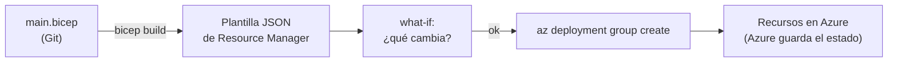

## 1. Resumen

Bicep es, según Microsoft Learn, «a domain-specific language that uses declarative syntax to deploy Azure resources». Un archivo Bicep describe lo que se quiere desplegar. Durante el despliegue, la CLI de Bicep lo convierte en una plantilla JSON de Azure Resource Manager, y Resource Manager crea los recursos.

Tres diferencias con Terraform que cambian cómo se trabaja:

- **no hay state:** «No state or state files to manage: Azure stores all states»;
- **soporta todos los tipos de recurso y versiones de API de Azure** apenas existen, sin esperar a un provider;
- **solo Azure.**

Antes de desplegar se revisa con **what-if**, y se despliega con `az deployment group create` (o `sub`, o `mg`, según el alcance).

## 2. Qué es

- **Archivo `.bicep`:** parámetros (`param`), variables (`var`), recursos (`resource`), módulos (`module`) y salidas (`output`); el orden no importa.
- **`targetScope`:** el alcance del despliegue (grupo de recursos por defecto, suscripción, management group).
- **Resource Manager:** el servicio de Azure que recibe la plantilla y crea los recursos.
- **What-if:** muestra qué cambiaría el despliegue, sin cambiar nada.
- **Idempotencia:** desplegar el mismo archivo varias veces deja los recursos en el mismo estado.

## 3. Problema que resuelve

Una cuenta de almacenamiento para el lake, con namespace jerárquico, sin acceso público a blobs y con sus contenedores por zona, creada a mano en tres suscripciones, termina distinta en cada una. Un archivo Bicep la describe una vez, en Git. Como no hay state, no hay un archivo más que guardar y proteger.

## 4. Cómo funciona

1. El archivo declara `environment` con `@allowed`, una cuenta `Microsoft.Storage/storageAccounts` con `isHnsEnabled: true` y un contenedor por zona, con un `for` sobre una variable.
2. `bicep build` compila a JSON de Resource Manager; la CI lo usa para revisar el archivo.
3. `az deployment group what-if` muestra qué crearía o cambiaría.
4. `az deployment group create` despliega en el grupo de recursos.
5. Desplegar de nuevo el mismo archivo no cambia nada, porque los despliegues son idempotentes.

## 5. Cuándo utilizarlo

- Plataformas que corren solo en Azure y quieren la herramienta nativa, sin state.
- Cuando hace falta un tipo de recurso o una versión de API de Azure recién publicados.
- Equipos que ya conocen las plantillas ARM: Bicep produce el mismo JSON con menos texto.

## 6. Cuándo no utilizarlo

- Infraestructura repartida entre varias nubes: Terraform cubre las tres con la misma herramienta.
- Desplegar a producción sin what-if.
- Funciones experimentales en producción: Microsoft Customer Support no las soporta.

## 7. Ejemplo sencillo

El archivo describe una cuenta `dekh…` con namespace jerárquico y dos contenedores, `raw` y `curated`. Antes del primer despliegue, what-if muestra qué se crearía. Como los despliegues son idempotentes, desplegar de nuevo el mismo archivo deja los recursos igual.

## 8. Ejemplo de producción

Una plataforma en Azure con:

- un archivo por componente (lake, Data Factory, Key Vault) y un archivo de parámetros por entorno;
- `bicep build` y what-if en la CI de cada pull request;
- despliegue con `az deployment group create` desde el pipeline, con una identidad con permisos en ese grupo de recursos;
- módulos para lo que se repite en varios componentes.

## 9. Arquitectura



## 10. Código

```bicep
// Bicep (main.bicep; compilado con bicep build en la CI, no desplegado): la zona cruda de un lake en Azure, una cuenta
// de almacenamiento con namespace jerárquico (ADLS Gen2), sin acceso público a blobs, y un contenedor por zona.
@allowed([
  'dev'
  'staging'
  'prod'
])
param environment string

param location string = resourceGroup().location

var zones = [
  'raw'
  'curated'
]

resource lake 'Microsoft.Storage/storageAccounts@2023-05-01' = {
  name: 'dekh${uniqueString(resourceGroup().id, environment)}'
  location: location
  sku: {
    name: 'Standard_ZRS'
  }
  kind: 'StorageV2'
  properties: {
    isHnsEnabled: true
    allowBlobPublicAccess: false
    minimumTlsVersion: 'TLS1_2'
  }
  tags: {
    environment: environment
  }
}

resource blobService 'Microsoft.Storage/storageAccounts/blobServices@2023-05-01' = {
  parent: lake
  name: 'default'
}

resource containers 'Microsoft.Storage/storageAccounts/blobServices/containers@2023-05-01' = [for zone in zones: {
  parent: blobService
  name: zone
}]

output lakeName string = lake.name
```

```bash
# Azure CLI (no ejecutado: no hay suscripción de Azure en la CI): ver qué cambiaría el despliegue con what-if y después
# desplegar en el grupo de recursos. Los comandos siguen las páginas de Bicep.
az deployment group what-if --resource-group rg-dekh-prod --template-file main.bicep --parameters environment=prod
az deployment group create --resource-group rg-dekh-prod --template-file main.bicep --parameters environment=prod
```

El archivo Bicep se **compila con `bicep build` en la CI** (Bicep 0.48.1, ADR-015) **y no se desplegó**. Los comandos de Azure CLI **no se ejecutaron**: no hay suscripción de Azure en la CI. Su forma sigue *Bicep What-If* y *Deploy Bicep files with the Azure CLI*.

## 11. GCP

En GCP, la herramienta administrada de IaC es **Infrastructure Manager**, que ejecuta Terraform. Las diferencias, según sus páginas:

| | Bicep | Infrastructure Manager |
|---|---|---|
| Lenguaje | Bicep, convertido a JSON de Resource Manager | Configuraciones de Terraform |
| State | Ninguno que administrar: lo guarda Azure | Un state por deployment y revision |
| Ver antes de aplicar | What-if | Preview |
| Cobro (consultado el 2026-10-19) | Bicep es gratuito; se pagan los recursos | Se cobra la ejecución en Cloud Build y el almacenamiento en Cloud Storage |

## 12. AWS

En AWS, el equivalente nativo es **CloudFormation** (ver `cloudformation-basics`). Las diferencias, según sus páginas:

| | Bicep | CloudFormation |
|---|---|---|
| Formato | Lenguaje propio, convertido a JSON de Resource Manager | Plantillas YAML o JSON |
| Ver antes de aplicar | What-if | Change set, que se revisa y se ejecuta |
| Cobro (consultado el 2026-10-19) | Gratuito; se pagan los recursos | Sin cargo adicional para recursos AWS::*; se pagan los recursos |

## 13. Azure

**Bicep** es la herramienta nativa de Azure que describe esta ficha. Comparado con Terraform en Azure:

| | Terraform (`azurerm`) | Bicep |
|---|---|---|
| State | Un state que guardar y proteger (backend `azurerm`) | Ninguno: Azure guarda el estado |
| Nuevos tipos de recurso | Las páginas citadas no lo tratan | Todos los tipos y versiones de API, apenas existen |
| Módulos | `module` con `source` | `module <nombre> '<ruta>'` (ver `terraform-modules`) |

## 14. Buenas prácticas

- Archivos en Git, con `bicep build` en la CI.
- What-if antes de todo despliegue a producción.
- Parámetros con `@allowed` y `@secure()` donde corresponda.
- **Seguridad:** el ejemplo desactiva el acceso público a blobs y exige TLS 1.2; los secretos llegan con `getSecret` desde Key Vault (ver `terraform-security`), y la identidad que despliega tiene permisos solo en su grupo de recursos.
- **Observabilidad:** outputs con los nombres que necesita el pipeline.
- **Costo:** Bicep es gratuito (consultado el 2026-10-19); el costo está en los recursos, como el SKU de redundancia del almacenamiento.

## 15. Errores frecuentes

- Desplegar sin what-if y descubrir un cambio que no se esperaba.
- Confundir el «noise» de what-if (propiedades que Azure pone por defecto) con cambios reales.
- Usar funciones experimentales en producción.
- Un solo archivo con todo el entorno.

## 16. Trade-offs

Bicep no tiene state ni backend y soporta todo Azure apenas sale, a cambio de quedar atado a Azure. What-if da visibilidad antes de desplegar, aunque con ruido. Frente a las plantillas ARM, Bicep es más corto y legible, y produce el mismo JSON.

## 17. Conceptos relacionados

- `infrastructure-as-code`: el marco.
- `cloudformation-basics`: el equivalente en AWS.
- `terraform-plan-apply`: el plan, frente a what-if.
- `terraform-modules`: módulos en Terraform y en Bicep.
- `terraform-security`: secretos con `getSecret` y `@secure()`.
- `adls-gen2-storage`: el lake que crea el ejemplo.

## 18. Preguntas técnicas abiertas

1. ¿Qué parte de tu plataforma en Azure se crea hoy a mano?
2. ¿Usarías Bicep o Terraform para una plataforma que corre solo en Azure? ¿Por qué?
3. ¿Cómo distinguirías el ruido de what-if de un cambio real?

## 19. Laboratorio relacionado

Pendiente (F4).

## 20. Fuentes

- Microsoft Learn: *What is Bicep?*, *Bicep file structure and syntax*, *Deploy Bicep files with the Azure CLI*, *Bicep What-If: Preview Changes Before Deployment* y *Bicep modules*.
- Google Cloud: *Infrastructure Manager overview* e *Infrastructure Manager pricing*.
- AWS: *Update CloudFormation stacks using change sets* y *AWS CloudFormation pricing*.

El detalle de cada fuente está en `sources` del frontmatter.

## 21. Fecha de última verificación

2026-10-19. Pasa a `verified`: revisión B-F3.1 del lote F3b-12b aplicada, sin VERIFY pendientes.

## 22. Historial de cambios importantes

- 2026-10-19: creación (lote F3b-12b).
- 2026-10-19: revisión B-F3.1 del lote F3b-12b aplicada (docs/reviews/cards-f3b-12b.md): sin hallazgos; sin cambios en esta ficha.
- 2026-10-19: `verification_status: verified` (sin VERIFY pendientes).
