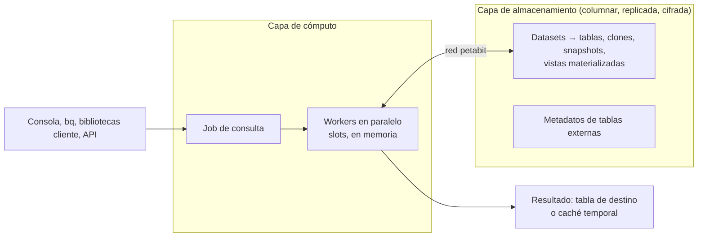

## 1. Resumen

BigQuery separa el **almacenamiento** del **cómputo**, y su documentación pone esa separación en el centro de su arquitectura:

- **Almacenamiento:** administrado, columnar, replicado y cifrado. Se paga por lo que se guarda.
- **Cómputo:** ejecuta cada consulta en paralelo con **slots**, unidades virtuales de cómputo que BigQuery asigna solo.
- **Red:** las dos capas se comunican por la red de Google, de escala petabit.

Como las capas son independientes, cada una escala sin afectar a la otra, y no hay servidores que aprovisionar. Las consecuencias prácticas son dos. Lo que se lee (las columnas y particiones) determina el costo y el tiempo de una consulta. Y los datos no «viven» en un clúster que haya que dimensionar.

## 2. Qué es

- **Capa de almacenamiento:**
  - ingiere, guarda y optimiza los datos;
  - formato columnar (Capacitor), con cada columna guardada por separado;
  - durabilidad de diseño de once nueves anual, con réplicas en varias zonas;
  - cifrado antes de escribir a disco.
- **Capa de cómputo:** reparte el trabajo de cada consulta entre workers en paralelo, en memoria. Los recursos se miden en slots (ver `bigquery-slots`).
- **Contenedores y objetos:**
  - **datasets:** contenedores lógicos que definen permisos, cuotas y facturación;
  - **tablas estándar;**
  - **clones y snapshots**, que solo guardan la diferencia con la tabla base;
  - **vistas materializadas** (ver `bigquery-materialized-views`);
  - **resultados en caché**, en tablas temporales sin costo de almacenamiento;
  - **tablas externas**, de las que BigQuery solo guarda metadatos (ver `bigquery-external-tables`).
- **Jobs de consulta:** interactivos (por defecto), batch (menor prioridad, se encolan si no hay recursos) y continuos.

## 3. Problema que resuelve

En una base tradicional, lectura, escritura y análisis comparten los mismos recursos, y las consultas analíticas pesadas compiten con la carga. Además, crecer en datos obliga a crecer en servidores. Según la documentación, la separación de BigQuery:

- deja que cada capa asigne recursos sin afectar a la otra;
- evita aprovisionar o escalar a mano;
- permite que Google despliegue mejoras en cada capa por separado, sin tiempo de inactividad.

## 4. Cómo funciona

1. Los datos llegan a la capa de almacenamiento (carga, streaming o DML) y se guardan por columna, comprimidos.
2. Una consulta crea un job. BigQuery decide cuántos slots usa según los datos, la complejidad y los slots disponibles.
3. Los workers leen de almacenamiento **solo las columnas** que la consulta usa, y solo las particiones que el filtro permite (ver `bigquery-partitioning`).
4. Los workers procesan en paralelo y en memoria, y reúnen el resultado.
5. El resultado queda en una tabla de destino o en una tabla temporal en caché, de unas 24 horas, que se reutiliza si se repite la misma consulta (ver `bigquery-query-optimization`).

## 5. Cuándo utilizarlo

- Análisis sobre grandes volúmenes con SQL, sin administrar infraestructura.
- Cuando conviene escalar el almacenamiento sin escalar el cómputo, o al revés.
- Como warehouse central en Google Cloud (ver `data-warehouse`).

## 6. Cuándo no utilizarlo

- Como base transaccional (OLTP) con muchas escrituras puntuales y lecturas por clave: BigQuery no indexa claves primarias, según su guía de rendimiento (ver `oltp-vs-olap`).
- Para consultas que leen todas las columnas de tablas grandes de forma rutinaria: el formato columnar no ayuda si se pide todo.
- Para servir lecturas por clave a una aplicación con latencias de milisegundos.

## 7. Ejemplo sencillo

Una tabla de 10 millones de filas y 20 columnas de 8 bytes. La consulta `SELECT col_00, SUM(col_07) … GROUP BY col_00` usa 2 columnas:

- un formato por filas leería 1,6 GB;
- el columnar lee 0,16 GB, el 10 %.

Esa es la idea del script de §10. BigQuery, además, comprime cada columna.

## 8. Ejemplo de producción

Una empresa carga sus pedidos en una tabla particionada por día, en un dataset por dominio, para separar permisos y facturación. Los analistas consultan con la consola y los dashboards con un BI. El almacenamiento crece cada mes y el equipo no hace nada para aumentarlo.

Cuando el cierre de mes satura el cómputo, el equipo no mueve datos: ajusta la capacidad de cómputo (ver `bigquery-slots`). Antes de borrar algo, guarda un **snapshot**, que solo ocupa el delta respecto de la tabla.

## 9. Arquitectura



## 10. Código

```python
# Python 3.12, solo biblioteca estándar (ejecutado; mypy --strict sin errores): por qué el almacenamiento columnar
# lee menos. Una tabla de 20 columnas; la consulta usa 2. Simulación didáctica de bytes leídos, no BigQuery.
FILAS = 10_000_000
COLUMNAS = {f"col_{i:02d}": 8 for i in range(20)}       # 20 columnas de 8 bytes cada una
usadas = ["col_00", "col_07"]                             # SELECT col_00, SUM(col_07) ... GROUP BY col_00

por_filas = FILAS * sum(COLUMNAS.values())                # formato por filas: se lee cada fila completa
por_columnas = FILAS * sum(COLUMNAS[c] for c in usadas)   # formato columnar: solo las columnas usadas
print(f"por filas: {por_filas / 1e9:.2f} GB; columnar: {por_columnas / 1e9:.2f} GB "
      f"({por_columnas / por_filas:.0%} de lo leído por filas)")
# por filas: 1.60 GB; columnar: 0.16 GB (10% de lo leído por filas)
```

Este script en Python 3.12, solo con biblioteca estándar, está ejecutado y pasa `mypy --strict` sin errores. Es una simulación didáctica de los bytes que se leen por filas y por columnas. No reproduce la compresión de Capacitor ni la facturación real (ver `bigquery-cost-model`).

## 11. GCP

**BigQuery** es el servicio de esta ficha. Su página de introducción menciona dos cosas más:

- sus funciones de gobierno (búsqueda semántica, linaje, calidad) las provee **Knowledge Catalog**;
- soporta formatos de tabla abiertos: Apache Iceberg, Delta y Apache Hudi (ver `bigquery-biglake-tables`).

## 12. AWS

No aplica de forma específica: esta ficha describe BigQuery. La comparación con otros warehouses está en `data-warehouse` y `cloud-warehouse-optimization`.

## 13. Azure

No aplica de forma específica (ver §12).

## 14. Buenas prácticas

- Diseñar para leer poco: columnas necesarias, tablas particionadas y con clustering.
- Un dataset por dominio o por nivel de acceso, porque el dataset define permisos, cuotas y facturación.
- Snapshots o clones antes de cambios riesgosos: guardan solo la diferencia.
- Elegir el modelo de facturación de almacenamiento (lógico o físico) por dataset, con datos de uso (ver `bigquery-cost-model`).
- **Seguridad:** los datos se cifran antes de escribirse a disco, con clave de Google o propia (CMEK); el acceso se da por dataset, tabla o vista, no por servidor.
- **Observabilidad:** los jobs y sus estadísticas (bytes, slots) son la señal principal; el plan de cada consulta muestra dónde se va el tiempo (ver `bigquery-query-optimization`).
- **Costo:** almacenamiento y cómputo se facturan por separado; el costo de una consulta depende de lo que lee, no del tamaño total de la tabla.

## 15. Errores frecuentes

- Pensar en BigQuery como una base con servidores que dimensionar.
- `SELECT *` sobre tablas anchas: el formato columnar solo ahorra si se piden pocas columnas.
- Usarlo como base transaccional con escrituras fila a fila.
- Un solo dataset para todo, que mezcla permisos y facturación de equipos distintos.

## 16. Trade-offs

La separación de capas da escala independiente y cero administración de infraestructura. A cambio, el control sobre cómo se ejecuta cada consulta es menor que en una base propia: no se fija cuántos slots usa una consulta, y no hay índices clásicos. El rendimiento se gana con el diseño de tablas (particiones, clustering) y de consultas. El formato columnar favorece el análisis y penaliza las lecturas fila a fila.

## 17. Conceptos relacionados

- `data-warehouse` y `oltp-vs-olap`: para qué sirve un warehouse.
- `row-vs-columnar-formats`: por qué columnar.
- `bigquery-slots` y `bigquery-cost-model`: cómputo y costo.
- `bigquery-partitioning` y `bigquery-clustering`: leer menos.
- `bigquery-materialized-views`, `bigquery-external-tables` y `bigquery-biglake-tables`: otros tipos de tabla.

## 18. Preguntas técnicas abiertas

1. ¿Qué consultas de tu equipo leen columnas que no usan?
2. ¿Cómo repartirías tus tablas en datasets según permisos y facturación?
3. ¿Qué cambiaría en tu diseño si el almacenamiento y el cómputo se pagaran juntos?

## 19. Laboratorio relacionado

Pendiente (F4).

## 20. Fuentes

- Google Cloud, BigQuery: *BigQuery overview*, *Overview of BigQuery storage*, *Overview of BigQuery analytics*, *Understand slots*, *Optimize query computation* y *Use cached query results*.

El detalle de cada fuente está en `sources` del frontmatter.

## 21. Fecha de última verificación

2026-10-11. Pasa a `verified`: revisión B-F3.1 del lote F3b-08a aplicada, sin VERIFY pendientes.

## 22. Historial de cambios importantes

- 2026-10-11: creación (lote F3b-08a).
- 2026-10-11: revisión B-F3.1 del lote F3b-08a aplicada (docs/reviews/cards-f3b-08a.md), regla del §17: relations incluye `oltp-vs-olap`, `bigquery-clustering`, `bigquery-materialized-views`, `bigquery-external-tables`, `bigquery-biglake-tables`, que el §17 nombra.
- 2026-10-11: `verification_status: verified` (sin VERIFY pendientes).
- 2026-10-13: `page_title` en cada cita, con el título de la página citada (ADR-012); sin cambios de contenido.
