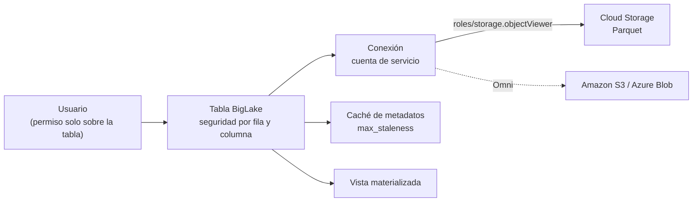

## 1. Resumen

Una **tabla BigLake** consulta archivos que están fuera de BigQuery, igual que una tabla externa. La diferencia clave es la **delegación de acceso**:

- una **conexión** con su propia cuenta de servicio lee el almacén;
- los usuarios solo necesitan permiso sobre la **tabla**, no sobre el bucket.

Eso permite seguridad por fila y por columna y enmascaramiento dinámico sobre archivos del lake. Funciona con Cloud Storage, y con Amazon S3 o Azure Blob Storage a través de BigQuery Omni. Además, una caché de metadatos opcional acelera las consultas, y se pueden crear vistas materializadas encima.

Aparte están las **Apache Iceberg managed tables** que, según su página, antes se llamaban «BigLake tables for Apache Iceberg in BigQuery». Son tablas administradas por BigQuery en formato Iceberg, con los datos en buckets del cliente.

## 2. Qué es

- **Delegación de acceso:** la conexión externa (`google_bigquery_connection` con `cloud_resource`) tiene una cuenta de servicio con permiso de lectura en el bucket. La tabla usa esa conexión, y el usuario solo necesita acceso a la tabla.
- **Seguridad fina:** por fila, por columna y, sobre Cloud Storage, enmascaramiento dinámico.
- **Almacenes:**
  - Cloud Storage, con tablas temporales o permanentes;
  - Amazon S3 y Blob Storage vía Omni, solo permanentes.
- **Caché de metadatos:**
  - guarda nombres de archivo, particiones y metadatos físicos;
  - `metadata_cache_mode` y `max_staleness` controlan su refresco;
  - con caché, los archivos nuevos no aparecen hasta el siguiente refresco;
  - no se usa con tablas externas de Iceberg, que ya traen manifiestos.
- **Apache Iceberg managed tables:**
  - administradas por BigQuery, con los datos en buckets del cliente en formato Iceberg;
  - admiten DML, streaming, evolución de esquema, time travel y transacciones;
  - exportan snapshots Iceberg V2 para que otros motores lean la misma copia.

## 3. Problema que resuelve

Con una tabla externa común, quien consulta necesita leer también el bucket. Eso impide restringir filas o columnas, porque con acceso al bucket se leen los archivos completos, y mezcla permisos de almacenamiento con permisos de análisis. BigLake separa los dos y permite:

- dar acceso a datos del lake sin dar acceso al bucket;
- aplicar seguridad por fila y por columna sobre archivos;
- acelerar consultas sobre muchos archivos con la caché de metadatos.

## 4. Cómo funciona

1. Se crea una conexión de tipo recurso cloud. BigQuery le asigna una cuenta de servicio.
2. Se da a esa cuenta de servicio permiso de lectura en el bucket, por ejemplo `roles/storage.objectViewer`.
3. Se crea la tabla con `WITH CONNECTION` en SQL, o con `connection_id` en Terraform, apuntando a los archivos.
4. Si se habilita, la caché de metadatos se refresca de forma automática o manual, con la antigüedad máxima que fija `max_staleness`.
5. Los usuarios consultan la tabla con su permiso de BigQuery. La conexión lee los archivos.
6. Las políticas de fila y columna se aplican sobre la tabla (ver `bigquery-security` y `bigquery-policy-tags`).

## 5. Cuándo utilizarlo

- Lakehouse en Cloud Storage con control de acceso fino desde BigQuery.
- Datos en S3 o Azure que se quieren consultar desde BigQuery sin copiarlos (Omni).
- Muchos archivos consultados con frecuencia, que se benefician de la caché de metadatos.
- Iceberg managed tables cuando otros motores, como Spark, deben leer la misma copia en formato abierto.

## 6. Cuándo no utilizarlo

- Para una exploración puntual de archivos sin requisitos de seguridad: una tabla externa basta.
- Si los archivos cambian a cada minuto y la consulta debe verlos al instante con la caché activada, porque los cambios se ven recién después del refresco.
- Como reemplazo de las tablas estándar cuando no hay motivo para que los datos estén afuera.

## 7. Ejemplo sencillo

Analistas que solo tienen acceso a la tabla BigLake `lake.eventos` consultan Parquet en Cloud Storage. No tienen permiso sobre el bucket. La cuenta de servicio de la conexión es la que lee los archivos.

## 8. Ejemplo de producción

Un equipo guarda eventos en Parquet en Cloud Storage, porque también los lee un trabajo de Spark. En BigQuery arma:

- una conexión con la cuenta de servicio que lee el bucket;
- la tabla BigLake `lake.eventos`, con caché de metadatos automática y antigüedad máxima de 4 horas;
- una política de columna que oculta el identificador del dispositivo a quien no lo necesita;
- una vista materializada encima, para el dashboard diario.

Para la tabla nueva de pedidos, que deben poder escribir tanto BigQuery como Spark, el equipo evalúa una Iceberg managed table, siempre según lo que su página dice que admite.

## 9. Arquitectura



## 10. Código

```hcl
# Terraform (validado en la CI con terraform validate, sin credenciales; no se aplicó): tabla BigLake sobre Parquet
# en Cloud Storage. La conexión tiene una cuenta de servicio que lee el bucket; los usuarios solo necesitan acceso
# a la tabla (delegación de acceso), y no al bucket.
# Requiere: provider hashicorp/google; el bucket y el dataset lake existentes.
terraform {
  required_providers {
    google = {
      source  = "hashicorp/google"
      version = "~> 8.0"
    }
  }
}

variable "project_id" {
  type = string
}

variable "bucket" {
  type = string
}

resource "google_bigquery_connection" "lake" {
  project       = var.project_id
  connection_id = "lake"
  location      = "US"
  cloud_resource {}
}

# Solo la cuenta de servicio de la conexión lee los objetos del bucket.
resource "google_storage_bucket_iam_member" "lake_reader" {
  bucket = var.bucket
  role   = "roles/storage.objectViewer"
  member = "serviceAccount:${google_bigquery_connection.lake.cloud_resource[0].service_account_id}"
}

resource "google_bigquery_table" "eventos" {
  project             = var.project_id
  dataset_id          = "lake"
  table_id            = "eventos"
  deletion_protection = false
  max_staleness       = "0-0 0 4:0:0" # la caché de metadatos puede tener hasta 4 horas

  external_data_configuration {
    autodetect          = true
    source_format       = "PARQUET"
    connection_id       = google_bigquery_connection.lake.name
    source_uris         = ["gs://${var.bucket}/eventos/*.parquet"]
    metadata_cache_mode = "AUTOMATIC"
  }

  depends_on = [google_storage_bucket_iam_member.lake_reader]
}
```

Este bloque de Terraform se valida en la CI con `terraform validate`, sin credenciales (`make validate-terraform`), y **no se aplicó**. Sigue el ejemplo de *Create Cloud Storage BigLake tables*:

- una conexión `cloud_resource`;
- un permiso de lectura para su cuenta de servicio, en el bucket en lugar del proyecto, para limitar el alcance;
- la tabla con `connection_id`, caché de metadatos automática y `max_staleness`.

## 11. GCP

**BigQuery** con **Cloud Storage**. El nombre «BigLake» aparece en dos productos distintos:

- las tablas BigLake de esta ficha, sobre archivos externos con delegación de acceso;
- las **Apache Iceberg managed tables**, administradas por BigQuery; su página dice que antes se llamaban «BigLake tables for Apache Iceberg in BigQuery».

## 12. AWS

**Amazon S3** se consulta desde BigQuery con tablas BigLake a través de **BigQuery Omni**. Esas tablas deben ser permanentes, según la página de BigLake. Es BigQuery leyendo S3, no un servicio de AWS.

## 13. Azure

**Azure Blob Storage**, igual que en §12, con BigLake vía BigQuery Omni.

## 14. Buenas prácticas

- Permiso de lectura de la conexión en el bucket, no en todo el proyecto.
- Los usuarios sin acceso al bucket: todo pasa por la tabla.
- Elegir `max_staleness` según la frescura que necesitan las consultas.
- Políticas de fila y columna en la tabla, no en copias.
- Comprobar en la página de Iceberg managed tables lo que admiten antes de diseñar con ellas.
- **Seguridad:** la cuenta de servicio de la conexión puede leer todo el prefijo; limitar su permiso al bucket o prefijo necesario, y controlar quién puede usar la conexión.
- **Observabilidad:** vigilar los trabajos de refresco de la caché de metadatos y la antigüedad de los metadatos frente a `max_staleness`.
- **Costo:** los archivos se pagan en el almacén externo; las consultas, como cómputo de BigQuery; una vista materializada encima evita releer archivos en consultas repetidas.

## 15. Errores frecuentes

- Dar a los analistas acceso al bucket además de la tabla, lo que anula la delegación.
- Activar la caché de metadatos y esperar ver los archivos nuevos al instante.
- Confundir las tablas BigLake con las Iceberg managed tables.
- Dar a la cuenta de servicio de la conexión `objectViewer` en todo el proyecto.

## 16. Trade-offs

BigLake da seguridad fina sobre datos que siguen en el lake, a cambio de operar una conexión y su cuenta de servicio. La caché de metadatos acelera, pero introduce un retraso en ver los cambios. Las Iceberg managed tables dan formato abierto con funciones administradas, a costa de depender de lo que BigQuery soporta del formato. Cargar en tablas estándar es lo más simple, pero duplica los datos y los saca del formato abierto.

## 17. Conceptos relacionados

- `bigquery-external-tables`: la tabla externa sin delegación.
- `lakehouse` y `data-lake`: el contexto arquitectónico.
- `bigquery-materialized-views`: vistas materializadas sobre BigLake.
- `bigquery-security`: IAM, vistas autorizadas y seguridad por fila sobre la tabla.
- `bigquery-policy-tags`: seguridad por columna y enmascaramiento sobre la tabla.
- Del blueprint, pendiente de ficha: `open-table-formats`.

## 18. Preguntas técnicas abiertas

1. ¿Qué usuarios de tu equipo tienen acceso a un bucket solo para consultar una tabla?
2. ¿Qué antigüedad de metadatos tolerarían tus consultas?
3. ¿Qué tabla debería poder leerse también desde Spark, en formato abierto?

## 19. Laboratorio relacionado

Pendiente (F4).

## 20. Fuentes

- Google Cloud, BigQuery: *Introduction to BigLake tables*, *Introduction to external data sources*, *Create Cloud Storage BigLake tables*, *Apache Iceberg managed tables* e *Introduction to materialized views*.

El detalle de cada fuente está en `sources` del frontmatter.

## 21. Fecha de última verificación

2026-10-11. Pasa a `verified`: revisión B-F3.1 del lote F3b-08a aplicada, sin VERIFY pendientes.

## 22. Historial de cambios importantes

- 2026-10-11: creación (lote F3b-08a).
- 2026-10-11: revisión B-F3.1 del lote F3b-08a aplicada (docs/reviews/cards-f3b-08a.md), regla del §17: relations incluye `bigquery-security`, `bigquery-policy-tags`, que el §17 nombra; §17 enlaza las fichas que ya existen.
- 2026-10-11: `verification_status: verified` (sin VERIFY pendientes).
- 2026-10-13: `page_title` en cada cita, con el título de la página citada (ADR-012); sin cambios de contenido.
