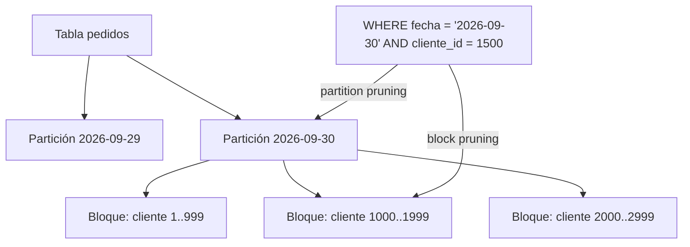

## 1. Resumen

El clustering en BigQuery ordena los datos de una tabla por hasta cuatro columnas y los organiza en bloques. Cuando una consulta filtra por esas columnas, BigQuery salta los bloques que no pueden contener filas que cumplan el filtro (*block pruning*) y procesa menos datos. Complementa al particionamiento, pero con una diferencia: el costo de una consulta sobre una tabla con clustering solo se conoce después de ejecutarla.

## 2. Qué es

Es una propiedad física de la tabla. Se declara con `CLUSTER BY` y una lista ordenada de hasta cuatro columnas. BigQuery ordena los datos por esas columnas y los agrupa en bloques de almacenamiento. En tablas particionadas, el orden se mantiene dentro de cada partición.

## 3. Problema que resuelve

La partición solo sirve para una columna (normalmente la fecha). Muchas consultas filtran además por otras columnas de alta cardinalidad, como cliente, país o SKU. El clustering reduce los datos leídos por esos filtros sin crear millones de particiones pequeñas.

## 4. Cómo funciona

1. Al escribir, BigQuery ordena los datos según las columnas de clustering y los organiza en bloques.
2. Al consultar con un filtro sobre esas columnas, poda los bloques que no pueden cumplirlo (*block pruning*).
3. Con cada escritura nueva pueden quedar bloques desordenados. BigQuery hace **reclustering automático** en segundo plano, sin efecto en la capacidad de consulta.

El **orden de las columnas importa**. Con `CLUSTER BY fecha_pedido, pais, estado`, un filtro por `fecha_pedido` y `pais` está optimizado. Un filtro solo por `pais` y `estado` no lo está.

## 5. Cuándo utilizarlo

- Filtros o agregaciones frecuentes sobre columnas de alta cardinalidad.
- Tablas particionadas cuyas particiones son grandes y se consultan filtrando por otras columnas.
- Casos en los que particionar produciría demasiadas particiones pequeñas.

## 6. Cuándo no utilizarlo

- Cuando se necesita una estimación estricta del costo **antes** de ejecutar: la partición la da y el clustering no.
- Cuando las consultas casi nunca filtran por las columnas candidatas.
- Tablas pequeñas, en las que la diferencia es despreciable.

## 7. Ejemplo sencillo

La tabla `pedidos`, particionada por día, se agrupa por `cliente_id`. Una consulta sobre un cliente en el último mes lee 30 particiones, pero dentro de cada una solo los bloques que pueden contener ese cliente.

## 8. Ejemplo de producción

Una tabla de eventos de varios terabytes, particionada por día, se consulta casi siempre por `tenant_id` y a veces por `tenant_id` y `tipo_evento`. Se define `CLUSTER BY tenant_id, tipo_evento`: la primera columna es la que casi todas las consultas filtran. Los bytes procesados por consulta bajan de forma notable. El equipo acepta que el dry run ya no da el costo exacto y controla el gasto con cuotas por proyecto y con vistas de jobs.

## 9. Arquitectura



## 10. Código

```sql
-- BigQuery: tabla particionada por día y con clustering por las columnas de filtro habituales.
-- El orden de CLUSTER BY importa: la primera columna debe ser la que más se filtra.
CREATE TABLE `proyecto.dwh.eventos`
(
  ts TIMESTAMP,
  tenant_id STRING,
  tipo_evento STRING,
  payload JSON
)
PARTITION BY DATE(ts)
CLUSTER BY tenant_id, tipo_evento;

-- Aprovecha partición y clustering: filtra por la fecha y por la primera columna de clustering.
SELECT tipo_evento, COUNT(*) AS n
FROM `proyecto.dwh.eventos`
WHERE DATE(ts) = '2026-09-30' AND tenant_id = 't-042'
GROUP BY tipo_evento;
```

## 11. GCP

Esta ficha trata de **BigQuery**:

- hasta cuatro columnas de clustering;
- en columnas `STRING`, solo se usan los primeros 1.024 caracteres;
- el reclustering es automático, en segundo plano y sin efecto en la capacidad de consulta.

La documentación recomienda preferir la partición cuando se necesita una estimación estricta del costo antes de ejecutar, o cuando las particiones resultantes promedian al menos 10 GB. Lo habitual es combinar ambas.

## 12. AWS

En **Redshift**, el equivalente más cercano son las **sort keys**. Los datos se guardan en bloques de 1 MB con el mínimo y el máximo de cada bloque en metadatos, y los predicados de rango saltan bloques. Hay dos tipos:

- `COMPOUND`, por defecto y recomendado con `INSERT`, `UPDATE` o `DELETE` frecuentes;
- `INTERLEAVED`, de hasta ocho columnas.

La idea es parecida al clustering, pero no es lo mismo: en Redshift se elige el tipo de sort key y hasta ocho columnas en `INTERLEAVED`, mientras que BigQuery admite hasta cuatro columnas en un solo orden.

## 13. Azure

En **Synapse** (dedicated SQL pool), el equivalente más cercano es el **clustered columnstore index ordenado**: ordena los datos por la clave antes de comprimirlos en segmentos, lo que reduce el solapamiento entre segmentos y permite *segment elimination*.

## 14. Buenas prácticas

- Elegir como primera columna de clustering la que más consultas filtran.
- Combinar partición por fecha con clustering por las columnas de filtro secundarias.
- Revisar periódicamente los filtros reales (vistas de jobs) y ajustar las columnas.
- **Costo:** medir los bytes procesados antes y después; como el costo exacto solo se conoce tras ejecutar, poner límites de bytes facturados por consulta o cuotas por proyecto.
- **Observabilidad:** seguir los bytes procesados por las consultas más frecuentes; si suben sin más datos, el filtro dejó de coincidir con el clustering.
- **Seguridad:** el clustering no restringe el acceso; para limitar filas por usuario hacen falta políticas de acceso a filas o vistas autorizadas.

## 15. Errores frecuentes

- Poner primero una columna que casi nadie filtra.
- Esperar una estimación exacta del costo en el dry run.
- Usar clustering en lugar de partición cuando se necesita control previo del costo.
- Agrupar por columnas de baja cardinalidad que ya cubre la partición.

## 16. Trade-offs

El clustering admite columnas de alta cardinalidad sin la sobrecarga de muchas particiones, a cambio de no dar costo exacto antes de ejecutar. La partición da control y estimación previa, pero solo sobre una columna y con límites de cantidad de particiones.

## 17. Conceptos relacionados

- `bigquery-partitioning`: la organización complementaria.
- `partition-pruning`: poda de particiones; el clustering agrega poda de bloques.
- `partitioning`: el concepto general.
- Con ficha: `clustering`.
- Del blueprint, pendientes de ficha: `bigquery-cost-optimization`, `columnar-storage`.

## 18. Preguntas técnicas abiertas

1. ¿Cómo elegirías el orden de las columnas de clustering a partir del historial de consultas?
2. ¿Qué harías si el negocio exige conocer el costo de una consulta antes de ejecutarla?
3. ¿Cuándo preferirías clustering por `cliente_id` en lugar de particionar por rango de enteros?

## 19. Laboratorio relacionado

Pendiente (F4): lab de tipo B sobre una consulta cara en BigQuery.

## 20. Fuentes

- Google Cloud: *Introduction to clustered tables* (BigQuery).
- AWS: *Sort keys* (Redshift).
- Microsoft Learn: *Performance tuning with ordered clustered columnstore index* (Synapse).

El detalle de cada fuente está en `sources` del frontmatter.

## 21. Fecha de última verificación

2026-09-30. Pasa a `verified`: revisión B-F3.1 del lote 2 aplicada, sin VERIFY pendientes.

## 22. Historial de cambios importantes

- 2026-09-30: creación (lote 2 de F3).
- 2026-09-30: `verification_status: verified` (revisión B-F3.1 del lote 2 aplicada; sin VERIFY pendientes).
- 2026-10-06: la sección de conceptos relacionados ya no lista como pendiente de ficha a `clustering`, que ya tiene ficha.
- 2026-10-13: `page_title` en cada cita, con el título de la página citada (ADR-012); sin cambios de contenido.
- 2026-10-14: lote F3b-rel (regla del §17): relations incluye `clustering`.
