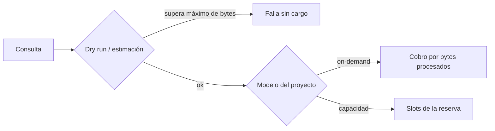
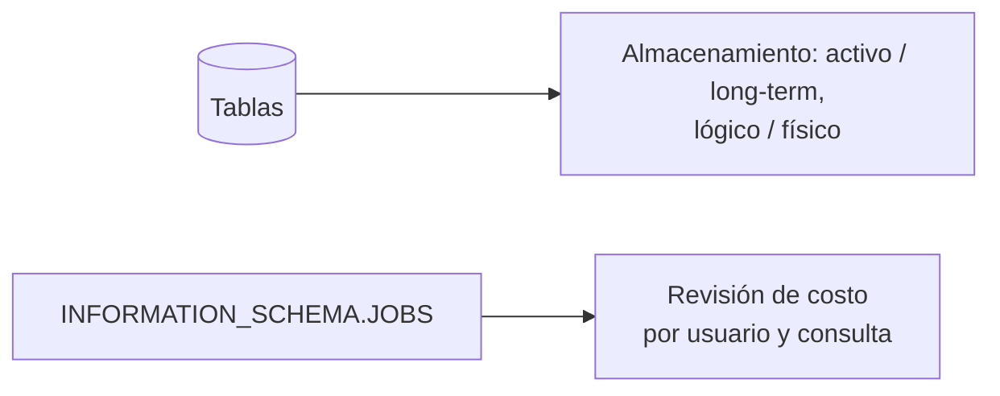

<!-- Precios y modalidades cambian: esta ficha describe el modelo, sin montos. Los precios vigentes están en la página de precios de BigQuery, por región. -->

## 1. Resumen

BigQuery cobra por separado el **cómputo** y el **almacenamiento**. Para el cómputo hay dos modelos:

- **on-demand**, por bytes procesados en cada consulta;
- **capacidad**, por slots (CPU virtuales) en el tiempo, con reservas y ediciones; los compromisos opcionales son solo de Enterprise y Enterprise Plus.

El almacenamiento distingue datos **activos** y **long-term** (sin modificar durante 90 días), y cada dataset elige facturar en bytes **lógicos** o **físicos**. Esta ficha explica el modelo y sus palancas, sin montos: los precios cambian y dependen de la región.

## 2. Qué es

Es el esquema de facturación de BigQuery, un servicio administrado de Google Cloud (clasificación *modern*). Saber cómo cobra es parte del diseño: en on-demand, la misma pregunta puede costar cien veces más según cómo se escriba la consulta y cómo esté organizada la tabla.

| Componente | Modelo | Qué se mide |
|---|---|---|
| Cómputo | On-demand | Bytes procesados por consulta |
| Cómputo | Capacidad (editions) | Slots en el tiempo, vía reservas; Standard, pago por uso con autoscaling; Enterprise y Enterprise Plus, además, compromisos de 1 o 3 años |
| Almacenamiento | Activo / long-term | Datos modificados en los últimos 90 días o no |
| Almacenamiento | Lógico / físico | Bytes sin comprimir o comprimidos (por dataset) |
| Otros | Aparte | Inserciones y lecturas streaming, BI Engine, Omni; BigQuery ML aparte, salvo con reservas de Enterprise o Enterprise Plus, donde entra en el uso de las ediciones |

## 3. Problema que resuelve

Sin entender el modelo aparecen sorpresas: un tablero que escanea toda la tabla cada cinco minutos, un analista que corre `SELECT *` sobre años de eventos, o un equipo con capacidad comprada que igual paga on-demand en otro proyecto. Conocer qué se mide permite diseñar tablas y consultas baratas y elegir el modelo de cómputo según la carga.

## 4. Cómo funciona

1. **On-demand:** cada consulta paga los bytes que procesa. Rige lo siguiente:
   - no se cobran las consultas con error ni las servidas desde caché;
   - hay redondeo al MB, con mínimo de 10 MB por tabla referenciada y por consulta;
   - cancelar una consulta puede costar hasta su costo completo.

   Como el almacenamiento es columnar, se pagan las columnas leídas de las particiones leídas. `LIMIT` no reduce el costo en tablas no clusterizadas.
2. **Capacidad:** se compran slots mediante **reservas**, en tres ediciones (Standard, Enterprise, Enterprise Plus), con pago por uso y autoscaling. Los compromisos de 1 o 3 años con descuento existen solo en Enterprise y Enterprise Plus; Standard es solo pago por uso. Con reservas de esas dos ediciones, BigQuery ML queda incluido en el uso de las ediciones. Cubre consultas, DML y DDL, pero no el almacenamiento, las inserciones streaming ni la Storage API.
3. **Almacenamiento:**
   - **activo** si la tabla o partición se modificó en los últimos 90 días, **long-term** si no; el cambio es automático;
   - por dataset, **lógico** (sin comprimir, el valor por defecto) o **físico** (comprimido);
   - time travel y fail-safe retienen datos borrados por un tiempo: con facturación lógica no se cobran; con facturación física, sí. Conviene considerarlo al elegir el modelo.
4. **Controles:**
   - dry run para estimar antes de ejecutar;
   - máximo de bytes facturados por consulta: falla sin cargo si la estimación lo supera;
   - cuotas personalizadas por día, por proyecto o por usuario;
   - `INFORMATION_SCHEMA.JOBS` para ver quién consume cuánto.

## 5. Cuándo utilizarlo

Este conocimiento aplica al:

- diseñar tablas (partición, clustering, columnas) y consultas recurrentes;
- elegir entre on-demand y capacidad para un proyecto o carga;
- poner límites a la exploración ad hoc;
- investigar un aumento de costo.

## 6. Cuándo no utilizarlo

- Para presupuestar con montos de esta ficha: no los tiene. Usar la página de precios vigente, por región.
- Para comparar proveedores solo por el precio unitario: cada modelo mide algo distinto (bytes, slots, RPU, CU).

## 7. Ejemplo sencillo

La misma pregunta, "ventas de ayer por país", sobre una tabla de 2 TB particionada por fecha:

- `SELECT * ...` sin filtro de fecha: procesa toda la tabla.
- `SELECT pais, monto ... WHERE fecha = ayer`: procesa dos columnas de una partición.

En on-demand, la diferencia de costo es proporcional a esos bytes. En capacidad, la diferencia está en los slots que ocupa y en lo que deja disponible para otras consultas.

## 8. Ejemplo de producción

Una empresa tiene tres cargas:

- **ETL nocturno**, predecible: corre en una reserva con capacidad.
- **Tableros de BI** que consultan agregados: on-demand, con tablas particionadas y clusterizadas.
- **Exploración de analistas**: on-demand, con máximo de bytes facturados por consulta y una cuota diaria por usuario.

Cada semana, una consulta a `INFORMATION_SCHEMA.JOBS` lista los usuarios y consultas con más bytes facturados. Así se encontró un tablero sin filtro de fecha que explicaba la mitad del gasto. Además, los datasets históricos, muy comprimibles, se pasaron a facturación física tras comparar ambos modelos.

## 9. Arquitectura





## 10. Código

```bash
# Estimar y limitar antes de ejecutar (bq, Google Cloud CLI).
# 1. Dry run: informa los bytes que procesaría, sin ejecutar ni cobrar.
bq query --dry_run --use_legacy_sql=false \
  'SELECT pais, SUM(monto) FROM `proyecto.dwh.ventas` WHERE fecha = "2026-10-04" GROUP BY pais'

# 2. Límite de bytes facturados (10 GB): si la estimación lo supera, la consulta falla sin cargo.
bq query --use_legacy_sql=false --maximum_bytes_billed=10000000000 \
  'SELECT pais, SUM(monto) FROM `proyecto.dwh.ventas` WHERE fecha = "2026-10-04" GROUP BY pais'
```

```sql
-- Quién consume cuánto en los últimos 7 días (on-demand: total_bytes_billed).
-- Requiere permiso para ver los jobs del proyecto; ajustar la región de la vista.
SELECT
  user_email,
  COUNT(*) AS consultas,
  ROUND(SUM(total_bytes_billed) / POW(1024, 4), 3) AS tib_facturados,
  COUNTIF(cache_hit) AS desde_cache
FROM `region-us`.INFORMATION_SCHEMA.JOBS
WHERE creation_time >= TIMESTAMP_SUB(CURRENT_TIMESTAMP(), INTERVAL 7 DAY)  -- columna de partición
  AND job_type = 'QUERY'
GROUP BY user_email
ORDER BY tib_facturados DESC;
```

Para pasar a TiB se divide por 1024⁴. El costo se obtiene multiplicando por el precio vigente de la región, que esta ficha no incluye a propósito.

## 11. GCP

En **BigQuery**, la decisión principal es on-demand frente a capacidad, y puede ser distinta por proyecto o carga:

- **On-demand:** no requiere planificar y se paga por bytes, así que el diseño (columnas, particiones, clustering) es directamente costo.
- **Capacidad:** da costo predecible por slots, con editions y reservas (y compromisos en Enterprise y Enterprise Plus); el diseño afecta el tiempo y la concurrencia más que la factura.

El almacenamiento se cobra aparte en ambos casos, con su propio modelo (activo o long-term, lógico o físico).

## 12. AWS

AWS tiene modelos distintos según el servicio:

- **Athena** es serverless y cobra por las consultas que se ejecutan, con la misma lógica que BigQuery on-demand: particiones y formatos columnares bajan el costo.
- **Redshift Serverless** cobra por la capacidad usada, on-demand o con reservas con descuento, y el almacenamiento aparte por GB-mes. Tiene un mínimo de 60 segundos, medido por segundo.
La unidad de medida cambia (bytes procesados frente a capacidad) y no se compara uno a uno.

## 13. Azure

El **serverless SQL pool** de Synapse cobra solo por los datos procesados, sin recursos reservados, como BigQuery on-demand. **Microsoft Fabric** se compra por **capacidad** (SKU medidos en capacity units), y esa capacidad habilita todas las funciones de Fabric licenciadas por capacidad: el modelo se parece más a la capacidad de BigQuery que a on-demand, pero abarca la plataforma y no solo el warehouse.

## 14. Buenas prácticas

- Particionar por fecha, clusterizar por los filtros frecuentes y exigir filtro de partición en tablas grandes.
- Seleccionar solo las columnas necesarias; nunca `SELECT *` en consultas programadas.
- Hacer un dry run de las consultas nuevas y fijar máximo de bytes facturados en exploración.
- Cuotas diarias por usuario en proyectos de análisis ad hoc.
- Separar cargas por proyecto o reserva según su patrón (ETL predecible frente a exploración).
- Evaluar facturación física en datasets muy comprimibles, comparando ambos modelos antes.
- **Seguridad:** las cuotas y límites también acotan el impacto de credenciales mal usadas; dar permisos de ejecución de jobs solo a quien los necesita.
- **Observabilidad:** revisar `INFORMATION_SCHEMA.JOBS` por usuario y por consulta (bytes facturados, aciertos de caché) y alertar ante aumentos respecto de la semana anterior.
- **Costo:** volver a revisar la elección on-demand frente a capacidad cuando cambia el patrón de carga.

## 15. Errores frecuentes

- Creer que `LIMIT` abarata una consulta en una tabla no clusterizada.
- Tableros que refrescan consultas sin filtro de partición.
- Cancelar una consulta cara creyendo que no se cobrará.
- Comprar capacidad sin medir y seguir pagando on-demand en otros proyectos.
- Copiar montos de un documento viejo en lugar de la página de precios vigente.

## 16. Trade-offs

On-demand no requiere planificar y es barato para cargas pequeñas o esporádicas, pero el costo varía con cada consulta. La capacidad da costo predecible y control de concurrencia, a cambio de dimensionar y de pagar capacidad aunque no se use (salvo con autoscaling). La facturación física puede ahorrar en datos comprimibles, pero no conviene en todos los datasets: hay que medir.

## 17. Conceptos relacionados

- `bigquery-partitioning` y `bigquery-clustering`: las palancas de diseño.
- `partition-pruning`: leer menos particiones.
- `row-vs-columnar-formats`: por qué elegir columnas reduce lo facturado.
- Con ficha: `scan-reduction`.
- `bigquery-query-optimization`: el plan, las insights y las prácticas de optimización de BigQuery.

## 18. Preguntas técnicas abiertas

1. ¿Qué datos necesitarías para decidir entre on-demand y capacidad en un proyecto?
2. ¿Cómo encontrarías la consulta que más gasta en el último mes?
3. ¿Por qué un máximo de bytes facturados puede hacer fallar una consulta sobre una tabla clusterizada que en realidad era barata?

## 19. Laboratorio relacionado

Pendiente (F4).

## 20. Fuentes

- Google Cloud: *BigQuery pricing*, *Understand slots*, *Introduction to workload management*, *Introduction to datasets*, *Data definition language statements*, *Estimate and control costs*, *Create custom query quotas*, *bq command-line tool reference* y *JOBS view*.
- AWS: *Billing for Amazon Redshift Serverless* y *What is Amazon Athena?*
- Microsoft Learn: *Serverless SQL pool in Azure Synapse Analytics* y *Microsoft Fabric licenses and capacity*.

El detalle de cada fuente está en `sources` del frontmatter.

## 21. Fecha de última verificación

2026-10-05. Pasa a `verified`: revisión B-F3.1 del lote 6 aplicada, sin VERIFY pendientes. Precios y modalidades cambian: revisar con la frecuencia del registro de fuentes.

## 22. Historial de cambios importantes

- 2026-10-05: creación (lote 6 de F3).
- 2026-10-05: revisión B-F3.1 del lote 6 aplicada (docs/reviews/cards-lote6.md): compromisos solo en Enterprise y Enterprise Plus, time travel y fail-safe solo cobrados con facturación física, y BigQuery ML incluido en las reservas de esas ediciones. `verification_status: verified` (sin VERIFY pendientes).
- 2026-10-07: la sección de conceptos relacionados ya no lista como pendiente de ficha a `scan-reduction`, que ya tiene ficha.
- 2026-10-11: «pendiente de ficha» actualizado: la ficha ya existe (lote F3b-08a); el §17 la enlaza y relations la incluye: relations incluye `bigquery-query-optimization`, que el §17 nombra; §17 enlaza las fichas que ya existen.
- 2026-10-13: `page_title` en cada cita, con el título de la página citada (ADR-012); sin cambios de contenido.
- 2026-10-14: lote F3b-rel (regla del §17): relations incluye `scan-reduction`.
- 2026-10-25: §9 con el estándar de diagramas (máximo 8 nodos, CLAUDE.md): dos diagramas: costo de consulta, y almacenamiento y revisión.
