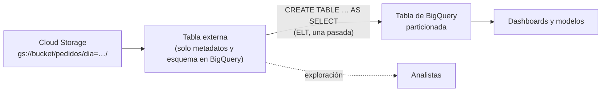

## 1. Resumen

Una **tabla externa** tiene esquema y definición en BigQuery, pero sus datos están afuera: en Cloud Storage, Google Drive o Bigtable. Se consulta con SQL como cualquier tabla, sin cargar los datos. Su documentación la propone para dos casos:

- **ELT en una pasada:** leer los archivos, limpiarlos y escribir el resultado en una tabla de BigQuery con `CREATE TABLE … AS SELECT`;
- **datos que cambian seguido** y que conviene unir sin recargarlos.

Tiene límites claros:

- es de solo lectura;
- no hay consistencia garantizada si los archivos cambian durante la consulta;
- suele ser más lenta que una tabla estándar;
- no admite clustering;
- se cobra cada consulta, aunque se repita.

Para delegación de acceso y seguridad por fila o columna sobre los mismos archivos está **BigLake** (ver `bigquery-biglake-tables`).

## 2. Qué es

- **Tabla externa:** definición y esquema en BigQuery; los datos, en la fuente. BigQuery no cobra almacenamiento por ella, aunque la fuente sí puede cobrarlo.
- **Fuentes:** Cloud Storage (varias URIs y comodines), Google Drive y Bigtable. Spanner y Cloud SQL van por **consultas federadas**, no por tablas externas.
- **Particionado externo:** con archivos en carpetas de estilo Hive (`dia=2026-10-10/`), `WITH PARTITION COLUMNS` expone la partición. `require_hive_partition_filter` obliga a filtrar por ella.
- **Diferencias con otros tipos**, según la tabla comparativa de BigQuery:
  - **BigLake:** acceso delegado a una cuenta de servicio;
  - **object tables:** cada fila es un archivo y sus metadatos;
  - **consultas federadas:** van contra bases operacionales.

## 3. Problema que resuelve

Cargar todo antes de poder mirarlo retrasa el análisis y duplica datos. Una tabla externa permite:

- explorar y validar archivos del lake antes de cargarlos;
- transformar y cargar en una sola consulta (ELT);
- unir con datos que cambian seguido sin un pipeline de recarga.

## 4. Cómo funciona

1. Se crea la tabla con `CREATE EXTERNAL TABLE … OPTIONS (format, uris)` o con Terraform, con el esquema explícito o detectado.
2. En cada consulta, BigQuery lee los archivos de la fuente. Lo que dure depende del almacenamiento: Cloud Storage es más rápido que Drive.
3. Si los archivos cambian mientras corre la consulta, el resultado puede ser inesperado: no hay consistencia garantizada.
4. Las consultas sobre Cloud Storage en GoogleSQL pueden usar la caché; las de otras fuentes no se cachean.
5. Para usar los datos repetidamente, se cargan en una tabla de BigQuery con `CREATE TABLE … AS SELECT`.

## 5. Cuándo utilizarlo

- Zona de llegada (landing) en Cloud Storage que se valida y carga una vez por día.
- Exploración de archivos nuevos antes de decidir su esquema definitivo.
- Datos chicos que cambian seguido y se unen a tablas de BigQuery.

## 6. Cuándo no utilizarlo

- Para consultas frecuentes de dashboards: se cobra cada vez, es más lento y no tiene clustering. Mejor cargar los datos.
- Si se necesita control de acceso fino o que los usuarios no tengan acceso al bucket: BigLake.
- Si los archivos cambian durante las consultas y la consistencia importa.
- Para modificar datos: es de solo lectura.

## 7. Ejemplo sencillo

Un proveedor deja CSV en `gs://bucket/pedidos/`. La tabla externa `pedidos_crudos_ext` permite consultarlos con SQL desde el primer día, antes de definir el pipeline de carga.

## 8. Ejemplo de producción

Los pedidos llegan como Parquet, particionados por día al estilo Hive. El equipo arma el flujo así:

1. Define `landing.pedidos_ext` con `WITH PARTITION COLUMNS (dia DATE)` y `require_hive_partition_filter = true`, para que ninguna consulta lea todas las carpetas.
2. Cada mañana, una consulta lee solo la partición del día, limpia y escribe en `validado.pedidos`, una tabla particionada de BigQuery.
3. Los dashboards consultan `validado.pedidos`, no la externa.

Los archivos se escriben antes de la carga y no durante ella, para evitar la falta de consistencia.

## 9. Arquitectura



## 10. Código

```hcl
# Terraform (validado en la CI con terraform validate, sin credenciales; no se aplicó): tabla externa sobre CSV en
# Cloud Storage, sin conexión: quien consulta necesita leer la tabla y también el bucket.
# Requiere: provider hashicorp/google; el bucket y el dataset landing existentes.
terraform {
  required_providers {
    google = {
      source  = "hashicorp/google"
      version = "~> 8.0"
    }
  }
}

variable "project_id" {
  type = string
}

variable "bucket" {
  type = string
}

resource "google_bigquery_table" "pedidos_crudos" {
  project             = var.project_id
  dataset_id          = "landing"
  table_id            = "pedidos_crudos_ext"
  deletion_protection = false

  external_data_configuration {
    autodetect    = false
    source_format = "CSV"
    source_uris   = ["gs://${var.bucket}/pedidos/*.csv"]
    schema = jsonencode([
      { name = "pedido_id", type = "STRING" },
      { name = "monto", type = "NUMERIC" },
      { name = "creado_en", type = "TIMESTAMP" },
    ])
    csv_options {
      quote             = "\""
      skip_leading_rows = 1
    }
  }
}
```

```sql
-- BigQuery, GoogleSQL (no ejecutado: requiere un proyecto de GCP). Tabla externa sobre Parquet particionado al
-- estilo Hive (gs://bucket/pedidos/dia=2026-10-10/...), que exige filtrar por la columna de partición.
CREATE EXTERNAL TABLE `mi-proyecto.landing.pedidos_ext`
WITH PARTITION COLUMNS (dia DATE)
OPTIONS (
  format = 'PARQUET',
  uris = ['gs://mi-bucket/pedidos/*'],
  hive_partition_uri_prefix = 'gs://mi-bucket/pedidos',
  require_hive_partition_filter = true
);

-- ELT: limpiar y cargar en una tabla de BigQuery en una pasada; las consultas siguientes van contra la tabla.
CREATE OR REPLACE TABLE `mi-proyecto.validado.pedidos` PARTITION BY dia AS
SELECT pedido_id, CAST(monto AS NUMERIC) AS monto, dia
FROM `mi-proyecto.landing.pedidos_ext`
WHERE dia = '2026-10-10' AND pedido_id IS NOT NULL;
```

El bloque de Terraform se valida en la CI con `terraform validate`, sin credenciales (`make validate-terraform`), y **no se aplicó**.

El SQL es GoogleSQL y **no se ejecutó**: requiere un proyecto de GCP y un bucket. La sintaxis de `CREATE EXTERNAL TABLE` con `WITH PARTITION COLUMNS` sigue *Create Cloud Storage external tables*.

## 11. GCP

**BigQuery** con **Cloud Storage** es el caso más común. La tabla comparativa de *Introduction to external data sources* distingue cuatro opciones:

- **tablas externas:** Cloud Storage, Drive y Bigtable, sin delegación de acceso;
- **BigLake:** Cloud Storage, y S3 o Azure Storage vía Omni, con delegación;
- **object tables;**
- **consultas federadas:** Spanner y Cloud SQL.

## 12. AWS

No aplica de forma específica: los datos en Amazon S3 se consultan desde BigQuery con BigLake y BigQuery Omni, no con tablas externas (ver `bigquery-biglake-tables`).

## 13. Azure

No aplica de forma específica: para Azure Storage, igual que en §12, BigLake con Omni.

## 14. Buenas prácticas

- Tablas externas para llegar y explorar; tablas de BigQuery para consumir.
- Particionado de estilo Hive con `require_hive_partition_filter = true` en carpetas grandes.
- Esquema explícito en producción, para que un archivo con columnas nuevas no cambie el resultado sin aviso.
- No escribir archivos en la ruta mientras corren las consultas.
- **Seguridad:** una tabla externa no delega el acceso, así que quien la consulta también necesita leer el bucket; para separar ese permiso, BigLake.
- **Observabilidad:** vigilar los bytes leídos de la fuente y las consultas sin filtro de partición; con `require_hive_partition_filter`, esas fallan en vez de leer todo.
- **Costo:** se cobra cada consulta aunque se repita, y la fuente puede cobrar almacenamiento; si se consulta seguido, cargar en una tabla permanente.

## 15. Errores frecuentes

- Conectar dashboards directamente a tablas externas.
- Dar a los analistas acceso al bucket solo para que puedan consultar la tabla externa, cuando BigLake lo evitaría.
- Consultar sin filtro de partición y leer años de archivos.
- Esperar caché en consultas a Drive o Bigtable.

## 16. Trade-offs

La tabla externa no duplica datos y está disponible al instante. A cambio, es más lenta, de solo lectura, sin clustering y sin consistencia garantizada, y se paga en cada consulta. Cargar en BigQuery duplica el almacenamiento y agrega un paso, pero da rendimiento, caché y todas las funciones de una tabla estándar. BigLake está en el medio: datos afuera con seguridad y caché de metadatos.

## 17. Conceptos relacionados

- `data-lake` y `gcs-buckets-and-objects`: dónde están los archivos.
- `bigquery-biglake-tables`: la versión con delegación de acceso.
- `etl-vs-elt`: cargar y transformar en una pasada.
- `bigquery-architecture`: qué guarda BigQuery de una tabla externa.

## 18. Preguntas técnicas abiertas

1. ¿Qué archivos de tu lake se consultan directo cuando deberían cargarse?
2. ¿Quién necesita hoy acceso al bucket solo para usar una tabla externa?
3. ¿Qué carpeta grande obligarías a filtrar por partición?

## 19. Laboratorio relacionado

Pendiente (F4).

## 20. Fuentes

- Google Cloud, BigQuery: *Introduction to external data sources*, *Introduction to external tables*, *Create Cloud Storage external tables* y *Overview of BigQuery storage*.

El detalle de cada fuente está en `sources` del frontmatter.

## 21. Fecha de última verificación

2026-10-11. Pasa a `verified`: revisión B-F3.1 del lote F3b-08a aplicada, sin VERIFY pendientes.

## 22. Historial de cambios importantes

- 2026-10-11: creación (lote F3b-08a).
- 2026-10-11: revisión B-F3.1 del lote F3b-08a aplicada (docs/reviews/cards-f3b-08a.md), regla del §17: relations incluye `bigquery-architecture`, que el §17 nombra.
- 2026-10-11: `verification_status: verified` (sin VERIFY pendientes).
