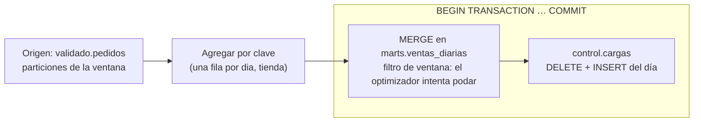

## 1. Resumen

Un **modelo incremental** actualiza una tabla procesando solo lo que pudo cambiar, en vez de reconstruirla entera. En BigQuery, el patrón a mano tiene tres partes:

1. **Ventana:** recalcular las particiones que pudieron cambiar, por ejemplo los últimos tres días por datos que llegan tarde.
2. **`MERGE`:** aplicar la ventana sobre la tabla destino. El origen debe tener una fila por clave, o el `MERGE` falla, y los filtros deben permitir que el optimizador pode particiones.
3. **Transacción:** el `MERGE` y el registro de control van en una transacción de varias sentencias, que es atómica.

Re-ejecutar con la misma ventana deja la misma tabla: es idempotente. Este es el SQL del patrón; **Dataform** lo implementa como producto, generando el `MERGE` (ver `dataform-incremental-tables`). El `MERGE` en general está en `sql-merge`.

## 2. Qué es

- **Ventana de recálculo:** el rango de particiones que se vuelve a calcular en cada corrida. Cubre los datos que llegan tarde sin reconstruir todo.
- **`MERGE`:**
  - combina `INSERT`, `UPDATE` y `DELETE` en una sentencia atómica;
  - hace un join entre destino y origen y aplica `WHEN MATCHED`, `WHEN NOT MATCHED` o `WHEN NOT MATCHED BY SOURCE`.
- **Una fila de origen por clave:** si una fila del destino coincide con varias del origen, BigQuery falla con «UPDATE/MERGE must match at most one source row for each target row».
- **Poda de particiones en el `MERGE`:**
  - el optimizador intenta usar los filtros de las cláusulas `WHEN` y de la condición del `MERGE`;
  - según el tipo de join, puede no lograrlo;
  - `WHEN NOT MATCHED` junto con `WHEN NOT MATCHED BY SOURCE` suele impedir la poda.
- **Transacción de varias sentencias:** `BEGIN TRANSACTION … COMMIT TRANSACTION`, con ACID y aislamiento de snapshot.

## 3. Problema que resuelve

Reconstruir una tabla de agregados cada día lee toda la historia y cuesta cada vez más. Cargar solo «lo de ayer» con `INSERT` duplica filas al reintentar y pierde los datos que llegan tarde. El patrón incremental:

- lee solo la ventana: menos bytes y menos slots;
- absorbe los datos tardíos dentro de la ventana;
- es idempotente, porque re-ejecutar no duplica;
- no deja la tabla y el registro de control a medias, porque van en una transacción.

## 4. Cómo funciona

1. Se fija el día de la corrida (`@dia`) y la ventana (`desde = @dia - 2`).
2. El origen agrega por la clave del destino (`dia`, `tienda_id`): una fila por clave.
3. `MERGE` actualiza las claves que existen e inserta las nuevas. La condición incluye el filtro de la ventana, para que el optimizador intente podar.
4. En la misma transacción, se borra y se vuelve a insertar la fila de control del día, sin duplicarla.
5. `COMMIT` confirma todo junto. Si algo falla, nada queda a medias.
6. Re-ejecutar con el mismo `@dia` recalcula la misma ventana y deja la tabla igual.

## 5. Cuándo utilizarlo

- Tablas grandes de agregados o hechos que crecen todos los días.
- Datos que llegan tarde dentro de una ventana conocida.
- Cuando se escribe el SQL a mano, sin Dataform ni dbt, por ejemplo en una consulta programada o desde un orquestador.

## 6. Cuándo no utilizarlo

- Tablas chicas, donde reconstruir todo es simple y barato.
- Si ya se usa Dataform o dbt: su configuración incremental genera el `MERGE` (ver `dataform-incremental-tables`).
- Si los cambios pueden afectar cualquier fecha histórica sin ventana conocida: hace falta otra estrategia, como CDC (ver `change-data-capture`), o reconstruir.
- Para agregaciones simples y frecuentes que una vista materializada incremental resuelve sola (ver `bigquery-materialized-views`).

## 7. Ejemplo sencillo

Cada día se recalculan las ventas de los últimos 3 días por tienda. Un pedido del día 8 que llegó el 10 entra en la corrida del 10, porque su día está en la ventana. Si la corrida del 10 se re-ejecuta, la tabla queda igual.

## 8. Ejemplo de producción

Un orquestador corre el modelo `ventas_diarias` cada mañana con `@dia` igual a ayer:

1. El origen es `validado.pedidos`, particionada por `dia`.
2. El `MERGE` toca solo tres particiones del destino.
3. El registro en `control.cargas` y el `MERGE` van en una transacción.

Una mañana, el pipeline falla después del `MERGE` y el orquestador reintenta. Como todo estaba en una transacción, el primer intento no dejó cambios, y el reintento deja la tabla igual que una corrida exitosa. Para un backfill de un mes, el orquestador corre el modelo una vez por día (ver `backfill`).

## 9. Arquitectura



## 10. Código

```sql
-- BigQuery, GoogleSQL (no ejecutado: requiere un proyecto de GCP). Modelo incremental por partición: se recalcula
-- la ventana de días que pudo cambiar y se aplica con MERGE, en una transacción con el registro de control.
-- Re-ejecutar con la misma ventana deja la misma tabla (idempotente).
DECLARE desde DATE DEFAULT DATE_SUB(@dia, INTERVAL 2 DAY);   -- ventana de 3 días para datos que llegan tarde

BEGIN TRANSACTION;

MERGE `mi-proyecto.marts.ventas_diarias` AS t
USING (
  SELECT dia, tienda_id, SUM(monto) AS monto, COUNT(*) AS pedidos
  FROM `mi-proyecto.validado.pedidos`
  WHERE dia BETWEEN desde AND @dia                        -- solo la ventana: menos bytes procesados
  GROUP BY dia, tienda_id                                 -- una fila de origen por clave: evita el error de MERGE
) AS s
ON t.dia = s.dia AND t.tienda_id = s.tienda_id AND t.dia BETWEEN desde AND @dia   -- filtro en la condición: el optimizador intenta podar
WHEN MATCHED THEN UPDATE SET monto = s.monto, pedidos = s.pedidos
WHEN NOT MATCHED THEN INSERT (dia, tienda_id, monto, pedidos) VALUES (s.dia, s.tienda_id, s.monto, s.pedidos);

DELETE FROM `mi-proyecto.control.cargas` WHERE modelo = 'ventas_diarias' AND dia = @dia;
INSERT INTO `mi-proyecto.control.cargas` (modelo, dia, cargado_en) VALUES ('ventas_diarias', @dia, CURRENT_TIMESTAMP());

COMMIT TRANSACTION;
```

Este bloque es GoogleSQL y **no se ejecutó**: requiere un proyecto de GCP con estas tablas y el parámetro `@dia`. La sintaxis sigue la referencia de `MERGE`, de las transacciones de varias sentencias y del lenguaje procedural. Que la ventana pode particiones depende del optimizador: la documentación dice que **intenta** usar esos filtros. El `MERGE` por clave con versión, en general, está en `sql-merge`.

## 11. GCP

**BigQuery.** El patrón usa `MERGE`, transacciones de varias sentencias y lenguaje procedural, según sus páginas. **Dataform** implementa la misma idea como producto: `type: "incremental"` con `uniqueKey` genera el `MERGE` (ver `dataform-incremental-tables`). Las dos fichas se mantienen separadas, como indica el blueprint.

## 12. AWS

No aplica de forma específica: el patrón es SQL de BigQuery. El `MERGE` de otros motores está en `sql-merge`, atribuido por motor.

## 13. Azure

No aplica de forma específica (ver §12).

## 14. Buenas prácticas

- Ventana fija y documentada, según cuánto tardan en llegar los datos.
- Agregar o deduplicar el origen por la clave antes del `MERGE`.
- Filtrar la ventana en la condición o en las cláusulas `WHEN`, y verificar en el plan que la poda ocurra.
- `MERGE` y registro de control en una transacción.
- Reconstrucción completa ocasional para corregir datos fuera de la ventana.
- **Seguridad:** la cuenta que corre el modelo necesita escribir el destino y el control, y solo leer el origen; no reutilizar una cuenta con permisos amplios.
- **Observabilidad:** registrar por corrida las filas actualizadas e insertadas y los bytes procesados; un salto en los bytes indica que la poda dejó de funcionar.
- **Costo:** el `MERGE` procesa los bytes del origen y, si hay `UPDATE` o `DELETE`, también los del destino; una ventana corta y bien filtrada los mantiene bajos.

## 15. Errores frecuentes

- Origen con varias filas por clave, y el `MERGE` falla.
- `INSERT` en vez de `MERGE`, que duplica al reintentar.
- `WHEN NOT MATCHED BY SOURCE … DELETE` sin acotar a la ventana, que borra la historia o impide la poda.
- Ventana demasiado corta, que pierde los datos tardíos.
- `MERGE` y control fuera de una transacción, que deja estados a medias tras un fallo.

## 16. Trade-offs

El modelo incremental procesa poco y escala con el tiempo, a cambio de lógica más compleja (ventana, deduplicación, transacción) y de no corregir sola lo que queda fuera de la ventana. Reconstruir todo es simple y siempre correcto, pero cada vez más caro. Dataform o dbt reducen el código a mano y dejan menos control sobre el SQL generado. Una ventana más larga captura más datos tardíos, pero procesa más.

## 17. Conceptos relacionados

- `incremental-load` e `incremental-pipelines`: la idea general.
- `sql-merge` y `upsert`: el `MERGE` en general.
- `dataform-incremental-tables`: la implementación de producto.
- `idempotency`, `late-arriving-data` y `backfill`: reintentar, datos tardíos y reprocesar.
- `bigquery-partitioning` y `bigquery-materialized-views`: particiones y la alternativa automática.
- `change-data-capture`: la alternativa cuando los cambios tocan cualquier fecha histórica (§6).

## 18. Preguntas técnicas abiertas

1. ¿Cuántos días tardan en llegar los datos más atrasados de tu fuente?
2. ¿Qué tabla tuya se reconstruye entera cada día y podría ser incremental?
3. ¿Cómo comprobarías que el `MERGE` poda particiones?

## 19. Laboratorio relacionado

Pendiente (F4).

## 20. Fuentes

- Google Cloud, BigQuery: *DML statements in GoogleSQL*, *Update partitioned table data using DML*, *Multi-statement transactions* y *Procedural language*.

El detalle de cada fuente está en `sources` del frontmatter.

## 21. Fecha de última verificación

2026-10-11. Pasa a `verified`: revisión B-F3.1 del lote F3b-08a aplicada, sin VERIFY pendientes.

## 22. Historial de cambios importantes

- 2026-10-11: creación (lote F3b-08a).
- 2026-10-11: revisión B-F3.1 del lote F3b-08a aplicada (docs/reviews/cards-f3b-08a.md), regla del §17: relations incluye `incremental-pipelines`, `upsert`, `backfill`, `bigquery-materialized-views`, que el §17 nombra.
- 2026-10-11: `verification_status: verified` (sin VERIFY pendientes).
- 2026-10-13: `page_title` en cada cita, con el título de la página citada (ADR-012); sin cambios de contenido.
- 2026-10-14: lote F3b-rel (regla del §17): relations incluye `change-data-capture`; el §17 nombra `change-data-capture`, que el cuerpo ya citaba.
