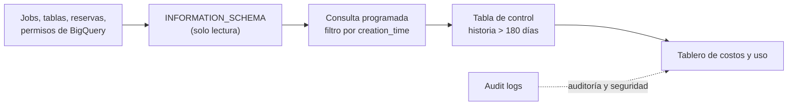

## 1. Resumen

**INFORMATION_SCHEMA** son vistas de solo lectura con los **metadatos** de BigQuery:

- datasets y tablas (tamaño, particiones, columnas);
- jobs: quién consultó, cuánto facturó, cuántos slots usó;
- reservas, permisos y recomendaciones.

Se consultan con SQL indicando un alcance (región, proyecto o dataset) y una vista; por ejemplo, `` `region-us`.INFORMATION_SCHEMA.JOBS ``. Para costo y rendimiento, la vista clave es **JOBS**:

- `total_bytes_billed` y `total_slot_ms` de cada job;
- 180 días de historial;
- particionada por `creation_time`.

Consultar estas vistas también cuesta: en on-demand, un mínimo de 10 MB por consulta. Para auditoría y seguridad, la documentación indica que la fuente principal son los **audit logs** (ver `bigquery-monitoring`).

## 2. Qué es

- **Vistas del sistema, de solo lectura:** acceso (`OBJECT_PRIVILEGES`), datasets (`SCHEMATA`), jobs, jobs por intervalo (`JOBS_TIMELINE_*`), reservas, tablas (`TABLES`, `COLUMNS`, `PARTITIONS`, `TABLE_STORAGE`), vistas, recomendaciones e insights.
- **Alcance:**
  - un dataset (`ventas.INFORMATION_SCHEMA.TABLES`);
  - un proyecto o una región (`` `region-us`.INFORMATION_SCHEMA.JOBS ``);
  - los calificadores de región no son jerárquicos: la multirregión US no incluye `us-west1`.
- **JOBS:**
  - es sinónimo de `JOBS_BY_PROJECT`; hay variantes por usuario, carpeta y organización;
  - columnas como `user_email`, `job_type`, `state`, `total_bytes_billed` y `total_slot_ms`;
  - particionada por `creation_time` y agrupada por `project_id` y `user_email`;
  - requiere los roles BigQuery User y BigQuery Resource Viewer en el proyecto.

## 3. Problema que resuelve

Saber qué consultas cuestan más, qué tablas crecen o quién usa qué dataset no requiere exportar logs ni herramientas aparte. Las vistas lo responden con SQL, en el mismo BigQuery, y se pueden programar como reportes o alertas.

## 4. Cómo funciona

1. Se elige el alcance según la vista: región para JOBS, dataset para TABLES o TABLE_STORAGE.
2. Se filtra por `creation_time` en JOBS. Como está particionada por esa columna, el filtro reduce lo leído.
3. Se agrupa por usuario, por consulta o por proyecto, y se ordena por `total_bytes_billed` o `total_slot_ms`.
4. BigQuery cobra la consulta: en on-demand, al menos 10 MB; en capacidad, usa los slots de la reserva.
5. Los resultados alimentan un tablero, un reporte programado o la revisión de las consultas más caras (ver `bigquery-query-optimization`).

## 5. Cuándo utilizarlo

- Encontrar las consultas y los usuarios que más bytes facturan o más slots usan.
- Controlar el tamaño de las tablas y las particiones.
- Revisar reservas y asignaciones.
- Inventariar objetos: tablas sin descripción, vistas, rutinas.

## 6. Cuándo no utilizarlo

- Como registro de auditoría de seguridad: para eso, los audit logs, que la documentación indica como fuente principal.
- Para historial de jobs de más de 180 días: hay que guardarlo aparte antes.
- Consultando JOBS sin filtro de `creation_time`: lee todo el historial disponible.

## 7. Ejemplo sencillo

`SELECT table_name, total_rows FROM ventas.INFORMATION_SCHEMA.TABLE_STORAGE` lista las tablas del dataset con sus filas, sin leer las tablas.

## 8. Ejemplo de producción

Cada lunes, una consulta programada lee la última semana de JOBS en la región US, agrupa por usuario y escribe en una tabla de control:

- consultas;
- TiB facturados;
- slot-horas.

El tablero de costos muestra las 20 cuentas que más facturan. Cuando un usuario sube mucho, el equipo revisa sus consultas con el plan y las insights. Como JOBS guarda 180 días, la consulta semanal también conserva la historia larga en la tabla de control.

## 9. Arquitectura



## 10. Código

```sql
-- BigQuery, GoogleSQL (no ejecutado: requiere un proyecto de GCP). INFORMATION_SCHEMA.JOBS de la región US:
-- las consultas que más bytes facturaron y más slot time usaron en los últimos 7 días, por usuario.
-- La vista está particionada por creation_time: filtrar por ella reduce lo que se lee.
SELECT
  user_email,
  COUNT(*) AS consultas,
  ROUND(SUM(total_bytes_billed) / POW(1024, 4), 2) AS tib_facturados,
  ROUND(SUM(total_slot_ms) / (1000 * 60 * 60), 1) AS slot_horas
FROM `region-us`.INFORMATION_SCHEMA.JOBS
WHERE creation_time >= TIMESTAMP_SUB(CURRENT_TIMESTAMP(), INTERVAL 7 DAY)
  AND job_type = 'QUERY'
  AND state = 'DONE'
GROUP BY user_email
ORDER BY tib_facturados DESC
LIMIT 20;

-- Tablas de un dataset con su tamaño (metadatos, sin leer las tablas).
SELECT table_name, total_rows, ROUND(total_logical_bytes / POW(1024, 3), 1) AS gib_logicos
FROM `mi-proyecto.ventas`.INFORMATION_SCHEMA.TABLE_STORAGE
ORDER BY total_logical_bytes DESC;
```

Este bloque es GoogleSQL y **no se ejecutó**: requiere un proyecto de GCP con historial de jobs. Las columnas de JOBS y la vista TABLE_STORAGE son las de *JOBS view* e *Introduction to INFORMATION_SCHEMA*. El calificador `region-us` se cambia según la ubicación de los datos.

## 11. GCP

**BigQuery.** Las vistas, sus alcances, la retención de JOBS y el costo mínimo son los de sus páginas citadas.

## 12. AWS

No aplica de forma específica: esta ficha describe las vistas de BigQuery.

## 13. Azure

No aplica de forma específica (ver §12).

## 14. Buenas prácticas

- Filtrar JOBS por `creation_time` siempre.
- Guardar resúmenes en una tabla propia si se necesita más de 180 días de historia.
- Usar el calificador de región correcto: no son jerárquicos.
- Un tablero de costos alimentado por JOBS, revisado cada semana.
- **Seguridad:** JOBS muestra quién consultó y el texto de cada consulta (columna `query`); dar los roles necesarios solo a quienes analizan costo y uso.
- **Observabilidad:** INFORMATION_SCHEMA complementa las métricas de Cloud Monitoring con más detalle, y los audit logs, para auditoría (ver `bigquery-monitoring`).
- **Costo:** cada consulta a INFORMATION_SCHEMA cuesta al menos 10 MB en on-demand; las consultas programadas frecuentes suman.

## 15. Errores frecuentes

- Consultar JOBS sin filtro de fecha.
- Usar `region-us` esperando ver jobs de `us-central1`.
- Tomar INFORMATION_SCHEMA como registro de auditoría.
- Esperar historia de jobs de hace un año.

## 16. Trade-offs

INFORMATION_SCHEMA da metadatos detallados con SQL y sin infraestructura, pero con retención limitada (180 días en JOBS) y con costo por consulta. Los audit logs dan un registro completo para auditoría, aunque requieren exportarlos para analizarlos con la misma facilidad. Cloud Monitoring da métricas agregadas y alertas, con menos detalle que las vistas.

## 17. Conceptos relacionados

- `bigquery-monitoring`: métricas, logs y alertas.
- `bigquery-cost-model` y `bigquery-slots`: lo que miden `total_bytes_billed` y `total_slot_ms`.
- `bigquery-query-optimization`: qué hacer con las consultas más caras.

## 18. Preguntas técnicas abiertas

1. ¿Qué cinco consultas facturaron más en tu proyecto la semana pasada?
2. ¿Dónde guardarías la historia de jobs de más de 180 días?
3. ¿Quién debería poder ver el texto de las consultas de todos?

## 19. Laboratorio relacionado

Pendiente (F4).

## 20. Fuentes

- Google Cloud, BigQuery: *Introduction to INFORMATION_SCHEMA*, *JOBS view*, *TABLE_STORAGE view* e *Introduction to audit logs in BigQuery*.

El detalle de cada fuente está en `sources` del frontmatter.

## 21. Fecha de última verificación

2026-10-11. Pasa a `verified`: revisión B-F3.1 del lote F3b-08b aplicada, sin VERIFY pendientes.

## 22. Historial de cambios importantes

- 2026-10-11: creación (lote F3b-08b).
- 2026-10-11: revisión B-F3.1 del lote F3b-08b aplicada (docs/reviews/cards-f3b-08b.md), regla del §17: relations incluye `bigquery-query-optimization`, que el §17 nombra.
- 2026-10-11: `verification_status: verified` (sin VERIFY pendientes).
- 2026-10-13: `page_title` en cada cita, con el título de la página citada (ADR-012); sin cambios de contenido.
