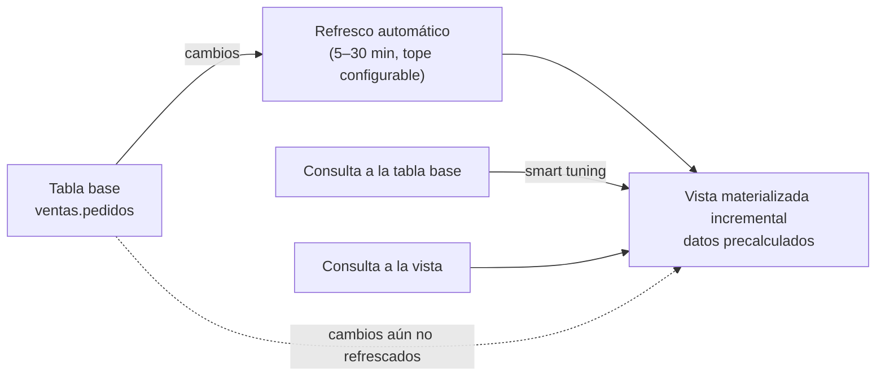

## 1. Resumen

Una **vista materializada** de BigQuery guarda el resultado de una consulta y lo mantiene sola. Sirve para agregaciones que se consultan una y otra vez, como un dashboard que suma ventas por día. Hay dos tipos:

- **Incrementales** (por defecto):
  - aceptan un SQL limitado;
  - BigQuery les agrega solo los cambios de la tabla base;
  - siempre devuelven datos frescos, porque combinan lo precalculado con los cambios recientes;
  - con **smart tuning**, BigQuery reescribe consultas contra la tabla base para que usen la vista.
- **No incrementales:** casi cualquier consulta, pero cada refresco la recalcula entera, y no tienen smart tuning ni frescura garantizada.

El refresco automático ocurre, por defecto, entre 5 y 30 minutos después de un cambio, como mucho una vez cada 30 minutos; ese tope se puede ajustar. Ver `materialization-strategies` para la decisión general.

## 2. Qué es

- **Datos precalculados:** el resultado de la consulta de la vista, guardado en el almacenamiento de BigQuery.
- **Refresco automático:**
  - lo ejecuta una cuenta de servicio de BigQuery y aparece en el historial de jobs;
  - `enable_refresh` lo activa o desactiva;
  - `refresh_interval_minutes` fija la frecuencia máxima: por defecto 30, mínimo 1.
- **Frescura:** una vista incremental devuelve datos frescos aunque no se haya refrescado. Si un cambio invalida lo precalculado, BigQuery lee de las tablas base.
- **Smart tuning:** si una parte de una consulta contra la tabla base se resuelve con la vista, BigQuery la reescribe. Solo en vistas incrementales.
- **`allow_non_incremental_definition = true`:** habilita una vista no incremental.
- **Vista materializada autorizada:** comparte un subconjunto de datos sin dar acceso al dataset de origen.

## 3. Problema que resuelve

Un dashboard que agrega millones de filas en cada carga lee la tabla completa una y otra vez. Hay dos alternativas, y las dos tienen problemas:

- un pipeline propio que precalcule la agregación, que hay que mantener;
- una vista normal, que recalcula todo en cada consulta.

La vista materializada incremental precalcula, se mantiene sola y no entrega datos viejos.

## 4. Cómo funciona

1. Se crea la vista con `CREATE MATERIALIZED VIEW … AS SELECT …` o con Terraform.
2. BigQuery calcula el resultado y lo guarda.
3. Cuando cambia la tabla base, el refresco automático agrega los cambios, dentro del tope de frecuencia.
4. Una consulta a la vista combina lo precalculado con los cambios aún no refrescados, así que el resultado es fresco.
5. Una consulta a la **tabla base** que la vista puede responder se reescribe para usarla (smart tuning).
6. La consulta de la vista no se puede modificar: para cambiarla hay que crear otra.

## 5. Cuándo utilizarlo

- Agregaciones, filtros o joins frecuentes y predecibles sobre tablas grandes.
- Dashboards que consultan las mismas métricas una y otra vez.
- Cuando se quiere frescura sin construir un pipeline de agregación.

## 6. Cuándo no utilizarlo

- Consultas que la sintaxis incremental no admite: o se acepta una vista no incremental (refresco completo, sin frescura garantizada) o conviene un modelo incremental propio (ver `bigquery-incremental-models`).
- Sobre tablas externas (no admitidas) o encima de otra vista materializada (no se anidan).
- Si la lógica cambia seguido: la consulta no se puede modificar después de crear la vista.
- Con operadores pesados como `UNPIVOT` o `UNNEST` en on-demand: el refresco puede fallar.

## 7. Ejemplo sencillo

`ventas_por_dia_mv` suma el monto y cuenta pedidos por día y tienda. El dashboard consulta la tabla base `pedidos` agrupando por día, y BigQuery reescribe esa consulta para usar la vista. El dashboard no cambia, y la consulta lee la vista en lugar de la tabla.

## 8. Ejemplo de producción

La tabla `ventas.pedidos` recibe pedidos todo el día. El equipo crea la vista incremental `ventas_por_dia_mv`, con un tope de refresco de 60 minutos para limitar el costo de los refrescos. Los dashboards siguen consultando `pedidos`, y smart tuning los dirige a la vista; como es incremental, ven los pedidos de la última hora aunque la vista no se haya refrescado. Para un reporte con `UNPIVOT`, que no admite la sintaxis incremental, el equipo usa una consulta programada a una tabla.

## 9. Arquitectura



## 10. Código

```hcl
# Terraform (validado en la CI con terraform validate, sin credenciales; no se aplicó): vista materializada
# incremental con refresco automático como máximo cada 60 minutos.
# Requiere: provider hashicorp/google; el dataset ventas y la tabla ventas.pedidos existentes.
terraform {
  required_providers {
    google = {
      source  = "hashicorp/google"
      version = "~> 8.0"
    }
  }
}

variable "project_id" {
  type = string
}

resource "google_bigquery_table" "ventas_por_dia" {
  project             = var.project_id
  dataset_id          = "ventas"
  table_id            = "ventas_por_dia_mv"
  deletion_protection = false

  materialized_view {
    query                            = "SELECT DATE(creado_en) AS dia, tienda_id, SUM(monto) AS monto, COUNT(*) AS pedidos FROM `${var.project_id}.ventas.pedidos` GROUP BY dia, tienda_id"
    enable_refresh                   = true
    refresh_interval_ms              = 3600000 # 60 minutos (por defecto, 30)
    allow_non_incremental_definition = false   # solo SQL incremental: admite smart tuning
  }
}
```

```sql
-- BigQuery, GoogleSQL (no ejecutado: requiere un proyecto de GCP). La misma vista materializada en DDL,
-- y una consulta sobre la tabla base que smart tuning puede resolver con la vista.
CREATE MATERIALIZED VIEW `mi-proyecto.ventas.ventas_por_dia_mv`
OPTIONS (enable_refresh = true, refresh_interval_minutes = 60)
AS
SELECT DATE(creado_en) AS dia, tienda_id, SUM(monto) AS monto, COUNT(*) AS pedidos
FROM `mi-proyecto.ventas.pedidos`
GROUP BY dia, tienda_id;

-- Consulta contra la tabla base: si la vista puede responderla, BigQuery la reescribe para usarla.
SELECT DATE(creado_en) AS dia, SUM(monto) AS monto
FROM `mi-proyecto.ventas.pedidos`
WHERE DATE(creado_en) >= '2026-10-01'
GROUP BY dia;
```

El bloque de Terraform se valida en la CI con `terraform validate`, sin credenciales (`make validate-terraform`), y **no se aplicó**. Usa el bloque `materialized_view` de `google_bigquery_table`, como en *Create materialized views*.

El SQL es GoogleSQL y **no se ejecutó**: requiere un proyecto de GCP. Que smart tuning reescriba la segunda consulta depende de que la vista pueda responderla.

## 11. GCP

**BigQuery.** Además de lo anterior, según su página de introducción:

- se pueden crear vistas materializadas sobre tablas **BigLake** con caché de metadatos (ver `bigquery-biglake-tables`);
- una vista materializada autorizada comparte datos sin dar acceso al dataset de origen.

## 12. AWS

No aplica de forma específica: esta ficha describe las vistas materializadas de BigQuery. La comparación general está en `materialization-strategies`.

## 13. Azure

No aplica de forma específica (ver §12).

## 14. Buenas prácticas

- Preferir vistas incrementales: frescura y smart tuning.
- Ajustar `refresh_interval_minutes` a la frescura que el negocio necesita: refrescar más seguido cuesta más.
- Diseñar la vista para las consultas más frecuentes; con smart tuning, los dashboards no necesitan cambiar.
- Versionar la vista: como la consulta no se modifica, un cambio es una vista nueva.
- **Seguridad:** compartir subconjuntos con vistas materializadas autorizadas, sin dar acceso al dataset de origen.
- **Observabilidad:** los refrescos aparecen como jobs de la cuenta de servicio de BigQuery; vigilar fallos de refresco, sobre todo con operadores pesados.
- **Costo:** la vista se guarda en el almacenamiento de BigQuery y cada refresco consume cómputo; se paga a cambio de no releer la tabla base en cada consulta.

## 15. Errores frecuentes

- Esperar que una vista no incremental esté siempre fresca.
- Intentar modificar la consulta de una vista existente.
- Crearla sobre una tabla externa, o encima de otra vista materializada.
- Un tope de refresco de 1 minuto sin necesidad, y pagar refrescos continuos.

## 16. Trade-offs

Una vista materializada incremental ahorra lecturas y se mantiene sola, a cambio de un SQL limitado y de no poder cambiar su consulta. Una no incremental acepta más SQL pero recalcula todo y no garantiza frescura. Un modelo incremental propio da control total sobre la lógica y la frecuencia, pero hay que construirlo y operarlo.

## 17. Conceptos relacionados

- `materialization-strategies`: vista, tabla, vista materializada o incremental.
- `bigquery-query-optimization`: materializar lo que se repite.
- `bigquery-incremental-models`: el modelo incremental propio.
- `bigquery-biglake-tables`: vistas materializadas sobre datos en Cloud Storage.

## 18. Preguntas técnicas abiertas

1. ¿Qué agregación de tus dashboards se recalcula en cada carga?
2. ¿Qué frescura necesita, y qué tope de refresco pondrías?
3. ¿Qué consulta tuya no cabe en la sintaxis incremental, y cómo la resolverías?

## 19. Laboratorio relacionado

Pendiente (F4).

## 20. Fuentes

- Google Cloud, BigQuery: *Introduction to materialized views*, *Manage materialized views* y *Create materialized views*.

El detalle de cada fuente está en `sources` del frontmatter.

## 21. Fecha de última verificación

2026-10-11. Pasa a `verified`: revisión B-F3.1 del lote F3b-08a aplicada, sin VERIFY pendientes.

## 22. Historial de cambios importantes

- 2026-10-11: creación (lote F3b-08a).
- 2026-10-11: revisión B-F3.1 del lote F3b-08a aplicada (docs/reviews/cards-f3b-08a.md), regla del §17: relations incluye `bigquery-biglake-tables`, que el §17 nombra.
- 2026-10-11: `verification_status: verified` (sin VERIFY pendientes).
