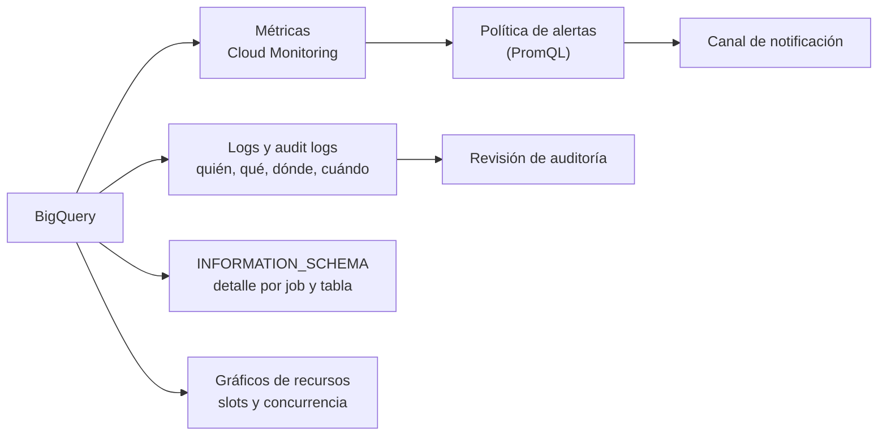

## 1. Resumen

BigQuery se vigila con cuatro fuentes, y cada una responde una pregunta distinta:

- **Métricas en Cloud Monitoring:** jobs en curso, bytes escaneados, tiempos de consulta. Sirven para tableros y **alertas**. Una consulta aparece recién al terminar bien (hasta 7 minutos después), y las fallidas no se reportan.
- **Logs y audit logs:** **quién hizo qué, dónde y cuándo**. Según la documentación, son la fuente principal para auditoría y seguridad.
- **INFORMATION_SCHEMA:** metadatos detallados de jobs, tablas y reservas, con SQL (ver `bigquery-information-schema`).
- **Gráficos de recursos:** uso de slots, capacidad y concurrencia en el tiempo.

Las fuentes tienen distinta granularidad, así que sus números pueden no coincidir.

## 2. Qué es

- **Métrica:**
  - valor numérico tomado a intervalos, con un tipo de recurso (`bigquery_dataset`, `bigquery_project` o `global`) y etiquetas;
  - por ejemplo, `bigquery.googleapis.com/query/count` y `bigquery.googleapis.com/job/num_in_flight`;
  - se consulta con PromQL en Cloud Monitoring.
- **Alerta:** una política de Cloud Monitoring que evalúa una condición sobre métricas y avisa por un canal (correo, chat, incidentes).
- **Log:** entradas que BigQuery crea por acciones (crear o borrar tablas, comprar slots, cargas).
- **Audit log:**
  - registro de quién hizo qué, con el contenido en `protoPayload`;
  - el proyecto tiene los de sus recursos, y carpetas, organizaciones y facturación tienen los suyos.
- **Gráficos de recursos:** el uso pasado de slots y la concurrencia, para planificar y diagnosticar.

## 3. Problema que resuelve

Sin monitoreo, los problemas se descubren por el costo de fin de mes o por un usuario que se queja: cargas que se acumulan, consultas que de pronto escanean diez veces más, alguien que da acceso de más a un dataset. Con las cuatro fuentes:

- una alerta avisa cuando algo sale de lo normal;
- los audit logs explican quién cambió o accedió a qué;
- INFORMATION_SCHEMA y los gráficos de recursos dan el detalle para diagnosticar.

## 4. Cómo funciona

1. BigQuery publica métricas en Cloud Monitoring. Las de una consulta, al terminar bien y con hasta 7 minutos de demora.
2. Una política de alertas evalúa una condición, por ejemplo más de 50 cargas en curso durante 10 minutos, y avisa por un canal.
3. Cada acción queda en los logs. Las de auditoría responden quién, qué, dónde y cuándo.
4. Para el detalle (qué consulta, cuántos bytes, cuántos slots), se consulta INFORMATION_SCHEMA.
5. Los gráficos de recursos muestran si la capacidad de slots alcanza, para ajustar reservas (ver `bigquery-slots`).

## 5. Cuándo utilizarlo

- **Alertas** sobre cargas acumuladas, errores de jobs o picos de bytes escaneados.
- **Audit logs** para responder quién accedió a datos sensibles o cambió permisos.
- **Gráficos de recursos** antes de cambiar el tamaño de una reserva.
- **INFORMATION_SCHEMA** para el detalle por consulta y usuario.

## 6. Cuándo no utilizarlo

- No alertar sobre errores con métricas de consultas: las consultas fallidas no se reportan como métricas. Para fallos, logs o INFORMATION_SCHEMA.
- No esperar métricas en tiempo real: pueden tardar hasta 7 minutos.
- No usar INFORMATION_SCHEMA como registro de auditoría: para eso, los audit logs.

## 7. Ejemplo sencillo

Una alerta de Cloud Monitoring sobre `job/num_in_flight` con `job_type="load"` avisa al equipo cuando el promedio de 10 minutos supera 50 cargas en curso. Esa es la señal de que algo río arriba está atascado o reintentando.

## 8. Ejemplo de producción

El equipo de plataforma monitorea en capas:

- **Alertas:** cargas acumuladas, y una consulta programada sobre INFORMATION_SCHEMA que avisa si un usuario escanea en un día más del doble de su promedio.
- **Auditoría:** los audit logs se exportan para revisar cada semana los cambios de IAM en datasets con datos sensibles.
- **Capacidad:** antes de renovar un compromiso de slots, revisa el gráfico de uso de slots de los últimos meses.

Cuando una alerta salta, el detalle de la consulta culpable está en JOBS.

## 9. Arquitectura



## 10. Código

```hcl
# Terraform (validado en la CI con terraform validate, sin credenciales; no se aplicó): alerta de Cloud Monitoring
# sobre una métrica de BigQuery con PromQL: demasiados jobs de carga en curso durante 10 minutos.
# Requiere: provider hashicorp/google; la API de Cloud Monitoring habilitada.
terraform {
  required_providers {
    google = {
      source  = "hashicorp/google"
      version = "~> 8.0"
    }
  }
}

variable "project_id" {
  type = string
}

resource "google_monitoring_notification_channel" "datos" {
  project      = var.project_id
  display_name = "equipo-datos"
  type         = "email"
  labels = {
    email_address = "datos-alertas@empresa.com"
  }
}

resource "google_monitoring_alert_policy" "cargas_en_curso" {
  project      = var.project_id
  display_name = "BigQuery: cargas acumuladas"
  combiner     = "OR"

  conditions {
    display_name = "Más de 50 jobs de carga en curso (promedio de 10 minutos)"
    condition_prometheus_query_language {
      # La expresión de la métrica es la del ejemplo de «Introduction to BigQuery monitoring».
      query               = "avg_over_time({\"bigquery.googleapis.com/job/num_in_flight\", monitored_resource=\"bigquery_project\", job_type=\"load\"}[10m]) > 50"
      duration            = "600s"
      evaluation_interval = "60s"
    }
  }

  notification_channels = [google_monitoring_notification_channel.datos.id]
}
```

Este bloque de Terraform se valida en la CI con `terraform validate`, sin credenciales (`make validate-terraform`), y **no se aplicó**. La expresión de la métrica es la del ejemplo de PromQL de *Introduction to BigQuery monitoring*. El umbral de 50 cargas y la duración de 10 minutos son de ejemplo.

## 11. GCP

**BigQuery** con **Cloud Monitoring** y **Cloud Logging**. Las fuentes, la demora de las métricas y el papel de los audit logs son los de las páginas citadas. El detalle por consulta está en `bigquery-information-schema`.

## 12. AWS

No aplica de forma específica: esta ficha describe el monitoreo de BigQuery.

## 13. Azure

No aplica de forma específica (ver §12).

## 14. Buenas prácticas

- Alertas sobre lo que exige acción (cargas atascadas, picos de bytes), no sobre todo lo medible.
- Para errores, logs o INFORMATION_SCHEMA, porque las consultas fallidas no generan métricas.
- Audit logs exportados y revisados para datasets sensibles.
- Contar con que las fuentes no coincidan: cada una tiene su granularidad.
- **Seguridad:** los audit logs son la fuente principal para preguntas de seguridad; protegerlos con acceso restringido y retención suficiente.
- **Observabilidad:** combinar las cuatro fuentes; una alerta sin detalle para diagnosticar obliga a buscar a mano.
- **Costo:** las consultas sobre INFORMATION_SCHEMA y la retención de logs también cuestan; programarlas con la frecuencia necesaria, no más.

## 15. Errores frecuentes

- Alertar sobre consultas fallidas con métricas que no las incluyen.
- Esperar ver una consulta en las métricas apenas termina.
- Usar INFORMATION_SCHEMA en lugar de audit logs para auditoría.
- Alertas sin canal de notificación ni responsable.

## 16. Trade-offs

Las métricas permiten alertas y tableros sin escribir SQL, pero llegan con demora y no incluyen las consultas fallidas. INFORMATION_SCHEMA da todo el detalle con SQL, a costo por consulta y con retención limitada. Los audit logs son completos para auditoría, pero hay que exportarlos y analizarlos aparte. Usar las cuatro da el panorama completo, a cambio de mantener varias piezas.

## 17. Conceptos relacionados

- `bigquery-information-schema`: el detalle con SQL.
- `bigquery-slots` y `bigquery-cost-model`: lo que se vigila.
- `bigquery-security`: los accesos que registran los audit logs.
- `orchestration-observability`: el monitoreo de los pipelines que cargan BigQuery.

## 18. Preguntas técnicas abiertas

1. ¿Qué tres alertas pondrías primero en tu proyecto de BigQuery?
2. ¿Dónde guardas hoy los audit logs y por cuánto tiempo?
3. ¿Cómo detectarías una consulta fallida si las métricas no la muestran?

## 19. Laboratorio relacionado

Pendiente (F4).

## 20. Fuentes

- Google Cloud, BigQuery: *Introduction to BigQuery monitoring*, *Introduction to audit logs in BigQuery* y *Monitor health and resource utilization*.

El detalle de cada fuente está en `sources` del frontmatter.

## 21. Fecha de última verificación

2026-10-11. Pasa a `verified`: revisión B-F3.1 del lote F3b-08b aplicada, sin VERIFY pendientes.

## 22. Historial de cambios importantes

- 2026-10-11: creación (lote F3b-08b).
- 2026-10-11: revisión B-F3.1 del lote F3b-08b aplicada (docs/reviews/cards-f3b-08b.md), regla del §17: relations incluye `orchestration-observability`, que el §17 nombra.
- 2026-10-11: `verification_status: verified` (sin VERIFY pendientes).
