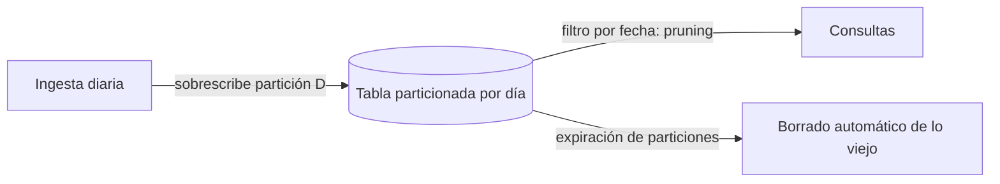

## 1. Resumen

BigQuery puede dividir una tabla en particiones por una columna de fecha u hora, por el momento de ingesta o por rangos de un entero. Si la consulta filtra por la columna de partición, BigQuery lee solo las particiones necesarias (*pruning*): baja el costo, sube el rendimiento y el costo puede estimarse antes de ejecutar.

## 2. Qué es

Una tabla particionada guarda sus datos en segmentos según el valor de la columna de partición. Cada partición se puede consultar, sobrescribir, borrar o expirar por separado. Es la implementación de BigQuery del concepto general `partitioning`.

## 3. Problema que resuelve

En BigQuery el costo y el tiempo dependen de los datos leídos. Sin partición, una consulta por "ayer" sobre una tabla de eventos de años lee la tabla entera. Con partición diaria, lee un día. La partición también permite gestionar el ciclo de vida (expirar datos viejos) y reescribir un día sin tocar el resto.

## 4. Cómo funciona

Hay tres tipos:

- **Por columna de tiempo**: sobre una columna `DATE`, `TIMESTAMP` o `DATETIME`. BigQuery ubica cada fila según su valor.
- **Por momento de ingesta**: BigQuery asigna la partición según cuándo ingirió la fila, con granularidad horaria, diaria, mensual o anual; los límites se calculan en UTC.
- **Por rango de enteros**: sobre una columna `INTEGER`, con inicio, fin e intervalo.

Hay dos particiones especiales: `__NULL__`, para filas con la columna de partición nula, y `__UNPARTITIONED__`, para valores fuera de rango (en tiempo, anteriores a 1960-01-01 o posteriores a 2159-12-31).

Cuando la consulta filtra por la columna de partición, BigQuery escanea solo las particiones que cumplen el filtro y salta el resto.

## 5. Cuándo utilizarlo

Según la documentación, conviene particionar cuando se quiere:

- escanear solo una parte de la tabla;
- estimar el costo de una consulta antes de ejecutarla;
- gestionar a nivel de partición: expiración automática, escritura o borrado de particiones específicas.

## 6. Cuándo no utilizarlo

- Tablas pequeñas, donde el beneficio es mínimo.
- Una granularidad tan fina que la tabla superaría el máximo de **10.000 particiones por tabla** (cuota vigente al 2026-09-30). La documentación recomienda entonces una granularidad más gruesa (mensual en vez de diaria) o clustering además o en lugar de la partición.
- Filtros que casi nunca usan la columna de partición: no habrá pruning.

## 7. Ejemplo sencillo

```sql
CREATE TABLE `proyecto.dataset.eventos` (
  evento_id STRING, cliente_id STRING, ocurrido_en TIMESTAMP
)
PARTITION BY DATE(ocurrido_en);

-- Lee solo la partición de ese día.
SELECT COUNT(*) FROM `proyecto.dataset.eventos`
WHERE DATE(ocurrido_en) = '2026-09-29';
```

## 8. Ejemplo de producción

Una tabla de eventos de varios TB se consulta casi siempre por fecha y `customer_id`. Se particiona por día sobre la fecha del evento, se hace clustering por `customer_id` y se fija una expiración de particiones según la política de retención. El pipeline diario sobrescribe solo la partición del día, lo que lo vuelve idempotente, y cada consulta de negocio filtra la fecha.

## 9. Arquitectura



## 10. Código

```sql
-- BigQuery: tabla particionada por día con clustering (ejecutable adaptando nombres).
CREATE TABLE `proyecto.dataset.eventos`
(
  evento_id STRING,
  cliente_id STRING,
  ocurrido_en TIMESTAMP,
  payload JSON
)
PARTITION BY DATE(ocurrido_en)
CLUSTER BY cliente_id;

-- Rango de enteros: particiones de 10 en 10 entre 0 y 100 (fuera de rango: __UNPARTITIONED__).
CREATE TABLE `proyecto.dataset.clientes_por_bucket` (cliente_id INT64, nombre STRING)
PARTITION BY RANGE_BUCKET(cliente_id, GENERATE_ARRAY(0, 100, 10));
```

## 11. GCP

Esta ficha trata del propio servicio. Hay que combinar la partición con el **clustering** (`bigquery-clustering`) cuando la tabla se filtra además por otra columna. Un `MERGE` con `UPDATE` o `DELETE` factura origen más destino, así que filtrar el destino por partición es clave para abaratarlo.

## 12. AWS

No hay un equivalente directo en un único servicio:

- **Athena** particiona datos en S3 por cualquier clave (a menudo carpetas estilo Hive, `dt=2026-09-30/`) y así limita los datos escaneados.
- **Redshift** optimiza el layout físico con el estilo de distribución (cómo reparte filas entre nodos) y con sort keys; ese es el modelo que hay que diseñar al migrar, en lugar de las particiones de BigQuery.

Trasladar un diseño de BigQuery exige revisar el modelo físico de cada servicio.

## 13. Azure

El dedicated SQL pool de **Azure Synapse** admite particiones de tabla, pero la documentación advierte que demasiadas particiones perjudican el rendimiento en tablas columnstore. Recomienda al menos 1 millón de filas por distribución y partición, y cada tabla ya está repartida en 60 distribuciones. El criterio de tamaño es muy distinto al de BigQuery.

## 14. Buenas prácticas

- Particionar por la columna que usan los filtros más frecuentes (casi siempre, la fecha del evento).
- Elegir la granularidad según el volumen: diaria por defecto; mensual si habría demasiadas particiones.
- Combinar con clustering para el segundo filtro más común.
- Fijar la expiración de particiones según la política de retención.
- Revisar en `INFORMATION_SCHEMA` y en el plan de ejecución que las consultas hacen pruning.
- **Costo:** la opción `require_partition_filter` obliga a filtrar por la columna de partición y evita consultas que lean la tabla entera por descuido.
- **Seguridad:** la partición no controla el acceso; la expiración de particiones ayuda a cumplir la retención definida para el dato.

## 15. Errores frecuentes

- Filtrar con una expresión que impide el pruning (por ejemplo, una función sobre la columna distinta de la que define la partición).
- Particionar por ingesta cuando las consultas filtran por la fecha del evento.
- Granularidad horaria sin necesidad, que acerca la tabla al máximo de particiones.
- Ignorar las particiones `__NULL__` y `__UNPARTITIONED__` en controles de calidad.

## 16. Trade-offs

Menos datos leídos y gestión por partición, a cambio de restricciones de diseño (una columna de partición por tabla, límite de particiones) y de disciplina en los filtros. El clustering es complementario: no tiene el límite de particiones, pero no ofrece gestión por partición (expiración o sobrescritura).

## 17. Conceptos relacionados

- `partitioning`: el concepto general.
- `incremental-load`: la partición facilita cargas incrementales y sobrescrituras idempotentes.
- Del blueprint, pendientes de ficha: `bigquery-clustering`, `partition-pruning`, `bigquery-cost-model`, `bigquery-query-optimization`.

## 18. Preguntas técnicas abiertas

1. ¿Cómo optimizarías una tabla de eventos de varios TB que se consulta sobre todo por fecha y `customer_id`?
2. ¿Cuándo preferirías particionar por ingesta en lugar de por la fecha del evento, y qué riesgo tiene?
3. ¿Cómo detectarías que una consulta frecuente no está aprovechando la partición?

## 19. Laboratorio relacionado

Pendiente (F4): lab de tipo C "Una consulta BigQuery procesa 4 TB diariamente. Analizar cómo reducir el volumen procesado" (§25).

## 20. Fuentes

- Google Cloud: *Introduction to partitioned tables*, *Create partitioned tables*, *Data definition language*, *DML statements in GoogleSQL* y *Quotas and limits* (BigQuery).
- AWS: *Partition your data* (Amazon Athena); *Sort keys* y *Data distribution for query optimization* (Amazon Redshift).
- Microsoft Learn: *Partitioning tables in dedicated SQL pool* (Azure Synapse).

El detalle de cada fuente está en `sources` del frontmatter.

## 21. Fecha de última verificación

2026-09-30. El VERIFY del máximo de particiones se resolvió con la página de cuotas (10.000 por tabla). Pasa a `verified`: revisión B-F3.1 aprobada y aplicada, sin VERIFY pendientes.

## 22. Historial de cambios importantes

- 2026-09-30: creación (lote 1 de F3).
- 2026-09-30: revisión B-F3.1 aplicada (docs/reviews/cards-lote1.md): relaciones completas, seguridad, observabilidad y costo, notas de fuentes y ejemplos corregidos.
- 2026-09-30: VERIFY resuelto: máximo de 10.000 particiones por tabla (página de cuotas).
- 2026-09-30: `verification_status: verified` (revisión B-F3.1 aprobada y aplicada; VERIFY resueltos).
