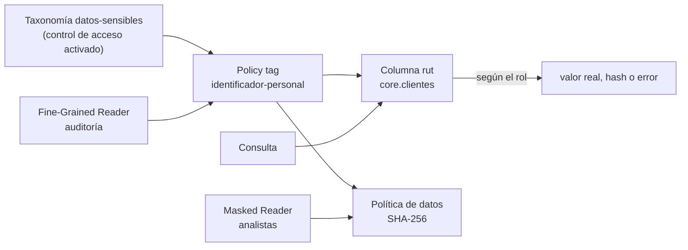

## 1. Resumen

Los **policy tags** controlan el acceso por **columna** en BigQuery:

1. Se define una **taxonomía** de etiquetas, por ejemplo «identificador personal».
2. Se asignan las etiquetas a columnas del esquema.
3. Se decide con IAM quién puede leer cada etiqueta.

Quien no tiene el rol **Fine-Grained Reader** en el tag no lee la columna. Con una **política de datos** puede verla **enmascarada**: un hash SHA-256, un valor por defecto o el email con el usuario oculto, entre otras reglas.

Así, la misma tabla da acceso completo a auditoría, enmascarado a los analistas y nulo a ventas, sin copias. Los policy tags se basan en la API de Data Catalog, que sigue vigente para esto aunque su catálogo migra a Knowledge Catalog. La alternativa son los **data governance tags** de Resource Manager.

## 2. Qué es

- **Taxonomía:** un conjunto jerárquico de policy tags con nombre único en la organización. Su control de acceso se activa para que los tags restrinjan.
- **Policy tag:** la etiqueta que se asigna a una columna en el esquema de la tabla.
- **Fine-Grained Reader** (`roles/datacatalog.categoryFineGrainedReader`): el rol, en el tag, que da acceso al valor real de la columna.
- **Política de datos (data policy):** asocia una regla de enmascaramiento a un policy tag.
- **Masked Reader** (`roles/bigquerydatapolicy.maskedReader`): ve la columna con la máscara. La documentación recomienda asignarlo en la política de datos, no en el proyecto.
- **Reglas de enmascaramiento:**
  - rutina propia (UDF);
  - año de una fecha;
  - valor por defecto del tipo;
  - máscara de email;
  - primeros o últimos cuatro caracteres;
  - hash SHA-256, que sirve para hacer joins;
  - anular.
- **Data governance tags:** la alternativa con tags de Resource Manager, para el mismo control por columna y enmascaramiento.

## 3. Problema que resuelve

Las vistas y los datasets separados controlan qué tablas ve cada uno, pero una columna sensible dentro de una tabla útil (el RUT de un cliente, el salario) obliga a duplicar la tabla sin esa columna. Con los policy tags:

- la columna se protege en la tabla misma, sin copias;
- cada grupo recibe el nivel adecuado: completo, enmascarado o nada;
- el control lo aplica BigQuery al consultar, no la disciplina de cada consulta.

## 4. Cómo funciona

1. Se crea la taxonomía con control de acceso activado y los policy tags.
2. Se etiqueta la columna en el esquema, con `policyTags`.
3. Se da Fine-Grained Reader en el tag a quien debe ver el valor real.
4. Para el acceso enmascarado, se crea una política de datos sobre el tag, con una regla como `SHA256`, y se da Masked Reader en esa política.
5. Al consultar, BigQuery verifica el rol del usuario:
   - con Fine-Grained Reader, ve el valor;
   - con Masked Reader, ve la máscara;
   - sin ninguno, la consulta que pide esa columna falla.
6. La máscara tiene precedencia sobre las demás operaciones de la consulta.

## 5. Cuándo utilizarlo

- Columnas con datos personales o sensibles en tablas que muchos consultan.
- Distintos niveles de acceso a la misma columna según el grupo.
- Joins sobre identificadores sensibles sin exponerlos (hash SHA-256).

## 6. Cuándo no utilizarlo

- Para restringir filas: eso es seguridad por fila (ver `bigquery-security`).
- Si la tabla debe copiarse entre regiones: las tablas con policy tags no se pueden copiar a otra región.
- Para datos que nadie fuera del equipo debería ver ni enmascarados: en ese caso, otro dataset o proyecto.

## 7. Ejemplo sencillo

La columna `rut` de `core.clientes` tiene el tag «identificador-personal»:

- auditoría tiene Fine-Grained Reader y ve el RUT;
- analistas tiene Masked Reader en la política con SHA-256 y ve un hash, con el que puede seguir uniendo tablas;
- ventas no tiene ningún rol y no puede consultar la columna.

## 8. Ejemplo de producción

El equipo de gobierno mantiene una taxonomía «datos-sensibles» con tags para identificadores, contacto y salarios, todo en Terraform:

- los pipelines asignan los tags al crear las tablas;
- las políticas de datos definen la máscara de cada tag: hash para identificadores, máscara de email para contacto, valor por defecto para salarios;
- los roles se dan a grupos, en el tag o en la política de datos, nunca en el proyecto.

Un analista nuevo entra al grupo de analistas y ve los identificadores como hash desde el primer día, sin cambios en las tablas.

## 9. Arquitectura



## 10. Código

```hcl
# Terraform (validado en la CI con terraform validate, sin credenciales; no se aplicó): taxonomía con un policy tag
# para identificadores personales, lectura completa para un grupo y lectura enmascarada (SHA-256) para otro.
# Requiere: provider hashicorp/google; el dataset core existente.
terraform {
  required_providers {
    google = {
      source  = "hashicorp/google"
      version = "~> 8.0"
    }
  }
}

variable "project_id" {
  type = string
}

resource "google_data_catalog_taxonomy" "sensibles" {
  project                = var.project_id
  region                 = "us"
  display_name           = "datos-sensibles"
  activated_policy_types = ["FINE_GRAINED_ACCESS_CONTROL"] # aplica el control de acceso de la taxonomía
}

resource "google_data_catalog_policy_tag" "identificador" {
  taxonomy     = google_data_catalog_taxonomy.sensibles.id
  display_name = "identificador-personal"
}

# Acceso completo a las columnas con el tag: rol Fine-Grained Reader en el policy tag.
resource "google_data_catalog_policy_tag_iam_member" "auditores" {
  policy_tag = google_data_catalog_policy_tag.identificador.name
  role       = "roles/datacatalog.categoryFineGrainedReader"
  member     = "group:auditoria@empresa.com"
}

# Acceso enmascarado: una política de datos con hash SHA-256 sobre el mismo tag.
resource "google_bigquery_datapolicy_data_policy" "hash_identificador" {
  project          = var.project_id
  location         = "us"
  data_policy_id   = "hash_identificador"
  policy_tag       = google_data_catalog_policy_tag.identificador.name
  data_policy_type = "DATA_MASKING_POLICY"
  data_masking_policy {
    predefined_expression = "SHA256"
  }
}

# Masked Reader a nivel de la política de datos, no del proyecto.
resource "google_bigquery_datapolicy_data_policy_iam_member" "analistas" {
  project        = var.project_id
  location       = "us"
  data_policy_id = google_bigquery_datapolicy_data_policy.hash_identificador.data_policy_id
  role           = "roles/bigquerydatapolicy.maskedReader"
  member         = "group:analistas@empresa.com"
}

# La columna rut lleva el policy tag en el esquema de la tabla.
resource "google_bigquery_table" "clientes" {
  project             = var.project_id
  dataset_id          = "core"
  table_id            = "clientes"
  deletion_protection = false
  schema = jsonencode([
    { name = "cliente_id", type = "INT64" },
    { name = "rut", type = "STRING", policyTags = { names = [google_data_catalog_policy_tag.identificador.name] } },
    { name = "segmento", type = "STRING" },
  ])
}
```

Este bloque de Terraform se valida en la CI con `terraform validate`, sin credenciales (`make validate-terraform`), y **no se aplicó**. `terraform validate` comprueba que los recursos y atributos existan en el provider:

- taxonomía, policy tag e IAM del tag;
- política de datos y su IAM;
- tabla con `policyTags` en el esquema.

Los roles y la regla SHA-256 son los de las páginas citadas.

## 11. GCP

**BigQuery** con la API de **Data Catalog** para los policy tags. Según *Introduction to data masking*:

- la API `datacatalog.googleapis.com` debe seguir habilitada;
- la búsqueda y la catalogación de Data Catalog están obsoletas y migran a Knowledge Catalog, pero la funcionalidad de policy tags no (ver `dataplex-governance`);
- el uso de policy tags tiene costos de BigQuery y de Data Catalog.

## 12. AWS

No aplica de forma específica: esta ficha describe BigQuery. El control por columna en AWS se trata en sus propias fichas.

## 13. Azure

No aplica de forma específica (ver §12).

## 14. Buenas prácticas

- Taxonomía pequeña y estable, mantenida por el equipo de gobierno.
- Roles en el tag o en la política de datos, nunca a nivel de proyecto.
- SHA-256 para identificadores que se usan en joins; otras reglas para lo demás.
- Asignar los tags en el pipeline que crea la tabla, no a mano después.
- **Seguridad:** el control lo aplica BigQuery en la consulta; quien administra la taxonomía y las políticas de datos tiene mucho poder, así que ese rol se limita.
- **Observabilidad:** auditar quién tiene Fine-Grained Reader y Masked Reader, y qué columnas sensibles no tienen tag.
- **Costo:** los policy tags evitan tablas duplicadas sin columnas sensibles; implican costos de BigQuery y de Data Catalog, según la página.

## 15. Errores frecuentes

- Dar Fine-Grained Reader o Masked Reader en el proyecto, lo que abre todas las columnas o políticas.
- Olvidar activar el control de acceso de la taxonomía, y que los tags no restrinjan nada.
- Deshabilitar la API de Data Catalog creyendo que todo migró a Knowledge Catalog.
- Intentar copiar a otra región una tabla con policy tags.

## 16. Trade-offs

Los policy tags protegen columnas sin duplicar tablas y con niveles por grupo, a cambio de mantener una taxonomía, políticas de datos y roles, y de depender de la API de Data Catalog. El enmascaramiento deja usar datos sensibles (por ejemplo, para joins con hash), pero un hash de un identificador de pocos valores posibles puede adivinarse; no reemplaza a la anonimización. Separar datos sensibles en otro dataset es más simple de razonar, pero duplica y fragmenta.

## 17. Conceptos relacionados

- `bigquery-security`: IAM, vistas autorizadas y seguridad por fila.
- `gcp-iam-for-data`: IAM en general.
- `dataplex-governance`: Knowledge Catalog.

## 18. Preguntas técnicas abiertas

1. ¿Qué columnas sensibles de tus tablas no tienen hoy ningún control?
2. ¿Qué grupos necesitan el valor real y cuáles alcanza con una máscara?
3. ¿Qué identificador tuyo es tan predecible que su hash se podría adivinar?

## 19. Laboratorio relacionado

Pendiente (F4).

## 20. Fuentes

- Google Cloud, BigQuery: *Introduction to column-level access control* e *Introduction to data masking*.

El detalle de cada fuente está en `sources` del frontmatter.

## 21. Fecha de última verificación

2026-10-11. Pasa a `verified`: revisión B-F3.1 del lote F3b-08b aplicada, sin VERIFY pendientes.

## 22. Historial de cambios importantes

- 2026-10-11: creación (lote F3b-08b).
- 2026-10-11: revisión B-F3.1 del lote F3b-08b aplicada (docs/reviews/cards-f3b-08b.md): filas aprobadas sin cambios en esta ficha.
- 2026-10-11: `verification_status: verified` (sin VERIFY pendientes).
