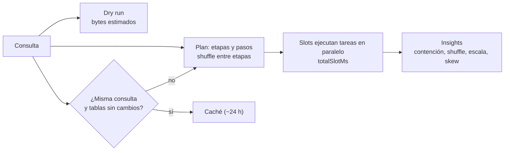

## 1. Resumen

En BigQuery, una consulta cuesta y tarda según **lo que lee** y **el cómputo que usa**, medido en slots. Su guía de optimización resume las palancas principales:

- **Leer menos:** solo las columnas necesarias (no `SELECT *`; `LIMIT` no reduce lo leído) y filtros por la columna de partición.
- **Calcular menos:** materializar transformaciones que se repiten, como regex o recortes, en vez de rehacerlas en cada consulta.
- **Unir mejor:** la tabla grande primero, y claves `INT64` en vez de `STRING`. BigQuery no indexa claves primarias.

Para diagnosticar, BigQuery da el **plan de ejecución** (etapas, shuffle, `totalSlotMs`), **insights de rendimiento** como contención de slots o datos desparejos, y la **caché de resultados**. El plan y la poda en general están en `query-plans` y `scan-reduction`.

## 2. Qué es

- **Plan de ejecución:**
  - BigQuery convierte el SQL en un grafo de **etapas** compuestas por pasos, que corren en paralelo y se pasan datos por **shuffle** (memoria distribuida);
  - las estadísticas se leen en la API (`jobs.get`) y en el grafo de ejecución de la consola.
- **`totalSlotMs`:** el cómputo total de una consulta, en milisegundos de slot.
- **Insights de rendimiento:**
  - **contención de slots:** muchas tareas listas y no hay slots;
  - **cuota de shuffle insuficiente;**
  - **cambio de escala de entrada:** la consulta lee al menos 50 % más de una tabla que la vez anterior;
  - **partition skew:** valores muy frecuentes en claves de join o agrupación cargan una partición, y un solo slot la procesa entera.
- **Caché de resultados:** la misma consulta repetida devuelve el resultado guardado, por unas 24 horas, sin costo de almacenamiento. Tiene excepciones: tabla de destino, tablas cambiadas, streaming reciente, funciones no deterministas, comodines y fuentes externas.
- **Broadcast join:** con una tabla grande a la izquierda y una chica a la derecha, BigQuery envía la chica a cada slot que procesa la grande.

## 3. Problema que resuelve

Una consulta mal escrita en BigQuery no falla: termina, pero lee de más y usa más slots. En on-demand se paga por TiB procesado, y en capacidad compite por slots con el resto (ver `bigquery-slots`). Sin estas prácticas:

- dashboards que releen tablas enteras cada vez;
- transformaciones caras repetidas en cada consulta;
- joins lentos por claves de texto o por datos desparejos.

## 4. Cómo funciona

1. **Medir antes:** un dry run estima los bytes que leerá la consulta; la estimación es una cota superior. El plan muestra las etapas y el slot time de una ejecución real.
2. **Proyectar:** listar solo las columnas necesarias, o usar `SELECT * EXCEPT`.
3. **Filtrar por partición** y, si hay clustering, por las columnas de clustering (ver `bigquery-partitioning` y `bigquery-clustering`).
4. **Materializar** lo que se repite: una columna ya normalizada en la tabla, o una vista materializada para agregaciones frecuentes (ver `bigquery-materialized-views`).
5. **Ordenar los joins** de la tabla más grande a la más chica, por columnas `INT64`. El optimizador decide los lados, pero la guía recomienda ese orden.
6. **Revisar las insights:**
   - con contención, menos datos o más slots;
   - con skew, tratar las claves muy frecuentes;
   - con un cambio de escala, revisar por qué creció la entrada.

## 5. Cuándo utilizarlo

- Consultas recurrentes (dashboards, modelos diarios) con muchos bytes procesados.
- Consultas que de pronto tardan más o leen más (insight de cambio de escala).
- Antes de pasar a capacidad o de comprar más slots.

## 6. Cuándo no utilizarlo

- No optimizar a mano una consulta de una sola vez que lee poco.
- No confiar en `LIMIT` para abaratar: no reduce los bytes leídos.
- No esperar la caché en consultas con `CURRENT_DATE` o sobre tablas que reciben streaming: no se cachean.

## 7. Ejemplo sencillo

`SELECT * FROM ventas.pedidos LIMIT 100` lee todas las columnas de toda la tabla, aunque devuelva 100 filas. `SELECT pedido_id, monto FROM ventas.pedidos WHERE dia = '2026-10-10'` lee dos columnas de una partición.

## 8. Ejemplo de producción

Un dashboard de ventas tarda y cuesta cada vez más. El plan y las insights muestran tres problemas:

- un `REGEXP_EXTRACT` sobre el canal en cada consulta;
- un join por `CAST(cliente_id AS STRING)`;
- un cambio de escala de entrada: la consulta lee la tabla completa en vez del mes.

El equipo corrige los tres:

1. Agrega `canal_normalizado` a la tabla en la carga.
2. Une por `cliente_id` `INT64`.
3. Filtra por la columna de partición `dia`.

Los bytes procesados bajan a una fracción y el slot time también. Como el dashboard repite consultas idénticas, sin `CURRENT_DATE`, una parte de las cargas vuelve a servirse desde la caché.

## 9. Arquitectura



## 10. Código

```sql
-- BigQuery, GoogleSQL (no ejecutado: requiere un proyecto de GCP). Antes y después de aplicar las prácticas de
-- «Optimize query computation». El plan y las insights de la consulta muestran el efecto (bytes y slot time).

-- Antes: lee todas las columnas y todas las particiones; transforma con regex en cada consulta.
SELECT *
FROM `mi-proyecto.ventas.pedidos` p
JOIN `mi-proyecto.ventas.clientes` c ON CAST(p.cliente_id AS STRING) = c.cliente_codigo
WHERE REGEXP_EXTRACT(p.canal, r'^(web|app)') IS NOT NULL
LIMIT 100;                                                    -- LIMIT no reduce los bytes leídos

-- Después: solo las columnas necesarias, filtro por la columna de partición, join por INT64,
-- y el canal ya normalizado en una columna materializada en la tabla (no se recalcula en cada consulta).
SELECT p.pedido_id, p.monto, c.segmento
FROM `mi-proyecto.ventas.pedidos` p                           -- tabla grande primero
JOIN `mi-proyecto.ventas.clientes` c ON p.cliente_id = c.cliente_id   -- INT64 = INT64
WHERE p.dia BETWEEN '2026-10-01' AND '2026-10-10'             -- columna de partición: poda particiones
  AND p.canal_normalizado IN ('web', 'app');
```

Este bloque es GoogleSQL y **no se ejecutó**: requiere un proyecto de GCP con estas tablas. Cada cambio del «después» corresponde a una práctica de *Optimize query computation*:

- columnas necesarias en vez de `SELECT *`, sin confiar en `LIMIT`;
- filtro por la columna de partición;
- join por `INT64` con la tabla grande primero;
- la transformación regex materializada en la tabla.

El efecto se mide con el dry run y con el plan de cada versión.

## 11. GCP

**BigQuery.** Las prácticas, el plan, las insights y la caché son los de sus páginas citadas. Para tablas grandes, ver también `bigquery-partitioning` y `bigquery-clustering`; para agregaciones repetidas, `bigquery-materialized-views`.

## 12. AWS

No aplica de forma específica: esta ficha trata el optimizador y la guía de BigQuery. La comparación entre warehouses está en `cloud-warehouse-optimization`.

## 13. Azure

No aplica de forma específica (ver §12).

## 14. Buenas prácticas

- Dry run o estimación de bytes antes de ejecutar consultas grandes.
- Columnas explícitas; nada de `SELECT *` en producción.
- Filtros por la columna de partición, y por las de clustering cuando las hay.
- Materializar transformaciones caras que se repiten.
- Joins por enteros, con la tabla grande primero.
- Revisar las insights de las consultas recurrentes.
- **Seguridad:** materializar columnas transformadas en otra tabla duplica datos; si son sensibles, aplicar en la tabla nueva los mismos controles que en la original.
- **Observabilidad:** seguir bytes procesados y `totalSlotMs` por consulta recurrente; un salto es la señal de que algo cambió (la insight de cambio de escala de entrada lo marca).
- **Costo:** en on-demand se paga lo leído, así que proyectar y podar baja el costo de forma directa; en capacidad, menos slots dejan capacidad para el resto.

## 15. Errores frecuentes

- Usar `LIMIT` para abaratar una consulta.
- Joins por `STRING` cuando existe una clave entera.
- Rehacer una regex sobre millones de filas en cada consulta del dashboard.
- Usar `CURRENT_DATE()` en una consulta que se quiere cachear.
- Ignorar el skew: una clave muy frecuente hace que un solo slot procese casi todo.

## 16. Trade-offs

Materializar columnas o agregados acelera y abarata las consultas, pero agrega almacenamiento y un paso de carga que mantener. Las columnas explícitas son más largas de escribir y frágiles ante cambios de esquema, aunque leen menos. La caché es gratis pero frágil: cualquier cambio en las tablas o una función no determinista la invalida. Más slots aceleran sin cambiar el SQL, pero cuestan; optimizar es más barato a largo plazo.

## 17. Conceptos relacionados

- `query-plans`, `scan-reduction` y `join-optimization`: los conceptos generales.
- `cloud-warehouse-optimization`: lo comparado entre warehouses.
- `bigquery-slots` y `bigquery-cost-model`: lo que se ahorra.
- `bigquery-partitioning` y `bigquery-clustering`: leer menos.
- `bigquery-materialized-views`: agregaciones precalculadas.

## 18. Preguntas técnicas abiertas

1. ¿Cuál es la consulta recurrente que más bytes procesa en tu proyecto, y por qué?
2. ¿Qué transformación repetida materializarías primero?
3. ¿Qué claves de join de tu modelo son `STRING` y podrían ser `INT64`?

## 19. Laboratorio relacionado

Pendiente (F4).

## 20. Fuentes

- Google Cloud, BigQuery: *Optimize query computation*, *Query plan and timeline*, *Get query performance insights*, *Use cached query results* y *Estimate and control costs*.

El detalle de cada fuente está en `sources` del frontmatter.

## 21. Fecha de última verificación

2026-10-11. `review_required`: pendiente de revisión B-F3.1 del lote F3b-08a.

## 22. Historial de cambios importantes

- 2026-10-11: creación (lote F3b-08a).
