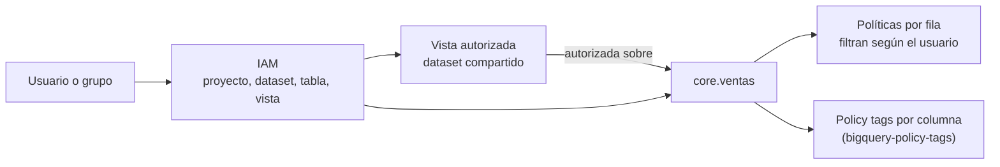

## 1. Resumen

BigQuery controla el acceso en capas que se combinan:

- **IAM** en proyecto, dataset, tabla, vista y rutina: quién puede ejecutar jobs y qué recursos puede leer o modificar.
- **Vistas autorizadas:** comparten un subconjunto (ciertas columnas o filas agregadas) sin dar acceso al dataset de origen.
- **Seguridad por fila:** políticas que filtran las filas que ve cada usuario o grupo. Quien no está en ninguna política no ve filas.
- **Seguridad por columna y enmascaramiento**, con policy tags (ver `bigquery-policy-tags`).

Lo de esta ficha es lo propio de BigQuery. El IAM de GCP en general está en `gcp-iam-for-data`.

## 2. Qué es

- **Política de permiso (allow policy):**
  - una por recurso, y la heredan sus descendientes;
  - se aplica a proyecto, dataset, tabla, vista y rutina;
  - los modelos no admiten roles individuales.
- **Vista autorizada:**
  - una vista en un dataset A que se autoriza sobre el dataset B de origen;
  - el usuario necesita acceso a A y permiso para ejecutar jobs, pero no acceso a B;
  - A y B deben estar en la misma ubicación;
  - existen también las vistas materializadas autorizadas y los datasets autorizados.
- **Política de acceso por fila:**
  - `CREATE ROW ACCESS POLICY … GRANT TO (…) FILTER USING (…)`, sobre una tabla, que puede tener varias;
  - quien no está en ninguna no ve filas;
  - quien tenía acceso completo necesita un filtro `TRUE`;
  - las crean usuarios con BigQuery Admin o BigQuery DataOwner.

## 3. Problema que resuelve

Dar acceso a un dataset entero es lo simple, pero expone todo: datos personales, filas de otras regiones, columnas internas. Las capas de BigQuery permiten:

- dar a cada equipo solo lo que necesita, sin copiar tablas;
- compartir resultados derivados sin abrir las tablas de origen;
- que la misma tabla muestre a cada región solo sus filas.

## 4. Cómo funciona

1. IAM decide si el usuario puede ejecutar jobs en el proyecto y leer el dataset o la tabla.
2. Si consulta una vista autorizada, BigQuery le permite leer las tablas de origen a través de la vista, aunque él no tenga acceso a ellas.
3. Si la tabla tiene políticas de fila, BigQuery aplica los filtros de las políticas que lo incluyen. Sin política, no ve filas.
4. Si hay policy tags en columnas, BigQuery controla el acceso a esas columnas y puede enmascararlas (ver `bigquery-policy-tags`).
5. Las capas se suman: el usuario ve la intersección de lo que todas permiten.

## 5. Cuándo utilizarlo

- **IAM por dataset:** separar dominios o niveles de acceso.
- **Vistas autorizadas:** marts y resultados derivados para otros equipos (ver `data-mart`).
- **Seguridad por fila:** una tabla que consultan equipos con alcances distintos (regiones, clientes, unidades de negocio).

## 6. Cuándo no utilizarlo

- No usar vistas o `SELECT * EXCEPT` como único control de una columna sensible: para eso, policy tags.
- No crear una tabla copia por región si una política por fila resuelve lo mismo sobre una sola tabla.
- No usar políticas de fila en tablas que dependen de vistas materializadas o de BI Engine para su rendimiento: no se aceleran con políticas de fila.

## 7. Ejemplo sencillo

La tabla `core.ventas` tiene dos políticas de fila:

- `ventas-norte` solo ve `region = 'norte'`;
- `ventas-sur` solo ve `region = 'sur'`.

El equipo central tiene un filtro `TRUE`. Los tres consultan la misma tabla y ven filas distintas.

## 8. Ejemplo de producción

El dataset `core` tiene las tablas de ventas. Ningún analista tiene acceso a `core`. Para compartir, el equipo:

1. Crea el dataset `compartido`, en la misma ubicación que `core`.
2. Crea la vista `ventas_por_region`, que agrega por región y día.
3. Autoriza esa vista sobre `core` y da a los analistas acceso de lectura a `compartido`.

Además, la tabla `core.ventas` tiene políticas por fila para los equipos regionales que sí consultan el detalle, y la columna de identificador del cliente lleva un policy tag. Al crear las políticas de fila, el equipo agrega un filtro `TRUE` para la cuenta del pipeline, que antes tenía acceso completo.

## 9. Arquitectura



## 10. Código

```hcl
# Terraform (validado en la CI con terraform validate, sin credenciales; no se aplicó): vista autorizada. Los analistas
# leen la vista en el dataset compartido sin acceso al dataset core.
# Requiere: provider hashicorp/google; el dataset core existente, en la misma ubicación que compartido.
terraform {
  required_providers {
    google = {
      source  = "hashicorp/google"
      version = "~> 8.0"
    }
  }
}

variable "project_id" {
  type = string
}

resource "google_bigquery_dataset" "compartido" {
  project    = var.project_id
  dataset_id = "compartido"
  location   = "US"
}

resource "google_bigquery_table" "ventas_por_region" {
  project             = var.project_id
  dataset_id          = google_bigquery_dataset.compartido.dataset_id
  table_id            = "ventas_por_region"
  deletion_protection = false
  view {
    query          = "SELECT region, dia, SUM(monto) AS monto FROM `${var.project_id}.core.ventas` GROUP BY region, dia"
    use_legacy_sql = false
  }
}

# Los analistas acceden al dataset de la vista.
resource "google_bigquery_dataset_access" "analistas_compartido" {
  project        = var.project_id
  dataset_id     = google_bigquery_dataset.compartido.dataset_id
  role           = "READER"
  group_by_email = "analistas@example.com"
}

# La vista se autoriza sobre core: los analistas no necesitan acceso a core.
resource "google_bigquery_dataset_access" "autorizar_vista" {
  project    = var.project_id
  dataset_id = "core"
  view {
    project_id = var.project_id
    dataset_id = google_bigquery_dataset.compartido.dataset_id
    table_id   = google_bigquery_table.ventas_por_region.table_id
  }
}
```

```sql
-- BigQuery, GoogleSQL (no ejecutado: requiere un proyecto de GCP). Seguridad por fila: cada equipo regional ve solo
-- sus filas; el equipo central ve todo con un filtro TRUE. Sin una política que lo incluya, un usuario no ve filas.
CREATE ROW ACCESS POLICY ventas_norte
ON `mi-proyecto.core.ventas`
GRANT TO ("group:ventas-norte@example.com")
FILTER USING (region = 'norte');

CREATE ROW ACCESS POLICY ventas_sur
ON `mi-proyecto.core.ventas`
GRANT TO ("group:ventas-sur@example.com")
FILTER USING (region = 'sur');

-- Quien tenía acceso completo antes de crear políticas debe quedar en un filtro TRUE para no perderlo.
CREATE ROW ACCESS POLICY central_todo
ON `mi-proyecto.core.ventas`
GRANT TO ("group:datos-central@example.com")
FILTER USING (TRUE);
```

El bloque de Terraform se valida en la CI con `terraform validate`, sin credenciales (`make validate-terraform`), y **no se aplicó**. Usa `google_bigquery_dataset_access`, como el ejemplo de *Authorized views*.

El SQL es GoogleSQL y **no se ejecutó**: requiere un proyecto de GCP y los grupos. La sintaxis sigue *Introduction to BigQuery row-level security*.

## 11. GCP

**BigQuery** con **IAM**. Las capas y sus límites son los de las páginas citadas. La seguridad por columna y el enmascaramiento con policy tags están en `bigquery-policy-tags`.

## 12. AWS

No aplica de forma específica: esta ficha describe BigQuery. El control de acceso fino en AWS (por ejemplo, con Lake Formation) se trata en las fichas de AWS.

## 13. Azure

No aplica de forma específica (ver §12).

## 14. Buenas prácticas

- Grupos, no personas, en las políticas de IAM y de fila.
- Un dataset por nivel de acceso; las vistas autorizadas para compartir hacia afuera.
- Al crear la primera política de fila, agregar un filtro `TRUE` para quienes deben seguir viendo todo, incluidas las cuentas de los pipelines.
- Revisar el rendimiento de las tablas con políticas de fila, porque no participan de la poda de particiones.
- **Seguridad:** mínimo privilegio en todas las capas; que solo un equipo reducido tenga BigQuery Admin o DataOwner, porque esos roles pueden crear políticas de fila.
- **Observabilidad:** los audit logs son, según la documentación, la fuente principal para preguntas de seguridad: quién hizo qué, dónde y cuándo; revisarlos responde quién dio o usó un acceso (ver `bigquery-monitoring`).
- **Costo:** las vistas autorizadas evitan copiar datos; las políticas de fila evitan tablas duplicadas por región.

## 15. Errores frecuentes

- Crear una política de fila y dejar sin acceso a usuarios y pipelines que antes veían toda la tabla.
- Dar acceso al dataset de origen además de la vista autorizada, lo que anula su propósito.
- Crear la vista autorizada en un dataset de otra ubicación.
- Usar `SELECT * EXCEPT` en una vista como control de una columna sensible, sin policy tags.

## 16. Trade-offs

Las capas finas (fila, columna) evitan copias y dan a cada usuario solo lo suyo, a cambio de más configuración y de efectos en el rendimiento: las políticas de fila no participan de la poda y desactivan aceleraciones como BI Engine. Las vistas autorizadas son simples y potentes, pero agregan un dataset y una vista que mantener por cada cosa que se comparte. Los datasets separados por nivel de acceso son claros, aunque multiplican los objetos.

## 17. Conceptos relacionados

- `gcp-iam-for-data`: IAM en general.
- `bigquery-policy-tags`: seguridad por columna y enmascaramiento.
- `data-mart`: marts como vistas autorizadas.
- `bigquery-monitoring`: los audit logs de los cambios de acceso.
- `bigquery-architecture`: el dataset como contenedor que define permisos.

## 18. Preguntas técnicas abiertas

1. ¿Qué datasets de tu proyecto tienen más acceso del que sus usuarios necesitan?
2. ¿Qué tabla copiada por región o por cliente podría ser una sola con políticas por fila?
3. ¿Quién puede hoy crear políticas de fila en tus tablas?

## 19. Laboratorio relacionado

Pendiente (F4).

## 20. Fuentes

- Google Cloud, BigQuery: *Control access to resources with IAM*, *Authorized views*, *Introduction to BigQuery row-level security* e *Introduction to audit logs in BigQuery*.

El detalle de cada fuente está en `sources` del frontmatter.

## 21. Fecha de última verificación

2026-10-11. Pasa a `verified`: revisión B-F3.1 del lote F3b-08b aplicada, sin VERIFY pendientes.

## 22. Historial de cambios importantes

- 2026-10-11: creación (lote F3b-08b).
- 2026-10-11: revisión B-F3.1 del lote F3b-08b aplicada (docs/reviews/cards-f3b-08b.md), regla del §17: relations incluye `bigquery-policy-tags`, `data-mart`, `bigquery-monitoring`, que el §17 nombra; el §17 nombra `bigquery-architecture`, que ya estaba en relations.
- 2026-10-11: `verification_status: verified` (sin VERIFY pendientes).
- 2026-10-13: `page_title` en cada cita, con el título de la página citada (ADR-012); sin cambios de contenido.
- 2026-10-21: datos de ejemplo sin dominios ni números reales (correos de grupo en `example.com`); sin cambios de contenido (auditoría antes de publicar el repositorio).
