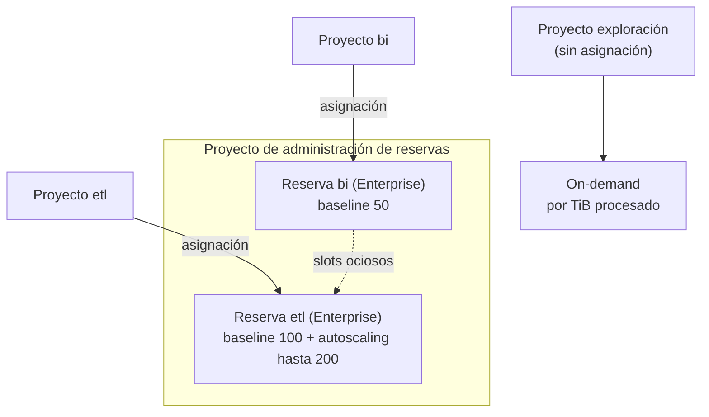

## 1. Resumen

Toda consulta de BigQuery usa **slots**, unidades virtuales de cómputo. BigQuery decide cuántos usa cada consulta; no se fija a mano. Lo que sí se elige es **cómo se paga ese cómputo**:

- **On-demand:** por TiB procesado por consulta. Es el modelo por defecto.
- **Capacidad:** por slot-hora, con una **edición** (Standard, Enterprise o Enterprise Plus) y **reservas**. Una reserva tiene una base fija (*baseline*) y puede crecer con *autoscaling*.

Las ediciones difieren en capacidades y en límites. Al 2026-10-11, por ejemplo, Standard solo admite autoscaling, hasta 1.600 slots por reserva, y no tiene compromisos. Los precios cambian y dependen de la región, así que se consultan en la página de precios; esta ficha no los copia.

## 2. Qué es

- **Slot:** unidad virtual de cómputo (CPU, memoria, E/S) que ejecuta las tareas de una consulta.
- **On-demand:**
  - se paga por TiB procesado;
  - cada proyecto tiene un límite de slots concurrentes, con ráfagas transitorias.
- **Capacidad:** se paga la capacidad asignada en el tiempo, por slot-hora.
- **Reserva:** un grupo de slots de una edición, con dos partes:
  - **baseline:** siempre asignado;
  - **autoscaling:** hasta un máximo, en múltiplos de 50. Se cobran los slots escalados, no los usados.
- **Asignación:** qué proyectos, carpetas u organización usan una reserva. En Standard, solo proyectos.
- **Compromiso:** compra de slots por 1 o 3 años con descuento. Solo en Enterprise y Enterprise Plus, según la tabla de ediciones.
- **Slots ociosos:**
  - baseline o compromisos que no se están usando;
  - por defecto, otras reservas del mismo proyecto de administración pueden usarlos;
  - no aplica a los slots autoescalados.
- **Fair scheduling:** reparte los slots disponibles por igual entre proyectos y luego entre jobs. La equidad es eventual: por momentos, un job puede tener más de lo justo.

## 3. Problema que resuelve

Sin elegir el modelo de cómputo, dos riesgos son habituales:

- consultas que procesan muchos TiB en on-demand, con un costo variable e imprevisible;
- reservas sobredimensionadas que se pagan sin usarse.

Entender los slots permite tres cosas:

- elegir on-demand o capacidad según la carga;
- separar cargas críticas en sus propias reservas;
- limitar el gasto con un máximo de autoscaling.

## 4. Cómo funciona

1. Cada consulta se divide en etapas y tareas. Los slots ejecutan las tareas en paralelo (ver `bigquery-query-optimization`).
2. En on-demand, el proyecto usa slots hasta su límite y paga por los TiB procesados.
3. En capacidad, el proyecto asignado a una reserva usa su baseline. Si necesita más, el autoscaling sube en múltiplos de 50 hasta el máximo, y baja cuando no hace falta.
4. Si una reserva no usa su baseline, otras pueden usarlo como slots ociosos, salvo que se configure `ignore_idle_slots`.
5. Dentro de una reserva, fair scheduling reparte los slots entre proyectos y jobs activos.
6. Un proyecto sin asignación usa on-demand. La documentación avisa que los proyectos nuevos o sin asignar caen en on-demand si no se gestionan las asignaciones con la jerarquía de recursos.

## 5. Cuándo utilizarlo

- **On-demand:** cargas pequeñas o irregulares, exploración, o cuando los TiB procesados son bajos.
- **Capacidad con autoscaling:** cargas grandes o predecibles, o cuando conviene un tope de gasto.
- **Baseline y compromisos:** consumo estable y alto, todo el mes.
- **Reservas separadas:** aislar la carga crítica (ETL nocturno) de la exploración.

## 6. Cuándo no utilizarlo

- No pasar a capacidad sin datos: comparar primero los TiB procesados y las slot-horas reales de un mes.
- No comprar compromisos para una carga que todavía cambia.
- No usar slots para tapar consultas mal escritas: optimizarlas reduce slots y costo (ver `bigquery-query-optimization`).

## 7. Ejemplo sencillo

Un equipo procesa 40 TiB al mes y su reserva tendría 9.000 slot-horas asignadas. Con los precios de su región aplicados a cada modelo, compara los dos costos y elige el menor. Con precios ilustrativos, en el script de §10 on-demand sale más barato. Con 900 TiB y 60.000 slot-horas, sale más barata la capacidad.

## 8. Ejemplo de producción

Una empresa separa dos cargas:

- **ETL:** una reserva Enterprise con 100 slots de baseline y autoscaling de hasta 200 más, asignada al proyecto de ETL.
- **Exploración:** se queda en on-demand, en otro proyecto.

La reserva de ETL usa slots ociosos de otras reservas cuando están libres. En el cierre de mes, el autoscaling sube hasta 300 slots y vuelve a bajar. El equipo revisa cada mes las slot-horas asignadas frente a las usadas para ajustar el baseline. Antes de crear proyectos nuevos, asigna la reserva a la carpeta, para que no caigan en on-demand por defecto.

## 9. Arquitectura



## 10. Código

```hcl
# Terraform (validado en la CI con terraform validate, sin credenciales; no se aplicó): una reserva de edición
# Enterprise con baseline y autoscaling, y la asignación del proyecto de ETL a esa reserva.
# Requiere: provider hashicorp/google; un proyecto de administración de reservas.
terraform {
  required_providers {
    google = {
      source  = "hashicorp/google"
      version = "~> 8.0"
    }
  }
}

variable "admin_project_id" {
  type = string
}

variable "etl_project_id" {
  type = string
}

resource "google_bigquery_reservation" "etl" {
  project           = var.admin_project_id
  name              = "etl"
  location          = "US"
  edition           = "ENTERPRISE"
  slot_capacity     = 100   # baseline: siempre asignados (y facturados)
  ignore_idle_slots = false # puede usar slots ociosos de otras reservas
  autoscale {
    max_slots = 200 # hasta 300 en total (baseline + autoscaling), en múltiplos de 50
  }
}

resource "google_bigquery_reservation_assignment" "etl" {
  project     = var.admin_project_id
  location    = "US"
  reservation = google_bigquery_reservation.etl.id
  assignee    = "projects/${var.etl_project_id}"
  job_type    = "QUERY"
}
```

```python
# Python 3.12, solo biblioteca estándar (ejecutado; mypy --strict sin errores): comparar on-demand (por TiB procesado)
# con capacidad (por slot-hora) para una carga. Los precios son parámetros: los valores del ejemplo son ilustrativos,
# no los de la página de precios; usar los vigentes de la página de precios de BigQuery para la región y edición.
from dataclasses import dataclass


@dataclass(frozen=True)
class Carga:
    tib_procesados_mes: float          # bytes facturados por las consultas, en TiB
    slot_horas_asignadas_mes: float    # baseline de todo el mes + slots autoescalados: se pagan los escalados, no los usados


def costo_on_demand(carga: Carga, precio_tib: float) -> float:
    return carga.tib_procesados_mes * precio_tib


def costo_capacidad(carga: Carga, precio_slot_hora: float) -> float:
    return carga.slot_horas_asignadas_mes * precio_slot_hora


def recomendar(carga: Carga, precio_tib: float, precio_slot_hora: float) -> str:
    od, cap = costo_on_demand(carga, precio_tib), costo_capacidad(carga, precio_slot_hora)
    mejor = "capacidad" if cap < od else "on-demand"
    return f"on-demand {od:,.0f}; capacidad {cap:,.0f} -> {mejor}"


PRECIO_TIB, PRECIO_SLOT_HORA = 6.0, 0.05   # ILUSTRATIVOS: reemplazar por los de la página de precios
print(recomendar(Carga(tib_procesados_mes=40, slot_horas_asignadas_mes=9_000), PRECIO_TIB, PRECIO_SLOT_HORA))
# on-demand 240; capacidad 450 -> on-demand
print(recomendar(Carga(tib_procesados_mes=900, slot_horas_asignadas_mes=60_000), PRECIO_TIB, PRECIO_SLOT_HORA))
# on-demand 5,400; capacidad 3,000 -> capacidad
```

El bloque de Terraform se valida en la CI con `terraform validate`, sin credenciales (`make validate-terraform`), y **no se aplicó**. Sigue el ejemplo de `google_bigquery_reservation` de la página *Manage workload reservations*.

El script en Python 3.12, solo con biblioteca estándar, está ejecutado y pasa `mypy --strict` sin errores. Los precios del ejemplo son **ilustrativos**: hay que reemplazarlos por los de la página de precios para la región y la edición. Las slot-horas de capacidad son las **asignadas**: el baseline de todo el mes más lo autoescalado, porque se cobran los slots escalados, no los usados.

## 11. GCP

**BigQuery.** Diferencias entre ediciones según la tabla de *Understand BigQuery editions*, consultada el 2026-10-11:

| | Standard | Enterprise | Enterprise Plus | On-demand |
| --- | --- | --- | --- | --- |
| Cobro | slot-hora (mínimo 1 minuto por defecto; *fluid scaling* opcional, sin mínimo) | slot-hora (mínimo 1 minuto por defecto; *fluid scaling* opcional, sin mínimo) | slot-hora (mínimo 1 minuto por defecto; *fluid scaling* opcional, sin mínimo) | por consulta (TiB), con nivel gratuito |
| SLO mensual | ≥99,9 % | ≥99,99 % | ≥99,99 % | ≥99,99 % |
| Cómputo | autoscaling | autoscaling + baseline | autoscaling + baseline | on-demand |
| Máximo por reserva | 1.600 slots | cuota | cuota | cuota |
| Reservas por proyecto de administración | 10 (hasta 16.000 slots por organización) | 200 | 200 | sin acceso a reservas |
| Compromisos | no | 1 año (20 %) o 3 años (40 %) | 1 año (20 %) o 3 años (40 %) | no |
| Idle sharing y target concurrency | no | sí | sí | no |
| BI Engine | no | sí | sí | sí |
| Recuperación ante desastres administrada | no | no | sí | no |

Los montos por slot-hora y por TiB están en la página de precios, por región.

## 12. AWS

No aplica de forma específica: el modelo de slots y ediciones es de BigQuery. La comparación de modelos de cómputo entre warehouses está en `cloud-warehouse-optimization`.

## 13. Azure

No aplica de forma específica (ver §12).

## 14. Buenas prácticas

- Medir un mes de TiB procesados y slot-horas antes de elegir el modelo.
- Autoscaling con un máximo como tope de gasto; baseline solo para el consumo estable.
- Reservas separadas para cargas con prioridades distintas.
- Asignar reservas a carpetas u organización, para que los proyectos nuevos no caigan en on-demand.
- Revisar la tabla de ediciones antes de elegir: algunas capacidades solo existen en Enterprise o Enterprise Plus.
- **Seguridad:** quien administra reservas y asignaciones decide cuánto puede gastar cada proyecto; ese permiso se limita al equipo de plataforma.
- **Observabilidad:** comparar slot-horas asignadas con usadas, y vigilar consultas que esperan slots (contención) en las insights de la consulta.
- **Costo:** en capacidad se pagan los slots asignados, no los usados; un baseline alto y ocioso es gasto sin uso, y el autoscaling sube en múltiplos de 50.

## 15. Errores frecuentes

- Pensar que se puede fijar cuántos slots usa una consulta.
- Comparar on-demand con capacidad usando slots usados en lugar de asignados.
- Crear proyectos nuevos sin asignación y pagar on-demand sin querer.
- Elegir Standard y descubrir después que no admite compromisos ni baseline.
- Copiar precios a la documentación interna y no actualizarlos.

## 16. Trade-offs

On-demand no requiere planificar y escala con el uso, pero su costo es variable y depende de los bytes procesados. Capacidad da un costo predecible y un tope, a cambio de dimensionar y pagar lo asignado aunque no se use. Los compromisos bajan el precio pero atan por 1 o 3 años. Las ediciones superiores suman capacidades y SLO a un precio mayor.

## 17. Conceptos relacionados

- `bigquery-cost-model`: el costo total, con almacenamiento.
- `bigquery-architecture`: la capa de cómputo.
- `bigquery-query-optimization`: menos slots por consulta.
- `cloud-warehouse-optimization`: comparación entre warehouses.
- `finops-for-data`: atribuir y controlar el consumo (dominio 22).

## 18. Preguntas técnicas abiertas

1. ¿Cuántos TiB procesa tu organización por mes, y cuántas slot-horas usaría?
2. ¿Qué carga merece una reserva propia?
3. ¿Qué capacidad de Enterprise o Enterprise Plus necesitas de verdad?

## 19. Laboratorio relacionado

Pendiente (F4).

## 20. Fuentes

- Google Cloud, BigQuery: *Understand slots*, *Understand BigQuery editions*, *Manage workload reservations*, *Query plan and timeline*, *Get query performance insights* y *BigQuery pricing*.

El detalle de cada fuente está en `sources` del frontmatter.

## 21. Fecha de última verificación

2026-10-11. Pasa a `verified`: revisión B-F3.1 del lote F3b-08a aplicada, sin VERIFY pendientes.

## 22. Historial de cambios importantes

- 2026-10-11: creación (lote F3b-08a).
- 2026-10-11: revisión B-F3.1 del lote F3b-08a aplicada (docs/reviews/cards-f3b-08a.md): en la tabla de ediciones, on-demand dice cuota en «Máximo por reserva» y «sin acceso a reservas» va en su propia fila (reservas por proyecto de administración); el mínimo de 1 minuto por defecto, con fluid scaling opcional, aplica a las tres ediciones, como en *Understand BigQuery editions* (2026-10-11).
- 2026-10-11: revisión B-F3.1 del lote F3b-08a aplicada (docs/reviews/cards-f3b-08a.md), regla del §17: relations incluye `cloud-warehouse-optimization`, que el §17 nombra.
- 2026-10-11: `verification_status: verified` (sin VERIFY pendientes).
- 2026-10-13: `page_title` en cada cita, con el título de la página citada (ADR-012); sin cambios de contenido.
- 2026-10-26: §17 y `relations` enlazan `finops-for-data`, creada en el lote F3b-22a (regla del §17); sin otros cambios.
