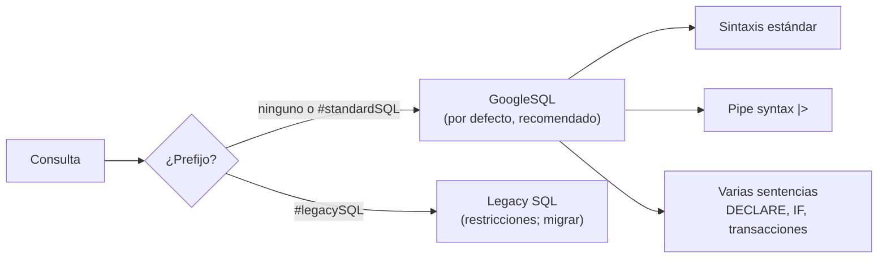

## 1. Resumen

BigQuery tiene dos dialectos:

- **GoogleSQL:** el recomendado para proyectos nuevos y el de por defecto. Cumple SQL 2011 y tiene extensiones para datos anidados y repetidos.
- **Legacy SQL:** se mantiene con restricciones, y la documentación recomienda migrar desde él.

Esta ficha trata lo propio de GoogleSQL, lo que cambia respecto de otros motores:

- nombres con backticks y punto;
- `SELECT * EXCEPT` y `REPLACE`;
- el prefijo `SAFE.` y `SAFE_DIVIDE`;
- los tipos `ARRAY` y `STRUCT`;
- `QUALIFY`;
- consultas de varias sentencias con lenguaje procedural;
- la **sintaxis de pipes** (`|>`).

Los conceptos SQL generales están en el dominio 02 (`sql-qualify`, `sql-unnest`, `sql-structs`, `sql-arrays`).

## 2. Qué es

- **Nombres:** `` `proyecto.dataset.tabla` ``, con backticks y solo puntos. Legacy SQL usaba corchetes y dos puntos.
- **`SELECT * EXCEPT (col)`:** todas las columnas salvo las nombradas.
- **`SELECT * REPLACE (expr AS col)`:** reemplaza el valor de una columna sin cambiar el orden ni los nombres.
- **`SAFE.`:** con ese prefijo, una función devuelve `NULL` en vez de un error causado por el valor de sus entradas. No vale para operadores ni para `CAST`; para dividir está `SAFE_DIVIDE`.
- **`ARRAY` y `STRUCT`:** tipos para datos repetidos y anidados. Un campo `REPEATED` de legacy SQL equivale a un `ARRAY`.
- **`QUALIFY`:** filtra por el resultado de funciones de ventana.
- **Lenguaje procedural:** varias sentencias en una consulta, con variables, `IF` y `WHILE`.
- **Pipe syntax:**
  - cada operador `|>` recibe el resultado anterior, y se puede empezar con `FROM`;
  - es una extensión con las mismas operaciones que la sintaxis estándar, y se pueden mezclar.

## 3. Problema que resuelve

Quien viene de otro motor escribe SQL que en BigQuery falla o cuesta de más: nombres con dos puntos de legacy SQL, divisiones que abortan la consulta por un cero, subconsultas para quedarse con la última versión de cada fila. Conocer el dialecto evita esos errores y aprovecha atajos que existen solo aquí.

## 4. Cómo funciona

1. El dialecto por defecto es GoogleSQL. Para forzar uno, se pone `#standardSQL` o `#legacySQL` en la primera línea de la consulta.
2. GoogleSQL resuelve los nombres como `proyecto.dataset.tabla` entre backticks.
3. Las funciones con `SAFE.` devuelven `NULL` ante entradas inválidas. La consulta sigue, y conviene contar esos `NULL` para no esconder datos malos.
4. Una consulta de varias sentencias comparte variables declaradas con `DECLARE`. Allí van también las transacciones (ver `bigquery-incremental-models`).
5. Los operadores de pipe se encadenan de arriba abajo. Cada uno ve todos los alias de la tabla anterior.

## 5. Cuándo utilizarlo

- Siempre GoogleSQL en consultas, vistas y modelos nuevos.
- `SAFE.` y `SAFE_DIVIDE` donde un dato inválido no debe abortar el lote, siempre midiendo cuántos `NULL` produce.
- `EXCEPT` para excluir columnas sensibles o pesadas sin listar todas las demás.
- Pipe syntax para transformaciones largas que se leen mejor de arriba abajo.

## 6. Cuándo no utilizarlo

- No escribir código nuevo en legacy SQL.
- No usar `SAFE.` para esconder errores que deberían detener el pipeline: un `NULL` silencioso es un dato perdido.
- No depender de `SELECT * EXCEPT` en modelos de producción si las columnas nuevas de la fuente no deberían propagarse sin revisión.

## 7. Ejemplo sencillo

`SELECT * EXCEPT (cliente_email) FROM ventas.pedidos` entrega todas las columnas menos el correo. `SAFE_DIVIDE(monto, unidades)` devuelve `NULL` donde `unidades` es 0, en vez de abortar la consulta.

## 8. Ejemplo de producción

Un modelo diario toma los pedidos del día y hace cuatro cosas:

1. Excluye el correo del cliente con `EXCEPT`.
2. Redondea el monto con `REPLACE`.
3. Calcula el precio unitario con `SAFE_DIVIDE` y parsea una fecha de texto con `SAFE.PARSE_DATE`.
4. Se queda con la última versión de cada pedido con `QUALIFY`.

Una prueba de calidad cuenta las filas con `fecha` en `NULL`: si superan el 1 %, el modelo falla y no publica (ver `sql-quality-checks`). Para el reporte, el equipo escribe la agregación con pipe syntax, que se revisa paso a paso.

## 9. Arquitectura



## 10. Código

```sql
-- BigQuery, GoogleSQL (no ejecutado: requiere un proyecto de GCP; la sintaxis sigue la referencia de GoogleSQL).
-- Rasgos propios del dialecto en una consulta: nombres con backticks y punto, SELECT * EXCEPT y REPLACE,
-- SAFE_DIVIDE y el prefijo SAFE., QUALIFY y, al final, la misma consulta en sintaxis de pipes.
SELECT * EXCEPT (cliente_email) REPLACE (ROUND(monto, 2) AS monto),
       SAFE_DIVIDE(monto, unidades) AS precio_unitario,          -- NULL en vez de error si unidades = 0
       SAFE.PARSE_DATE('%Y-%m-%d', fecha_texto) AS fecha         -- NULL si el texto no es una fecha
FROM `mi-proyecto.ventas.pedidos`
WHERE DATE(creado_en) = '2026-10-10'
QUALIFY ROW_NUMBER() OVER (PARTITION BY pedido_id ORDER BY actualizado_en DESC) = 1;   -- última versión de cada pedido

-- Pipe syntax: se lee de arriba abajo, cada |> recibe el resultado anterior.
FROM `mi-proyecto.ventas.pedidos`
|> WHERE DATE(creado_en) = '2026-10-10'
|> AGGREGATE SUM(monto) AS monto, COUNT(*) AS pedidos GROUP BY tienda_id
|> ORDER BY monto DESC;
```

Este bloque es GoogleSQL y **no se ejecutó**: requiere un proyecto de GCP. La sintaxis sigue las páginas de referencia de la ficha: *Query syntax*, *Function calls* y *Pipe query syntax*. Las tablas son de ejemplo.

## 11. GCP

**BigQuery.** GoogleSQL es su dialecto recomendado y el de por defecto. Legacy SQL sigue disponible con restricciones, y la documentación recomienda migrar, aunque no es obligatorio para algunas consultas existentes.

## 12. AWS

No aplica de forma específica: cada warehouse tiene su dialecto. Las diferencias entre motores de construcciones como `QUALIFY` o `MERGE` están en las fichas del dominio 02, atribuidas por motor.

## 13. Azure

No aplica de forma específica (ver §12).

## 14. Buenas prácticas

- GoogleSQL en todo lo nuevo; migrar legacy SQL cuando se toque esa consulta.
- Nombres completos con backticks en código que corre en otros proyectos.
- `SAFE.` acompañado de una métrica de cuántos `NULL` produce.
- Listar columnas explícitas en modelos de producción; `EXCEPT` en exploración o para quitar columnas sensibles.
- **Seguridad:** `EXCEPT` no es control de acceso: una columna sensible se protege con permisos o políticas, no omitiéndola en una consulta (ver `bigquery-security`).
- **Observabilidad:** contar los `NULL` que producen `SAFE.` y `SAFE_DIVIDE` y alertar si suben.
- **Costo:** `EXCEPT` también reduce los bytes leídos, porque el formato es columnar; `LIMIT` no los reduce (ver `bigquery-query-optimization`).

## 15. Errores frecuentes

- Mezclar nombres de legacy SQL (`proyecto:dataset.tabla`) en GoogleSQL.
- Usar `SAFE.` y no medir cuántos datos se perdieron.
- Esperar que `SAFE.CAST` funcione: `CAST` no admite el prefijo; para eso está `SAFE_CAST`.
- Creer que la pipe syntax hace algo distinto: son las mismas operaciones, con otra forma de escribirlas.

## 16. Trade-offs

Las extensiones de GoogleSQL hacen las consultas más cortas y robustas. A cambio, atan el código a BigQuery: `EXCEPT`, `REPLACE`, `SAFE.` o la pipe syntax no existen igual en otros motores. La pipe syntax mejora la lectura de transformaciones largas, pero el equipo y sus herramientas tienen que conocerla.

## 17. Conceptos relacionados

- `sql-qualify`, `sql-unnest`, `sql-structs` y `sql-arrays`: construcciones SQL con su detalle por motor.
- `bigquery-architecture`: el motor que ejecuta este SQL.
- `bigquery-query-optimization`: escribir SQL que lea menos.
- `bigquery-incremental-models`: consultas de varias sentencias y transacciones.
- `sql-quality-checks`: medir los `NULL` que deja `SAFE.`.

## 18. Preguntas técnicas abiertas

1. ¿Qué consultas de tu equipo siguen en legacy SQL?
2. ¿Dónde usarías `SAFE.` y qué umbral de `NULL` aceptarías?
3. ¿Qué transformación larga se leería mejor con pipe syntax?

## 19. Laboratorio relacionado

Pendiente (F4).

## 20. Fuentes

- Google Cloud, BigQuery: *Introduction to SQL in BigQuery* y *Migrating to GoogleSQL*.
- Referencia de GoogleSQL: *Query syntax*, *Function calls*, *Pipe query syntax* y *Procedural language*.

El detalle de cada fuente está en `sources` del frontmatter.

## 21. Fecha de última verificación

2026-10-11. Pasa a `verified`: revisión B-F3.1 del lote F3b-08a aplicada, sin VERIFY pendientes.

## 22. Historial de cambios importantes

- 2026-10-11: creación (lote F3b-08a).
- 2026-10-11: revisión B-F3.1 del lote F3b-08a aplicada (docs/reviews/cards-f3b-08a.md), regla del §17: relations incluye `bigquery-query-optimization`, `bigquery-incremental-models`, `sql-quality-checks`, que el §17 nombra.
- 2026-10-11: `verification_status: verified` (sin VERIFY pendientes).
- 2026-10-13: `page_title` en cada cita, con el título de la página citada (ADR-012); sin cambios de contenido.
