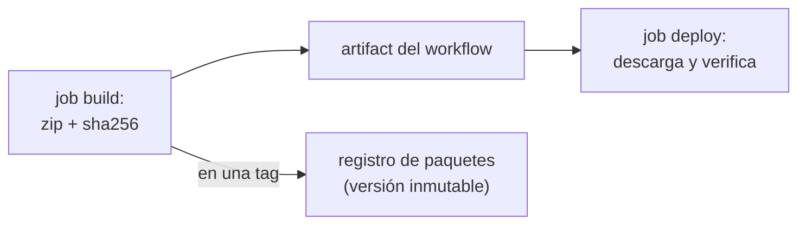

## 1. Resumen

Un **artifact** es lo que produce un build y se usa después: un paquete, una imagen, un reporte. GitHub Docs lo define como «a file or collection of files produced during a workflow run». Hay dos niveles:

- **artifacts del pipeline:** viven con la corrida y pasan de un job a otro (GitHub Actions, job artifacts de GitLab, pipeline artifacts de Azure);
- **registros de paquetes:** guardan versiones para consumirlas o desplegarlas (Artifact Registry, CodeArtifact, Azure Artifacts).

GitLab lo dice directo: «Do not use job artifacts as a release store»; para publicar, un paquete versionado. Y en Azure Artifacts una versión publicada es inmutable.

## 2. Qué es

- **Artifact de workflow (GitHub):** se sube con `upload-artifact` y se baja con `download-artifact` en otro job del mismo workflow.
- **Caché (GitHub):** para dependencias que cambian poco; distinto del artifact, y un job debe poder regenerarla si falta.
- **Job artifact (GitLab):** los stages siguientes reciben una copia; `expire_in` fija cuánto se guarda.
- **Pipeline artifact (Azure):** se publica en un stage y se descarga en otro o en otro pipeline.
- **Registro de paquetes:** Artifact Registry (GCP), CodeArtifact (AWS), Azure Artifacts.

## 3. Problema que resuelve

Si cada job reconstruye el paquete, lo que se prueba y lo que se despliega pueden ser distintos: otra versión de una dependencia, otro momento. La regla es construir una vez y mover ese archivo: el job de despliegue usa el mismo artifact que salió del build, verificado.

## 4. Cómo funciona

1. El job de build empaqueta el código y calcula su hash.
2. Sube el paquete y el hash como artifact.
3. El job de despliegue (con `needs: build`) descarga el artifact.
4. Verifica el hash antes de usarlo.
5. Para publicar una versión, el paquete va a un registro con versión propia, no a los artifacts del pipeline.

## 5. Cuándo utilizarlo

- Artifacts del pipeline para pasar el resultado del build a los jobs de test y despliegue.
- Registro de paquetes para versiones que otros consumen (una librería de conectores) o que se despliegan más de una vez.
- Reportes de tests y logs que hay que ver después de la corrida.

## 6. Cuándo no utilizarlo

- Artifacts del pipeline como almacén de releases: GitLab lo desaconseja.
- La caché para el resultado del build: no está garantizada.
- Republicar la misma versión de un paquete: en Azure Artifacts falla, porque las versiones son inmutables.

## 7. Ejemplo sencillo

El job de build empaqueta `src/` en `pipeline-<sha>.zip` con su `.sha256`. El job de despliegue lo descarga, verifica el hash y despliega ese archivo.

## 8. Ejemplo de producción

Una librería de conectores:

- cada pull request construye el paquete y lo pasa como artifact a los tests;
- cada tag de versión publica el paquete en el registro (Artifact Registry o CodeArtifact) con esa versión;
- los entornos instalan siempre desde el registro, por versión;
- el build es reproducible: el mismo commit produce el mismo hash, y se puede comprobar.

## 9. Arquitectura



## 10. Código

```python
# Python 3.12, solo biblioteca estándar (ejecutado en la CI; mypy --strict sin errores): empaqueta un directorio en un
# zip reproducible (orden fijo y fecha fija) y escribe su SHA-256. Construir dos veces el mismo código da el mismo
# hash; el job de despliegue verifica el hash antes de usar el artifact.
from __future__ import annotations

import hashlib
import sys
import zipfile
from pathlib import Path

FIXED_DATE = (1980, 1, 1, 0, 0, 0)  # la fecha mínima de ZIP: no depende de cuándo se construyó


def build(src: Path, out: Path) -> str:
    out.parent.mkdir(parents=True, exist_ok=True)
    with zipfile.ZipFile(out, "w", compression=zipfile.ZIP_DEFLATED) as zf:
        for path in sorted(p for p in src.rglob("*") if p.is_file()):
            info = zipfile.ZipInfo(path.relative_to(src).as_posix(), date_time=FIXED_DATE)
            info.external_attr = 0o644 << 16
            zf.writestr(info, path.read_bytes(), compress_type=zipfile.ZIP_DEFLATED)
    digest = hashlib.sha256(out.read_bytes()).hexdigest()
    out.with_name(out.name + ".sha256").write_text(f"{digest}  {out.name}\n", encoding="utf-8")
    return digest


def verify(artifact: Path) -> bool:
    expected = artifact.with_name(artifact.name + ".sha256").read_text(encoding="utf-8").split()[0]
    return hashlib.sha256(artifact.read_bytes()).hexdigest() == expected


if __name__ == "__main__":
    if sys.argv[1] == "build":
        print(build(Path(sys.argv[2]), Path(sys.argv[3])))
    else:
        sys.exit(0 if verify(Path(sys.argv[2])) else 1)
```

```yaml
# GitHub Actions (.github/workflows/build.yml; validado con actionlint en la CI, no ejecutado): un job construye el
# paquete una vez y lo sube como artifact; el job de despliegue lo descarga, verifica el hash y usa ese mismo archivo.
name: build

on:
  push:
    branches: [main]

permissions:
  contents: read

jobs:
  build:
    runs-on: ubuntu-24.04
    steps:
      - uses: actions/checkout@v7
      - uses: actions/setup-python@v7
        with:
          python-version: "3.12"
      - run: python package.py build src dist/pipeline-${{ github.sha }}.zip
      - uses: actions/upload-artifact@v7
        with:
          name: pipeline
          path: dist/

  deploy:
    needs: build
    runs-on: ubuntu-24.04
    steps:
      - uses: actions/checkout@v7
      - uses: actions/download-artifact@v8
        with:
          name: pipeline
          path: dist/
      - run: python package.py verify dist/pipeline-${{ github.sha }}.zip
      - run: echo "desplegar dist/pipeline-${{ github.sha }}.zip"
```

El script de Python se **ejecuta en la CI** y pasa `mypy --strict`. El test construye dos veces el mismo directorio, cambiando las fechas de los archivos, y comprueba que el hash es el mismo y que `verify` rechaza un archivo alterado. Usa la fecha fija `(1980, 1, 1, 0, 0, 0)`, el valor por defecto de `ZipInfo` según la documentación de `zipfile`. El workflow se **valida con actionlint en la CI** (ADR-014) **y no se ejecutó**.

## 11. GCP

En GCP, **Cloud Build** guarda lo que construye en **Artifact Registry**. Las diferencias, según sus páginas:

| | GitHub Actions | Cloud Build y Artifact Registry |
|---|---|---|
| Pasar entre jobs | Artifact del workflow (`upload-artifact` / `download-artifact`) | Las páginas citadas no lo tratan entre builds |
| Registro | Las páginas citadas de GitHub no lo tratan | Artifact Registry: paquetes e imágenes, integrado con el despliegue en GKE, Cloud Run y Compute Engine |
| Permisos | `GITHUB_TOKEN` del workflow | Rol Artifact Registry Writer para la cuenta del build si está en otro proyecto |

## 12. AWS

En AWS, **CodeBuild** produce artifacts y **CodeArtifact** guarda paquetes. Las diferencias, según sus páginas:

| | GitHub Actions | AWS CodeBuild y CodeArtifact |
|---|---|---|
| Producir | Job de build con `upload-artifact` | CodeBuild compila, prueba y produce artifacts listos para desplegar |
| Registro | Las páginas citadas de GitHub no lo tratan | CodeArtifact, compatible con pip, twine, Maven, Gradle y npm |

## 13. Azure

En **Azure Pipelines**, los pipeline artifacts se publican (`publish`) y se descargan en otros stages o pipelines (*Publish and download pipeline artifacts*). Los paquetes de **Azure Artifacts** son inmutables: al publicar una versión queda reservada, y re-ejecutar un job que la publica falla si ya existe.

## 14. Buenas prácticas

- Construir una vez y desplegar el mismo archivo.
- Hash del artifact, verificado antes de usarlo.
- Builds reproducibles: orden y fechas fijas al empaquetar.
- Versiones en un registro, no en los artifacts del pipeline.
- **Seguridad:** verificar el hash evita desplegar un archivo alterado; permisos de escritura al registro solo para el pipeline de release.
- **Observabilidad:** nombrar el artifact con el commit (`${{ github.sha }}`) dice de dónde salió.
- **Costo:** los artifacts y registros cobran almacenamiento; expirar lo que no se usa (`expire_in` en GitLab).

## 15. Errores frecuentes

- Reconstruir el paquete en el job de despliegue.
- Guardar el resultado del build en la caché.
- Publicar la misma versión dos veces.
- Zips con la fecha de construcción: el mismo código da hashes distintos.

## 16. Trade-offs

Pasar artifacts entre jobs asegura que se despliega lo que se probó, a cambio de subir y bajar archivos en cada corrida. Un registro de paquetes da versiones estables y consumibles, con un servicio más que mantener y pagar. Un build reproducible requiere cuidar orden, fechas y dependencias fijas, y permite comprobar que nadie cambió el paquete.

## 17. Conceptos relacionados

- `ci-cd-pipelines`: el pipeline que construye.
- `git-tags-and-releases`: la versión que se publica.
- `automated-testing-in-ci`: el reporte de tests como artifact.
- `idempotency`: el mismo código da el mismo paquete.

## 18. Preguntas técnicas abiertas

1. ¿Lo que despliegas es exactamente lo que probaste? ¿Cómo lo sabes?
2. ¿Dónde guardas hoy las versiones de tus librerías internas?
3. ¿Tu build da el mismo hash dos veces seguidas?

## 19. Laboratorio relacionado

Pendiente (F4).

## 20. Fuentes

- GitHub Docs: *Workflow artifacts*. GitLab Docs: *Job artifacts*. Microsoft Learn: *Publish and download pipeline artifacts*.
- Google Cloud: *Artifact Registry overview* y *Store artifacts in Artifact Registry*.
- AWS: *What is AWS CodeArtifact?* y *What is AWS CodeBuild?*. Python: *zipfile — Work with ZIP archives*.

El detalle de cada fuente está en `sources` del frontmatter.

## 21. Fecha de última verificación

2026-10-14. `review_required`: pendiente de revisión B-F3.1 del lote F3b-11a.

## 22. Historial de cambios importantes

- 2026-10-14: creación (lote F3b-11a).
