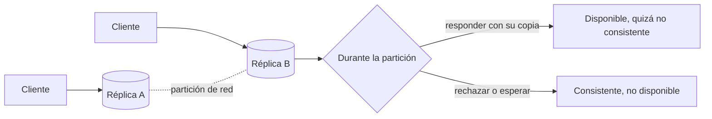

## 1. Resumen

El teorema CAP dice que, **cuando la red se parte**, un sistema distribuido que replica datos tiene que elegir entre:

- **consistencia:** toda lectura ve la última escritura;
- **disponibilidad:** toda solicitud que recibe un nodo que no ha fallado obtiene respuesta.

No puede garantizar las dos a la vez. Brewer lo planteó como conjetura en 2000, y Gilbert y Lynch lo formalizaron y probaron en 2002. En la práctica no se trata de "elegir dos de tres" en todo momento: la tolerancia a particiones no es opcional en una red real, y la decisión importa durante una partición. Fuera de ellas, el equilibrio que más pesa es entre consistencia y latencia (PACELC).

## 2. Qué es

Es un resultado teórico consolidado de la computación distribuida. En la formulación de Gilbert y Lynch:

- **Consistencia (C):** el servicio se comporta como una memoria atómica de lectura y escritura; cada operación parece ocurrir en un instante único, como si hubiera un solo servidor.
- **Disponibilidad (A):** toda solicitud recibida por un nodo que no ha fallado debe obtener una respuesta; el algoritmo debe terminar, aunque sin cota de tiempo.
- **Tolerancia a particiones (P):** la comunicación entre servidores puede fallar, con mensajes demorados o perdidos.

**El teorema (Teorema 1 de Gilbert y Lynch):** en el modelo de red asíncrona es imposible implementar un objeto de lectura y escritura que garantice disponibilidad y consistencia atómica en todas las ejecuciones justas, incluidas aquellas en que se pierden mensajes. El Teorema 2 extiende el resultado al modelo parcialmente síncrono.

La C de CAP no es la C de ACID: en ACID, consistencia significa respetar las reglas de integridad de la base.

## 3. Problema que resuelve

Da un marco para entender por qué las bases distribuidas ofrecen distintos niveles de consistencia, y evita expectativas imposibles, como un sistema replicado entre regiones que responda siempre, siempre con el último dato y aun con la red cortada. También ayuda a leer con criterio las afirmaciones de los productos sobre sus garantías.

## 4. Cómo funciona

1. Dos réplicas A y B guardan el mismo dato.
2. La red entre ellas se corta (partición).
3. Llega una escritura a A, que no puede avisarle a B.
4. Llega una lectura a B. B tiene dos opciones:
   - **responder** con lo que tiene, que puede estar atrasado: disponible, no consistente;
   - **no responder** (o fallar) hasta poder comunicarse: consistente, no disponible.
5. Cuando la red se recupera, las réplicas se reconcilian.

En la prueba, como B no puede distinguir si hubo o no una escritura en A, cualquier respuesta que dé puede ser incorrecta. En una red asíncrona, una demora larga es indistinguible de una partición.

## 5. Cuándo utilizarlo

Este razonamiento sirve al:

- elegir una base distribuida o replicada entre regiones, y su nivel de consistencia;
- diseñar qué hace una aplicación cuando una dependencia remota no responde;
- evaluar afirmaciones del tipo "consistencia fuerte y alta disponibilidad global".

## 6. Cuándo no utilizarlo

- Para clasificar productos con etiquetas fijas "CP" o "AP": muchos sistemas permiten elegir el comportamiento por operación o por configuración.
- Para un sistema en un solo nodo, sin replicación: no aplica.
- Como única guía de diseño: fuera de las particiones, la latencia y el costo de la consistencia (PACELC) suelen pesar más en el día a día.

## 7. Ejemplo sencillo

Un inventario replicado en dos regiones pierde la conexión entre ellas. Si la segunda región sigue vendiendo con su copia, está disponible, pero puede vender stock que ya no existe. Si deja de vender hasta recuperar la conexión, es consistente, pero no está disponible.

## 8. Ejemplo de producción

Un equipo usa una base distribuida global para el carrito de compras y elige un nivel de consistencia de sesión: cada cliente ve sus propios cambios aunque otras réplicas vayan atrasadas. Para el stock, que no admite ventas de más, usa consistencia fuerte en las operaciones de reserva y acepta la mayor latencia. La política depende de qué cuesta más en cada caso: una lectura atrasada o una solicitud rechazada.

## 9. Arquitectura



## 10. Código

```python
# Python 3.12, solo biblioteca estándar: simulación didáctica de CAP con dos réplicas.
# Durante una partición, cada réplica debe elegir entre responder (disponible, quizá con un valor viejo)
# o rechazar (consistente, no disponible). No es un sistema real: ilustra la decisión.
from dataclasses import dataclass, field


class Unavailable(Exception):
    """La réplica no puede garantizar el último valor y prefiere no responder."""


@dataclass
class Replica:
    name: str
    value: int = 0
    peers: list["Replica"] = field(default_factory=list)
    partitioned: bool = False

    def write(self, value: int) -> None:
        self.value = value
        if not self.partitioned:
            for peer in self.peers:          # replicación síncrona cuando hay comunicación
                peer.value = value

    def read(self, mode: str) -> int:
        if self.partitioned and mode == "CP":
            raise Unavailable(f"{self.name}: partición de red, no puedo garantizar el último valor")
        return self.value                    # en modo AP responde aunque el valor pueda estar atrasado


def scenario(mode: str) -> str:
    a, b = Replica("A"), Replica("B")
    a.peers, b.peers = [b], [a]
    a.write(1)                               # sin partición: A y B quedan en 1
    a.partitioned = b.partitioned = True     # se corta la red entre A y B
    a.write(2)                               # A acepta la escritura, pero no puede replicarla
    try:
        return f"{mode}: B responde {b.read(mode)} (A tiene {a.value})"
    except Unavailable as exc:
        return f"{mode}: {exc}"


if __name__ == "__main__":
    print(scenario("AP"))   # AP: B responde 1 (A tiene 2) -> disponible, no consistente
    print(scenario("CP"))   # CP: B rechaza -> consistente, no disponible
```

## 11. GCP

**Spanner** ofrece por defecto consistencia externa, más estricta que la serializabilidad, en una base distribuida globalmente. Google documenta su relación con CAP en *Spanner, TrueTime, and the CAP Theorem*.

## 12. AWS

AWS no tiene en el registro de fuentes de este proyecto una página oficial dedicada a CAP. El razonamiento se aplica igual a sus bases distribuidas y replicadas entre regiones: hay que revisar en la documentación de cada servicio qué garantías de lectura ofrece y cómo se comporta ante fallos de red.

## 13. Azure

**Azure Cosmos DB** convierte el compromiso en una configuración: cinco niveles, de Strong a Eventual. La documentación cita **PACELC** (consistencia frente a disponibilidad durante particiones, y consistencia frente a latencia sin ellas) y señala que la consistencia fuerte aumenta la latencia de escritura y reduce la disponibilidad ante fallos. Es la forma más explícita, entre los productos revisados, de elegir el punto del espectro.

## 14. Buenas prácticas

- Decidir por operación qué es peor: una lectura atrasada o una solicitud rechazada.
- Usar consistencia fuerte donde un error es caro (stock, saldos) y niveles más débiles donde se tolera (contadores, recomendaciones).
- Diseñar la reconciliación tras una partición: conflictos, reintentos idempotentes.
- Leer las garantías en la documentación de cada producto, no en etiquetas genéricas.
- **Seguridad:** en sistemas eventualmente consistentes, los cambios de permisos también pueden propagarse con demora; verificarlos en vez de suponerlos inmediatos.
- **Observabilidad:** medir el atraso de replicación y la tasa de solicitudes rechazadas o con timeout durante incidentes de red.
- **Costo:** la consistencia fuerte entre regiones suele costar latencia y, según el servicio, más recursos; reservarla para lo que la necesita.

## 15. Errores frecuentes

- Resumir CAP como "elegí dos de tres" y suponer que se puede renunciar a la tolerancia a particiones en una red real.
- Confundir la C de CAP con la C de ACID.
- Etiquetar productos como "CP" o "AP" sin mirar su configuración.
- Ignorar la latencia en los momentos sin partición, que es donde se vive la mayor parte del tiempo (PACELC).

## 16. Trade-offs

Durante una partición: consistencia o disponibilidad. Sin partición: consistencia o latencia, según PACELC. Los sistemas modernos ofrecen elegir ese punto por operación o por cuenta, lo que traslada la decisión al diseño de la aplicación.

## 17. Conceptos relacionados

- `data-consistency`: los niveles de consistencia en la práctica.
- `acid`: la otra "consistencia", la de las reglas de integridad.

## 18. Preguntas técnicas abiertas

1. ¿Qué operaciones de tu sistema prefieren rechazar antes que responder con un dato viejo?
2. ¿Por qué una demora larga en la red es, para una réplica, indistinguible de una partición?
3. ¿Qué nivel de consistencia elegirías para un contador de visitas y cuál para un saldo?

## 19. Laboratorio relacionado

Pendiente (F4).

## 20. Fuentes

- Gilbert y Lynch (2002): *Brewer's conjecture and the feasibility of consistent, available, partition-tolerant web services* (referencia conceptual, Nivel 4).
- Microsoft Learn: *Consistency level choices* (Azure Cosmos DB).
- Google Cloud: *Spanner: TrueTime and external consistency*.

El detalle de cada fuente está en `sources` del frontmatter.

## 21. Fecha de última verificación

2026-10-06. Pasa a `verified`: revisión B-F3.1 del lote F3b-01a aplicada, sin VERIFY pendientes.

## 22. Historial de cambios importantes

- 2026-10-05: creación (lote F3b-01a, dominio 01-fundamentals).
- 2026-10-06: revisión B-F3.1 del lote F3b-01a aplicada (docs/reviews/cards-f3b-01a.md): disponibilidad según Gilbert y Lynch (toda solicitud recibida por un nodo que no ha fallado), enunciado del Teorema 1 y fuente cambiada a la copia legible del autor.
- 2026-10-06: `verification_status: verified` (revisión B-F3.1 del lote F3b-01a aplicada; sin VERIFY pendientes).
