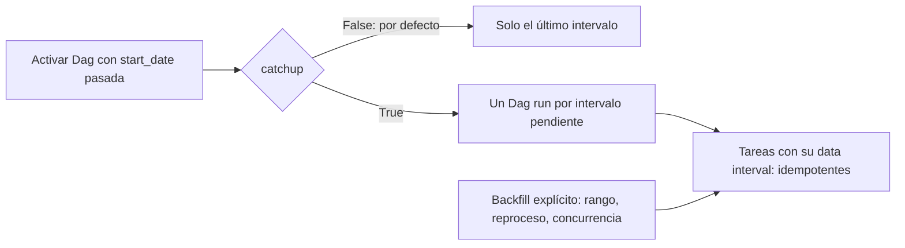

## 1. Resumen

Catchup es la política del scheduler que, cuando se activa un Dag con una fecha de inicio en el pasado, crea una ejecución por cada intervalo que no se ejecutó. En Airflow está **desactivada por defecto**: al activar un Dag solo se crea la ejecución del último intervalo. Activarla es útil si el Dag procesa exactamente su intervalo y es idempotente; si no, puede lanzar cientos de ejecuciones que procesan "hoy" una y otra vez.

## 2. Qué es

Es una propiedad del scheduling, no una tarea:

- en Airflow se define por Dag (`catchup=True` o `False`) o para todo el entorno (`[scheduler] catchup_by_default`);
- actúa al activar el Dag o cuando hay intervalos pendientes o limpiados;
- se distingue del **backfill**, que es una acción explícita sobre un rango elegido, con sus propias opciones (reproceso, concurrencia, orden).

## 3. Problema que resuelve

Un pipeline diario se crea hoy con `start_date` de hace tres meses, o estuvo pausado una semana. Sin catchup, esos intervalos quedan sin procesar salvo que alguien lance un backfill. Con catchup, el scheduler los crea solo.

El problema inverso también existe: un Dag nuevo con `start_date` antigua y catchup activado lanza de golpe todas las ejecuciones históricas, lo que puede saturar el origen, el destino o los workers.

## 4. Cómo funciona

1. Un Dag con `start_date`, `end_date` opcional y un schedule temporal define una serie de intervalos.
2. Con catchup **desactivado** (por defecto), al activarlo el scheduler crea solo la ejecución del último intervalo.
3. Con catchup **activado**, el scheduler crea una ejecución por cada intervalo no ejecutado desde el último (o limpiado).
4. Cada ejecución recibe su propio *data interval*; si la tarea lo usa, procesa el período correcto.

La documentación de Airflow es explícita: si el Dag no está escrito para su intervalo (usa "ahora" en lugar del intervalo), hay que dejar catchup apagado.

## 5. Cuándo utilizarlo

- Dags que procesan exactamente su intervalo y escriben de forma idempotente.
- Cuando se quiere que las pausas o caídas del scheduler se recuperen solas.
- Dags nuevos cuya historia desde `start_date` debe cargarse y cuyo rango es razonable.

## 6. Cuándo no utilizarlo

- Dags que consultan "el estado actual" (por ejemplo, un snapshot de una API sin filtro temporal): cada ejecución histórica traería lo mismo.
- Rangos largos que saturarían el origen: mejor un backfill explícito con concurrencia limitada.
- Dags no idempotentes: cada intervalo repetido duplicaría datos.

## 7. Ejemplo sencillo

Un Dag diario con `start_date` del 1 de septiembre se activa el 30 de septiembre.

- Con catchup apagado: se crea una sola ejecución, la del 29 al 30.
- Con catchup encendido: se crean 29 ejecuciones, una por día.

## 8. Ejemplo de producción

El equipo deja `catchup_by_default=False` en el entorno y decide Dag por Dag. Los Dags de carga diaria por partición, idempotentes, tienen `catchup=True` y `max_active_runs` bajo: si el entorno estuvo caído un fin de semana, al volver se recuperan esos días en orden y sin saturar el origen. Los Dags que leen snapshots de APIs tienen `catchup=False`. Para cargas históricas largas se usa backfill explícito, no catchup.

## 9. Arquitectura



## 10. Código

```python
# Airflow 3: Dag diario con catchup explícito y concurrencia de ejecuciones limitada.
# Requiere: apache-airflow 3.x; replace_partition es idempotente (reemplaza la partición del día).
from datetime import datetime

from airflow.sdk import dag, task


@dag(
    schedule="@daily",
    start_date=datetime(2026, 9, 1),
    catchup=True,          # recupera los intervalos pendientes al activar o tras una caída
    max_active_runs=3,     # no más de 3 días en paralelo contra el origen
)
def ventas_diarias():
    @task
    def cargar(*, ds: str) -> None:
        replace_partition(day=ds)   # procesa el intervalo, nunca "ahora"

    cargar()


ventas_diarias()
```

Como cada ejecución reemplaza la partición de su día, repetir o recuperar intervalos no duplica datos.

## 11. GCP

En **Managed Service for Apache Airflow (ex Cloud Composer)**, el comportamiento es el de Airflow: `catchup` por Dag y `catchup_by_default` para el entorno. Las opciones de configuración de Airflow se sobrescriben al crear el entorno o después; algunas opciones están bloqueadas y no se pueden cambiar.

## 12. AWS

En **Amazon MWAA** también rige el comportamiento de Airflow. Las opciones de configuración (como `scheduler.catchup_by_default`) se indican en la consola y MWAA las aplica como variables de entorno del contenedor; si `airflow.cfg` define la misma opción, prevalece la de la consola.

## 13. Azure

**Data Factory** no tiene un "catchup" con ese nombre. El equivalente más cercano es el **tumbling window trigger**: su `startTime` puede estar en el pasado y dispara una ejecución por cada ventana, así que al crearlo procesa las ventanas históricas. A diferencia de Airflow, es una propiedad del disparador y no del pipeline.

## 14. Buenas prácticas

- Dejar `catchup_by_default=False` en el entorno y decidir explícitamente en cada Dag.
- Activar catchup solo en Dags que procesan su intervalo y son idempotentes.
- Limitar las ejecuciones simultáneas al activar catchup.
- Para rangos largos, preferir backfill explícito con concurrencia y orden controlados.
- **Seguridad:** las ejecuciones de catchup usan las mismas credenciales que las normales; no conceder permisos extra "para recuperar".
- **Observabilidad:** alertar si un Dag acumula muchas ejecuciones pendientes o en cola tras activarse.
- **Costo:** cada intervalo recuperado cuesta como una ejecución normal; estimar el rango antes de activar un Dag con `start_date` antigua.

## 15. Errores frecuentes

- Crear un Dag con `start_date` de hace un año y catchup activado en un entorno que lo tiene por defecto.
- Activar catchup en un Dag que usa "ahora" y procesar el mismo día cientos de veces.
- Confundir catchup con backfill y esperar opciones de reproceso que solo tiene el backfill.

## 16. Trade-offs

Catchup recupera intervalos sin intervención, a cambio de menos control sobre cuándo y cuántos corren. El backfill explícito da control (rango, reproceso, concurrencia, orden), a cambio de requerir una acción manual.

## 17. Conceptos relacionados

- `backfill`: reproceso explícito de un rango.
- `dag`: la unidad a la que se aplica catchup.
- `idempotency`: requisito para recuperar intervalos sin duplicar.
- Del blueprint, pendientes de ficha: `scheduler`, `data-orchestration`, `pipeline-dependencies`.

## 18. Preguntas técnicas abiertas

1. ¿Qué harías si activas un Dag y descubres que creó 300 ejecuciones pendientes?
2. ¿Cómo decidirías si un Dag nuevo debe tener catchup activado?
3. ¿Qué diferencia práctica hay entre recuperar una semana con catchup y con un backfill?

## 19. Laboratorio relacionado

Pendiente (F4): lab de tipo B sobre duplicados tras un reproceso (§25).

## 20. Fuentes

- Apache Airflow: *Dag Runs*, *Configuration Reference*, *Backfill* y *airflow.sdk API Reference*.
- Google Cloud: *Override Airflow configuration options* (Managed Service for Apache Airflow).
- AWS: *Using Apache Airflow configuration options on Amazon MWAA*.
- Microsoft Learn: *Create tumbling window triggers* (Data Factory).

El detalle de cada fuente está en `sources` del frontmatter.

## 21. Fecha de última verificación

2026-09-30. `max_active_runs` y `catchup` están en la referencia de la API de Dag del Task SDK de Airflow. La ficha queda en `review_required` hasta la revisión humana (B-F3.1).

## 22. Historial de cambios importantes

- 2026-09-30: creación (lote 3 de F3).
