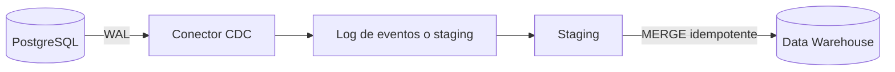

## 1. Resumen

CDC captura los cambios de una base de datos a medida que ocurren y los entrega como un flujo ordenado de eventos, para no tener que re-extraer tablas completas. Es la base de la replicación de bases operacionales hacia un data warehouse con baja latencia.

## 2. Qué es

Es un patrón de integración: en lugar de consultar el estado actual de las tablas, se observa **qué cambió** (insert, update, delete) y se publica cada cambio con su posición en el historial de la base (en PostgreSQL, el LSN del WAL).

## 3. Problema que resuelve

Las extracciones completas o por timestamp son costosas, cargan la base operacional y no detectan borrados físicos. CDC reduce latencia y carga sobre el origen, y conserva la secuencia de cambios.

## 4. Cómo funciona

Hay tres variantes:

- **Basado en log** (preferido): lee el log de transacciones del motor. En PostgreSQL, *logical decoding* decodifica el write-ahead log (WAL) en un flujo de cambios, y un *replication slot* guarda la posición de cada consumidor. Debezium, por ejemplo, lee ese flujo con el plugin `pgoutput`.
- **Basado en triggers**: cada cambio se escribe en una tabla auxiliar. Añade carga a cada transacción del origen.
- **Basado en consultas** (timestamp o versión): simple, pero no ve borrados físicos ni estados intermedios.

Un detalle con consecuencias: un slot de PostgreSQL emite cada cambio una sola vez en operación normal, pero su posición se persiste en los checkpoints, así que **tras un crash puede reenviar cambios recientes**. El consumidor debe tolerar duplicados.

## 5. Cuándo utilizarlo

- Replicar tablas OLTP hacia un data warehouse con baja latencia.
- Alimentar arquitecturas event-driven a partir de una base existente, sin modificar la aplicación.
- Conservar el historial de cambios, por ejemplo para SCD2.

## 6. Cuándo no utilizarlo

- Tablas pequeñas o que cambian poco, donde una carga completa periódica es más simple de operar.
- Cuando no hay acceso ni permisos al log de transacciones del origen.
- Cuando el equipo no puede operar la infraestructura que exige (slots, conectores, evolución de esquema).

## 7. Ejemplo sencillo

Una tabla `orders` en PostgreSQL: cada `UPDATE` de estado genera un evento con el valor nuevo, la operación (`u`) y la posición (LSN) en el WAL. El consumidor aplica el evento en el destino si su LSN es mayor que el último aplicado.

## 8. Ejemplo de producción

PostgreSQL → servicio CDC → staging en el data warehouse → `MERGE` idempotente hacia la tabla final, deduplicando por clave primaria y posición del log. Operación: alertas sobre el retraso de replicación y sobre el WAL retenido por el slot, y un procedimiento de backfill para reconstruir una tabla si el flujo se interrumpe.

## 9. Arquitectura



## 10. Código

```sql
-- BigQuery: aplica el último cambio por clave desde staging (ejecutable adaptando nombres).
-- Requiere: tabla orders(order_id, status, lsn) y staged_changes(order_id, status, op, lsn).
MERGE `proyecto.dataset.orders` AS t
USING (
  SELECT * FROM `proyecto.dataset.staged_changes`
  WHERE TRUE
  QUALIFY ROW_NUMBER() OVER (PARTITION BY order_id ORDER BY lsn DESC) = 1
) AS s
ON t.order_id = s.order_id
WHEN MATCHED AND s.op = 'd' AND s.lsn > t.lsn THEN DELETE
WHEN MATCHED AND s.lsn > t.lsn THEN UPDATE SET status = s.status, lsn = s.lsn
WHEN NOT MATCHED AND s.op != 'd' THEN INSERT (order_id, status, lsn) VALUES (s.order_id, s.status, s.lsn);
```

La deduplicación previa es obligatoria: BigQuery devuelve un error si una fila del destino coincide con más de una fila de origen ("UPDATE/MERGE must match at most one source row for each target row").

## 11. GCP

**Datastream** es el servicio serverless de CDC y replicación de Google Cloud: no hay recursos que aprovisionar y escala solo. Admite PostgreSQL (incluido Cloud SQL) entre sus orígenes y BigQuery como destino, y combina backfill inicial con cambios continuos.

## 12. AWS

**AWS DMS** hace cargas completas y replicación continua: lee los logs de transacciones con la API nativa de cada motor. La propia documentación advierte que su CDC **no es replicación en tiempo real**: la latencia depende de la carga del origen, la red y la instancia de replicación. Frente a Datastream, se opera con instancias (o modo serverless) y tareas, y admite más combinaciones de origen y destino.

## 13. Azure

SQL Server, Azure SQL Managed Instance y Azure SQL Database tienen **CDC nativo en el motor**: un proceso lee el log de transacciones y escribe *tablas de cambios* consultables con funciones. Es un mecanismo del motor, no un servicio de replicación como Datastream o DMS: mover esos cambios a otro sistema requiere una herramienta adicional.

## 14. Buenas prácticas

- Aplicar los cambios de forma idempotente, ordenados por la posición del log.
- Monitorear el retraso de replicación y el WAL retenido: un slot sin consumidor impide eliminar WAL y consume disco.
- Gestionar la evolución de esquema de forma explícita y probarla antes de producción.
- Tener un procedimiento de re-snapshot (backfill) documentado.
- **Seguridad:** el rol de replicación necesita el atributo `REPLICATION` (o ser superusuario): usar un rol dedicado, con acceso solo a las tablas publicadas, credenciales en un gestor de secretos y conexión cifrada hacia el conector.
- **Observabilidad:** medir, por slot, cuánto WAL retiene y cuánto retrasa el consumidor a partir de `restart_lsn` y `confirmed_flush_lsn` en `pg_replication_slots`, y alertar sobre ambos. Además, conciliar conteos entre origen y destino.
- **Costo:** el WAL retenido ocupa disco en el origen; el servicio de CDC (Datastream o la instancia de DMS) y las escrituras en el destino se facturan aparte. Sin precios aquí: dependen del servicio y cambian.

## 15. Errores frecuentes

- Replication slots abandonados que retienen WAL hasta llenar el disco del origen.
- Asumir entrega exactly-once sin deduplicar en el destino (un crash puede reenviar cambios).
- Ignorar los borrados en el destino.
- Aplicar un `MERGE` sin deduplicar el lote por clave.

## 16. Trade-offs

Menor latencia y carga de lectura sobre el origen, a cambio de más complejidad operativa y de acoplamiento al formato del log de cada motor. Un servicio administrado (Datastream, DMS) reduce la operación, pero limita orígenes, destinos y control fino frente a Debezium autogestionado.

## 17. Conceptos relacionados

- `idempotency`: los consumidores deben tolerar reentregas.
- `sql-merge`: aplica un lote de cambios en el destino.
- `scd-type-2`: conserva cada versión del registro.
- Con ficha: `schema-evolution`.
- `database-ingestion`: elegir entre carga completa, incremental por watermark o CDC.
- Del blueprint, pendiente de ficha: `cdc-architecture`.

## 18. Preguntas técnicas abiertas

1. ¿Cómo garantizarías que un reproceso de eventos CDC no duplique filas en el data warehouse?
2. ¿Qué harías si un replication slot inactivo empieza a llenar el disco del origen?
3. ¿Cómo manejarías un cambio de esquema en la tabla origen sin detener el pipeline?

## 19. Laboratorio relacionado

Pendiente: lab "CDC PostgreSQL → BigQuery" (F4).

## 20. Fuentes

- PostgreSQL: *Logical Decoding Concepts* (slots, WAL, reenvío tras crash).
- Debezium: conector de PostgreSQL.
- Google Cloud: *Datastream overview*.
- AWS: *Creating tasks for ongoing replication using AWS DMS*.
- Microsoft Learn: *What is change data capture (CDC)?*

El detalle de cada fuente está en `sources` del frontmatter.

## 21. Fecha de última verificación

2026-09-30. Las afirmaciones de producto se contrastaron con las páginas oficiales citadas. Pasa a `verified`: revisión B-F3.1 aprobada y aplicada, sin VERIFY pendientes.

## 22. Historial de cambios importantes

- 2026-09-28: creación como ficha de ejemplo de F0.
- 2026-09-30: lote 1 de F3. Secciones de GCP, AWS y Azure verificadas con documentación oficial; ejemplo de MERGE con deduplicación; reenvío de cambios tras un crash.
- 2026-09-30: revisión B-F3.1 aplicada (docs/reviews/cards-lote1.md): relaciones completas, seguridad, observabilidad y costo, notas de fuentes y ejemplos corregidos.
- 2026-09-30: `verification_status: verified` (revisión B-F3.1 aprobada y aplicada; VERIFY resueltos).
- 2026-10-06: la sección de conceptos relacionados ya no lista como pendiente de ficha a `schema-evolution`, que ya tiene ficha.
- 2026-10-11: §17 enlaza `database-ingestion`, que ya tiene ficha (lote F3b-05a); antes figuraba como pendiente de ficha.
- 2026-10-13: `page_title` en cada cita, con el título de la página citada (ADR-012); sin cambios de contenido.
