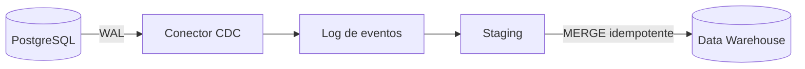

<!-- Ficha de ejemplo F0: su objetivo es probar schema y validación. Contenido breve, pendiente de ampliar y verificar en F3. -->

## 1. Resumen

CDC captura los cambios de una base de datos a medida que ocurren y los entrega como un flujo de eventos ordenado, para no tener que re-extraer tablas completas.

## 2. Qué es

Es un patrón de integración: en lugar de consultar el estado actual de las tablas, se observa **qué cambió** (insert, update, delete) y se publica cada cambio con su posición en el historial de la base.

## 3. Problema que resuelve

Las extracciones completas o por timestamp son costosas, no detectan borrados y cargan la base operacional. CDC reduce latencia y carga, y conserva el historial de cambios.

## 4. Cómo funciona

Variantes principales:

- **Basado en log** (preferido): lee el log de transacciones (WAL en PostgreSQL, binlog en MySQL). En PostgreSQL se apoya en *logical decoding* y *replication slots*.
- **Basado en triggers**: escribe cada cambio en una tabla auxiliar; más carga sobre el origen.
- **Basado en consultas** (timestamp/versión): simple, pero no ve borrados físicos ni estados intermedios.

<!-- VERIFY: detalle de logical decoding y replication slots contra la documentación de PostgreSQL de la versión objetivo. -->

## 5. Cuándo utilizarlo

- Replicar tablas OLTP hacia un data warehouse con baja latencia.
- Alimentar arquitecturas event-driven a partir de una base existente.
- Mantener historial de cambios (por ejemplo, para SCD2).

## 6. Cuándo no utilizarlo

- Tablas pequeñas o de baja frecuencia de cambio, donde una carga completa periódica es más simple.
- Cuando no hay acceso ni permisos al log de transacciones del origen.
- Cuando el equipo no puede operar la infraestructura (slots, conectores, esquemas) que exige.

## 7. Ejemplo sencillo

Una tabla `orders` en PostgreSQL: cada `UPDATE` de estado genera un evento con el valor anterior, el nuevo y la posición (LSN) en el WAL.

## 8. Ejemplo de producción

PostgreSQL → servicio CDC → staging en el data warehouse → `MERGE` idempotente hacia la tabla final, con deduplicación por clave primaria y posición del log.

## 9. Arquitectura



## 10. Código

```sql
-- Aplicación idempotente de cambios desde staging (SQL genérico, ilustrativo).
MERGE INTO orders AS t
USING staged_changes AS s
  ON t.order_id = s.order_id
WHEN MATCHED AND s.op = 'd' AND s.lsn > t.lsn THEN DELETE
WHEN MATCHED AND s.lsn > t.lsn THEN UPDATE SET status = s.status, lsn = s.lsn
WHEN NOT MATCHED AND s.op <> 'd' THEN INSERT (order_id, status, lsn) VALUES (s.order_id, s.status, s.lsn);
```

## 11. GCP

Datastream ofrece CDC administrado desde bases operacionales hacia destinos de Google Cloud.

<!-- VERIFY: orígenes y destinos soportados por Datastream (incluido BigQuery) contra https://cloud.google.com/datastream/docs/overview -->

## 12. AWS

AWS DMS soporta replicación continua de cambios además de cargas completas. No es equivalente a Datastream: difieren orígenes, destinos, modelo de despliegue y costo.

<!-- VERIFY: modos de tarea CDC de DMS contra https://docs.aws.amazon.com/dms/latest/userguide/CHAP_Task.CDC.html -->

## 13. Azure

SQL Server y Azure SQL incluyen una funcionalidad nativa de CDC basada en tablas de cambios. Es un mecanismo en el motor, no un servicio de replicación como Datastream o DMS.

<!-- VERIFY: disponibilidad por edición/servicio contra Microsoft Learn. -->

## 14. Buenas prácticas

- Aplicar cambios de forma idempotente, ordenados por posición del log.
- Monitorear el retraso de replicación y el crecimiento del WAL retenido por slots.
- Gestionar la evolución de esquema de forma explícita.

## 15. Errores frecuentes

- Replication slots abandonados que retienen WAL y llenan el disco del origen.
- Asumir entrega exactly-once sin deduplicación en destino.
- Ignorar los borrados en el destino.

## 16. Trade-offs

Menor latencia y carga de lectura sobre el origen, a cambio de más complejidad operativa y de acoplamiento al formato del log del motor.

## 17. Conceptos relacionados

- Idempotencia
- Pendientes de crear en F1: SCD2, MERGE incremental, streaming, WAL.

## 18. Preguntas técnicas abiertas

1. ¿Cómo garantizarías que un reproceso de eventos CDC no duplique filas en el data warehouse?
2. ¿Qué harías si un replication slot inactivo empieza a llenar el disco del origen?
3. ¿Cómo manejarías un cambio de esquema en la tabla origen sin detener el pipeline?

## 19. Laboratorio relacionado

Pendiente: lab "CDC PostgreSQL → BigQuery" (F4).

## 20. Fuentes

Ver `sources` en el frontmatter: PostgreSQL (logical decoding), Debezium, Datastream, AWS DMS, Microsoft Learn.

## 21. Fecha de última verificación

2026-09-28 (URLs comprobadas; afirmaciones de producto pendientes: `review_required`).

## 22. Historial de cambios importantes

- 2026-09-28: creación como ficha de ejemplo de F0.
