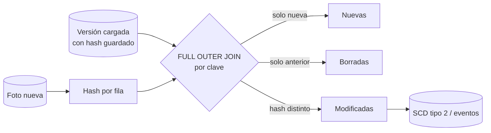

## 1. Resumen

Cuando el origen no ofrece un flujo de cambios (CDC) ni una columna confiable de "última modificación", los cambios se **deducen comparando** la versión nueva de los datos con la que ya se cargó:

- clave solo en la nueva → **nueva**;
- clave solo en la anterior → **borrada**;
- clave en ambas con algún atributo distinto → **modificada**.

La comparación puede hacerse columna a columna o, en tablas anchas, con un **hash de fila**. El hash tiene trampas que no producen errores:

- los `NULL` que una concatenación borra o propaga;
- la falta de separadores entre columnas.

Por eso dos filas distintas pueden dar el mismo hash.

## 2. Qué es

| Técnica | Cómo | Cuándo |
|---|---|---|
| CDC basado en log | Lee el log de la base de origen (ver `change-data-capture`) | El origen lo permite |
| Columna de modificación | `updated_at > watermark` | El origen la mantiene de forma confiable |
| Comparación columna a columna | `IS DISTINCT FROM` en cada atributo | Pocas columnas |
| Hash de fila | Hash de las columnas concatenadas con separador y marcador de `NULL` | Muchas columnas; también sirve para reconciliar |
| Diferencia de conjuntos | `EXCEPT` entre versiones | Tablas pequeñas o medianas |

Esta ficha trata las tres últimas, que son SQL.

## 3. Problema que resuelve

Muchos orígenes (archivos diarios, APIs sin filtro de fecha, réplicas sin log accesible) entregan una foto completa en cada carga. Reemplazar todo cada vez pierde la información de qué cambió, que es justo lo que necesitan las dimensiones tipo 2, los eventos de negocio y los controles de calidad.

## 4. Cómo funciona

1. **Alinear por clave:** `FULL OUTER JOIN` entre la versión nueva y la anterior por la clave natural.
2. **Clasificar:** sin pareja a la derecha es nueva, sin pareja a la izquierda es borrada, y con pareja se compara.
3. **Comparar:**
   - columna a columna, con `IS DISTINCT FROM` donde el motor lo admite (ver `sql-nulls`);
   - o un hash por fila.
4. **Armar el hash sin colisiones evitables:**
   - **`NULL`:** cada motor concatena distinto. BigQuery: `CONCAT` devuelve `NULL` si algún argumento es `NULL`. T-SQL: `CONCAT` convierte `NULL` en cadena vacía. PostgreSQL: `concat` y `concat_ws` ignoran los `NULL`. Redshift: `CONCAT` y `||` devuelven `NULL` si una expresión es `NULL`, como en BigQuery, y su documentación indica `NVL` o `COALESCE`. En todos los casos conviene reemplazar `NULL` por un marcador explícito que no pueda aparecer en los datos.
   - **Separador:** sin separador, `'ab' + 'c'` y `'a' + 'bc'` producen el mismo texto.
   - **Orden y tipos:** siempre las mismas columnas, en el mismo orden y con el mismo formato (fechas, decimales).
5. **Algoritmo:**
   - BigQuery: `FARM_FINGERPRINT` (64 bits, mismo resultado para la misma entrada) o `SHA256`;
   - T-SQL: `HASHBYTES` con `SHA2_256`, porque MD5 y SHA1 están obsoletos;
   - Redshift: `SHA2`.

   Un hash de 64 bits es compacto pero tiene más probabilidad de colisión que uno de 256 en tablas muy grandes.

## 5. Cuándo utilizarlo

- Orígenes que entregan fotos completas sin CDC ni `updated_at` confiable.
- Para alimentar una dimensión tipo 2 o una tabla de eventos de cambio.
- Para reconciliar origen y destino (ver `data-reconciliation`).

## 6. Cuándo no utilizarlo

- Cuando el origen ofrece CDC: el log trae también los cambios intermedios entre dos fotos, que la comparación no ve.
- En tablas enormes cargadas cada pocos minutos: comparar fotos completas es caro; conviene CDC o un `updated_at`.
- Con hashes sin marcador de `NULL` ni separador.

## 7. Ejemplo sencillo

```sql
-- PostgreSQL (ejecutado): concat_ws ignora los NULL, y dos filas distintas producen el mismo texto.
SELECT concat_ws('|', 'a', NULL, 'b') AS fila_1,   -- a|b
       concat_ws('|', 'a', 'b', NULL) AS fila_2;   -- a|b
```

## 8. Ejemplo de producción

Un proveedor entrega cada noche la foto completa de 3 millones de productos con 40 atributos. La carga calcula un hash por fila con marcador de `NULL` y separador, lo compara con el hash guardado de la carga anterior y emite tres conjuntos: nuevos, modificados y borrados. Los modificados alimentan la dimensión tipo 2.

En la primera versión el hash concatenaba sin marcador: un producto que pasó de `color = NULL, talla = 'M'` a `color = 'M', talla = NULL` no se detectó como cambio. El control de reconciliación lo encontró y se agregó el marcador.

## 9. Arquitectura



## 10. Código

```sql
-- PostgreSQL (ejecutado): nuevas, modificadas y borradas con hash de fila.
WITH o AS (
  SELECT id, md5(concat_ws('|', coalesce(nombre, '\N'), coalesce(email, '\N'))) AS h FROM origen
), d AS (
  SELECT id, md5(concat_ws('|', coalesce(nombre, '\N'), coalesce(email, '\N'))) AS h FROM destino
)
SELECT coalesce(o.id, d.id) AS id,
       CASE WHEN d.id IS NULL THEN 'nuevo'
            WHEN o.id IS NULL THEN 'borrado en origen'
            ELSE 'modificado' END AS cambio
FROM o FULL JOIN d ON o.id = d.id
WHERE o.h IS DISTINCT FROM d.h;

-- BigQuery (sintaxis documentada; no ejecutado aquí): CONCAT devuelve NULL con un argumento NULL,
-- así que el marcador es obligatorio.
-- SELECT id, FARM_FINGERPRINT(CONCAT(IFNULL(nombre, '\\N'), '|', IFNULL(email, '\\N'))) AS h FROM origen;

-- T-SQL (sintaxis documentada; no ejecutado aquí): CONCAT convierte NULL en '' y HASHBYTES con SHA2_256.
-- SELECT id, HASHBYTES('SHA2_256', CONCAT(COALESCE(nombre, '\N'), '|', COALESCE(email, '\N'))) AS h FROM origen;
```

Con un origen (1 igual, 2 con email que pasó a `NULL`, 3 igual y 5 nuevo) y un destino (1, 2, 3 y 4), la consulta devuelve `2 modificado`, `4 borrado en origen` y `5 nuevo`.

Sin el marcador, `concat_ws('|', 'a', NULL, 'b')` y `concat_ws('|', 'a', 'b', NULL)` producen el mismo hash. Sin separador, `concat('ab', 'c')` y `concat('a', 'bc')` también: las dos colisiones se comprobaron en PostgreSQL. Las versiones de BigQuery y T-SQL siguen la sintaxis de su documentación y no se ejecutaron.

## 11. GCP

En **BigQuery**:

- `CONCAT` devuelve `NULL` si cualquier argumento es `NULL`, así que sin marcador el hash de la fila completa se vuelve `NULL`;
- `FARM_FINGERPRINT` da un `INT64` reproducible;
- `SHA256` da 32 bytes, y la documentación advierte que MD5 ya no se considera seguro;
- `EXCEPT DISTINCT` permite comparar versiones como conjuntos.

## 12. AWS

En **Redshift**, `CONCAT` admite dos expresiones (se anidan para más) y `||` da el mismo resultado. Si una o las dos expresiones son `NULL`, el resultado es `NULL`, el mismo efecto que en BigQuery: sin marcador, el hash de la fila se vuelve `NULL`. Para columnas con `NULL`, la documentación indica `NVL` o `COALESCE`. `SHA2(cadena, bits)` devuelve el hash en hexadecimal. Redshift no admite `IS DISTINCT FROM` (ver `sql-nulls`), así que la comparación columna a columna se escribe con `IS NULL` explícitos.

## 13. Azure

En **T-SQL** (Synapse y Fabric Warehouse), `CONCAT` **convierte los `NULL` en cadena vacía**, un comportamiento distinto del de BigQuery. Sin marcador, `NULL` y `''` dan el mismo hash. `HASHBYTES` con `SHA2_256` o `SHA2_512` es la opción recomendada: MD5 y SHA1 están obsoletos desde SQL Server 2016.

## 14. Buenas prácticas

- Marcador explícito de `NULL` y separador entre columnas en todo hash de fila.
- Definir la lista y el orden de columnas del hash en un solo lugar (macro o vista) y versionarla.
- Normalizar formatos antes de hashear: fechas, decimales y espacios.
- Guardar el hash junto a la fila cargada para no recalcularlo sobre el destino.
- **Seguridad:** un hash de columnas sensibles no las anonimiza si el espacio de valores es pequeño (por ejemplo, un RUT); no usarlo como seudonimización.
- **Observabilidad:** registrar en cada carga cuántas filas son nuevas, modificadas y borradas; un pico de modificadas suele ser un cambio de formato en el origen.
- **Costo:** comparar hashes guardados evita leer y comparar todas las columnas del destino en cada carga.

## 15. Errores frecuentes

- Concatenar sin marcador de `NULL` (`concat_ws` en PostgreSQL, `CONCAT` en T-SQL) y perder cambios.
- Concatenar sin separador.
- Cambiar el orden de columnas del hash y marcar toda la tabla como modificada.
- Usar MD5 o SHA1 donde la documentación del motor los da por obsoletos o inseguros.
- Suponer que la comparación de fotos ve los cambios intermedios entre dos cargas.

## 16. Trade-offs

Comparar fotos funciona con cualquier origen, a cambio de leer la foto completa y de no ver los cambios intermedios. El CDC basado en log ve todos los cambios y lee menos, a cambio de acceso al log y de infraestructura adicional. Un hash de 64 bits es compacto y rápido, a cambio de más riesgo de colisión que uno de 256 bits.

## 17. Conceptos relacionados

- `change-data-capture`: cambios desde el log.
- `incremental-load`: cargar solo lo que cambió.
- `data-reconciliation`: verificar con hashes.
- `sql-nulls`: comparar con `NULL`.
- `scd-type-2`: consumir los cambios detectados.

## 18. Preguntas técnicas abiertas

1. ¿Qué orígenes de tu pipeline entregan fotos completas y cuáles ofrecen CDC?
2. ¿Qué marcador de `NULL` usarías para que no pueda aparecer en tus datos?
3. ¿Cómo detectarías un cambio de formato en el origen que marca toda la tabla como modificada?

## 19. Laboratorio relacionado

Pendiente (F4).

## 20. Fuentes

- Google Cloud: *Hash functions*, *String functions* y *Query syntax* (BigQuery).
- AWS: *CONCAT* y *SHA2* (Amazon Redshift).
- Microsoft Learn: *CONCAT (Transact-SQL)* y *HASHBYTES (Transact-SQL)*.
- PostgreSQL: *String Functions and Operators*.

El detalle de cada fuente está en `sources` del frontmatter.

## 21. Fecha de última verificación

2026-10-07. En `review_required` hasta la revisión B-F3.1 del lote F3b-02c.

## 22. Historial de cambios importantes

- 2026-10-05: esqueleto creado desde el blueprint (rama `f/sql`), con la nota "técnicas SQL (hash de fila, comparación de columnas) distintas de CDC basado en log".
- 2026-10-07: ficha completa (lote F3b-02c, dominio 02-sql).
- 2026-10-07: revisión B-F3.1 del lote F3b-02c aplicada (docs/reviews/cards-f3b-02c.md): Redshift: `CONCAT` y `||` devuelven `NULL` con un argumento `NULL` (su página), distinto de T-SQL y de `concat`/`concat_ws` de PostgreSQL.
