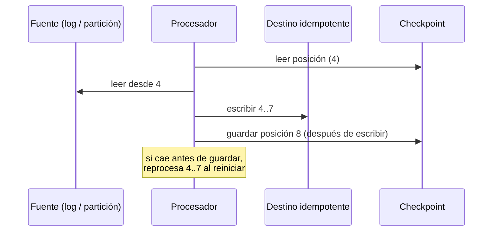

## 1. Resumen

Un checkpoint es el **progreso guardado** de un proceso continuo o largo: hasta qué offset leyó, qué estado acumulaba. Sirve para que, tras una caída, el proceso retome desde ahí y no desde el principio. Cada motor lo implementa distinto, y esta ficha no los trata como equivalentes:

- **Spark Structured Streaming:** guarda offsets y agregados en una ubicación de checkpoint.
- **Managed Service for Apache Flink:** hace checkpoints automáticos del estado y snapshots manuales.
- **Event Hubs:** sus procesadores registran la posición por partición en un checkpoint store.

Lo común es que lo procesado después del último checkpoint se **vuelve a procesar** al retomar, salvo que el motor ofrezca otra garantía. Por eso el destino tiene que tolerar el reproceso.

## 2. Qué es

- **Posición:** hasta dónde se leyó la fuente (offset, número de secuencia, archivo).
- **Estado:** lo acumulado en memoria que no está en la fuente (conteos, ventanas abiertas).
- **Checkpoint:** posición y, según el motor, estado, guardados en almacenamiento durable en momentos definidos.

Según cada motor:

- **Spark Structured Streaming:** con `checkpointLocation`, la consulta guarda el rango de offsets procesado en cada trigger y los agregados en curso, en un sistema de archivos compatible con HDFS.
- **Managed Service for Apache Flink:**
  - un checkpoint es un respaldo actualizado de la aplicación para recuperarse de interrupciones;
  - un snapshot es un respaldo manual para volver a un estado anterior.
- **Event Hubs:** un procesador marca la posición del último evento procesado con éxito en cada partición, dentro de un consumer group, y otra instancia retoma desde ahí.

## 3. Problema que resuelve

Un consumidor de un flujo que cae a las 3 de la mañana tiene tres opciones malas sin checkpoint:

- empezar desde el principio y reprocesar todo;
- empezar desde «ahora» y perder lo intermedio;
- adivinar.

Con checkpoint, retoma desde el último punto confirmado, y la pérdida y el reproceso quedan acotados a lo que pasó después de ese punto.

## 4. Cómo funciona

1. El proceso lee y procesa un lote o un tramo de eventos.
2. Escribe el resultado en el destino.
3. **Después**, guarda el checkpoint con la nueva posición, de forma durable y atómica.
4. Si cae entre los pasos 2 y 3, al reiniciar lee el checkpoint anterior y reprocesa ese tramo. El resultado ya escrito se vuelve a escribir, así que el destino tiene que ser idempotente.
5. Si guardara el checkpoint **antes** de escribir el resultado y cayera entre medio, perdería ese tramo. Por eso el orden importa.
6. **Cambios de código:** en Spark hay cambios que no se pueden hacer en una consulta que se reinicia desde la misma ubicación de checkpoint.

## 5. Cuándo utilizarlo

- Consumidores de streaming (colas, logs de eventos, event hubs).
- Jobs batch largos que procesan muchos archivos o particiones, para no rehacer lo terminado.
- Cualquier proceso cuyo reinicio desde cero sea caro o imposible (porque la fuente ya no retiene los datos).

## 6. Cuándo no utilizarlo

- Para jobs cortos que se pueden repetir completos de forma barata e idempotente: reiniciar desde cero es más simple.
- Como sustituto de un destino idempotente: el checkpoint acota el reproceso, no lo elimina (salvo garantías específicas del motor).
- Para volver atrás a propósito, como reprocesar una semana: eso es un replay (ver `replay`).

## 7. Ejemplo sencillo

Un consumidor procesa los eventos 0 a 3 y guarda el checkpoint «4». Cae procesando el 6. Al reiniciar lee «4» y reprocesa el 4 y el 5, que ya había escrito. Como el destino escribe por id, no se duplican.

## 8. Ejemplo de producción

Un servicio consume eventos de ventas de un event hub con 8 particiones:

- cada instancia procesa lotes de 500 eventos;
- escribe en el warehouse con upsert por `evento_id`;
- después, marca el checkpoint de la partición.

Cuando una instancia se reinicia, otra toma sus particiones desde el último checkpoint. Algunos eventos se procesan dos veces, y el upsert los absorbe. Una métrica cuenta cuántos eventos se reprocesaron en cada reinicio.

## 9. Arquitectura



## 10. Código

```python
# Python 3.12, solo biblioteca estándar (ejecutado; mypy --strict sin errores): consumidor de un log con
# offsets que guarda su checkpoint de forma atómica después de procesar cada lote. Si cae a mitad de un lote,
# al reiniciar retoma desde el último checkpoint y reprocesa ese lote (al menos una vez): el destino es idempotente.
import json
import os
import tempfile
from pathlib import Path

LOG = [f'{{"id": "e{i}", "monto": {i * 10}}}' for i in range(10)]     # el log de origen, con offsets 0..9


class Falla(Exception):
    pass


def leer_checkpoint(ruta: Path) -> int:
    return int(json.loads(ruta.read_text(encoding="utf-8"))["offset"]) if ruta.exists() else 0


def guardar_checkpoint(ruta: Path, offset: int) -> None:
    temporal = ruta.with_name(ruta.name + ".tmp")
    temporal.write_text(json.dumps({"offset": offset}), encoding="utf-8")
    os.replace(temporal, ruta)   # si tiene éxito, el renombrado es atómico (POSIX); puede fallar entre sistemas de archivos


def consumir(ruta: Path, destino: dict[str, int], lote: int, fallar_en: int | None = None) -> int:
    offset = leer_checkpoint(ruta)
    while offset < len(LOG):
        for i in range(offset, min(offset + lote, len(LOG))):
            if i == fallar_en:
                raise Falla(f"caída procesando el offset {i}")
            evento = json.loads(LOG[i])
            destino[evento["id"]] = evento["monto"]          # escritura idempotente por id
        offset = min(offset + lote, len(LOG))
        guardar_checkpoint(ruta, offset)                    # el checkpoint va DESPUÉS de escribir el lote
    return offset


ruta = Path(tempfile.mkdtemp()) / "consumidor.checkpoint"
destino: dict[str, int] = {}
try:
    consumir(ruta, destino, lote=4, fallar_en=6)
except Falla as error:
    print(error, leer_checkpoint(ruta), sorted(destino))   # caída procesando el offset 6 4 ['e0', 'e1', 'e2', 'e3', 'e4', 'e5']
print(consumir(ruta, destino, lote=4))                       # 10: retoma en el offset 4 y reprocesa e4 y e5
print(len(destino), sum(destino.values()))                   # 10 450: sin duplicados pese al reproceso
```

Ejecutado con Python 3.12.3 y `mypy --strict` sin errores. La primera corrida cae en el offset 6, con el checkpoint en 4 y los eventos e0 a e5 ya escritos. La segunda retoma desde 4, reprocesa e4 y e5, y termina en 10, con 10 eventos únicos y un total de 450: el reproceso no duplicó nada. El checkpoint se escribe con `os.replace`. Si tiene éxito, el renombrado es atómico (requisito de POSIX), y puede fallar entre sistemas de archivos distintos. Se ejecutó en Windows (NTFS).

## 11. GCP

Esta ficha no cita una fuente de Google Cloud sobre checkpoints. Para retomar o retroceder la posición de una suscripción de Pub/Sub, ver `failure-recovery` (seek) y `replay`.

## 12. AWS

En **Managed Service for Apache Flink**, el checkpointing es el método de tolerancia a fallos:

- los checkpoints son respaldos automáticos para recuperarse de reinicios inesperados, con la misma semántica que una ejecución sin fallas;
- los snapshots son respaldos manuales para restaurar un estado anterior;
- con ambos configurados, el servicio ofrece procesamiento exactly-once durante actualizaciones, escalado o mantenimiento.

Esto es propio del servicio y de Flink. No describe el checkpoint de Spark ni el de Event Hubs.

## 13. Azure

En **Event Hubs**, el checkpointing lo hace el procesador de eventos: marca, por partición y por consumer group, la posición del último evento procesado con éxito. Si un procesador se desconecta, otra instancia retoma desde ese checkpoint. Los procesadores registran la propiedad de las particiones en un checkpoint store, que también usan para balancear la carga. A diferencia de Spark y Flink, aquí el checkpoint es una posición por partición que decide la aplicación, no un respaldo del estado de la aplicación.

## 14. Buenas prácticas

- Guardar el checkpoint después de escribir el resultado, nunca antes.
- Escritura del checkpoint durable y atómica.
- Destino idempotente (upsert por id, carga por partición) para absorber el reproceso.
- Frecuencia de checkpoint según el costo de reprocesar frente al costo de guardarlo.
- En Spark, revisar qué cambios de la consulta se permiten antes de desplegar sobre un checkpoint existente.
- **Seguridad:** el almacenamiento del checkpoint necesita los mismos controles que el pipeline; quien puede modificarlo puede hacer que el proceso salte o repita datos.
- **Observabilidad:** medir la distancia entre la posición del checkpoint y el final de la fuente (retraso), y cuántos eventos se reprocesan en cada reinicio.
- **Costo:** checkpoints muy frecuentes cuestan escrituras; muy espaciados, más reproceso tras cada caída.

## 15. Errores frecuentes

- Guardar el checkpoint antes de escribir el resultado y perder datos en una caída.
- Borrar o reutilizar una ubicación de checkpoint sin entender que el proceso perderá o repetirá su progreso.
- Destino no idempotente: duplicados después de cada reinicio.
- Suponer que el checkpoint de un motor funciona igual que el de otro.

## 16. Trade-offs

El checkpoint acota la pérdida y el reproceso tras una caída, a cambio de escrituras extra y de un estado que hay que cuidar y migrar con el código. Más frecuencia significa menos reproceso pero más costo. Las garantías más fuertes (como exactly-once en Managed Flink con checkpoints y snapshots) dependen del motor y de su configuración. Un consumidor simple con checkpoint de posición deja la idempotencia a cargo del destino.

## 17. Conceptos relacionados

- `failure-recovery`: el conjunto de piezas para recuperarse.
- `streaming-ingestion`: dónde los checkpoints son imprescindibles.
- `idempotency`: por qué el destino debe tolerar el reproceso.
- `replay`: volver atrás a propósito.

## 18. Preguntas técnicas abiertas

1. ¿Cada cuántos eventos o segundos guardarías el checkpoint de tu consumidor, y por qué?
2. ¿Qué pasa con tu destino si un tramo se procesa dos veces?
3. ¿Cómo desplegarías un cambio en una consulta de streaming que tiene un checkpoint en uso?

## 19. Laboratorio relacionado

Pendiente (F4).

## 20. Fuentes

- Apache Spark 4.2.0: *Structured Streaming Programming Guide*.
- AWS: *Implement fault tolerance in Managed Service for Apache Flink*.
- Microsoft Learn: *Partition load balancing for event processing* (Event Hubs).
- Python 3.12: *os*.

El detalle de cada fuente está en `sources` del frontmatter.

## 21. Fecha de última verificación

2026-10-11. Pasa a `verified`: revisión B-F3.1 del lote F3b-05a aplicada, sin VERIFY pendientes.

## 22. Historial de cambios importantes

- 2026-10-11: creación (lote F3b-05a).
- 2026-10-11: revisión B-F3.1 del lote F3b-05a aplicada (docs/reviews/cards-f3b-05a.md): filas aprobadas sin cambios en esta ficha.
- 2026-10-11: `verification_status: verified` (sin VERIFY pendientes).
- 2026-10-13: `page_title` en cada cita, con el título de la página citada (ADR-012); sin cambios de contenido.
