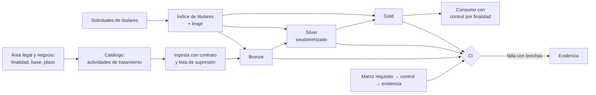

## 1. Resumen

Esta ficha no es asesoría legal: explica cómo trabaja un ingeniero de datos bajo la Ley 21.719. La ley entra solo como origen de cada requisito; el detalle técnico de cada uno está en su ficha hija.

La Ley 21.719 reescribe la Ley 19.628. Según BCN, fue publicada el 2024-12-13 y, por su artículo primero transitorio, sus modificaciones rigen desde el **2026-12-01**; BCN muestra la Ley 19.628 con una versión «Con Vigencia Diferida por Fecha» desde esa fecha.

**Estado al 2026-10-22.** El Ejecutivo ingresó el boletín 18.623-07 (mensaje N° 110-374). Su numeral 2 reemplaza esa fecha por el **1 de diciembre de 2027**. Según la tramitación oficial del Senado, el proyecto está en primer trámite, en primer informe de la Comisión de Constitución, con urgencia de discusión inmediata. Es un proyecto: **mientras no se publique otra ley, rige el 2026-12-01**.

El reglamento de los modelos de prevención de infracciones (art. 49) es el Decreto 662 del Ministerio de Hacienda, publicado el 2026-09-09.

Para ingeniería de datos, el cambio es este: casi todo lo que hace un pipeline es **tratamiento**, y la ley exige poder **demostrar** que cada tratamiento cumple sus principios. Eso se traduce en controles técnicos implementados, verificados de forma continua y con evidencia.

## 2. Qué es

**[Buena práctica]** Mapa de los artículos de la Ley 19.628 modificada y la ficha hija que los trata:

| Artículo | Qué implica para datos | Ficha | Etiqueta |
|---|---|---|---|
| 1 bis | También se aplica a quien, desde fuera de Chile, ofrece bienes o servicios a titulares en Chile o monitorea su comportamiento | `processors-and-international-transfers` | **[Obligación legal · art. 1 bis]** |
| 2 | Dato personal, sensible, anonimización, seudonimización, perfiles, encargado | `pii-identification`, `chilean-identifier-pseudonymization` | **[Obligación legal · art. 2]** |
| 3 | Cada principio (letras a a h) necesita un control y una evidencia | esta ficha | **[Obligación legal · art. 3]** |
| 4 a 11 | Acceso, rectificación, supresión, oposición, portabilidad y bloqueo; 30 días corridos | `data-subject-rights-pipeline` | **[Obligación legal · art. 4]** |
| 8 bis | Explicación, intervención humana y revisión de decisiones automatizadas | `dpia-and-automated-decisions` | **[Obligación legal · art. 8 bis]** |
| 12 y 13 | Bases de licitud, registradas por actividad de tratamiento | `processing-activities-inventory` | **[Obligación legal · art. 12]** |
| 14 | Acreditar la licitud; suprimir o anonimizar datos precontractuales | `processing-activities-inventory` | **[Obligación legal · art. 14]** |
| 14 bis | El secreto alcanza datos públicos que se organizan o combinan | esta ficha | **[Obligación legal · art. 14 bis]** |
| 14 ter | La política pública de tratamiento se alimenta del catálogo | `processing-activities-inventory` | **[Obligación legal · art. 14 ter]** |
| 14 quáter | Por defecto, solo los datos estrictamente necesarios | `data-minimization-by-layer` | **[Obligación legal · art. 14 quáter]** |
| 14 quinquies | Seguridad, restauración y verificación regular de su eficacia | `privacy-controls-as-code` | **[Obligación legal · art. 14 quinquies]** |
| 14 sexies | Reporte y registro de vulneraciones; aviso a titulares en ciertos casos | `data-breach-response` | **[Obligación legal · art. 14 sexies]** |
| 15 y 15 bis | Cesión y encargo; el encargado suprime o devuelve al terminar | `processors-and-international-transfers` | **[Obligación legal · art. 15 bis]** |
| 15 ter | Evaluación de impacto en casos tasados | `dpia-and-automated-decisions` | **[Obligación legal · art. 15 ter]** |
| 16 a 16 sexies | Sensibles, salud, biométricos, niños, niñas y adolescentes, investigación, geolocalización | `pii-identification` | **[Obligación legal · art. 16]** |
| 27 y 28 | Transferencia internacional | `processors-and-international-transfers` | **[Obligación legal · art. 27]** |
| 34 bis a 35 | Infracciones y sanciones; varias nacen de fallas técnicas | esta ficha (§16) | **[Obligación legal · art. 35]** |
| 49 a 53 | Modelo de prevención voluntario; reglamento en el Decreto 662 | `privacy-controls-as-code` | **[Obligación legal · art. 49]** |

- **[Obligación legal · art. 3]** Ocho principios: a) licitud y lealtad, b) finalidad, c) proporcionalidad, d) calidad, e) responsabilidad, f) seguridad, g) transparencia e información, h) confidencialidad.
- **[Obligación legal · art. 12]** La carga de la prueba es del responsable: debe poder acreditar la licitud de cada tratamiento (también arts. 3 a) y 13).
- **[Obligación legal · art. 15 bis]** El encargado (proveedor de nube, de ETL u otro) trata datos solo según el encargo; si los usa para otro fin o los cede sin autorización, pasa a ser responsable y responde solidariamente.
- **[Decisión de arquitectura]** El área legal, privacidad y el negocio deciden finalidad, base y plazo; seguridad define el nivel de riesgo. Ingeniería implementa los controles, aporta el análisis técnico y genera la evidencia. La responsabilidad legal sigue siendo del responsable del tratamiento.

## 3. Problema que resuelve

**[Buena práctica]** Sin traducción técnica, la ley queda en un documento: hay copias de datos personales sin control, accesos amplios, tablas que no se pueden borrar, backfills que reintroducen datos suprimidos y ninguna evidencia de qué se hizo.

**[Decisión de arquitectura]** Con una matriz requisito → control → evidencia, ejecutada en la CI, cada requisito tiene un dueño técnico, un control que funciona y una prueba reciente.

## 4. Cómo funciona

1. **[Obligación legal · art. 2]** Inventariar y clasificar datos personales y sensibles (`pii-identification`).
2. **[Obligación legal · art. 14 ter]** Registrar cada **actividad de tratamiento** con finalidad, base de licitud y plazo, y asociarla a los activos que usa; un dataset puede servir a varias actividades con bases distintas (`processing-activities-inventory`).
3. **[Obligación legal · art. 14 quáter]** Minimizar desde la ingesta: contratos de datos con campos permitidos por capa (`data-minimization-by-layer`).
4. **[Obligación legal · art. 4]** Construir las capacidades para atender derechos: localizar, exportar, rectificar, bloquear y suprimir (`data-subject-rights-pipeline`, `retention-and-erasure`).
5. **[Obligación legal · art. 14 sexies]** Controles de seguridad verificados y capacidad de dimensionar una vulneración (`data-breach-response`).
6. **[Obligación legal · art. 14 quinquies]** Cada control produce evidencia automática y la CI falla si falta un control, falta la evidencia o la evidencia está vencida (`privacy-controls-as-code`).

## 5. Cuándo utilizarlo

- Al diseñar una plataforma o un pipeline que trata datos de personas en Chile, o de personas en Chile desde fuera (art. 1 bis).
- Al preparar una revisión interna, un modelo de prevención o la respuesta a un requerimiento.

## 6. Cuándo no utilizarlo

- Para decidir finalidades, bases de licitud o plazos: eso lo deciden el área legal y el responsable.
- Como interpretación de la ley: esta ficha cita su texto y lo traduce a controles.

## 7. Ejemplo sencillo

| Requisito | Control implementado | Evidencia |
|---|---|---|
| Proporcionalidad y por defecto (arts. 3 c) y 14 quáter) | Contrato de datos con columnas permitidas por capa; retención por tabla | Test de esquema en la CI; retención aplicada |
| Calidad (art. 3 d)) | Tests de exactitud y actualidad | Reporte de calidad |
| Derechos (arts. 4 a 11) | Pipeline de solicitudes con índice de titulares | Log de solicitudes con plazos, sin datos del titular |
| Seguridad (art. 14 quinquies) | Cifrado, mínimo privilegio, seudonimización con HMAC | Revisión periódica de accesos; prueba de restauración |
| Vulneraciones (art. 14 sexies) | Consulta de alcance por linaje | Registro de vulneraciones |
| Encargo (art. 15 bis) | Inventario de encargados por dataset; supresión al cierre | Constancia de supresión o devolución |

## 8. Ejemplo de producción

Caso genérico: una aerolínea con datos de pasajeros, reservas y vuelos, en arquitectura por capas.

| Capa | Qué contiene | Controles | Error frecuente |
|---|---|---|---|
| Ingesta | Reservas, CRM, check-in, APIs | Contrato de datos, clasificación, campos permitidos | Ingerir «todo por si acaso» |
| Bronze | Datos de origen | Acceso restringido, retención definida, lista de supresión aplicada | Creer que bronze está exenta |
| Silver | Validado y minimizado | Seudonimización con HMAC y llave separada | Creer que un seudónimo vuelve anónimo el dato |
| Gold | Agregado o mínimo por caso de uso | Acceso por finalidad; agregación con umbral mínimo | Creer que gold no tiene datos personales |
| Consumo | BI, APIs, modelos | Máscaras de columna, filtros de fila, registro de decisiones automatizadas | Exportaciones sin control |

### Evidencia de cumplimiento

| Evidencia | Dónde queda | Quién la produce |
|---|---|---|
| Matriz requisito → control → evidencia | Repositorio, versionada | Ingeniería de datos |
| Resultado de la matriz y fecha de cada evidencia | Log de la CI | CI |
| Actividades de tratamiento con finalidad, base y plazo | Catálogo | Dueño del dato, área legal |
| Solicitudes de titulares y su cierre | Log de solicitudes, sin datos del titular | Pipeline de derechos |
| Vulneraciones | Registro de vulneraciones | Seguridad, ingeniería |

## 9. Arquitectura



## 10. Código

```python
# Python 3.12+, biblioteca estándar. Se ejecuta en la CI: matriz requisito → control → evidencia.
# Termina con código 1 si algún requisito no tiene control, no tiene evidencia o su evidencia está vencida,
# para que el despliegue se bloquee. Los artículos citan la Ley 19.628 con las modificaciones de la Ley 21.719.
import sys
from dataclasses import dataclass
from datetime import date

HOY = date(2026, 10, 22)          # en la CI real: date.today()
VIGENCIA_EVIDENCIA_DIAS = 30      # una evidencia más antigua no demuestra que el control sigue operando


@dataclass(frozen=True)
class Fila:
    requisito: str                # artículo y tema
    decide: str                   # "legal", "datos" o "legal+datos"
    control: str | None           # control técnico implementado (no documentado)
    evidencia: str | None         # prueba generada por el sistema
    ultima_evidencia: date | None # cuándo se generó por última vez


MATRIZ = [
    Fila("art. 3 C / 14 quáter: proporcionalidad y por defecto", "datos",
         "contrato de datos con columnas permitidas por capa", "test de esquema en la CI", date(2026, 10, 21)),
    Fila("art. 3 D: calidad", "datos",
         "tests de exactitud y actualidad por tabla", "reporte de calidad", date(2026, 10, 20)),
    Fila("art. 11: derechos en 30 días corridos", "legal+datos",
         "pipeline de solicitudes con índice de titulares", "log de solicitudes y plazos", date(2026, 10, 15)),
    Fila("art. 14 quinquies: seguridad", "datos",
         "cifrado, mínimo privilegio, seudonimización con HMAC", "revisión de accesos", date(2026, 8, 1)),
    Fila("art. 14 sexies: registro de vulneraciones", "legal+datos",
         "consulta de alcance por linaje", None, None),
    Fila("art. 15 bis: encargados", "legal+datos",
         None, None, None),
]


def problemas(f: Fila) -> list[str]:
    if f.control is None:
        return ["sin control"]
    if f.evidencia is None or f.ultima_evidencia is None:
        return ["sin evidencia"]
    if (HOY - f.ultima_evidencia).days > VIGENCIA_EVIDENCIA_DIAS:
        return [f"evidencia vencida ({(HOY - f.ultima_evidencia).days} días)"]
    return []


def main() -> int:
    brechas = [(f.requisito, p) for f in MATRIZ for p in problemas(f)]
    print(f"requisitos: {len(MATRIZ)}; brechas: {len(brechas)}")
    for requisito, problema in brechas:
        print(f"  BRECHA  {requisito}: {problema}")
    return 1 if brechas else 0


if __name__ == "__main__":
    sys.exit(main())
```

El script se **ejecuta en la CI** con la biblioteca estándar y pasa `mypy --strict`. Imprime 6 requisitos con 3 brechas: la evidencia de seguridad vencida (82 días), el registro de vulneraciones sin evidencia y los encargados sin control; termina con código 1, así que la CI falla. La tercera regla es la importante: un control documentado sin evidencia reciente no demuestra que siga operando (art. 14 quinquies d)).

## 11. GCP

En GCP, **Sensitive Data Protection** y **Cloud Audit Logs**. Según *Ley 19628 SOBRE PROTECCION DE LOS DATOS PERSONALES*, *Sensitive Data Protection overview* y *Cloud Audit Logs overview* (no ejecutado):

| Necesidad | Servicio | Etiqueta |
|---|---|---|
| Descubrir y clasificar | Sensitive Data Protection: descubre, clasifica y desidentifica; perfila BigQuery, Cloud SQL y Cloud Storage | **[Buena práctica]** |
| Auditar accesos a datos | Cloud Audit Logs: los Data Access audit logs están desactivados por defecto, salvo en BigQuery | **[Decisión de arquitectura]** |

## 12. AWS

En AWS, **Amazon Macie** y **AWS CloudTrail**. Según *Ley 19628 SOBRE PROTECCION DE LOS DATOS PERSONALES*, *What is Amazon Macie?* y *Logging data events* (no ejecutado):

| Necesidad | Servicio | Etiqueta |
|---|---|---|
| Descubrir | Amazon Macie: datos sensibles en buckets de S3 | **[Buena práctica]** |
| Auditar accesos a datos | CloudTrail: los data events no se registran por defecto | **[Decisión de arquitectura]** |

## 13. Azure

En Azure, **Microsoft Purview** y **Unity Catalog** de Azure Databricks. Según *Ley 19628 SOBRE PROTECCION DE LOS DATOS PERSONALES*, *Data classification in Data Map* y *What is Unity Catalog?* (no ejecutado):

| Necesidad | Servicio | Etiqueta |
|---|---|---|
| Descubrir y clasificar | Purview Data Map: clasificaciones de sistema y propias al escanear | **[Buena práctica]** |
| Gobierno en el lakehouse | Unity Catalog: privilegios, políticas por atributos, filtros de fila y columna, auditoría y linaje | **[Buena práctica]** |

Ningún servicio certifica cumplimiento por sí solo: cada uno se evalúa por alcance, configuración y evidencia disponible.

## 14. Buenas prácticas

- **[Buena práctica]** Una fila de la matriz por requisito, con dueño técnico y fecha de la última evidencia.
- **[Decisión de arquitectura]** Los metadatos legales viven en el catálogo, por actividad de tratamiento, no en el código del pipeline.
- **[Buena práctica]** **Seguridad:** ningún ambiente no productivo con datos personales reales; datos enmascarados o sintéticos.
- **[Buena práctica]** **Observabilidad:** sin datos personales en los logs; los logs de solicitudes y de vulneraciones guardan identificadores internos.
- **[Obligación legal · art. 15 bis]** **GenAI:** enviar datos personales a una API externa de LLM es tratamiento por un encargado y puede ser transferencia internacional (art. 27).
- **[Buena práctica]** **Costo:** empezar por lo de mayor riesgo: datos sensibles (incluida la situación socioeconómica), datos de niños, niñas y adolescentes, copias y accesos.

## 15. Errores frecuentes

- Tratar la ley como un tema solo del área legal.
- Controles documentados que nadie verifica.
- Base de licitud asignada a un dataset entero.
- Borrar en una tabla y olvidar derivados, respaldos y backfills.
- Creer que seudonimizar es anonimizar.
- Ignorar que tratar datos innecesarios o inexactos es infracción grave (art. 34 ter c) y d)).

## 16. Trade-offs

Una matriz detallada da trazabilidad completa y cuesta mantenerla; una matriz corta se mantiene y deja huecos. Conviene una fila por requisito, con el detalle en las fichas hijas. Exigir evidencia reciente aumenta el costo de operación, pero es lo que permite demostrar que el control funciona.

### Sanciones (arts. 34 bis a 35)

| Tipo | Ejemplos con origen técnico | Multa máxima |
|---|---|---|
| Leve | Responder solicitudes en forma incompleta o fuera de plazo (34 bis c)) | 5.000 UTM o amonestación escrita |
| Grave | Datos innecesarios o inexactos (34 ter c) y d)); fallas de seguridad (j)); omitir registros de vulneraciones (k)); transferencias contra la ley (m)) | 10.000 UTM |
| Gravísima | Omitir en forma deliberada la comunicación de una vulneración (34 quáter f)); no hacer la evaluación de impacto obligatoria (k)) | 20.000 UTM |

En reincidencia, hasta tres veces el monto. Una empresa que no es de menor tamaño y reincide en infracciones graves o gravísimas puede llegar al 2 % o 4 % de sus ingresos anuales del último año calendario, respectivamente (art. 35). Haber cumplido los deberes de dirección y supervisión, acreditado con el certificado del modelo de prevención (art. 51), es atenuante (art. 36 n.º 5).

### Básico vs. senior

| Enfoque básico | Enfoque senior |
|---|---|
| Identifica datos personales | Automatiza su descubrimiento y clasificación |
| Aplica permisos IAM | Diseña segregación de funciones y revisiones de privilegios |
| Ejecuta un DELETE | Diseña supresión consistente entre capas, respaldos y reprocesamientos |
| Conoce el cifrado | Gestiona llaves, secretos y evidencia de configuración |
| Documenta pipelines | Mantiene linaje técnico por actividad de tratamiento |
| Ejecuta pruebas de calidad | Pone controles de privacidad en la CI |
| Responde ante incidentes | Calcula el alcance de una vulneración en horas |

## 17. Conceptos relacionados

Fichas hijas del subdominio:

- `pii-identification`: datos personales y sensibles.
- `processing-activities-inventory`: actividades de tratamiento.
- `data-minimization-by-layer`: proporcionalidad por capa.
- `chilean-identifier-pseudonymization`: seudonimización del RUT.
- `data-subject-rights-pipeline`: derechos del titular.
- `retention-and-erasure`: retención y supresión.
- `data-breach-response`: vulneraciones.
- `dpia-and-automated-decisions`: evaluación de impacto y decisiones automatizadas.
- `processors-and-international-transfers`: encargados y transferencias.
- `privacy-controls-as-code`: controles en la CI.

Otras: `data-classification`.

## 18. Preguntas técnicas abiertas

1. ¿Qué pipelines tuyos tratan datos de personas, y para qué actividades?
2. Si mañana llega una solicitud de supresión, ¿en cuántas tablas, respaldos y exportaciones está ese titular?
3. ¿Qué control tuyo tiene evidencia de los últimos 30 días?

## 19. Laboratorio relacionado

Pendiente (F4).

## 20. Fuentes

- BCN Ley Chile: *Ley 19628 SOBRE PROTECCION DE LOS DATOS PERSONALES* (versión con vigencia diferida desde 2026-12-01), *Ley 21719* y *Decreto 662*.
- Senado: *Boletín 18623-07* (tramitación) y *Boletín N° 18.623-07* (mensaje N° 110-374).
- Google Cloud: *Sensitive Data Protection overview* y *Cloud Audit Logs overview*.
- AWS: *What is Amazon Macie?* y *Logging data events*.
- Microsoft Learn: *Data classification in Data Map* y *What is Unity Catalog?*.

El detalle de cada fuente está en `sources` del frontmatter.

## 21. Fecha de última verificación

2026-10-22: articulado, vigencia, estado del boletín 18.623-07 y Decreto 662 consultados ese día en BCN y en el Senado. `review_required`: pasa a `verified` solo con la aprobación explícita de Felipe (`owner_approved_at`). Revisión mensual, y extraordinaria si se publica la ley de postergación.

## 22. Historial de cambios importantes

- 2026-10-21: creación (lote F3b-19a); absorbe `compliance-scope-for-data-engineers`.
- 2026-10-22: reestructura como ficha padre del subdominio (upgrade de 19): mapa de artículos, estado de la postergación según el Senado, Decreto 662, caso por capas, sanciones y contraste básico/senior. La matriz exige evidencia reciente y hace fallar la CI. El detalle pasa a las fichas hijas.
- 2026-10-24: las hijas se declaran con `PART_OF` (ADR-024) en vez de `RELATED_TO`; `implication` por artículo en `legal_basis` (enmienda de ADR-023). Sin cambios de contenido legal ni de código.
