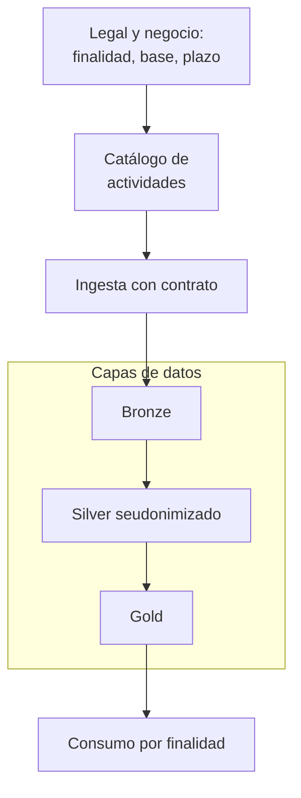
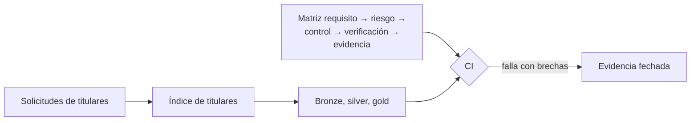

## 1. Resumen

Esta ficha no es asesoría legal: explica el alcance técnico. El detalle de cada requisito está en su ficha hija.

### Objetivo

Comprender cómo la protección de datos personales influye en el diseño, desarrollo, operación, seguridad y auditoría de las plataformas de datos, conectando los principios y obligaciones de la normativa chilena con arquitecturas, herramientas y prácticas reales de Ingeniería de Datos.

El propósito es desarrollar el criterio técnico necesario para identificar riesgos, diseñar soluciones responsables, implementar controles y generar evidencia verificable, integrando la privacidad durante todo el ciclo de vida de los datos.

### Idea central

Un proceso puede ejecutarse sin errores, cumplir sus controles de calidad y entregar información confiable, pero al mismo tiempo:

- Utilizar datos para una finalidad no autorizada.
- Recopilar o conservar información que no resulta necesaria.
- Exponer datos personales mediante accesos, transformaciones o transferencias inadecuadas.
- Mantener copias o derivados que dificultan la rectificación o supresión.
- Carecer de trazabilidad y evidencia suficiente para investigar incidentes o demostrar la eficacia de sus controles.

Por ello, la Ingeniería de Datos debe incorporar la privacidad como un criterio transversal de diseño y operación, no únicamente como una revisión posterior al desarrollo.

### Contexto normativo

La Ley 21.719 reescribe la Ley 19.628. Según BCN, fue publicada el 2024-12-13 y, por su artículo primero transitorio, sus modificaciones rigen desde el **2026-12-01**; BCN muestra la Ley 19.628 con una versión «Con Vigencia Diferida por Fecha» desde esa fecha.

**Estado al 2026-10-28.** El Ejecutivo ingresó el boletín 18.623-07 (mensaje N° 110-374). Su numeral 2 reemplaza esa fecha por el **1 de diciembre de 2027**. Según la tramitación oficial del Senado, el 2026-10-28 el Senado lo aprobó en general y en particular a la vez y lo despachó a la Cámara de Diputados (subetapa «Oficio de ley a Cámara Revisora»), con urgencia de discusión inmediata. Es un proyecto: **mientras no se publique otra ley, rige el 2026-12-01**.

### Qué implica para Ingeniería de Datos

Las actividades habituales de una plataforma de datos —recolección, ingesta, consulta, transformación, almacenamiento, integración, transmisión, conservación y eliminación— pueden constituir operaciones de tratamiento de datos personales.

En consecuencia, una arquitectura de datos debe permitir responder preguntas fundamentales:

| | |
|---|---|
| Qué datos tratamos | Identificación, clasificación y contexto de los datos personales. |
| Por qué los tratamos | Finalidad y fundamento de licitud definidos por los responsables correspondientes. |
| Dónde se encuentran | Sistemas de origen, capas de procesamiento, derivados, respaldos y terceros. |
| Quién puede utilizarlos | Identidades, permisos, condiciones de acceso y consumidores autorizados. |
| Durante cuánto tiempo | Políticas de conservación, bloqueo, anonimización o supresión, según corresponda. |
| Cómo protegemos los datos | Medidas de seguridad, minimización, seudonimización y prevención de exposiciones. |
| Cómo respondemos | Mecanismos para gestionar derechos de los titulares, vulneraciones e incidentes. |
| Cómo lo demostramos | Trazabilidad, verificaciones, registros y evidencia de los controles implementados. |

### De la normativa a la implementación técnica

La ley establece obligaciones y responsabilidades jurídicas. La Ingeniería de Datos contribuye a su cumplimiento mediante soluciones técnicas adecuadas al contexto, al riesgo y a las decisiones adoptadas por las áreas responsables.

Para estudiar esa relación, utilizaremos el enfoque:

**Requisito normativo → Riesgo identificado → Control técnico → Verificación → Evidencia**

Este modelo permite conectar las obligaciones aplicables con decisiones concretas de arquitectura, desarrollo y operación.

## 2. Qué es

**[Buena práctica]** **Obligación legal frente a patrón técnico.** La ley impone obligaciones a quien corresponde (responsable o encargado). La matriz requisito → control → evidencia, las pruebas en la CI y los plazos internos de revisión son patrones técnicos propuestos aquí: **no** son obligaciones literales ni exigen una herramienta específica.

### Ocho principios del artículo 3

- **[Obligación legal · art. 3]** a) Licitud y lealtad.
- **[Obligación legal · art. 3]** b) Finalidad.
- **[Obligación legal · art. 3]** c) Proporcionalidad.
- **[Obligación legal · art. 3]** d) Calidad.
- **[Obligación legal · art. 3]** e) Responsabilidad.
- **[Obligación legal · art. 3]** f) Seguridad.
- **[Obligación legal · art. 3]** g) Transparencia e información.
- **[Obligación legal · art. 3]** h) Confidencialidad.

### Responsabilidades: quién decide y quién implementa

- **[Buena práctica]** Legal, privacidad y negocio: definen finalidad, base de licitud y plazos aplicables.
- **[Buena práctica]** Seguridad: define y evalúa el riesgo y las medidas de protección.
- **[Buena práctica]** Ingeniería de Datos: implementa controles técnicos, automatización, trazabilidad y evidencia.
- **[Obligación legal · art. 3]** Responsable del tratamiento: conserva las responsabilidades legales que le corresponden.

### Conceptos que el ingeniero debe dominar

**[Buena práctica]** La etiqueta de cada fila corresponde a la definición (letra del art. 2 entre paréntesis); la columna «Error a evitar» es orientación técnica.

| Concepto | Explicación práctica | Error a evitar |
|---|---|---|
| **[Obligación legal · art. 2]** Dato personal (f) | Información vinculada o referida a una persona natural identificada o identificable, directa o indirectamente | Suponer que solo el nombre o el RUT son datos personales |
| **[Obligación legal · art. 2]** Dato sensible (g) | Se refiere a características físicas o morales o a hechos o circunstancias de la vida privada o intimidad, y revela origen étnico o racial, afiliación política, sindical o gremial, situación socioeconómica, convicciones ideológicas o filosóficas, creencias religiosas, salud, perfil biológico humano, datos biométricos, vida sexual, orientación sexual o identidad de género (lista cerrada; detección en `pii-identification`) | Clasificar solo por el nombre de la columna |
| **[Obligación legal · art. 2]** Tratamiento (o) | Cualquier operación, automatizada o no, para recolectar, procesar, almacenar, comunicar, transmitir o utilizar datos personales | Creer que un ETL interno no es tratamiento |
| **[Obligación legal · art. 2]** Responsable (n) | Decide los fines y medios del tratamiento, aunque lo ejecute un encargado | Atribuir las decisiones jurídicas al equipo técnico |
| **[Obligación legal · art. 2]** Encargado (x) | Trata datos personales por cuenta del responsable | Suponer que todo proveedor es encargado en toda actividad |
| **[Obligación legal · art. 2]** Seudonimización (l) | Los datos ya no se atribuyen a un titular sin información adicional, que figura por separado y está sujeta a medidas técnicas y organizativas | Considerarla anonimización |
| **[Obligación legal · art. 2]** Anonimización (k) | Procedimiento irreversible: el dato ya no puede vincularse a una persona ni permitir su identificación | Declarar anónima una tabla solo porque se quitó el RUT |
| **[Obligación legal · art. 3]** Finalidad y base de licitud (arts. 3 b), 12 y 13) | Para qué se trata el dato y qué habilita ese tratamiento | Asignar una sola base a un dataset que se reutiliza |

### Los ocho principios del art. 3 como decisiones técnicas

**[Obligación legal · art. 3]** Los ocho principios rigen el tratamiento; la pregunta y el control de cada fila son orientativos y llevan su propia etiqueta.

| Principio | Pregunta del ingeniero | Control orientativo |
|---|---|---|
| a) Licitud y lealtad | ¿Este tratamiento tiene una base validada para esta finalidad? | Cada actividad del catálogo con su base validada |
| b) Finalidad | ¿Algún consumidor usa los datos para otro propósito? | Metadatos de uso, permisos y contratos de consumo |
| c) Proporcionalidad | ¿Capturamos más campos de los necesarios? | Lista de columnas permitidas por producto y capa |
| d) Calidad | ¿Los datos son exactos y están actualizados? | Pruebas de exactitud, vigencia y rectificación |
| e) Responsabilidad | ¿Quién decide y quién opera cada control? | Dueños, aprobaciones y evidencia |
| f) Seguridad | ¿Quién puede acceder y qué pasa ante una falla? | Mínimo privilegio, cifrado, respaldo y monitoreo |
| g) Transparencia e información | ¿Podemos explicar qué tratamientos existen? | Catálogo conectado al inventario de actividades |
| h) Confidencialidad | ¿Se exponen datos a usuarios o sistemas no autorizados? | Segregación, secretos, registros y control de exportaciones |

**[Buena práctica]** Estos controles son propuestas de diseño: su suficiencia depende del contexto, del riesgo y de las obligaciones aplicables.

## 3. Problema que resuelve

**[Buena práctica]** Sin traducción técnica, la ley queda en un documento: hay copias de datos personales sin control, accesos amplios, tablas que no se pueden borrar, backfills que reintroducen datos suprimidos y ninguna evidencia de qué se hizo.

**[Buena práctica]** **La pregunta central:** ¿podemos reconstruir qué ocurrió con los datos de una persona y demostrar qué medidas se aplicaron?

**[Decisión de arquitectura]** Responderla exige coordinar negocio, legal y privacidad, seguridad, plataforma e ingeniería de datos. Ingeniería no decide la finalidad ni la base; sí identifica las implicancias técnicas, implementa los controles y reporta sus limitaciones.

## 4. Cómo funciona

**[Buena práctica]** Seis preguntas de diseño.

1. **[Buena práctica]** **¿Qué datos trato?** Descubrir identificadores directos e indirectos, datos sensibles y combinaciones reidentificables.
2. **[Decisión de arquitectura]** **¿Para qué se necesitan?** Registrar cada **actividad de tratamiento** con finalidad, base de licitud y plazo, y asociarla a los activos que usa; un dataset puede servir a varias actividades con bases distintas. De ahí sale la información pública.
3. **[Buena práctica]** **¿Dónde circulan?** Trazar fuentes, APIs, colas, buckets, tablas, modelos, exportaciones y proveedores, incluidos los que están fuera de Chile.
4. **[Decisión de arquitectura]** **¿Cómo los protejo?** Minimizar desde la ingesta con contratos que fijan los campos permitidos por capa, seudonimizar cuando proceda y evaluar el impacto en los casos que lo exigen.
5. **[Buena práctica]** **¿Cómo los corrijo, bloqueo o suprimo?** Capacidades para los derechos del art. 4 que alcancen derivados, historiales, respaldos, CDC y reprocesos.
6. **[Decisión de arquitectura]** **¿Cómo lo demuestro?** Cada control produce evidencia automática y la CI falla si falta un control o su evidencia; la consulta de alcance por linaje permite dimensionar una vulneración.

**[Decisión de arquitectura]** Matriz de control:

| Requisito | Riesgo | Control técnico | Verificación | Evidencia |
|---|---|---|---|---|
| Minimización | Columnas no aprobadas llegan a capas analíticas | Contrato de campos permitidos | Test de esquema en CI | Resultado del test y versión del contrato |
| Retención | Datos vencidos siguen guardados o vuelven con un replay | Política por clase de dato y almacenamiento | Control de vencidos tras la purga | Configuración, ejecución y excepciones |
| Acceso restringido | Usuarios inactivos o con privilegios de más | IAM o RBAC, segregación | Revisión periódica de permisos | Inventario de permisos y revisión fechada |
| Derechos del titular | Supresión parcial: el dato reaparece en derivados o reprocesos | Localizador de registros y flujo autorizado | Prueba de replay con tombstones | ID de la solicitud, estados y resultado |
| Vulneraciones | No poder dimensionar el alcance a tiempo | Logs, alertas y consulta de alcance por linaje | Simulacro de consulta de alcance | Línea de tiempo, sistemas afectados y acciones |
| Transferencias | Flujos a terceros o al extranjero sin control | Inventario de destinos y controles del proveedor | Conciliación de flujos contra el inventario | Contrato, evaluación y trazabilidad |

**[Buena práctica]** La evidencia no guarda nombres, RUT ni datos sensibles cuando basta una referencia interna protegida.

## 5. Cuándo utilizarlo

- Al diseñar una plataforma o un pipeline que trata datos de personas.
- Al incorporar una fuente, API, CDC o pipeline nuevo que trate datos personales.
- Al migrar una plataforma on-premise a la nube.
- Al crear productos de datos, modelos, dashboards, exportaciones o integraciones externas.
- Al habilitar ambientes de desarrollo y pruebas, respaldos y recuperación.
- Al introducir servicios de IA o LLM que puedan recibir datos personales.
- Al preparar una revisión interna, un modelo de prevención o la respuesta a un requerimiento.

## 9. Arquitectura

**Del requisito al dato.**



**Control y evidencia.**



## 10. Código

```python
# Python 3.12+, biblioteca estándar. De punta a punta: datos ficticios → 4 controles → validación de la evidencia →
# código de salida (0 aprueba, 1 rechaza). Uso: python controles.py con-brechas | corregido | sin-revision |
# evidencia-alterada | control-faltante | evidencia-vencida. PASS / FAIL / UNKNOWN como en privacy-controls-as-code:
# UNKNOWN (falta el dato para evaluar) nunca cuenta como PASS. Didáctico: no certifica cumplimiento; cada docstring
# nombra el principio o el derecho de la Ley 19.628, modificada por la Ley 21.719, que el control evidencia, y separa
# la regla técnica, que la ley no fija.
import hashlib
import json
import sys
from dataclasses import dataclass, field, replace
from datetime import date, datetime, timedelta, timezone

# @paso 1 Datos
REFERENCE = datetime(2026, 10, 26, 12, tzinfo=timezone.utc)   # fecha fija: resultado reproducible
MAX_AGE = timedelta(days=30)   # política interna ilustrativa, NO un plazo legal
RETENTION_DAYS = 90            # plazo de la política. Alargarlo para que el control pase es un antipatrón: se purga
CUTOFF = REFERENCE.date() - timedelta(days=RETENTION_DAYS)
APPROVED = frozenset({"customer_id", "email", "created_at"})
Row = dict[str, object]


@dataclass(frozen=True)
class User:
    name: str
    active: bool
    authorized: bool


@dataclass(frozen=True)
class Platform:
    warehouse: tuple[Row, ...]
    source: tuple[Row, ...]
    tombstones: frozenset[object]
    users: tuple[User, ...]
    last_access_review: date | None = date(2026, 10, 20)
    replay_honors_tombstones: bool = True
    replay_applies_retention: bool = True


@dataclass(frozen=True)
class Result:
    control_id: str
    status: str   # PASS | FAIL | UNKNOWN
    detail: str
    executed_at: datetime = REFERENCE
    evidence_uri: str = ""
    evidence: dict[str, str] = field(default_factory=dict)

    def sha256(self) -> str:   # huella de la evidencia serializada, guardada junto a evidence_uri
        return hashlib.sha256(json.dumps(self.evidence, sort_keys=True).encode()).hexdigest()


def expired(row: Row) -> bool:
    return date.fromisoformat(str(row["created_at"])) < CUTOFF


def with_gaps() -> Platform:   # cada brecha se inyecta por separado y a la vista
    ana: Row = {"customer_id": 101, "email": "ana@example.test", "created_at": "2026-10-01"}
    bruno: Row = {"customer_id": 102, "email": "bruno@example.test", "created_at": "2026-10-03"}   # suprimido
    old: Row = {"customer_id": 104, "email": "diego@example.test", "created_at": "2026-06-01"}
    return Platform(
        warehouse=({**ana, "nota_libre": "sin aprobar"}, old),      # brecha 4: columna no aprobada; 3: registro vencido
        source=(ana, bruno, old), tombstones=frozenset({102}),
        users=(User("analista", True, True), User("ex_usuario", False, True)),   # brecha 1: inactivo con acceso
        replay_honors_tombstones=False,                                          # brecha 2: replay sin tombstones
        replay_applies_retention=False)              # bug: el replay desde source vuelve a traer el registro vencido


def fix(p: Platform) -> Platform:   # corrige cada brecha; el plazo de retención no cambia
    kept = tuple({c: v for c, v in r.items() if c in APPROVED} for r in p.warehouse if not expired(r))   # purga y minimiza
    users = tuple(replace(u, authorized=u.authorized and u.active) for u in p.users)
    return replace(p, warehouse=kept, users=users, replay_honors_tombstones=True, replay_applies_retention=True)


def replay(p: Platform) -> list[Row]:   # lo que vuelve a cargarse si se reconstruye el warehouse desde source
    rows = [r for r in p.source if not (p.replay_honors_tombstones and r["customer_id"] in p.tombstones)]
    if p.replay_applies_retention:
        rows = [r for r in rows if not expired(r)]
    return rows


# @paso 2 Controles
def access_review(p: Platform) -> tuple[str, str]:
    """Principio de seguridad (art. 3): el tratamiento se protege con medidas técnicas y organizativas contra el acceso
    no autorizado. Control técnico: un usuario inactivo no conserva acceso (authorized ⇒ active) y la revisión de
    accesos tiene fecha; esa regla es del ejemplo, no de la ley."""
    holders = [u.name for u in p.users if u.authorized and not u.active]
    if holders:
        return "FAIL", f"inactivos con acceso: {holders}"
    if p.last_access_review is None:
        return "UNKNOWN", "sin fecha de última revisión"
    return "PASS", "ok"


def erasure_replay_check(p: Platform) -> tuple[str, str]:
    """Derecho de supresión (art. 7): el titular puede pedir que se supriman sus datos en los casos que el artículo
    indica. Control técnico: un registro suprimido no vuelve con un replay (tombstones); el artículo no habla de
    replays."""
    revived = [r["customer_id"] for r in replay(p) if r["customer_id"] in p.tombstones]
    if revived:
        return "FAIL", f"reaparecen: {revived}"
    return "PASS", "ok"


def retention_check(p: Platform) -> tuple[str, str]:
    """Principio de proporcionalidad (art. 3): los datos se conservan solo el tiempo necesario para la finalidad y
    después se suprimen o anonimizan. Control técnico: se evalúa el warehouse y también la salida del replay, que puede
    volver a traer lo purgado; el plazo de cada dato es política interna."""
    stored = [r["customer_id"] for r in p.warehouse if expired(r)]
    replayed = [r["customer_id"] for r in replay(p) if expired(r)]
    if stored or replayed:
        return "FAIL", f"vencidos sin purgar: {stored}; en la salida del replay: {replayed}"
    return "PASS", "ok"


def schema_minimization(p: Platform) -> tuple[str, str]:
    """Principio de proporcionalidad (art. 3): solo los datos necesarios, adecuados y pertinentes para la finalidad.
    Control técnico: ninguna columna fuera del contrato aprobado."""
    extra = sorted({c for r in p.warehouse for c in r} - APPROVED)
    if extra:
        return "FAIL", f"columnas no aprobadas: {extra}"
    return "PASS", "ok"


CONTROLS = (access_review, erasure_replay_check, retention_check, schema_minimization)
CONTROL_IDS = tuple(control.__name__ for control in CONTROLS)


def run_controls(p: Platform) -> list[Result]:
    results = []
    for control in CONTROLS:
        status, detail = control(p)
        uri = f"evidencia://ci-20261026/{control.__name__}.json"
        evidence = {"status": status, "detail": detail}
        results.append(Result(control.__name__, status, detail, evidence_uri=uri, evidence=evidence))
    return results


# @paso 3 Validación
def completeness(results: list[Result], expected: tuple[str, ...]) -> list[str]:
    """Cada control esperado aparece exactamente una vez: si falta o está duplicado, es brecha."""
    ids = [r.control_id for r in results]
    gaps = [f"{c}: falta el resultado" for c in expected if ids.count(c) == 0]
    return gaps + [f"{c}: resultado duplicado" for c in expected if ids.count(c) > 1]


def evidence_gaps(r: Result, stored_sha256: dict[str, str]) -> list[str]:
    gaps = []
    if r.status != "PASS":
        gaps.append(f"{r.control_id}: {r.status} ({r.detail})")
    if REFERENCE - r.executed_at > MAX_AGE:
        gaps.append(f"{r.control_id}: evidencia vencida ({(REFERENCE - r.executed_at).days} días)")
    if not r.evidence_uri:
        gaps.append(f"{r.control_id}: evidencia sin URI")
    if stored_sha256.get(r.control_id) != r.sha256():
        gaps.append(f"{r.control_id}: huella distinta a la guardada")
    return gaps


def validate(results: list[Result], stored_sha256: dict[str, str], expected: tuple[str, ...]) -> list[str]:
    """Principio de responsabilidad (art. 3): quien trata datos responde por el cumplimiento de los principios y
    deberes de la ley. Control técnico: un estado autodeclarado no basta; cada control aparece una vez, con evidencia
    reciente, con URI y con la misma huella SHA-256 que se guardó."""
    gaps = completeness(results, expected)
    for r in results:
        gaps += evidence_gaps(r, stored_sha256)
    return gaps


# @paso 4 Resultado
def scenario_results(scenario: str) -> tuple[list[Result], dict[str, str]]:
    platforms = {"con-brechas": with_gaps(), "sin-revision": replace(fix(with_gaps()), last_access_review=None)}
    results = run_controls(platforms.get(scenario, fix(with_gaps())))
    stored = {r.control_id: r.sha256() for r in results}   # en la CI, la huella se guarda al ejecutar
    if scenario == "evidencia-alterada":   # alguien edita la evidencia después de guardada su huella
        results[2] = replace(results[2], evidence={"status": "PASS", "detail": "editado a mano"})
    if scenario == "control-faltante":     # el resultado de schema_minimization no llega
        results = [r for r in results if r.control_id != "schema_minimization"]
    if scenario == "evidencia-vencida":    # access_review se ejecutó hace 31 días
        results[0] = replace(results[0], executed_at=REFERENCE - timedelta(days=31))
    return results, stored


SCENARIOS = ("con-brechas", "corregido", "sin-revision", "evidencia-alterada", "control-faltante", "evidencia-vencida")


def main(scenario: str) -> int:
    if scenario not in SCENARIOS:
        print(f"escenario desconocido: {scenario}; use uno de {', '.join(SCENARIOS)}")
        return 1
    results, stored = scenario_results(scenario)
    gaps = validate(results, stored, CONTROL_IDS)
    print(f"{scenario}: " + ", ".join(f"{r.control_id}={r.status}" for r in results))
    print("\n".join(f"BRECHA {g}" for g in gaps) or "sin brechas")
    if gaps:
        print("CI: rechazada (1)")
        return 1
    print("CI: aprobada (0)")
    return 0


if __name__ == "__main__":
    sys.exit(main(sys.argv[1] if len(sys.argv) > 1 else "con-brechas"))
```

El script se **ejecuta en la CI**: evalúa cuatro controles de privacidad sobre datos ficticios, valida su evidencia y devuelve el código de salida con que la CI aprueba o rechaza.

`con-brechas`: las cuatro brechas inyectadas hacen fallar sus cuatro controles; código de salida 1.

```text
$ python controles.py con-brechas
con-brechas: access_review=FAIL, erasure_replay_check=FAIL, retention_check=FAIL, schema_minimization=FAIL
BRECHA access_review: FAIL (inactivos con acceso: ['ex_usuario'])
BRECHA erasure_replay_check: FAIL (reaparecen: [102])
BRECHA retention_check: FAIL (vencidos sin purgar: [104]; en la salida del replay: [104])
BRECHA schema_minimization: FAIL (columnas no aprobadas: ['nota_libre'])
CI: rechazada (1)
```

`corregido`: con cada brecha corregida, los cuatro controles pasan; código de salida 0.

```text
$ python controles.py corregido
corregido: access_review=PASS, erasure_replay_check=PASS, retention_check=PASS, schema_minimization=PASS
sin brechas
CI: aprobada (0)
```

`sin-revision`: sin fecha de la última revisión de accesos, `access_review` queda en `UNKNOWN`, que no cuenta como `PASS`; código de salida 1.

```text
$ python controles.py sin-revision
sin-revision: access_review=UNKNOWN, erasure_replay_check=PASS, retention_check=PASS, schema_minimization=PASS
BRECHA access_review: UNKNOWN (sin fecha de última revisión)
CI: rechazada (1)
```

`evidencia-alterada`: la evidencia de `retention_check` se edita después de guardar su huella y la huella ya no coincide; código de salida 1.

```text
$ python controles.py evidencia-alterada
evidencia-alterada: access_review=PASS, erasure_replay_check=PASS, retention_check=PASS, schema_minimization=PASS
BRECHA retention_check: huella distinta a la guardada
CI: rechazada (1)
```

`control-faltante`: no llega el resultado de `schema_minimization` y la validación lo marca como faltante; código de salida 1.

```text
$ python controles.py control-faltante
control-faltante: access_review=PASS, erasure_replay_check=PASS, retention_check=PASS
BRECHA schema_minimization: falta el resultado
CI: rechazada (1)
```

`evidencia-vencida`: la evidencia de `access_review` tiene 31 días, más que los 30 de la política; código de salida 1.

```text
$ python controles.py evidencia-vencida
evidencia-vencida: access_review=PASS, erasure_replay_check=PASS, retention_check=PASS, schema_minimization=PASS
BRECHA access_review: evidencia vencida (31 días)
CI: rechazada (1)
```

Limitación: es un ejemplo didáctico y no certifica cumplimiento; un `PASS` demuestra que el control funcionó, no que el tratamiento sea lícito. La huella se calcula en la misma ejecución; en producción se compara contra la evidencia guardada en un almacenamiento inmutable.

## 11. GCP

En GCP, **Sensitive Data Protection** y **Cloud Audit Logs**.

| Necesidad | Servicio |
|---|---|
| Descubrir y clasificar | Sensitive Data Protection: descubre, clasifica y desidentifica; perfila BigQuery, Cloud SQL y Cloud Storage |
| Auditar accesos a datos | Cloud Audit Logs: los Data Access audit logs están desactivados por defecto, salvo en BigQuery |

Los Data Access audit logs se configuran por servicio: revisar BigQuery y cada recurso que se use.

## 12. AWS

En AWS, **Amazon Macie** y **AWS CloudTrail**.

| Necesidad | Servicio |
|---|---|
| Descubrir | Amazon Macie: datos sensibles en buckets de S3 |
| Auditar accesos a datos | CloudTrail: los data events no se registran por defecto |

## 13. Azure

En Azure, **Microsoft Purview** y **Unity Catalog** de Azure Databricks.

| Necesidad | Servicio |
|---|---|
| Descubrir y clasificar | Purview Data Map: clasificaciones de sistema y propias al escanear |
| Gobierno en el lakehouse | Unity Catalog: privilegios, políticas por atributos, filtros de fila y columna, auditoría y linaje |

Los servicios de GCP, AWS y Azure no son equivalencias exactas. Ningún servicio certifica cumplimiento por sí solo: cada uno se evalúa por alcance, configuración y evidencia disponible.

## 14. Buenas prácticas

- **[Buena práctica]** Una fila de la matriz por requisito, con dueño técnico y fecha de la última evidencia.
- **[Decisión de arquitectura]** Los metadatos legales viven en el catálogo, por actividad de tratamiento, no en el código del pipeline.
- **[Buena práctica]** **Seguridad:** ningún ambiente no productivo con datos personales reales; datos enmascarados o sintéticos.
- **[Buena práctica]** **Observabilidad:** sin datos personales en los logs; los logs de solicitudes y de vulneraciones guardan identificadores internos.
- **[Buena práctica]** **GenAI:** tratar una API externa de LLM que recibe datos personales como un encargado (art. 15 bis) y revisar si hay transferencia internacional (art. 27).
- **[Buena práctica]** **Costo:** empezar por lo de mayor riesgo: datos sensibles (incluida la situación socioeconómica), datos de niños, niñas y adolescentes, copias y accesos.

## 16. Trade-offs

**[Decisión de arquitectura]**

- **Minimización frente a flexibilidad analítica:** capturar menos reduce el riesgo y puede limitar análisis futuros; se resuelve con finalidades explícitas, aprobaciones y productos de datos definidos, no recolectando por si acaso.
- **Linaje completo frente a costo:** rastrear todas las copias cuesta; priorizar los datos y flujos de mayor riesgo y automatizar el descubrimiento de a poco.
- **Retención frente a auditoría y recuperación:** borrar demasiado pronto puede afectar obligaciones legítimas de conservación; conservar indefinidamente aumenta la exposición. La política se aprueba y debe poder ejecutarse.
- **Seguridad frente a rendimiento:** tokenización, máscaras y controles finos agregan latencia y complejidad; se diseñan con pruebas de carga y análisis de riesgo.
- **Matriz detallada frente a mantenible:** una fila por requisito, con el detalle en las fichas hijas; exigir evidencia reciente cuesta, pero es lo que demuestra que el control funciona.

No toda falla técnica es una infracción: la calificación jurídica depende del hecho y del procedimiento. Lo útil para ingeniería es prevenir las fallas que sí tienen origen técnico.

### Sanciones

| Tipo | Ejemplos con origen técnico | Multa máxima |
|---|---|---|
| Leve | Responder solicitudes en forma incompleta o fuera de plazo (34 bis c)) | 5.000 UTM o amonestación escrita |
| Grave | Datos innecesarios o inexactos (34 ter c) y d)); fallas de seguridad (j)); omitir registros de vulneraciones (k)); transferencias contra la ley (m)) | 10.000 UTM |
| Gravísima | Omitir en forma deliberada la comunicación de una vulneración (34 quáter f)); no hacer la evaluación de impacto obligatoria (k)) | 20.000 UTM |

En reincidencia, la Agencia puede aplicar hasta tres veces el monto de la infracción. Si una empresa que no es de menor tamaño reincide en infracciones graves o gravísimas, la multa puede alcanzar la más gravosa entre ese triple y el 2 % o 4 % de sus ingresos anuales por ventas y servicios del último año calendario, respectivamente (art. 35). Es atenuante haber cumplido diligentemente los deberes de dirección y supervisión, lo que se verifica con el certificado del art. 51 (art. 36 n.º 5). Ese certificado es del modelo de prevención de infracciones, que los responsables pueden adoptar voluntariamente (art. 49).

### Qué se espera de un nivel senior

- Automatiza el descubrimiento y la clasificación de datos personales.
- Diseña segregación de funciones y revisiones de privilegios.
- Diseña una supresión consistente entre capas, respaldos y reprocesamientos.
- Gestiona llaves, secretos y evidencia de configuración.
- Mantiene linaje técnico por actividad de tratamiento.
- Pone controles de privacidad en la CI.
- Calcula el alcance de una vulneración en horas.

## 18. Preguntas técnicas abiertas

1. ¿Qué pipelines tuyos tratan datos de personas, y para qué actividades?
2. Si mañana llega una solicitud de supresión, ¿en cuántas tablas, respaldos y exportaciones está ese titular?
3. ¿Qué control tuyo tiene evidencia de los últimos 30 días?
4. ¿Cómo impedirías que un backfill restaure datos que debían quedar suprimidos?
5. ¿Qué información técnica necesitarían seguridad y privacidad para dimensionar una vulneración?

## 20. Fuentes

- BCN Ley Chile: *Ley 19628 SOBRE PROTECCION DE LOS DATOS PERSONALES* (versión con vigencia diferida desde 2026-12-01), *Ley 21719* y *Decreto 662*.
- Senado: *Boletín 18623-07* (tramitación) y *Boletín N° 18.623-07* (mensaje N° 110-374).
- Google Cloud: *Sensitive Data Protection overview* y *Cloud Audit Logs overview*.
- AWS: *What is Amazon Macie?* y *Logging data events*.
- Microsoft Learn: *Data classification in Data Map* y *What is Unity Catalog?*.

El detalle de cada fuente está en `sources` del frontmatter.

## 21. Fecha de última verificación

2026-10-28: textos legales vueltos a consultar en BCN (sin cambios) y estado del boletín 18.623-07 en el Senado (aprobado por el Senado y despachado a la Cámara). Antes, 2026-10-25: textos legales vueltos a consultar, sin cambios, y 2026-10-22: articulado, vigencia, estado del boletín 18.623-07 y Decreto 662 consultados ese día en BCN y en el Senado. `review_required` desde el 2026-11-06: depuración de contenido pedida por Felipe; vuelve a `verified` cuando la apruebe (`owner_approved_at`). Revisión mensual, y extraordinaria si se publica la ley de postergación.

## 22. Historial de cambios importantes

- 2026-10-21: creación (lote F3b-19a); absorbe `compliance-scope-for-data-engineers`.
- 2026-10-22: reestructura como ficha padre del subdominio (upgrade de 19): mapa de artículos, estado de la postergación según el Senado, Decreto 662, caso por capas, sanciones y contraste básico/senior. La matriz exige evidencia reciente y hace fallar la CI. El detalle pasa a las fichas hijas.
- 2026-10-24: las hijas se declaran con `PART_OF` (ADR-024) en vez de `RELATED_TO`; `implication` por artículo en `legal_basis` (enmienda de ADR-023). Sin cambios de contenido legal ni de código.
- 2026-10-25: revisión del upgrade (`docs/reviews/cards-f3b-19-upgrade.md`) y auditoría de las etiquetas «Obligación legal»: cada una afirma solo lo que dice su artículo; lo demás pasa a buena práctica o decisión de arquitectura. Textos de BCN y del Senado consultados el 2026-10-25, sin cambios desde el 2026-10-22.
- 2026-10-25: §9 con el estándar de diagramas (máximo 8 nodos, CLAUDE.md): dos diagramas: del requisito al dato, y control y evidencia; capas en un subgraph.
- 2026-10-26: mejora de contenido con tres niveles de lectura: §1 (cómo leerla), §2 (obligación frente a patrón técnico, conceptos del art. 2 con «Error a evitar» y principios del art. 3 con pregunta y control), §3 (pregunta central), §4 (seis preguntas enlazadas a las hijas y matriz con «Decisión aprobada por»), §5, §6, §7 (minimización de una API), §8 (caso de supresión), §10 (validador de resultados con entrada versionada y fecha como argumento), §11 y §13 (no son equivalencias exactas; Data Access audit logs), §15 (tabla), §16 (trade-offs), §17 (regla editorial) y §18. Sin cambios en `legal_basis`, etiquetas de los artículos, aviso, vigencia, boletín ni sanciones.
- 2026-10-27: revisión `docs/reviews/cdp-v2.md` aplicada: la fila del art. 2 g) recoge la lista completa de la letra, sin «entre otros», y la del art. 2 l) dice «medidas técnicas y organizativas». Sin cambios en `legal_basis` ni vigencia.
- 2026-10-28: pasa al dominio 24-privacy-engineering, tramo `fundamentos` (ADR-027), desde 19-compliance; sin cambios de contenido. La URL de la ficha (`/concepts/chile-data-protection/`) no cambia.
- 2026-10-28: vigencia actualizada con el estado de hoy del boletín 18.623-07 (aprobado por el Senado y despachado a la Cámara; la vigencia legal sigue en el 2026-12-01), consultado en el Senado; textos de BCN y mensaje vueltos a consultar, sin cambios. Un test compara la fecha y el estado con `content/legal-frameworks/cl-ley-21719.yaml`. §17: «Fichas hijas del dominio».
- 2026-10-28: §17 nombra las cuatro fichas hijas del lote P2 (`purpose-based-authorization`, `distributed-erasure-propagation`, `privacy-backup-and-recovery`, `privacy-in-ai-rag-llm`), en el orden del blueprint. Sin otros cambios.
- 2026-10-28: mismos errores que la revisión de P2: la fila del art. 14 quáter del mapa de artículos nombra sus cuatro factores.
- 2026-10-28: el resumen pasa a ser la introducción del subdominio (objetivo, idea central, contexto normativo y preguntas que debe responder la arquitectura). La vigencia citada sigue siendo la de la ley publicada; el boletín 18.623-07 sigue siendo un proyecto.
- 2026-10-30: sobre la versión de Felipe (`b/ui-ajustes-1030`), solo lo que exige ADR-023 para pasar `make validate`: etiquetas en el párrafo de marco y en los ítems del §2 (principios a) a h) y responsabilidades), y columna «Etiqueta» en la matriz del §4 y en las tablas de §11–13, con los mismos valores que tenían antes. La vigencia ya estaba en sincronía con `cl-ley-21719.yaml`.
- 2026-10-30: Enmienda 3 de ADR-023: en §4, §13, la tabla con la misma etiqueta en todas sus filas pasa a la línea «Etiqueta: […]» antes de la tabla, sin columna. Sin cambios de contenido.
- 2026-10-30: se quitan del resumen «Cómo leerla» y el subtítulo «Ley 21.719: Protección de datos personales aplicada a Ingeniería de Datos»; del §2, el párrafo del marco de la Ley 19.628/21.719 y el bloque «Precisiones transversales».
- 2026-10-30: §17 nombra las fichas hijas nuevas `gdpr` y `lgpd` (lote P4, tramo 6 «Marcos regulatorios comparados»). Sin cambios de contenido.
- 2026-10-30: Enmienda 4 de ADR-023: 6 tabla(s) sin columna ni línea «Etiqueta»; la fila con origen legal lleva «Obligación legal» al inicio de su primera celda. Sin cambios de contenido.
- 2026-11-01: aprobada por Felipe con lista explícita (`owner_approved_at: 2026-11-01`); pasa a `verified` (ADR-023).
- 2026-11-01: §10 reemplazado a partir de la propuesta de Felipe: flujo de punta a punta (datos ficticios → cuatro controles → validación de la evidencia → código de salida 0/1 sin `assert`), estados PASS/FAIL/UNKNOWN, cuatro brechas inyectadas por separado, regla «autorizado ⇒ activo», purga del registro vencido sin cambiar el plazo, `evidence_sha256`, duplicados y evidencia vencida. Sale la entrada versionada `tests/fixtures/privacy-control-results.json`. **Por el cambio de código, la ficha vuelve a `review_required` hasta que Felipe la apruebe de nuevo.**
- 2026-11-01: aprobada de nuevo por Felipe con el §10 nuevo, condicionada a la CI en verde (run 41354325642, 786 tests): `owner_approved_at: 2026-11-01`, vuelve a `verified`.
- 2026-11-03: piloto de código guiado en el §10 (pedido de Felipe): una función por control con el docstring de su letra del art. 3 y sin ternarios encadenados; marcadores `# @paso 1–4`; el replay desde `source` reintroducía el registro vencido y `retention_check` ahora evalúa también su salida (`fix()` aplica la retención al replay); escenario nuevo `evidencia-alterada`, donde falla la huella SHA-256; una salida por escenario con su línea `$ python controles.py <escenario>`, igual a la de la CI. Vuelve a `review_required` hasta la aprobación de Felipe.
- 2026-11-03: aprobada por Felipe con el §10 nuevo (`owner_approved_at: 2026-11-03`); vuelve a `verified` (ADR-023).
- 2026-11-03: a pedido de Felipe, los principios del art. 3 se nombran (en negrita en el texto) en vez de por su letra. Sin cambios de fondo; el estado no cambia.
- 2026-11-04: revisión `docs/reviews/p10.md` aplicada (pedido de Felipe): los docstrings del §10 citan el texto del art. 3 (confidencialidad con «la relación con el titular»; calidad «exactos, completos, actuales y pertinentes»; proporcionalidad «suprimidos o anonimizados») y dejan aparte, como control técnico, lo que la ley no fija (acceso del inactivo, replay, huella SHA-256); el párrafo del §10 nombra en negrita los principios, sin «la letra». Vuelve a `review_required`.
- 2026-11-04: aprobada por Felipe con la revisión P10 y su verificación aplicadas (cita de confidencialidad con «Este», como en BCN) (`owner_approved_at: 2026-11-04`); vuelve a `verified` (ADR-023).
- 2026-11-06: depuración de contenido pedida por Felipe (ADR-029). Se eliminan las secciones 6 (Cuándo no utilizarlo), 7 (Ejemplo sencillo), 8 (Ejemplo de producción), 15 (Errores frecuentes, con la fila «Tenemos cifrado, cumplimos» y la frase sobre la infracción grave del art. 34 ter c) y d)), 17 (Conceptos relacionados) y 19 (Laboratorio relacionado). Además: en §1, el encabezado de la tabla de preguntas y «no es formar especialistas legales, sino»; en §3, el párrafo de la matriz requisito → control → evidencia ejecutada en la CI; en §4, las referencias entre paréntesis a artículos y fichas al final de cada paso; en §16, «(arts. 34 bis a 35)» del título de Sanciones y la columna básica de «Básico vs. senior», que pasa a la lista «Qué se espera de un nivel senior»; en §10, la explicación del código, que queda en una frase, una línea por escenario y una limitación. El catálogo legal agrupado por tema sale del §2 y pasa al anexo. Las dos citas del boletín 18.623-07 se rotulan «tramitación» y «mensaje». Vuelve a `review_required` hasta la aprobación de Felipe.
- 2026-11-07: pedido de Felipe. La matriz del §4 sigue los cinco pasos del Resumen (requisito, riesgo, control técnico, verificación, evidencia) y deja la columna «Decisión aprobada por»; el nodo de la matriz del diagrama «Control y evidencia» nombra los cinco pasos; sale «Resultado esperado» del Resumen. §10: la validación exige que cada control aparezca una vez (falta o duplicado es brecha), separa «evidencia sin URI» de «huella distinta a la guardada» y suma los escenarios `control-faltante` y `evidencia-vencida`; los docstrings nombran el principio sin letra (seguridad en `access_review`) y el derecho de supresión (art. 7) en `erasure_replay_check`, parafraseados, sin citas textuales. Sigue en `review_required`.

## Anexo · Catálogo legal por tema

### Fundamentos, alcance y principios

- **[Obligación legal · art. 1 bis]** Ámbito territorial. También alcanza al encargado fuera de Chile que trata por cuenta de un responsable en Chile y a quien, desde fuera, ofrece bienes o servicios a titulares en Chile o monitorea su comportamiento. Ficha: `processors-and-international-transfers`.
- **[Obligación legal · art. 2]** Definiciones. Dato personal, sensible, anonimización, seudonimización, perfiles y encargado. Fichas: `pii-identification`, `chilean-identifier-pseudonymization`.
- **[Obligación legal · art. 3]** Principios: **licitud y lealtad**, **finalidad**, **proporcionalidad**, **calidad**, **responsabilidad**, **seguridad**, **transparencia e información** y **confidencialidad**. Cada principio necesita un control y una evidencia. Ficha: esta ficha.

### Derechos y decisiones automatizadas

- **[Obligación legal · art. 4]** Derechos del titular, desarrollados en los arts. 5 a 11. Seis tipos de solicitud con plazo y evidencia. Ficha: `data-subject-rights-pipeline`.
- **[Obligación legal · art. 8 bis]** Decisiones individuales automatizadas: explicación, intervención humana y revisión. Ficha: `dpia-and-automated-decisions`.

### Licitud, responsabilidad y transparencia

- **[Obligación legal · art. 12]** Consentimiento; el responsable prueba la licitud. Las demás bases están en el art. 13. Ficha: `processing-activities-inventory`.
- **[Obligación legal · art. 14]** Obligaciones del responsable: acreditar la licitud y suprimir o anonimizar datos precontractuales. Ficha: `processing-activities-inventory`.
- **[Obligación legal · art. 14 bis]** Secreto o confidencialidad, también de datos públicos organizados o combinados. Ficha: esta ficha.
- **[Obligación legal · art. 14 ter]** Información y transparencia: la política pública se alimenta del catálogo. Ficha: `processing-activities-inventory`.

### Privacidad desde el diseño y seguridad

- **[Obligación legal · art. 14 quáter]** Protección desde el diseño y por defecto. Por defecto, solo los datos específicos y estrictamente necesarios, según número de datos, extensión, plazo y accesibilidad. Ficha: `data-minimization-by-layer`.
- **[Obligación legal · art. 14 quinquies]** Medidas de seguridad y verificación regular. Ficha: `privacy-controls-as-code`.
- **[Obligación legal · art. 14 sexies]** Reporte de vulneraciones a la Agencia, registro de esas comunicaciones y aviso a titulares en ciertos casos. Ficha: `data-breach-response`.

### Encargados, impacto y datos sensibles

- **[Obligación legal · art. 15 bis]** Tratamiento por un encargado. Suprime o devuelve al terminar; la cesión está en el art. 15. Ficha: `processors-and-international-transfers`.
- **[Obligación legal · art. 15 ter]** Evaluación de impacto en los casos que el artículo enumera. Ficha: `dpia-and-automated-decisions`.
- **[Obligación legal · art. 16]** Datos sensibles; reglas especiales en los arts. 16 bis a 16 sexies. Ficha: `pii-identification`.

### Transferencias, sanciones y prevención

- **[Obligación legal · art. 27]** Transferencia internacional. Cada flujo al exterior necesita un mecanismo. Países adecuados y cláusulas, en el art. 28. Ficha: `processors-and-international-transfers`.
- **[Obligación legal · art. 35]** Sanciones. Varias infracciones nacen de fallas técnicas. Ficha: esta ficha (Trade-offs).
- **[Buena práctica]** Art. 49. Modelo de prevención de infracciones, voluntario. El certificado del art. 51 acredita el atenuante del art. 36 n.º 5. Reglamento en el Decreto 662. Ficha: `privacy-controls-as-code`.
