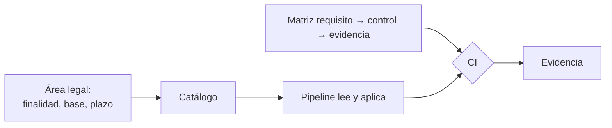

## 1. Resumen

Esta ficha no es asesoría legal: explica cómo trabaja un ingeniero de datos bajo la Ley 21.719, que entra solo como origen de cada requisito.

La Ley 21.719 reescribe la Ley 19.628 sobre datos personales. Según BCN, fue publicada el 2024-12-13 y sus modificaciones rigen desde el 2026-12-01: su artículo primero transitorio fija el día primero del mes vigésimo cuarto posterior a la publicación, y BCN muestra la Ley 19.628 con una versión «Con Vigencia Diferida por Fecha» desde esa fecha. Al 2026-10-21, el boletín 18.623-07, que «modifica la ley N° 21.719 […] en el sentido que indica», está en primer trámite en el Senado (*Boletín 18623-07*). Mientras no se publique otra ley, la fecha que rige es la de BCN.

Para ingeniería de datos, el cambio es este: casi todo lo que hace un pipeline es **tratamiento**, y la ley pide poder **demostrar** que cada tratamiento cumple sus principios. Eso se traduce en controles técnicos con evidencia.

## 2. Qué es

- **[Obligación legal · art. 2]** La ley define dato personal (información vinculada a una persona natural identificada o identificable), dato sensible, tratamiento (recolectar, procesar, almacenar, comunicar, transmitir o utilizar), responsable (quien decide fines y medios), titular, anonimización y seudonimización.
- **[Obligación legal · art. 3]** El tratamiento se rige por ocho principios: licitud y lealtad, finalidad, proporcionalidad, calidad, responsabilidad, seguridad, transparencia e información, y confidencialidad.
- **[Obligación legal · art. 14]** El responsable tiene obligaciones propias, entre ellas poner a disposición del titular los antecedentes que acrediten la licitud del tratamiento.
- **[Obligación legal · art. 15 bis]** Quien trata datos por encargo (un proveedor de nube o de ETL, una consultora) actúa conforme al encargo y a las instrucciones del responsable, regido por un contrato.
- **[Decisión de arquitectura]** Lo que decide el área legal (finalidad, base de licitud, plazos de conservación) entra a la plataforma como metadato; el pipeline lo lee y lo hace cumplir, no lo decide.

## 3. Problema que resuelve

**[Buena práctica]** Sin una traducción técnica, la ley queda en un documento que nadie del equipo de datos lee: hay copias de datos personales sin control, accesos amplios, tablas que no se pueden borrar y ninguna evidencia de qué se hizo.

**[Decisión de arquitectura]** Con un mapa requisito → control → evidencia, cada principio tiene un dueño técnico, un control en la plataforma y una prueba que se puede mostrar.

## 4. Cómo funciona

1. **[Obligación legal · art. 2]** Identificar qué datos son personales o sensibles, con las definiciones de la ley.
2. **[Obligación legal · art. 3]** Por cada principio, definir el control técnico (por ejemplo, proporcionalidad → columnas mínimas por capa y retención por tabla).
3. **[Decisión de arquitectura]** Guardar en el catálogo lo que decide el área legal: finalidad, base de licitud, plazo de conservación.
4. **[Buena práctica]** Asociar a cada control una evidencia automática: un test de la CI, un informe, un registro generado.
5. **[Buena práctica]** Revisar la matriz en la CI: un requisito sin control o sin evidencia es una brecha visible.

## 5. Cuándo utilizarlo

- Al diseñar una plataforma o un pipeline que trata datos de personas en Chile.
- Al preparar una revisión interna o la respuesta a un pedido de información.

## 6. Cuándo no utilizarlo

- Para decidir finalidades, bases de licitud o plazos: eso lo decide el área legal.
- Como interpretación de la ley: esta ficha solo cita su texto.

## 7. Ejemplo sencillo

| Requisito | Control | Evidencia |
|---|---|---|
| Proporcionalidad (art. 3) | Columnas mínimas por capa; retención por tabla | Test de la CI |
| Seguridad (art. 3) | Cifrado, mínimo privilegio, seudonimización | Informe de accesos |
| Acreditar la licitud (art. 14) | Base de licitud en el catálogo | Registro de tratamientos |
| Protección desde el diseño (art. 14 quáter) | Revisión de privacidad por pipeline | Falta |
| Encargo a terceros (art. 15 bis) | Falta | Falta |

## 8. Ejemplo de producción

- Matriz versionada en el repositorio, con dueño técnico por requisito.
- Metadatos legales (finalidad, base, plazo) en el catálogo, mantenidos por el dueño del dato y el área legal.
- La CI revisa la matriz y los tests de cada control en cada cambio.

### Evidencia de cumplimiento

| Evidencia | Dónde queda | Quién la produce |
|---|---|---|
| Matriz requisito → control → evidencia | Repositorio, versionada | Ingeniería de datos |
| Resultado de la revisión de la matriz | Log de la CI | CI |
| Metadatos de finalidad, base y plazo | Catálogo | Dueño del dato y área legal |

## 9. Arquitectura



## 10. Código

```python
# Python 3.12, biblioteca estándar (ejecutado en la CI): matriz requisito → control → evidencia. Cada requisito
# de la ley apunta a un control técnico y a la evidencia que lo demuestra; la CI falla si falta alguno.
# Los requisitos citan el texto de la Ley 19.628 con las modificaciones de la Ley 21.719.
from dataclasses import dataclass


@dataclass(frozen=True)
class Fila:
    requisito: str          # artículo y tema, del texto oficial
    decide: str             # "legal" decide el qué; "datos" implementa el cómo
    control: str | None     # control técnico en la plataforma
    evidencia: str | None   # dónde queda la prueba


MATRIZ = [
    Fila("art. 3 c) proporcionalidad", "datos", "columnas mínimas por capa; retención por tabla", "test de la CI y política de retención"),
    Fila("art. 3 f) seguridad", "datos", "cifrado, mínimo privilegio, seudonimización", "informe de accesos y de cifrado"),
    Fila("art. 14 a) acreditar la licitud", "legal", "base de licitud por dataset en el catálogo", "registro de tratamientos generado"),
    Fila("art. 14 quáter protección desde el diseño", "datos", "revisión de privacidad en cada pipeline", None),
    Fila("art. 15 bis encargo a terceros", "legal", None, None),
]

completas = [f for f in MATRIZ if f.control and f.evidencia]
print(f"requisitos: {len(MATRIZ)}; con control y evidencia: {len(completas)}")
print("sin control:", [f.requisito for f in MATRIZ if not f.control])
print("sin evidencia:", [f.requisito for f in MATRIZ if f.control and not f.evidencia])
print("los decide el área legal:", [f.requisito for f in MATRIZ if f.decide == "legal"])
brechas = len(MATRIZ) - len(completas)
print(f"la CI falla: {brechas > 0} ({brechas} brechas)")
```

El script se **ejecuta en la CI** con la biblioteca estándar y pasa `mypy --strict`. Imprime 5 requisitos con 3 completos, el que no tiene control y el que no tiene evidencia, los dos que decide el área legal, y que la CI fallaría por 2 brechas.

## 11. GCP

En GCP, **Sensitive Data Protection** como herramienta de descubrimiento y clasificación. Según *Ley 19628 SOBRE PROTECCION DE LOS DATOS PERSONALES* y *Sensitive Data Protection overview* (no ejecutado):

| | Matriz (este ejemplo) | Google Cloud | Etiqueta |
|---|---|---|---|
| Qué resuelve | Qué control y qué evidencia tiene cada requisito | Descubrir, clasificar y desidentificar datos sensibles; perfilar BigQuery, Cloud SQL y Cloud Storage | **[Buena práctica]** |
| Qué no resuelve | — | Decidir finalidad o base de licitud | **[Decisión de arquitectura]** |

## 12. AWS

En AWS, **Amazon Macie**. Según *Ley 19628 SOBRE PROTECCION DE LOS DATOS PERSONALES* y *What is Amazon Macie?* (no ejecutado):

| | Matriz (este ejemplo) | Amazon Macie | Etiqueta |
|---|---|---|---|
| Qué resuelve | Qué control y qué evidencia tiene cada requisito | Descubrir datos sensibles en Amazon S3 y evaluar la seguridad de los buckets | **[Buena práctica]** |
| Alcance | Toda la plataforma | Buckets de Amazon S3 | **[Buena práctica]** |

## 13. Azure

En Azure, **Microsoft Purview** (Data Map). Según *Ley 19628 SOBRE PROTECCION DE LOS DATOS PERSONALES* y *Data classification in Data Map* (no ejecutado):

| | Matriz (este ejemplo) | Purview Data Map | Etiqueta |
|---|---|---|---|
| Qué resuelve | Qué control y qué evidencia tiene cada requisito | Clasificar activos al escanear, con más de 200 clasificaciones de sistema y propias | **[Buena práctica]** |
| Qué no resuelve | — | Decidir finalidad o base de licitud | **[Decisión de arquitectura]** |

## 14. Buenas prácticas

- **[Buena práctica]** Una fila de la matriz por requisito, con dueño técnico.
- **[Decisión de arquitectura]** Los metadatos legales viven en el catálogo, no en el código del pipeline.
- **[Buena práctica]** **Seguridad:** la matriz no reemplaza los controles; cada fila apunta a un control real y probado.
- **[Buena práctica]** **Observabilidad:** la revisión de la matriz corre en la CI y su resultado queda como evidencia.
- **[Buena práctica]** **Costo:** empezar por los requisitos con más riesgo (datos sensibles, copias, accesos) y no por documentar todo a la vez.

## 15. Errores frecuentes

- Tratar la ley como un tema solo del área legal.
- Controles sin evidencia: si no hay prueba, no se puede demostrar.
- Decidir finalidades desde el pipeline.

## 16. Trade-offs

Una matriz detallada da trazabilidad completa y cuesta mantenerla; una matriz corta se mantiene y deja huecos. Conviene una fila por requisito con un control y una evidencia, y el detalle en las fichas de cada técnica.

## 17. Conceptos relacionados

- `pii-identification`: qué datos son personales o sensibles.
- `processing-activities-inventory`: el registro de tratamientos.
- `data-minimization-by-layer`: proporcionalidad por capa.
- `pseudonymization-vs-anonymization`: los términos que define la ley.
- `data-classification`: clasificación técnica.

## 18. Preguntas técnicas abiertas

1. ¿Qué pipelines tuyos tratan datos de personas?
2. ¿Dónde queda hoy la finalidad de cada dataset?
3. ¿Qué evidencia podrías mostrar mañana de cada control?

## 19. Laboratorio relacionado

Pendiente (F4).

## 20. Fuentes

- BCN Ley Chile: *Ley 19628 SOBRE PROTECCION DE LOS DATOS PERSONALES* (versión con vigencia diferida desde 2026-12-01) y *Ley 21719 REGULA LA PROTECCIÓN Y EL TRATAMIENTO DE LOS DATOS PERSONALES Y CREA LA AGENCIA DE PROTECCIÓN DE DATOS PERSONALES*.
- Senado: *Boletín 18623-07*.
- Google Cloud: *Sensitive Data Protection overview*.
- AWS: *What is Amazon Macie?*.
- Microsoft Learn: *Data classification in Data Map*.

El detalle de cada fuente está en `sources` del frontmatter.

## 21. Fecha de última verificación

2026-10-21: texto legal, vigencia y estado del boletín 18.623-07 consultados ese día en BCN y en el Senado. `review_required`: pendiente de revisión B-F3.1 del lote F3b-19a; pasa a `verified` solo con la aprobación explícita de Felipe (`owner_approved_at`). Revisión mensual.

## 22. Historial de cambios importantes

- 2026-10-21: creación (lote F3b-19a); absorbe `compliance-scope-for-data-engineers`.
