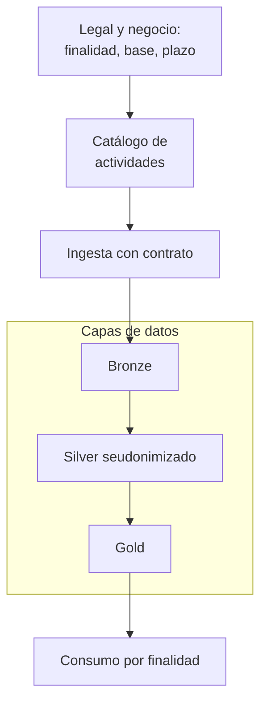
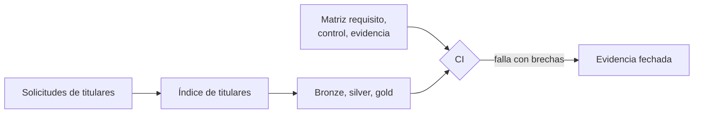

## 1. Resumen

Esta ficha no es asesoría legal: explica el alcance técnico. El detalle de cada requisito está en su ficha hija.

**Cómo leerla.** *Comprender* (§1–6): qué exige la ley y qué afecta a tu trabajo. *Aplicar* (§7–13): cómo diseñarías la solución. *Demostrar*: la evidencia del §8, el código del §10 y las preguntas del §18, para verificar que funciona.

### Ley 21.719: Protección de datos personales aplicada a Ingeniería de Datos

### Objetivo

Comprender cómo la protección de datos personales influye en el diseño, desarrollo, operación, seguridad y auditoría de las plataformas de datos, conectando los principios y obligaciones de la normativa chilena con arquitecturas, herramientas y prácticas reales de Ingeniería de Datos.

El propósito no es formar especialistas legales, sino desarrollar el criterio técnico necesario para identificar riesgos, diseñar soluciones responsables, implementar controles y generar evidencia verificable, integrando la privacidad durante todo el ciclo de vida de los datos.

### Idea central

Un proceso puede ejecutarse sin errores, cumplir sus controles de calidad y entregar información confiable, pero al mismo tiempo:

- Utilizar datos para una finalidad no autorizada.
- Recopilar o conservar información que no resulta necesaria.
- Exponer datos personales mediante accesos, transformaciones o transferencias inadecuadas.
- Mantener copias o derivados que dificultan la rectificación o supresión.
- Carecer de trazabilidad y evidencia suficiente para investigar incidentes o demostrar la eficacia de sus controles.

Por ello, la Ingeniería de Datos debe incorporar la privacidad como un criterio transversal de diseño y operación, no únicamente como una revisión posterior al desarrollo.

### Contexto normativo

La Ley 21.719 reescribe la Ley 19.628. Según BCN, fue publicada el 2024-12-13 y, por su artículo primero transitorio, sus modificaciones rigen desde el **2026-12-01**; BCN muestra la Ley 19.628 con una versión «Con Vigencia Diferida por Fecha» desde esa fecha.

**Estado al 2026-10-28.** El Ejecutivo ingresó el boletín 18.623-07 (mensaje N° 110-374). Su numeral 2 reemplaza esa fecha por el **1 de diciembre de 2027**. Según la tramitación oficial del Senado, el 2026-10-28 el Senado lo aprobó en general y en particular a la vez y lo despachó a la Cámara de Diputados (subetapa «Oficio de ley a Cámara Revisora»), con urgencia de discusión inmediata. Es un proyecto: **mientras no se publique otra ley, rige el 2026-12-01**.

### Qué implica para Ingeniería de Datos

Las actividades habituales de una plataforma de datos —recolección, ingesta, consulta, transformación, almacenamiento, integración, transmisión, conservación y eliminación— pueden constituir operaciones de tratamiento de datos personales.

En consecuencia, una arquitectura de datos debe permitir responder preguntas fundamentales:

| Pregunta | Qué debe poder responder la plataforma |
|---|---|
| Qué datos tratamos | Identificación, clasificación y contexto de los datos personales. |
| Por qué los tratamos | Finalidad y fundamento de licitud definidos por los responsables correspondientes. |
| Dónde se encuentran | Sistemas de origen, capas de procesamiento, derivados, respaldos y terceros. |
| Quién puede utilizarlos | Identidades, permisos, condiciones de acceso y consumidores autorizados. |
| Durante cuánto tiempo | Políticas de conservación, bloqueo, anonimización o supresión, según corresponda. |
| Cómo protegemos los datos | Medidas de seguridad, minimización, seudonimización y prevención de exposiciones. |
| Cómo respondemos | Mecanismos para gestionar derechos de los titulares, vulneraciones e incidentes. |
| Cómo lo demostramos | Trazabilidad, verificaciones, registros y evidencia de los controles implementados. |

### De la normativa a la implementación técnica

La ley establece obligaciones y responsabilidades jurídicas. La Ingeniería de Datos contribuye a su cumplimiento mediante soluciones técnicas adecuadas al contexto, al riesgo y a las decisiones adoptadas por las áreas responsables.

Para estudiar esa relación, utilizaremos el enfoque:

**Requisito normativo → Riesgo identificado → Control técnico → Verificación → Evidencia**

Este modelo permite conectar las obligaciones aplicables con decisiones concretas de arquitectura, desarrollo y operación.

### Resultado esperado

Desarrollar conocimientos que permitan no solo comprender qué debe protegerse, sino también cómo diseñar, implementar, mantener y verificar soluciones de datos que incorporen la privacidad de forma consistente, trazable y sostenible.

## 2. Qué es

**[Buena práctica]** **Obligación legal frente a patrón técnico.** La ley impone obligaciones a quien corresponde (responsable o encargado). La matriz requisito → control → evidencia, las pruebas en la CI y los plazos internos de revisión son patrones técnicos propuestos aquí: **no** son obligaciones literales ni exigen una herramienta específica.

La Ley 19.628, modificada por la Ley 21.719, establece un marco de protección de datos personales. En Ingeniería de Datos, su aplicación se traduce en identificar los datos tratados, controlar sus usos, implementar salvaguardas y conservar evidencia de los controles. La interpretación y las decisiones jurídicas corresponden a las áreas responsables.

### Ocho principios del artículo 3

- a) Licitud y lealtad.
- b) Finalidad.
- c) Proporcionalidad.
- d) Calidad.
- e) Responsabilidad.
- f) Seguridad.
- g) Transparencia e información.
- h) Confidencialidad.

### Fundamentos, alcance y principios

- **[Obligación legal · art. 1 bis]** Ámbito territorial. También alcanza al encargado fuera de Chile que trata por cuenta de un responsable en Chile y a quien, desde fuera, ofrece bienes o servicios a titulares en Chile o monitorea su comportamiento. Ficha: `processors-and-international-transfers`.
- **[Obligación legal · art. 2]** Definiciones. Dato personal, sensible, anonimización, seudonimización, perfiles y encargado. Fichas: `pii-identification`, `chilean-identifier-pseudonymization`.
- **[Obligación legal · art. 3]** Principios, letras a) a h). Cada principio necesita un control y una evidencia. Ficha: esta ficha.

### Derechos y decisiones automatizadas

- **[Obligación legal · art. 4]** Derechos del titular, desarrollados en los arts. 5 a 11. Seis tipos de solicitud con plazo y evidencia. Ficha: `data-subject-rights-pipeline`.
- **[Obligación legal · art. 8 bis]** Decisiones individuales automatizadas: explicación, intervención humana y revisión. Ficha: `dpia-and-automated-decisions`.

### Licitud, responsabilidad y transparencia

- **[Obligación legal · art. 12]** Consentimiento; el responsable prueba la licitud. Las demás bases están en el art. 13. Ficha: `processing-activities-inventory`.
- **[Obligación legal · art. 14]** Obligaciones del responsable: acreditar la licitud y suprimir o anonimizar datos precontractuales. Ficha: `processing-activities-inventory`.
- **[Obligación legal · art. 14 bis]** Secreto o confidencialidad, también de datos públicos organizados o combinados. Ficha: esta ficha.
- **[Obligación legal · art. 14 ter]** Información y transparencia: la política pública se alimenta del catálogo. Ficha: `processing-activities-inventory`.

### Privacidad desde el diseño y seguridad

- **[Obligación legal · art. 14 quáter]** Protección desde el diseño y por defecto. Por defecto, solo los datos específicos y estrictamente necesarios, según número de datos, extensión, plazo y accesibilidad. Ficha: `data-minimization-by-layer`.
- **[Obligación legal · art. 14 quinquies]** Medidas de seguridad y verificación regular. Ficha: `privacy-controls-as-code`.
- **[Obligación legal · art. 14 sexies]** Reporte de vulneraciones a la Agencia, registro de esas comunicaciones y aviso a titulares en ciertos casos. Ficha: `data-breach-response`.

### Encargados, impacto y datos sensibles

- **[Obligación legal · art. 15 bis]** Tratamiento por un encargado. Suprime o devuelve al terminar; la cesión está en el art. 15. Ficha: `processors-and-international-transfers`.
- **[Obligación legal · art. 15 ter]** Evaluación de impacto en los casos que el artículo enumera. Ficha: `dpia-and-automated-decisions`.
- **[Obligación legal · art. 16]** Datos sensibles; reglas especiales en los arts. 16 bis a 16 sexies. Ficha: `pii-identification`.

### Transferencias, sanciones y prevención

- **[Obligación legal · art. 27]** Transferencia internacional. Cada flujo al exterior necesita un mecanismo. Países adecuados y cláusulas, en el art. 28. Ficha: `processors-and-international-transfers`.
- **[Obligación legal · art. 35]** Sanciones. Varias infracciones nacen de fallas técnicas. Ficha: esta ficha (§16).
- **[Buena práctica]** Art. 49. Modelo de prevención de infracciones, voluntario. El certificado del art. 51 acredita el atenuante del art. 36 n.º 5. Reglamento en el Decreto 662. Ficha: `privacy-controls-as-code`.

### Responsabilidades: quién decide y quién implementa

- Legal, privacidad y negocio: definen finalidad, base de licitud y plazos aplicables.
- Seguridad: define y evalúa el riesgo y las medidas de protección.
- Ingeniería de Datos: implementa controles técnicos, automatización, trazabilidad y evidencia.
- Responsable del tratamiento: conserva las responsabilidades legales que le corresponden.

### Precisiones transversales

- **[Obligación legal · art. 12]** La carga de probar la licitud corresponde al responsable; las demás bases de licitud se tratan en el art. 13.
- **[Obligación legal · art. 15 bis]** El encargado trata según el encargo; si se aparta de él, puede responder como responsable.
- **[Decisión de arquitectura]** Las decisiones de arquitectura son elecciones de diseño y no deben presentarse automáticamente como exigencias legales.

### Conceptos que el ingeniero debe dominar

**[Buena práctica]** La etiqueta de cada fila corresponde a la definición (letra del art. 2 entre paréntesis); la columna «Error a evitar» es orientación técnica.

| Concepto | Explicación práctica | Error a evitar | Etiqueta |
|---|---|---|---|
| Dato personal (f) | Información vinculada o referida a una persona natural identificada o identificable, directa o indirectamente | Suponer que solo el nombre o el RUT son datos personales | **[Obligación legal · art. 2]** |
| Dato sensible (g) | Se refiere a características físicas o morales o a hechos o circunstancias de la vida privada o intimidad, y revela origen étnico o racial, afiliación política, sindical o gremial, situación socioeconómica, convicciones ideológicas o filosóficas, creencias religiosas, salud, perfil biológico humano, datos biométricos, vida sexual, orientación sexual o identidad de género (lista cerrada; detección en `pii-identification`) | Clasificar solo por el nombre de la columna | **[Obligación legal · art. 2]** |
| Tratamiento (o) | Cualquier operación, automatizada o no, para recolectar, procesar, almacenar, comunicar, transmitir o utilizar datos personales | Creer que un ETL interno no es tratamiento | **[Obligación legal · art. 2]** |
| Responsable (n) | Decide los fines y medios del tratamiento, aunque lo ejecute un encargado | Atribuir las decisiones jurídicas al equipo técnico | **[Obligación legal · art. 2]** |
| Encargado (x) | Trata datos personales por cuenta del responsable | Suponer que todo proveedor es encargado en toda actividad | **[Obligación legal · art. 2]** |
| Seudonimización (l) | Los datos ya no se atribuyen a un titular sin información adicional, que figura por separado y está sujeta a medidas técnicas y organizativas | Considerarla anonimización | **[Obligación legal · art. 2]** |
| Anonimización (k) | Procedimiento irreversible: el dato ya no puede vincularse a una persona ni permitir su identificación | Declarar anónima una tabla solo porque se quitó el RUT | **[Obligación legal · art. 2]** |
| Finalidad y base de licitud (arts. 3 b), 12 y 13) | Para qué se trata el dato y qué habilita ese tratamiento | Asignar una sola base a un dataset que se reutiliza | **[Obligación legal · art. 3]** |

### Los ocho principios del art. 3 como decisiones técnicas

**[Obligación legal · art. 3]** Los ocho principios rigen el tratamiento; la pregunta y el control de cada fila son orientativos y llevan su propia etiqueta.

| Principio | Pregunta del ingeniero | Control orientativo | Etiqueta |
|---|---|---|---|
| a) Licitud y lealtad | ¿Este tratamiento tiene una base validada para esta finalidad? | Cada actividad del catálogo con su base validada | **[Decisión de arquitectura]** |
| b) Finalidad | ¿Algún consumidor usa los datos para otro propósito? | Metadatos de uso, permisos y contratos de consumo | **[Decisión de arquitectura]** |
| c) Proporcionalidad | ¿Capturamos más campos de los necesarios? | Lista de columnas permitidas por producto y capa | **[Decisión de arquitectura]** |
| d) Calidad | ¿Los datos son exactos y están actualizados? | Pruebas de exactitud, vigencia y rectificación | **[Buena práctica]** |
| e) Responsabilidad | ¿Quién decide y quién opera cada control? | Dueños, aprobaciones y evidencia | **[Buena práctica]** |
| f) Seguridad | ¿Quién puede acceder y qué pasa ante una falla? | Mínimo privilegio, cifrado, respaldo y monitoreo | **[Buena práctica]** |
| g) Transparencia e información | ¿Podemos explicar qué tratamientos existen? | Catálogo conectado al inventario de actividades | **[Decisión de arquitectura]** |
| h) Confidencialidad | ¿Se exponen datos a usuarios o sistemas no autorizados? | Segregación, secretos, registros y control de exportaciones | **[Buena práctica]** |

**[Buena práctica]** Estos controles son propuestas de diseño: su suficiencia depende del contexto, del riesgo y de las obligaciones aplicables.

## 3. Problema que resuelve

**[Buena práctica]** Sin traducción técnica, la ley queda en un documento: hay copias de datos personales sin control, accesos amplios, tablas que no se pueden borrar, backfills que reintroducen datos suprimidos y ninguna evidencia de qué se hizo.

**[Decisión de arquitectura]** Con una matriz requisito → control → evidencia, ejecutada en la CI, cada requisito tiene un dueño técnico, un control que funciona y una prueba reciente.

**[Buena práctica]** **La pregunta central:** ¿podemos reconstruir qué ocurrió con los datos de una persona y demostrar qué medidas se aplicaron?

**[Decisión de arquitectura]** Responderla exige coordinar negocio, legal y privacidad, seguridad, plataforma e ingeniería de datos. Ingeniería no decide la finalidad ni la base; sí identifica las implicancias técnicas, implementa los controles y reporta sus limitaciones.

## 4. Cómo funciona

**[Buena práctica]** Seis preguntas de diseño; cada una lleva a su ficha hija.

1. **[Buena práctica]** **¿Qué datos trato?** Descubrir identificadores directos e indirectos, datos sensibles y combinaciones reidentificables, según las definiciones del art. 2 (`pii-identification`).
2. **[Decisión de arquitectura]** **¿Para qué se necesitan?** Registrar cada **actividad de tratamiento** con finalidad, base de licitud y plazo, y asociarla a los activos que usa; un dataset puede servir a varias actividades con bases distintas. De ahí sale la información pública que pide el art. 14 ter (`processing-activities-inventory`).
3. **[Buena práctica]** **¿Dónde circulan?** Trazar fuentes, APIs, colas, buckets, tablas, modelos, exportaciones y proveedores, incluidos los que están fuera de Chile (arts. 1 bis y 27; `processors-and-international-transfers`).
4. **[Decisión de arquitectura]** **¿Cómo los protejo?** Minimizar desde la ingesta con contratos que fijan los campos permitidos por capa (art. 14 quáter; `data-minimization-by-layer`), seudonimizar cuando proceda (`chilean-identifier-pseudonymization`) y evaluar el impacto en los casos que lo exigen (`dpia-and-automated-decisions`).
5. **[Buena práctica]** **¿Cómo los corrijo, bloqueo o suprimo?** Capacidades para los derechos del art. 4 que alcancen derivados, historiales, respaldos, CDC y reprocesos (`data-subject-rights-pipeline`, `retention-and-erasure`).
6. **[Decisión de arquitectura]** **¿Cómo lo demuestro?** Cada control produce evidencia automática y la CI falla si falta un control o su evidencia (verificación regular del art. 14 quinquies; `privacy-controls-as-code`); la consulta de alcance por linaje permite dimensionar una vulneración (art. 14 sexies; `data-breach-response`).

**[Decisión de arquitectura]** Matriz de control:

| Requisito o necesidad | Decisión aprobada por | Control técnico | Evidencia verificable | Etiqueta |
|---|---|---|---|---|
| Minimización | Negocio y privacidad | Contrato de campos permitidos | Test de esquema y versión del contrato | **[Decisión de arquitectura]** |
| Retención | Privacidad y negocio | Política por clase de dato y almacenamiento | Configuración, ejecución y excepciones | **[Decisión de arquitectura]** |
| Acceso restringido | Seguridad y dueño del dato | IAM o RBAC, segregación y revisión | Inventario de permisos y revisión fechada | **[Decisión de arquitectura]** |
| Derechos del titular | Responsable y privacidad | Localizador de registros y flujo autorizado | ID interno de la solicitud, estados y resultado | **[Decisión de arquitectura]** |
| Vulneraciones | Seguridad y privacidad | Logs, alertas y consulta de alcance por linaje | Línea de tiempo, sistemas afectados y acciones | **[Decisión de arquitectura]** |
| Transferencias | Privacidad, compras y seguridad | Inventario de destinos y controles del proveedor | Contrato, evaluación y trazabilidad de flujos | **[Decisión de arquitectura]** |

**[Buena práctica]** La evidencia no guarda nombres, RUT ni datos sensibles cuando basta una referencia interna protegida.

## 5. Cuándo utilizarlo

- Al diseñar una plataforma o un pipeline que trata datos de personas.
- Al incorporar una fuente, API, CDC o pipeline nuevo que trate datos personales.
- Al migrar una plataforma on-premise a la nube.
- Al crear productos de datos, modelos, dashboards, exportaciones o integraciones externas.
- Al habilitar ambientes de desarrollo y pruebas, respaldos y recuperación.
- Al introducir servicios de IA o LLM que puedan recibir datos personales.
- Al preparar una revisión interna, un modelo de prevención o la respuesta a un requerimiento.

## 6. Cuándo no utilizarlo

- Para decidir finalidades, bases de licitud o plazos: eso lo deciden el área legal y el responsable.
- Como interpretación de la ley: esta ficha cita su texto y lo traduce a controles.
- Para concluir por sí sola que una actividad es lícita, que una transferencia está habilitada o que una anonimización es suficiente. Tampoco dice que todo tratamiento exija consentimiento: la base se determina caso a caso.

## 7. Ejemplo sencillo

**[Buena práctica]** Minimización de una API. Una API entrega `customer_id`, `email`, `phone`, `birth_date`, `country` y `purchase_total`; el caso analítico aprobado solo necesita estadísticas de compras por país.

| | Qué se hace |
|---|---|
| Diseño deficiente | `SELECT *` en cada carga y retención indefinida de todos los campos |
| Diseño recomendado | Contrato de campos permitidos (`country`, `purchase_total`); no almacenar lo innecesario cuando sea viable; retención documentada; acceso restringido a la fuente; en gold, agregados acordes al riesgo de reidentificación |
| Prueba | Una columna nueva no autorizada hace fallar la validación del contrato antes de llegar al producto de datos |

El detalle por capa y su código están en `data-minimization-by-layer`.

## 8. Ejemplo de producción

Caso genérico: una aerolínea con datos de pasajeros, reservas y vuelos, en arquitectura por capas.

| Capa | Qué contiene | Controles | Error frecuente |
|---|---|---|---|
| Ingesta | Reservas, CRM, check-in, APIs | Contrato de datos, clasificación, campos permitidos | Ingerir «todo por si acaso» |
| Bronze | Datos de origen | Acceso restringido, retención definida, lista de supresión aplicada | Creer que bronze está exenta |
| Silver | Validado y minimizado | Seudonimización con HMAC y llave separada | Creer que un seudónimo vuelve anónimo el dato |
| Gold | Agregado o mínimo por caso de uso | Acceso por finalidad; agregación con umbral mínimo | Creer que gold no tiene datos personales |
| Consumo | BI, APIs, modelos | Máscaras de columna, filtros de fila, registro de decisiones automatizadas | Exportaciones sin control |

### Caso: solicitud de supresión, de punta a punta

1. **[Buena práctica]** El responsable verifica identidad, alcance, procedencia y posibles obligaciones de conservación.
2. **[Buena práctica]** Ingeniería localiza registros y derivados con un índice de titulares protegido y el linaje.
3. **[Decisión de arquitectura]** Cada sistema ejecuta la acción autorizada: supresión, bloqueo u otra medida.
4. **[Buena práctica]** Se revisan snapshots, exportaciones, respaldos y reprocesos: un `DELETE` en una tabla no resuelve todo.
5. **[Decisión de arquitectura]** Las próximas cargas no reintroducen al titular, con reglas de exclusión que no retienen más datos de los necesarios.
6. **[Buena práctica]** Se registra la evidencia técnica y el resultado vuelve al responsable para la respuesta formal.

La dificultad no es el SQL del borrado, sino la consistencia entre capas, versiones, réplicas y cargas futuras. El procedimiento y su código están en `retention-and-erasure` y `data-subject-rights-pipeline`.

### Evidencia de cumplimiento

| Evidencia | Dónde queda | Quién la produce |
|---|---|---|
| Matriz requisito → control → evidencia | Repositorio, versionada | Ingeniería de datos |
| Resultado de la matriz y fecha de cada evidencia | Log de la CI | CI |
| Actividades de tratamiento con finalidad, base y plazo | Catálogo | Dueño del dato, área legal |
| Solicitudes de titulares y su cierre | Log de solicitudes, sin datos del titular | Pipeline de derechos |
| Vulneraciones | Registro de vulneraciones | Seguridad, ingeniería |

## 9. Arquitectura

**Del requisito al dato.**



**Control y evidencia.**



## 10. Código

```python
# Python 3.12+, biblioteca estándar. Se ejecuta en la CI: valida los resultados que dejaron las pruebas de los
# controles (no su descripción). Uso: python validate_privacy_controls.py privacy-control-results.json 2026-10-26
# La fecha de referencia entra como argumento para que el resultado sea reproducible; en un pipeline real la pasa
# el orquestador. Termina con código 1 si falta un control, no aprobó, su evidencia está vencida o no tiene
# referencia de ejecución. Es didáctico: no certifica cumplimiento.
import json
import sys
from datetime import date, datetime, timedelta, timezone
from pathlib import Path

MAX_AGE = timedelta(days=30)  # política interna ilustrativa, NO un plazo legal
REQUIRED = ("access_review", "erasure_replay_check", "retention_check", "schema_minimization")


def validate(results: list[dict[str, str]], today: date) -> list[str]:
    now = datetime(today.year, today.month, today.day, 23, 59, tzinfo=timezone.utc)
    by_id = {r["control_id"]: r for r in results}
    errors: list[str] = []
    for control_id in REQUIRED:
        result = by_id.get(control_id)
        if result is None:
            errors.append(f"{control_id}: sin resultado")
            continue
        if result.get("status") != "passed":
            errors.append(f"{control_id}: prueba no aprobada ({result.get('status')})")
        try:
            executed = datetime.fromisoformat(result["executed_at"].replace("Z", "+00:00"))
            if executed.tzinfo is None or executed > now:
                errors.append(f"{control_id}: fecha inválida")
            elif now - executed > MAX_AGE:
                errors.append(f"{control_id}: evidencia vencida ({(now - executed).days} días)")
        except (KeyError, ValueError):
            errors.append(f"{control_id}: fecha ausente o incorrecta")
        if not result.get("evidence_uri") or not result.get("run_id"):
            errors.append(f"{control_id}: falta run_id o evidence_uri")
    return errors


def main(path: Path, today: date) -> int:
    results = json.loads(path.read_text(encoding="utf-8"))["results"]
    errors = validate(results, today)
    print(f"controles exigidos: {len(REQUIRED)}; resultados: {len(results)}; brechas: {len(errors)}")
    for e in errors:
        print("  BRECHA", e)
    return 1 if errors else 0


if __name__ == "__main__":
    sys.exit(main(Path(sys.argv[1]), date.fromisoformat(sys.argv[2])))
```

Entrada versionada en el repositorio (`tests/fixtures/privacy-control-results.json`); en un pipeline real la generan las pruebas de cada control:

```json
{
  "results": [
    {"control_id": "schema_minimization", "status": "passed", "executed_at": "2026-10-25T12:00:00Z",
     "run_id": "ci-4821", "evidence_uri": "artifact://ci-4821/schema-minimization"},
    {"control_id": "access_review", "status": "passed", "executed_at": "2026-08-01T09:00:00Z",
     "run_id": "ci-3310", "evidence_uri": "artifact://ci-3310/access-review"},
    {"control_id": "retention_check", "status": "failed", "executed_at": "2026-10-25T12:05:00Z",
     "run_id": "ci-4821", "evidence_uri": ""}
  ]
}
```

El script se **ejecuta en la CI** con la biblioteca estándar, con esa entrada y la fecha `2026-10-26` como argumento, y pasa `mypy --strict`. Imprime 4 brechas: `access_review` con evidencia vencida (86 días), `erasure_replay_check` sin resultado, y `retention_check` no aprobado y sin `evidence_uri`; termina con código 1, así que la CI falla. **Los 30 días son una política interna de ejemplo, no un plazo legal.** Un `status` autodeclarado no basta: en producción también se comprueba que la evidencia exista, esté íntegra, tenga permisos adecuados y venga del sistema que la generó (`privacy-controls-as-code`).

## 11. GCP

En GCP, **Sensitive Data Protection** y **Cloud Audit Logs**.

| Necesidad | Servicio |
|---|---|
| Descubrir y clasificar | Sensitive Data Protection: descubre, clasifica y desidentifica; perfila BigQuery, Cloud SQL y Cloud Storage |
| Auditar accesos a datos | Cloud Audit Logs: los Data Access audit logs están desactivados por defecto, salvo en BigQuery |

Los Data Access audit logs se configuran por servicio: revisar BigQuery y cada recurso que se use.

## 12. AWS

En AWS, **Amazon Macie** y **AWS CloudTrail**.

| Necesidad | Servicio |
|---|---|
| Descubrir | Amazon Macie: datos sensibles en buckets de S3 |
| Auditar accesos a datos | CloudTrail: los data events no se registran por defecto |

## 13. Azure

En Azure, **Microsoft Purview** y **Unity Catalog** de Azure Databricks.

| Necesidad | Servicio |
|---|---|
| Descubrir y clasificar | Purview Data Map: clasificaciones de sistema y propias al escanear |
| Gobierno en el lakehouse | Unity Catalog: privilegios, políticas por atributos, filtros de fila y columna, auditoría y linaje |

Los servicios de §11 a §13 no son equivalencias exactas. Ningún servicio certifica cumplimiento por sí solo: cada uno se evalúa por alcance, configuración y evidencia disponible.

## 14. Buenas prácticas

- **[Buena práctica]** Una fila de la matriz por requisito, con dueño técnico y fecha de la última evidencia.
- **[Decisión de arquitectura]** Los metadatos legales viven en el catálogo, por actividad de tratamiento, no en el código del pipeline.
- **[Buena práctica]** **Seguridad:** ningún ambiente no productivo con datos personales reales; datos enmascarados o sintéticos.
- **[Buena práctica]** **Observabilidad:** sin datos personales en los logs; los logs de solicitudes y de vulneraciones guardan identificadores internos.
- **[Buena práctica]** **GenAI:** tratar una API externa de LLM que recibe datos personales como un encargado (art. 15 bis) y revisar si hay transferencia internacional (art. 27).
- **[Buena práctica]** **Costo:** empezar por lo de mayor riesgo: datos sensibles (incluida la situación socioeconómica), datos de niños, niñas y adolescentes, copias y accesos.

## 15. Errores frecuentes

**[Buena práctica]**

| Error | Por qué importa | Corrección |
|---|---|---|
| Tratar la ley como un tema solo del área legal | Las fallas nacen en el diseño | Controles con dueño técnico |
| `SELECT *` permanente | Propaga campos innecesarios | Contratos explícitos |
| «Es bronze, se guarda todo» | La capa raw también trata datos | Retención y acceso por riesgo |
| «Tiene hash, es anónimo» | Un hash de un identificador se puede reidentificar | Evaluar técnica, llaves y contexto (`chilean-identifier-pseudonymization`) |
| Una base de licitud para un dataset entero | Un dataset sirve a varias actividades | Base por actividad |
| Borrar solo en gold | Quedan fuentes, derivados y respaldos | Linaje y proceso integral |
| Ignorar los backfills | Reintroducen datos suprimidos | Reglas de reproceso consistentes |
| PII en logs | Amplía la exposición | Identificadores internos protegidos |
| «Tenemos cifrado, cumplimos» | La seguridad no cubre finalidad ni derechos | Revisar todos los principios |
| «La CI pasó, cumplimos la ley» | Una prueba técnica no acredita el marco jurídico | Evidencia y revisión del responsable |
| Controles documentados que nadie verifica | No demuestran que operan | Evidencia reciente en la CI |

Tratar datos innecesarios o inexactos es infracción grave (art. 34 ter c) y d)).

## 16. Trade-offs

**[Decisión de arquitectura]**

- **Minimización frente a flexibilidad analítica:** capturar menos reduce el riesgo y puede limitar análisis futuros; se resuelve con finalidades explícitas, aprobaciones y productos de datos definidos, no recolectando por si acaso.
- **Linaje completo frente a costo:** rastrear todas las copias cuesta; priorizar los datos y flujos de mayor riesgo y automatizar el descubrimiento de a poco.
- **Retención frente a auditoría y recuperación:** borrar demasiado pronto puede afectar obligaciones legítimas de conservación; conservar indefinidamente aumenta la exposición. La política se aprueba y debe poder ejecutarse.
- **Seguridad frente a rendimiento:** tokenización, máscaras y controles finos agregan latencia y complejidad; se diseñan con pruebas de carga y análisis de riesgo.
- **Matriz detallada frente a mantenible:** una fila por requisito, con el detalle en las fichas hijas; exigir evidencia reciente cuesta, pero es lo que demuestra que el control funciona.

No toda falla técnica es una infracción: la calificación jurídica depende del hecho y del procedimiento. Lo útil para ingeniería es prevenir las fallas que sí tienen origen técnico.

### Sanciones (arts. 34 bis a 35)

| Tipo | Ejemplos con origen técnico | Multa máxima |
|---|---|---|
| Leve | Responder solicitudes en forma incompleta o fuera de plazo (34 bis c)) | 5.000 UTM o amonestación escrita |
| Grave | Datos innecesarios o inexactos (34 ter c) y d)); fallas de seguridad (j)); omitir registros de vulneraciones (k)); transferencias contra la ley (m)) | 10.000 UTM |
| Gravísima | Omitir en forma deliberada la comunicación de una vulneración (34 quáter f)); no hacer la evaluación de impacto obligatoria (k)) | 20.000 UTM |

En reincidencia, la Agencia puede aplicar hasta tres veces el monto de la infracción. Si una empresa que no es de menor tamaño reincide en infracciones graves o gravísimas, la multa puede alcanzar la más gravosa entre ese triple y el 2 % o 4 % de sus ingresos anuales por ventas y servicios del último año calendario, respectivamente (art. 35). Es atenuante haber cumplido diligentemente los deberes de dirección y supervisión, lo que se verifica con el certificado del art. 51 (art. 36 n.º 5). Ese certificado es del modelo de prevención de infracciones, que los responsables pueden adoptar voluntariamente (art. 49).

### Básico vs. senior

| Enfoque básico | Enfoque senior |
|---|---|
| Identifica datos personales | Automatiza su descubrimiento y clasificación |
| Aplica permisos IAM | Diseña segregación de funciones y revisiones de privilegios |
| Ejecuta un DELETE | Diseña supresión consistente entre capas, respaldos y reprocesamientos |
| Conoce el cifrado | Gestiona llaves, secretos y evidencia de configuración |
| Documenta pipelines | Mantiene linaje técnico por actividad de tratamiento |
| Ejecuta pruebas de calidad | Pone controles de privacidad en la CI |
| Responde ante incidentes | Calcula el alcance de una vulneración en horas |

## 17. Conceptos relacionados

Fichas hijas del dominio:

- `pii-identification`: datos personales y sensibles.
- `processing-activities-inventory`: actividades de tratamiento.
- `data-minimization-by-layer`: proporcionalidad por capa.
- `chilean-identifier-pseudonymization`: seudonimización del RUT.
- `purpose-based-authorization`: acceso por finalidad.
- `data-subject-rights-pipeline`: derechos del titular.
- `distributed-erasure-propagation`: propagación de supresiones.
- `retention-and-erasure`: retención y supresión.
- `privacy-backup-and-recovery`: respaldos y restauraciones.
- `data-breach-response`: vulneraciones.
- `dpia-and-automated-decisions`: evaluación de impacto y decisiones automatizadas.
- `processors-and-international-transfers`: encargados y transferencias.
- `privacy-controls-as-code`: controles en la CI.
- `privacy-in-ai-rag-llm`: IA, RAG y LLM.

Otras: `data-classification`.

Regla editorial: esta ficha es el mapa y el ejemplo de punta a punta; los procedimientos, el SQL, el IAM detallado y los modelos de datos van en las fichas hijas.

## 18. Preguntas técnicas abiertas

1. ¿Qué pipelines tuyos tratan datos de personas, y para qué actividades?
2. Si mañana llega una solicitud de supresión, ¿en cuántas tablas, respaldos y exportaciones está ese titular?
3. ¿Qué control tuyo tiene evidencia de los últimos 30 días?
4. ¿Cómo impedirías que un backfill restaure datos que debían quedar suprimidos?
5. ¿Qué información técnica necesitarían seguridad y privacidad para dimensionar una vulneración?

## 19. Laboratorio relacionado

Pendiente (F4).

## 20. Fuentes

- BCN Ley Chile: *Ley 19628 SOBRE PROTECCION DE LOS DATOS PERSONALES* (versión con vigencia diferida desde 2026-12-01), *Ley 21719* y *Decreto 662*.
- Senado: *Boletín 18623-07* (tramitación) y *Boletín N° 18.623-07* (mensaje N° 110-374).
- Google Cloud: *Sensitive Data Protection overview* y *Cloud Audit Logs overview*.
- AWS: *What is Amazon Macie?* y *Logging data events*.
- Microsoft Learn: *Data classification in Data Map* y *What is Unity Catalog?*.

El detalle de cada fuente está en `sources` del frontmatter.

## 21. Fecha de última verificación

2026-10-28: textos legales vueltos a consultar en BCN (sin cambios) y estado del boletín 18.623-07 en el Senado (aprobado por el Senado y despachado a la Cámara). Antes, 2026-10-25: textos legales vueltos a consultar, sin cambios, y 2026-10-22: articulado, vigencia, estado del boletín 18.623-07 y Decreto 662 consultados ese día en BCN y en el Senado. `review_required`: pasa a `verified` solo con la aprobación explícita de Felipe (`owner_approved_at`). Revisión mensual, y extraordinaria si se publica la ley de postergación.

## 22. Historial de cambios importantes

- 2026-10-21: creación (lote F3b-19a); absorbe `compliance-scope-for-data-engineers`.
- 2026-10-22: reestructura como ficha padre del subdominio (upgrade de 19): mapa de artículos, estado de la postergación según el Senado, Decreto 662, caso por capas, sanciones y contraste básico/senior. La matriz exige evidencia reciente y hace fallar la CI. El detalle pasa a las fichas hijas.
- 2026-10-24: las hijas se declaran con `PART_OF` (ADR-024) en vez de `RELATED_TO`; `implication` por artículo en `legal_basis` (enmienda de ADR-023). Sin cambios de contenido legal ni de código.
- 2026-10-25: revisión del upgrade (`docs/reviews/cards-f3b-19-upgrade.md`) y auditoría de las etiquetas «Obligación legal»: cada una afirma solo lo que dice su artículo; lo demás pasa a buena práctica o decisión de arquitectura. Textos de BCN y del Senado consultados el 2026-10-25, sin cambios desde el 2026-10-22.
- 2026-10-25: §9 con el estándar de diagramas (máximo 8 nodos, CLAUDE.md): dos diagramas: del requisito al dato, y control y evidencia; capas en un subgraph.
- 2026-10-26: mejora de contenido con tres niveles de lectura: §1 (cómo leerla), §2 (obligación frente a patrón técnico, conceptos del art. 2 con «Error a evitar» y principios del art. 3 con pregunta y control), §3 (pregunta central), §4 (seis preguntas enlazadas a las hijas y matriz con «Decisión aprobada por»), §5, §6, §7 (minimización de una API), §8 (caso de supresión), §10 (validador de resultados con entrada versionada y fecha como argumento), §11 y §13 (no son equivalencias exactas; Data Access audit logs), §15 (tabla), §16 (trade-offs), §17 (regla editorial) y §18. Sin cambios en `legal_basis`, etiquetas de los artículos, aviso, vigencia, boletín ni sanciones.
- 2026-10-27: revisión `docs/reviews/cdp-v2.md` aplicada: la fila del art. 2 g) recoge la lista completa de la letra, sin «entre otros», y la del art. 2 l) dice «medidas técnicas y organizativas». Sin cambios en `legal_basis` ni vigencia.
- 2026-10-28: pasa al dominio 24-privacy-engineering, tramo `fundamentos` (ADR-027), desde 19-compliance; sin cambios de contenido. La URL de la ficha (`/concepts/chile-data-protection/`) no cambia.
- 2026-10-28: vigencia actualizada con el estado de hoy del boletín 18.623-07 (aprobado por el Senado y despachado a la Cámara; la vigencia legal sigue en el 2026-12-01), consultado en el Senado; textos de BCN y mensaje vueltos a consultar, sin cambios. Un test compara la fecha y el estado con `content/legal-frameworks/cl-ley-21719.yaml`. §17: «Fichas hijas del dominio».
- 2026-10-28: §17 nombra las cuatro fichas hijas del lote P2 (`purpose-based-authorization`, `distributed-erasure-propagation`, `privacy-backup-and-recovery`, `privacy-in-ai-rag-llm`), en el orden del blueprint. Sin otros cambios.
- 2026-10-28: mismos errores que la revisión de P2: la fila del art. 14 quáter del mapa de artículos nombra sus cuatro factores.
- 2026-10-28: el resumen pasa a ser la introducción del subdominio (objetivo, idea central, contexto normativo y preguntas que debe responder la arquitectura). La vigencia citada sigue siendo la de la ley publicada; el boletín 18.623-07 sigue siendo un proyecto.
