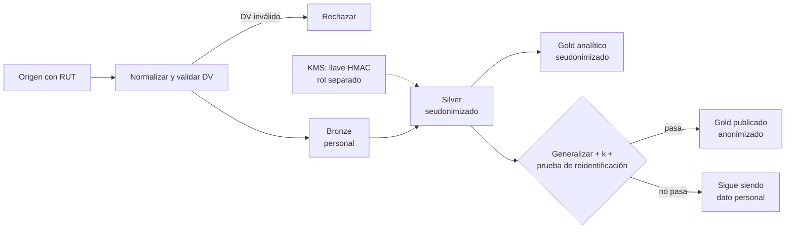

## 1. Resumen

Esta ficha no es asesoría legal: si un dataset puede declararse anonimizado lo valida el responsable con el área legal; aquí están las técnicas y las pruebas que respaldan esa decisión. La versión genérica, sin la ley, es `pseudonymization-vs-anonymization`.

En la práctica, «anonimizado» suele significar «le sacamos el RUT». Para la ley eso no basta: si alguien puede volver a identificar a la persona con medios razonables, el dato sigue siendo personal. Para el RUT:

- **normalizar:** `11.111.111-1`, `11111111-1` y `111111111` son el mismo RUT; sin normalizar, dan seudónimos distintos y las uniones se rompen;
- **validar el dígito verificador:** un valor con el DV equivocado no se seudonimiza; se rechaza;
- **HMAC con llave en un KMS:** la llave es la «información adicional» que figura por separado;
- **medir:** aun con seudónimos, los cuasi-identificadores pueden reidentificar (k-anonimato).

## 2. Qué es

- **[Obligación legal · art. 2]** **Seudonimización** (letra l)): sin información adicional que figure por separado y esté protegida, el dato ya no se atribuye al titular. **Anonimización** (letra k)): procedimiento irreversible; el dato anonimizado deja de ser personal. Para saber si alguien es identificable se consideran los medios que razonablemente se podrían usar (letra f)).
- **[Obligación legal · art. 14 quinquies]** Entre las medidas de seguridad, la ley nombra la seudonimización y el cifrado (letra a)): seudonimizar reduce el riesgo, no saca al dato de la ley.
- **[Obligación legal · art. 3]** Al vencer el plazo de conservación, suprimir o anonimizar (letra c)); anonimizar solo sirve si es real.
- **[Obligación legal · art. 16 bis]** Los resultados de estudios con datos de salud o de perfil biológico se publican anonimizados (letra c)).
- **[Obligación legal · art. 16 quinquies]** Con fines históricos, estadísticos o científicos, lo que se publica se anonimiza.
- **[Obligación legal · art. 26]** Un reglamento regulará los procedimientos de anonimización, especialmente de datos sensibles; revisar cuando se dicte.
- **[Buena práctica]** **Cuasi-identificadores:** atributos que solos no identifican pero combinados sí (comuna, año de nacimiento, sexo, ruta de vuelo).

## 3. Problema que resuelve

**[Buena práctica]** Errores con consecuencia legal: un SHA-256 del RUT llamado «anonimización» (el espacio de RUT es chico y se recorre); dos sistemas con el RUT en formatos distintos que dan dos seudónimos por persona; la llave guardada junto a los datos; tablas «anónimas» que se cruzan con otra fuente y reidentifican.

## 4. Cómo funciona

1. **[Buena práctica]** Normalizar: quitar puntos y espacios, pasar la `k` a mayúscula y llevar al formato `número-DV`.
2. **[Buena práctica]** Validar el dígito verificador con módulo 11; rechazar el valor si no calza.
3. **[Obligación legal · art. 2]** Calcular `HMAC-SHA-256(llave, rut_normalizado)`; la llave vive en un KMS, separada de los datos y con un rol distinto del que lee los datos.
4. **[Decisión de arquitectura]** Usar el mismo seudónimo en todas las capas: habilita uniones, el índice de titulares y la supresión.
5. **[Buena práctica]** Para anonimizar: definir cuasi-identificadores, generalizar (comuna → región, año → década), suprimir grupos atípicos y medir k.
6. **[Decisión de arquitectura]** Registrar en el catálogo el estado de cada dataset: `personal`, `seudonimizado` o `anonimizado`, con la evidencia de la prueba.

## 5. Cuándo utilizarlo

- Seudonimización: por defecto en silver y gold de toda plataforma con datos personales.
- Anonimización: para publicar, compartir con terceros, usar más allá del plazo de conservación o entrenar modelos que no necesitan identificar personas.

## 6. Cuándo no utilizarlo

- No declarar anonimizado un dataset solo porque no tiene RUT ni nombre.
- No anonimizar cuando el caso de uso necesita volver a la persona (atención, cobranza): ahí corresponde seudonimizar, o tokenizar si hay que recuperar el valor (`tokenization`).

## 7. Ejemplo sencillo

| Técnica | ¿Sigue siendo dato personal? | Uso |
|---|---|---|
| SHA-256 del RUT | Sí, y además se revierte probando los números posibles | No usar |
| HMAC con llave en KMS | Sí (seudonimizado) | Silver y gold |
| Tokenización con bóveda | Sí (seudonimizado) | Cuando hay que volver al dato original |
| Agregado con umbral mínimo por celda | No, si se prueba | Reportes y publicaciones |
| Generalización + k medido + supresión de atípicos | No, si se prueba | Datasets compartidos |

## 8. Ejemplo de producción

| Capa | Estado | Control |
|---|---|---|
| Bronze | Personal | Acceso restringido; RUT en claro solo aquí |
| Silver | Seudonimizado | HMAC con llave en KMS; rol de llave separado |
| Gold analítico | Seudonimizado | Sin identificadores directos; máscaras en cuasi-identificadores |
| Gold publicado | Anonimizado | Agregación con umbral, k medido, evidencia en el catálogo |

### Evidencia de cumplimiento

| Evidencia | Dónde queda | Quién la produce |
|---|---|---|
| Estado de cada dataset (personal, seudonimizado, anonimizado) | Catálogo | Ingeniería |
| Test: RUT normalizado y DV validado antes del HMAC | Log de la CI | CI |
| Política de acceso a la llave | KMS y su auditoría | Seguridad |
| Prueba de k-anonimato y de reidentificación | Reporte versionado | Ingeniería |

## 9. Arquitectura



## 10. Código

```python
# Python 3.12, biblioteca estándar (ejecutado en la CI): seudonimizar el RUT y probar que seudonimizar no es anonimizar. Primero se normaliza (puntos, guion,
# k minúscula, espacios) y se valida el dígito verificador; después se calcula un HMAC con una clave que vive fuera
# de los datos. Un hash simple del RUT se revierte probando los números posibles.
import hashlib
import hmac
import re
import secrets
from collections import Counter


def dv(numero: int) -> str:
    suma, factor = 0, 2
    for digito in reversed(str(numero)):
        suma += int(digito) * factor
        factor = 2 if factor == 7 else factor + 1
    resto = 11 - suma % 11
    return {11: "0", 10: "K"}.get(resto, str(resto))


def normalizar(valor: str) -> str:
    """Forma canónica «12345678-5»; ValueError si el formato o el dígito verificador no son válidos."""
    limpio = re.sub(r"[.\s]", "", valor).upper()
    m = re.fullmatch(r"(\d{7,8})-?([\dK])", limpio)
    if m is None or dv(int(m.group(1))) != m.group(2):
        raise ValueError(f"RUT no válido: {valor!r}")
    return f"{int(m.group(1))}-{m.group(2)}"


def seudonimo(clave: bytes, valor: str) -> str:
    return hmac.new(clave, normalizar(valor).encode(), hashlib.sha256).hexdigest()


CLAVE = secrets.token_bytes(32)  # en producción, en un KMS o gestor de secretos, nunca junto a los datos
N = 11_111_111                   # RUT ficticio (dígitos repetidos)
variantes = [f"{N:,}".replace(",", ".") + f"-{dv(N)}", f"{N}-{dv(N)}", f" {N}{dv(N)} "]
print("variantes del mismo RUT, mismo seudónimo:", len({seudonimo(CLAVE, v) for v in variantes}) == 1)
print("sin normalizar, seudónimos distintos:", len({hmac.new(CLAVE, v.encode(), hashlib.sha256).hexdigest() for v in variantes}))
try:
    seudonimo(CLAVE, f"{N}-{'0' if dv(N) != '0' else '1'}")
except ValueError as exc:
    print("DV inválido:", exc)

objetivo = hashlib.sha256(normalizar(variantes[0]).encode()).hexdigest()  # hash simple, sin clave
candidatos = [f"{n}-{dv(n)}" for n in range(11_000_000, 12_000_000)]  # un tramo de 1.000.000 de RUT
hallado = next((c for c in candidatos if hashlib.sha256(c.encode()).hexdigest() == objetivo), None)
print(f"hash simple revertido probando {len(candidatos):,} RUT del tramo: {hallado is not None}".replace(",", "."))
clave_adivinada = secrets.token_bytes(32)  # quien no tiene la clave solo puede adivinarla
buscado = seudonimo(CLAVE, variantes[0])
print("con HMAC y sin la clave, el mismo ataque no sirve:",
      next((c for c in candidatos if seudonimo(clave_adivinada, c) == buscado), None) is None)

# Aun con seudónimos, los cuasi-identificadores pueden reidentificar: k-anonimato.
filas = [  # (token, comuna, año de nacimiento, sexo)
    ("a1", "Providencia", 1985, "F"), ("a2", "Providencia", 1985, "F"), ("a3", "Providencia", 1986, "F"),
    ("a4", "Ñuñoa", 1990, "M"), ("a5", "Ñuñoa", 1991, "M"), ("a6", "Colchane", 1958, "M"),
]


def k_minimo(cuasi: list[tuple[str, str, str]]) -> int:
    return min(Counter(cuasi).values())


exacto = [(c, str(a), s) for _, c, a, s in filas]
generalizado = [("RM" if c != "Colchane" else "Tarapacá", f"{a // 10 * 10}s", s) for _, c, a, s in filas]
print("k con datos exactos:", k_minimo(exacto))
print("k generalizando comuna y década:", k_minimo(generalizado))
conteo = Counter(generalizado)
atipicos = [g for g, n in conteo.items() if n < 2]
print("grupos únicos a suprimir:", atipicos)
print("k tras suprimir atípicos:", k_minimo([g for g in generalizado if g not in atipicos]))
```

El script se **ejecuta en la CI** con la biblioteca estándar y pasa `mypy --strict`. La llave se genera con `secrets` y el RUT es ficticio (dígitos repetidos). Imprime el mismo seudónimo para las tres variantes del RUT, 3 seudónimos sin normalizar, el rechazo del DV inválido, el hash simple revertido en un tramo de 1.000.000 de RUT y que el ataque no sirve contra el HMAC. Al final, la prueba de k-anonimato: k = 1 con datos exactos y también al generalizar comuna y década, porque una persona de una comuna pequeña queda sola en su grupo; k = 2 tras suprimir ese grupo atípico.

## 11. GCP

En GCP, **Sensitive Data Protection**. Según *Ley 19628 SOBRE PROTECCION DE LOS DATOS PERSONALES*, *Pseudonymization* y *Re-identification risk analysis* (no ejecutado):

| Necesidad | Servicio | Etiqueta |
|---|---|---|
| Seudónimo de una vía | Hash criptográfico con HMAC-SHA-256 | **[Buena práctica]** |
| Seudónimo reversible | AES-SIV o FPE, con la llave | **[Decisión de arquitectura]** |
| Medir el riesgo | Análisis de k-anonimato y l-diversidad | **[Buena práctica]** |

## 12. AWS

En AWS, **AWS Glue DataBrew**. Según *Ley 19628 SOBRE PROTECCION DE LOS DATOS PERSONALES* y *CRYPTOGRAPHIC_HASH* (no ejecutado):

| Necesidad | Servicio | Etiqueta |
|---|---|---|
| Seudónimo con llave | `HMAC_SHA256` por defecto, con un secreto de Secrets Manager | **[Buena práctica]** |
| Normalización del RUT | Propia, antes del hash | **[Decisión de arquitectura]** |

## 13. Azure

En Azure, **Always Encrypted** en Azure SQL. Según *Ley 19628 SOBRE PROTECCION DE LOS DATOS PERSONALES* y *Always Encrypted* (no ejecutado):

| Necesidad | Servicio | Etiqueta |
|---|---|---|
| Igualdad y uniones sobre la columna | Cifrado determinista, reversible con la llave | **[Buena práctica]** |
| Diferencia con el HMAC | El determinista protege la columna dentro de la base; el HMAC produce un seudónimo para llevar a otra capa | **[Decisión de arquitectura]** |

## 14. Buenas prácticas

- **[Buena práctica]** Una sola función de normalización para todos los pipelines.
- **[Obligación legal · art. 2]** La llave, separada de los datos y con acceso restringido.
- **[Buena práctica]** **Seguridad:** nunca `sha256(rut)` sin llave; rotar la llave con un plan de re-seudonimización, porque perderla rompe uniones históricas.
- **[Buena práctica]** **GenAI:** quitar o seudonimizar los datos personales antes de enviar texto a un LLM; el texto libre trae datos que ningún esquema declara.
- **[Buena práctica]** **Observabilidad:** alertar si aparece un RUT en claro fuera de bronze.
- **[Buena práctica]** **Costo:** la tokenización con bóveda cuesta más que el HMAC; usarla solo si hay que recuperar el valor.

## 15. Errores frecuentes

- Llamar «anonimizado» a un dato seudonimizado.
- Seudonimizar sin normalizar.
- Hash sin llave, o con la llave en el mismo repositorio.
- Medir k sin considerar todos los cuasi-identificadores.
- Publicar agregados con celdas de una o dos personas.

## 16. Trade-offs

| Más privacidad | Más utilidad |
|---|---|
| Generalizar más (región, década) | Mantener detalle (comuna, fecha) |
| Umbral de agregación alto | Más celdas y más granularidad |
| HMAC sin vuelta atrás | Tokenización que permite recuperar el valor |

## 17. Conceptos relacionados

- `chile-data-protection`: ficha padre.
- `pseudonymization-vs-anonymization`: la versión genérica en 18.
- `keyed-hashing`, `tokenization`, `k-anonymity`, `key-management`: técnicas de 18.
- `pii-identification`, `data-minimization-by-layer`, `data-subject-rights-pipeline`, `retention-and-erasure`: fichas hermanas que usan el seudónimo.

## 18. Preguntas técnicas abiertas

1. ¿En cuántos formatos guardan tus sistemas el RUT?
2. ¿Alguno de tus datasets «anónimos» pasaría una prueba de k-anonimato?
3. ¿Quién puede leer la llave de seudonimización y quién los datos?

## 19. Laboratorio relacionado

Pendiente (F4).

## 20. Fuentes

- BCN Ley Chile: *Ley 19628 SOBRE PROTECCION DE LOS DATOS PERSONALES* (versión con vigencia diferida desde 2026-12-01).
- Python 3.12: *hmac*.
- Google Cloud: *Pseudonymization* y *Re-identification risk analysis*.
- AWS: *CRYPTOGRAPHIC_HASH*.
- Microsoft Learn: *Always Encrypted*.

El detalle de cada fuente está en `sources` del frontmatter.

## 21. Fecha de última verificación

2026-10-22: arts. 2, 3, 14 quinquies, 16 bis, 16 quinquies y 26 consultados ese día en BCN. `review_required`: pasa a `verified` solo con la aprobación explícita de Felipe (`owner_approved_at`). Revisión mensual.

## 22. Historial de cambios importantes

- 2026-10-21: creación (lote F3b-19b).
- 2026-10-22: upgrade de 19: incorpora la parte legal de la seudonimización y la anonimización (arts. 2 f), k) y l), 3 c), 14 quinquies a), 16 bis c), 16 quinquies y 26) y la prueba de k-anonimato; enlaza `pseudonymization-vs-anonymization` (18), que no cambia.
- 2026-10-24: `PART_OF` hacia `chile-data-protection` (ADR-024) e `implication` por artículo en `legal_basis` (enmienda de ADR-023). Sin cambios de contenido legal ni de código.
