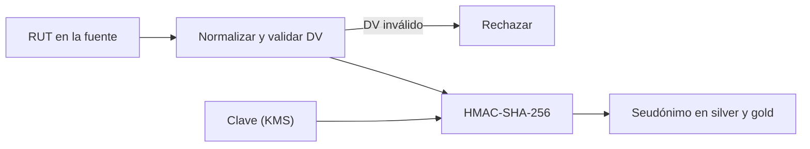

## 1. Resumen

Esta ficha no es asesoría legal: cubre la técnica para seudonimizar el RUT.

La ley define seudonimización: los datos ya no pueden atribuirse a un titular **sin información adicional que figure por separado** y esté protegida. Para el RUT, eso se traduce en tres pasos:

- **normalizar:** `11.111.111-1`, `11111111-1` y `111111111` son el mismo RUT; si no se normalizan, dan seudónimos distintos y las uniones se rompen;
- **validar el dígito verificador:** un valor con el DV equivocado no se seudonimiza; se rechaza;
- **HMAC con clave en un KMS:** la clave es la «información adicional» que figura por separado.

Un hash simple del RUT no cumple esa separación: no hay información adicional, y probando los números posibles se revierte (*Pseudonymization*; `keyed-hashing`).

## 2. Qué es

- **[Obligación legal · art. 2]** La seudonimización exige que la información que permite volver al titular figure por separado y esté protegida.
- **[Obligación legal · art. 14 quinquies]** Entre las medidas de seguridad adecuadas al riesgo, la ley nombra la seudonimización y el cifrado.
- **[Buena práctica]** El RUT de una persona natural tiene un espacio chico (decenas de millones de números): un hash sin clave se revierte en minutos.
- **[Decisión de arquitectura]** El seudónimo es un HMAC-SHA-256 del RUT normalizado, con una clave del KMS que no llega a la plataforma de análisis.

## 3. Problema que resuelve

**[Buena práctica]** Dos sistemas guardan el RUT de formas distintas (`11.111.111-1` y `11111111-1`). Al seudonimizar sin normalizar, el mismo cliente queda con dos seudónimos y las uniones fallan en silencio. Y si el seudónimo es un `sha256(rut)`, cualquiera con la tabla recupera los RUT.

## 4. Cómo funciona

1. **[Buena práctica]** Normalizar: quitar puntos y espacios, pasar la `k` a mayúscula y llevar al formato `número-DV`.
2. **[Buena práctica]** Validar el dígito verificador con módulo 11; rechazar el valor si no calza.
3. **[Obligación legal · art. 2]** Calcular `HMAC-SHA-256(clave, rut_normalizado)`; la clave vive en un KMS, separada de los datos.
4. **[Decisión de arquitectura]** Guardar solo el seudónimo en las capas de análisis; el RUT queda en la zona controlada.
5. **[Obligación legal · art. 14 quinquies]** Rotar la clave según la política de seguridad, sabiendo que rotar cambia todos los seudónimos.

## 5. Cuándo utilizarlo

- Para unir y contar por cliente en análisis sin exponer el RUT.
- Cuando nadie en análisis necesita volver al RUT.

## 6. Cuándo no utilizarlo

- Si un proceso necesita recuperar el RUT: ahí va tokenización con bóveda (`tokenization`).
- Como anonimización: el seudónimo sigue siendo dato personal.

## 7. Ejemplo sencillo

| Prueba | Resultado |
|---|---|
| Tres variantes del mismo RUT | Mismo seudónimo |
| Las mismas variantes sin normalizar | 3 seudónimos distintos |
| RUT con DV inválido | Rechazado |
| Hash simple, probando 1.000.000 de RUT de un tramo | Revertido |
| HMAC sin la clave, mismo ataque | No sirve |

## 8. Ejemplo de producción

- Una función de normalización y validación compartida por todos los pipelines.
- La clave del HMAC en Cloud KMS, AWS KMS o Key Vault; el pipeline la obtiene en tiempo de ejecución.
- El seudónimo como clave de unión en silver y gold; el RUT solo en la zona controlada.

### Evidencia de cumplimiento

| Evidencia | Dónde queda | Quién la produce |
|---|---|---|
| Test: RUT normalizado y DV validado antes del HMAC | Log de la CI | CI |
| Ubicación y política de acceso de la clave | KMS y su auditoría | Plataforma |
| Test «sin RUT en claro en análisis» | Log de la CI | CI |

## 9. Arquitectura



## 10. Código

```python
# Python 3.12, biblioteca estándar (ejecutado en la CI): seudonimizar el RUT. Primero se normaliza (puntos, guion,
# k minúscula, espacios) y se valida el dígito verificador; después se calcula un HMAC con una clave que vive fuera
# de los datos. Un hash simple del RUT se revierte probando los números posibles.
import hashlib
import hmac
import re
import secrets


def dv(numero: int) -> str:
    suma, factor = 0, 2
    for digito in reversed(str(numero)):
        suma += int(digito) * factor
        factor = 2 if factor == 7 else factor + 1
    resto = 11 - suma % 11
    return {11: "0", 10: "K"}.get(resto, str(resto))


def normalizar(valor: str) -> str:
    """Forma canónica «12345678-5»; ValueError si el formato o el dígito verificador no son válidos."""
    limpio = re.sub(r"[.\s]", "", valor).upper()
    m = re.fullmatch(r"(\d{7,8})-?([\dK])", limpio)
    if m is None or dv(int(m.group(1))) != m.group(2):
        raise ValueError(f"RUT no válido: {valor!r}")
    return f"{int(m.group(1))}-{m.group(2)}"


def seudonimo(clave: bytes, valor: str) -> str:
    return hmac.new(clave, normalizar(valor).encode(), hashlib.sha256).hexdigest()


CLAVE = secrets.token_bytes(32)  # en producción, en un KMS o gestor de secretos, nunca junto a los datos
N = 11_111_111                   # RUT ficticio (dígitos repetidos)
variantes = [f"{N:,}".replace(",", ".") + f"-{dv(N)}", f"{N}-{dv(N)}", f" {N}{dv(N)} "]
print("variantes del mismo RUT, mismo seudónimo:", len({seudonimo(CLAVE, v) for v in variantes}) == 1)
print("sin normalizar, seudónimos distintos:", len({hmac.new(CLAVE, v.encode(), hashlib.sha256).hexdigest() for v in variantes}))
try:
    seudonimo(CLAVE, f"{N}-{'0' if dv(N) != '0' else '1'}")
except ValueError as exc:
    print("DV inválido:", exc)

objetivo = hashlib.sha256(normalizar(variantes[0]).encode()).hexdigest()  # hash simple, sin clave
candidatos = [f"{n}-{dv(n)}" for n in range(11_000_000, 12_000_000)]  # un tramo de 1.000.000 de RUT
hallado = next((c for c in candidatos if hashlib.sha256(c.encode()).hexdigest() == objetivo), None)
print(f"hash simple revertido probando {len(candidatos):,} RUT del tramo: {hallado is not None}".replace(",", "."))
clave_adivinada = secrets.token_bytes(32)  # quien no tiene la clave solo puede adivinarla
buscado = seudonimo(CLAVE, variantes[0])
print("con HMAC y sin la clave, el mismo ataque no sirve:",
      next((c for c in candidatos if seudonimo(clave_adivinada, c) == buscado), None) is None)
```

El script se **ejecuta en la CI** con la biblioteca estándar y pasa `mypy --strict`. El RUT es ficticio (dígitos repetidos). Imprime el mismo seudónimo para las tres variantes, 3 seudónimos sin normalizar, el rechazo del DV inválido, el hash simple revertido en un tramo de 1.000.000 de RUT y que el mismo ataque no sirve contra el HMAC.

## 11. GCP

En GCP, **Sensitive Data Protection**. Según *Ley 19628 SOBRE PROTECCION DE LOS DATOS PERSONALES* y *Pseudonymization* (no ejecutado):

| | HMAC propio (este ejemplo) | Sensitive Data Protection | Etiqueta |
|---|---|---|---|
| Seudónimo de una vía | HMAC-SHA-256 | Hash criptográfico con HMAC-SHA-256 | **[Buena práctica]** |
| Reversible | No | AES-SIV y FPE, con la clave | **[Decisión de arquitectura]** |
| Normalización del RUT | Propia, antes del HMAC | No la describe la página; se hace antes | **[Buena práctica]** |

## 12. AWS

En AWS, **AWS Glue DataBrew**. Según *Ley 19628 SOBRE PROTECCION DE LOS DATOS PERSONALES* y *CRYPTOGRAPHIC_HASH* (no ejecutado):

| | HMAC propio (este ejemplo) | DataBrew | Etiqueta |
|---|---|---|---|
| Algoritmo | HMAC-SHA-256 | `HMAC_SHA256` por defecto; también hash sin clave | **[Buena práctica]** |
| Clave | KMS | Secreto de Secrets Manager | **[Decisión de arquitectura]** |

## 13. Azure

En Azure, **Always Encrypted** en Azure SQL. Según *Ley 19628 SOBRE PROTECCION DE LOS DATOS PERSONALES* y *Always Encrypted* (no ejecutado):

| | HMAC propio (este ejemplo) | Cifrado determinista | Etiqueta |
|---|---|---|---|
| Qué es | Seudónimo de una vía | Cifrado reversible con la clave | **[Decisión de arquitectura]** |
| Igualdad y joins | Sí, por seudónimo | Sí, sobre la columna cifrada | **[Buena práctica]** |

## 14. Buenas prácticas

- **[Buena práctica]** Una sola función de normalización para todos los pipelines.
- **[Obligación legal · art. 2]** La clave, separada de los datos y con acceso restringido.
- **[Buena práctica]** **Seguridad:** nunca `sha256(rut)` sin clave; el espacio del RUT es chico.
- **[Buena práctica]** **Observabilidad:** contar los RUT rechazados por DV inválido; un aumento indica un problema en la fuente.
- **[Buena práctica]** **Costo:** rotar la clave obliga a recalcular los seudónimos de todas las tablas que se unen; planificarlo.

## 15. Errores frecuentes

- Seudonimizar sin normalizar.
- Guardar la clave en el código o junto a los datos.
- Llamar «anónimo» a una tabla con seudónimos.

## 16. Trade-offs

HMAC no necesita bóveda y no permite volver al RUT; tokenizar permite volver y obliga a operar la bóveda. Una clave por dominio permite unir todo y concentra el riesgo en esa clave.

## 17. Conceptos relacionados

- `keyed-hashing`: HMAC frente a hash simple.
- `tokenization`: la alternativa reversible.
- `key-management`: la clave en un KMS.
- `pii-identification`: el dígito verificador.
- `data-minimization-by-layer`: el seudónimo en silver.

## 18. Preguntas técnicas abiertas

1. ¿En cuántos formatos guardan tus sistemas el RUT?
2. ¿Tus seudónimos actuales usan clave?
3. ¿Dónde vive esa clave?

## 19. Laboratorio relacionado

Pendiente (F4).

## 20. Fuentes

- BCN Ley Chile: *Ley 19628 SOBRE PROTECCION DE LOS DATOS PERSONALES* (versión con vigencia diferida desde 2026-12-01).
- Python 3.12: *hmac*.
- Google Cloud: *Pseudonymization*.
- AWS: *CRYPTOGRAPHIC_HASH*.
- Microsoft Learn: *Always Encrypted*.

El detalle de cada fuente está en `sources` del frontmatter.

## 21. Fecha de última verificación

2026-10-21: texto legal consultado ese día en BCN. `review_required`: pendiente de revisión B-F3.1 del lote F3b-19b; pasa a `verified` solo con la aprobación explícita de Felipe (`owner_approved_at`). Revisión mensual.

## 22. Historial de cambios importantes

- 2026-10-21: creación (lote F3b-19b).
