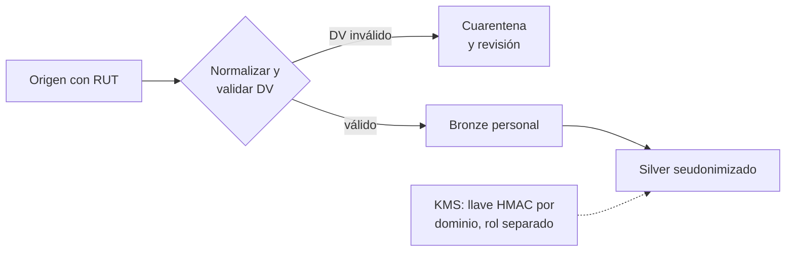
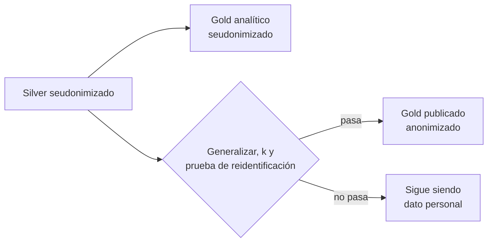

## 1. Resumen

Esta ficha no es asesoría legal: si un dataset puede declararse anonimizado lo valida el responsable con el área legal; aquí están las técnicas y las pruebas que respaldan esa decisión. La versión genérica, sin la ley, es `pseudonymization-vs-anonymization`.

Seudonimizar es sustituir un identificador por otro que no permita atribuir el dato a una persona sin información adicional protegida. **No es anonimizar.** En la práctica, «anonimizado» suele significar «le sacamos el RUT»; para la ley eso no basta: si alguien puede volver a identificar a la persona con medios razonables, el dato sigue siendo personal. Para el RUT:

- **normalizar:** `11.111.111-1`, `11111111-1` y `111111111` son el mismo RUT; sin normalizar, dan seudónimos distintos y las uniones se rompen;
- **validar el dígito verificador:** un valor con el DV equivocado no se seudonimiza; va a cuarentena para revisión, sin asumir que deja de ser personal;
- **HMAC con llave en un KMS:** la llave es la «información adicional» que figura por separado; una llave por dominio si no hace falta unir entre finalidades;
- **medir:** aun con seudónimos, los cuasi-identificadores pueden reidentificar (k-anonimato).

## 2. Qué es

- **[Obligación legal · art. 2]** **Seudonimización** (letra l)): sin información adicional que figure por separado y esté protegida, el dato ya no se atribuye al titular. **Anonimización** (letra k)): procedimiento irreversible; el dato anonimizado deja de ser personal. Para saber si alguien es identificable se consideran los medios que razonablemente se podrían usar (letra f)).
- **[Obligación legal · art. 14 quinquies]** Entre las medidas de seguridad, la ley nombra la seudonimización y el cifrado (letra a)): seudonimizar reduce el riesgo, no saca al dato de la ley.
- **[Obligación legal · art. 3]** Al vencer el plazo de conservación, suprimir o anonimizar (**proporcionalidad**); anonimizar solo sirve si es real.
- **[Obligación legal · art. 16 bis]** Los resultados de estudios con datos de salud o de perfil biológico pueden publicarse; si se publican, los datos se anonimizan antes (letra c)).
- **[Obligación legal · art. 16 quinquies]** Con fines históricos, estadísticos o científicos se pueden publicar resultados; antes, se anonimizan los datos que se publiquen.
- **[Obligación legal · art. 26]** Un reglamento regulará los procedimientos de anonimización, especialmente de datos sensibles. **[Buena práctica]** Revisar estas técnicas cuando se dicte.
- **[Buena práctica]** Cuatro términos que no conviene mezclar:

| Término | Qué es | Ejemplo |
|---|---|---|
| Identificador directo | Identifica por sí solo en un contexto | RUT, número de documento |
| Seudónimo | Valor sustituto que necesita información adicional (llave o tabla de correspondencia) para volver al titular | HMAC del RUT normalizado |
| Cuasi-identificador | Solo no identifica; combinado con otros, sí | Comuna, año de nacimiento, sexo, ruta de vuelo |
| Dato anonimizado | Resultado de un procedimiento irreversible, evaluado contra los medios razonables | Agregado con k medido y prueba de reidentificación |

- **[Buena práctica]** **El HMAC es determinista:** con la misma llave y el mismo RUT normalizado da el mismo seudónimo. Eso permite uniones, y también correlacionar registros; por eso un seudónimo universal compartido entre todos los sistemas no siempre conviene.

## 3. Problema que resuelve

**[Buena práctica]** Un pipeline analítico une compras, reservas y atención de clientes. Si todos los datasets llevan el RUT en claro, la exposición crece con cada copia; si cada sistema aplica un hash distinto o normaliza distinto, las uniones fallan. Una seudonimización controlada une solo lo necesario y restringe quién puede volver a la identidad.

**[Buena práctica]** Errores con consecuencia legal: un SHA-256 del RUT llamado «anonimización» (el espacio de RUT es chico y se recorre); dos sistemas con el RUT en formatos distintos que dan dos seudónimos por persona; la llave guardada junto a los datos; tablas «anónimas» que se cruzan con otra fuente y reidentifican.

## 4. Cómo funciona

1. **[Buena práctica]** Definir finalidad y alcance: qué consumidores necesitan unir registros por titular y cuáles pueden trabajar con agregados.
2. **[Buena práctica]** Normalizar: quitar puntos y espacios, pasar la `k` a mayúscula y llevar al formato `número-DV`, con una sola función versionada.
3. **[Buena práctica]** Validar el dígito verificador con módulo 11; si no calza, el valor no se seudonimiza y va a cuarentena para revisión de calidad, sin descartarlo ni darlo por no personal.
4. **[Decisión de arquitectura]** Calcular `HMAC-SHA-256(llave, rut_normalizado)`, con la llave en un KMS y un rol distinto del que lee los datos; una llave por dominio o finalidad si la unión entre ellos no está justificada. **[Obligación legal · art. 2]** Para que sea seudonimización, la información adicional (aquí, la llave) figura por separado y sujeta a medidas técnicas y organizativas (letra l)).
5. **[Decisión de arquitectura]** Dentro de un dominio, usar el mismo seudónimo en todas las capas: habilita uniones, el índice de titulares y la supresión.
6. **[Buena práctica]** Separar funciones y comprobar: acceso al RUT original, al servicio de seudonimización y a la llave por roles distintos; pruebas de estabilidad del seudónimo, de permisos, de RUT o seudónimos en logs y del plan de rotación.
7. **[Buena práctica]** Para anonimizar: definir cuasi-identificadores, generalizar (comuna → región, año → década), suprimir grupos atípicos y medir k. Es una evaluación aparte, no un paso más de la seudonimización.
8. **[Decisión de arquitectura]** Registrar en el catálogo el estado de cada dataset: `personal`, `seudonimizado` o `anonimizado`, con la versión del algoritmo, el identificador de la llave (nunca la llave) y la evidencia de la prueba.

## 5. Cuándo utilizarlo

- Seudonimización: por defecto en silver y gold de toda plataforma con datos personales, cuando un proceso necesita correlacionar registros por titular y sus consumidores no necesitan el RUT.
- Anonimización: para publicar, compartir con terceros, usar más allá del plazo de conservación o entrenar modelos que no necesitan identificar personas.

## 6. Cuándo no utilizarlo

- No declarar anonimizado un dataset solo porque no tiene RUT ni nombre.
- No anonimizar cuando el caso de uso necesita volver a la persona (atención, cobranza): ahí corresponde seudonimizar, o tokenizar si hay que recuperar el valor (`tokenization`).
- No usarla como sustituto de la minimización, los permisos o la retención; ni un seudónimo global si habilita correlaciones innecesarias entre finalidades.

## 7. Ejemplo sencillo

| Técnica | ¿Sigue siendo dato personal? | Uso |
|---|---|---|
| SHA-256 del RUT | Sí, y además se revierte probando los números posibles | No usar |
| HMAC con llave en KMS | Sí (seudonimizado) | Silver y gold |
| HMAC con una llave por dominio | Sí (seudonimizado); el mismo RUT da seudónimos distintos en cada dominio | Cuando no hace falta unir entre finalidades |
| Tokenización con bóveda | Sí (seudonimizado) | Cuando hay que volver al dato original |
| Seudónimo con comuna y fecha de vuelo | Sí; los cuasi-identificadores pueden reidentificar | Medir k antes de compartir |
| Agregado con umbral mínimo por celda | No, si se prueba | Reportes y publicaciones |
| Generalización + k medido + supresión de atípicos | No, si se prueba | Datasets compartidos |

## 8. Ejemplo de producción

Escenario genérico: una aerolínea consolida reservas y atención de pasajeros para un análisis autorizado.

| Capa | Estado | Control |
|---|---|---|
| Bronze | Personal | Acceso restringido; RUT en claro solo aquí; cuarentena para RUT con DV inválido |
| Silver | Seudonimizado | HMAC con llave en KMS; rol de llave separado; llave por dominio |
| Gold analítico | Seudonimizado | Sin identificadores directos; máscaras en cuasi-identificadores |
| Gold publicado | Anonimizado | Agregación con umbral, k medido, evidencia en el catálogo |

### Evidencia de cumplimiento

| Evidencia | Dónde queda | Quién la produce | Qué demuestra | Qué no demuestra |
|---|---|---|---|---|
| Estado de cada dataset, versión del algoritmo e id de la llave | Catálogo | Ingeniería | Qué técnica y qué llave se usaron en cada dataset | Que el estado declarado sea correcto |
| Test: RUT normalizado y DV validado antes del HMAC | Log de la CI | CI | Que las variantes dan el mismo seudónimo y lo inválido no pasa | Que no haya RUT en otros campos |
| Política de acceso a la llave y su auditoría | KMS | Seguridad | Quién puede usar la llave y quién la usó | Que la llave no se haya copiado fuera del KMS |
| Prueba de k-anonimato y de reidentificación | Reporte versionado | Ingeniería | El k alcanzado con los cuasi-identificadores evaluados | Que no haya otra fuente con la que cruzar |
| Procedimiento de rotación de la llave | Runbook versionado | Seguridad e ingeniería | Cómo se re-seudonimiza y qué uniones históricas cambian | Que la rotación se haya ensayado |

## 9. Arquitectura

**Seudonimizar el RUT.**



**Publicar: seudonimizar no es anonimizar.**



## 10. Código

```python
# Python 3.12+, biblioteca estándar. Seudonimizar el RUT y probar que seudonimizar no es anonimizar, de punta a punta:
# normalizar y validar (lo inválido a cuarentena) → seudónimo HMAC con una llave por dominio y su id → ataque al hash
# simple → k-anonimato y puerta de publicación → código de salida (0 pasa, 1 bloquea). Uso: python seudonimizacion.py
# publicar-exacto | publicar-generalizado | sin-normalizar. Las llaves de este ejemplo se derivan de un texto fijo para
# que la salida sea reproducible; en producción viven en un KMS o gestor de secretos, nunca junto a los datos. RUT
# ficticios.
import hashlib
import hmac
import re
import sys
from collections import Counter

K_MIN = 2   # política interna ilustrativa, no un umbral legal
CUASI_CATALOGO = ("comuna", "nacimiento", "sexo")   # cuasi-identificadores que el catálogo marca en el dataset
LLAVES = {(dominio, llave): hashlib.sha256(f"demo-{dominio}-{llave}".encode()).digest()
          for dominio in ("reservas", "marketing") for llave in ("k1", "k2")}


# @paso 1 Normalizar y validar
def dv(numero: int) -> str:
    suma, factor = 0, 2
    for digito in reversed(str(numero)):
        suma += int(digito) * factor
        factor = 2 if factor == 7 else factor + 1
    resto = 11 - suma % 11
    return {11: "0", 10: "K"}.get(resto, str(resto))


FORMA = re.compile(r"(\d{7,8})-?([\dK])")


def normalizar(valor: str) -> str | None:
    """Forma canónica «número-DV» (sin puntos ni espacios, K mayúscula); None si el formato o el DV no son válidos."""
    m = FORMA.fullmatch(re.sub(r"[.\s]", "", valor).upper())
    if m is None or dv(int(m.group(1))) != m.group(2):
        return None
    return f"{int(m.group(1))}-{m.group(2)}"


def separar(entrada: list[tuple[str, str]]) -> tuple[list[tuple[str, str]], list[tuple[str, str]]]:
    """(id, RUT canónico) de los válidos y (id, motivo) de la cuarentena: el valor malo no se copia ni se descarta,
    queda en bronze y la cuarentena guarda solo a qué registro mirar y por qué."""
    validos, cuarentena = [], []
    for id_registro, valor in entrada:
        if (canonico := normalizar(valor)) is not None:
            validos.append((id_registro, canonico))
        else:
            limpio = re.sub(r"[.\s]", "", valor).upper()
            cuarentena.append((id_registro, "DV inválido" if FORMA.fullmatch(limpio) else "formato no válido"))
    return validos, cuarentena


# @paso 2 Seudónimo por dominio
def seudonimo(dominio: str, llave: str, rut: str) -> str:
    """HMAC con la llave del dominio; el id de la llave va adelante para poder rotarla."""
    return f"{llave}:" + hmac.new(LLAVES[(dominio, llave)], rut.encode(), hashlib.sha256).hexdigest()[:12]


def rotar(dominio: str, ruts: list[str], de: str, a: str) -> list[tuple[str, str]]:
    """Tabla de correspondencia vieja → nueva: sin ella, una solicitud del titular registrada con el seudónimo viejo
    pierde su rastro. Se guarda con el mismo control de acceso que las llaves y se borra al cerrar las solicitudes."""
    return [(seudonimo(dominio, de, r), seudonimo(dominio, a, r)) for r in ruts]


def unir(izquierda: dict[str, int], derecha: dict[str, str]) -> int:
    """Coincidencias de una unión por seudónimo entre dos tablas."""
    return len(izquierda.keys() & derecha.keys())


# @paso 3 Ataque al hash simple
def revertir(objetivo: str, desde: int, hasta: int, huella: object) -> str | None:
    """Prueba todos los RUT de un tramo hasta que la huella coincide."""
    for n in range(desde, hasta):
        candidato = f"{n}-{dv(n)}"
        if callable(huella) and huella(candidato) == objetivo:
            return candidato
    return None


def hash_simple(rut: str) -> str:
    return hashlib.sha256(rut.encode()).hexdigest()


LLAVE_ADIVINADA = hashlib.sha256(b"adivinada").digest()   # quien no tiene la llave solo puede adivinarla


def hmac_sin_llave(rut: str) -> str:
    return "k1:" + hmac.new(LLAVE_ADIVINADA, rut.encode(), hashlib.sha256).hexdigest()[:12]


# @paso 4 Anonimizar y puerta
Fila = tuple[str, str, str]   # (comuna, nacimiento, sexo)


def k_minimo(filas: list[Fila]) -> int:
    return min(Counter(filas).values()) if filas else 0


def generalizar(filas: list[Fila]) -> list[Fila]:
    return [("RM" if c != "Colchane" else "Tarapacá", f"{int(a) // 10 * 10}s", s) for c, a, s in filas]


def suprimir_atipicos(filas: list[Fila]) -> tuple[list[Fila], int]:
    """Filas que quedan y cuántos grupos se suprimieron: los cuasi-identificadores del grupo suprimido no se informan."""
    conteo = Counter(filas)
    return [f for f in filas if conteo[f] >= K_MIN], sum(1 for n in conteo.values() if n < K_MIN)


def puerta_publicacion(filas: list[Fila], declarados: tuple[str, ...]) -> list[str]:
    """Pasa solo con k ≥ K_MIN y todos los cuasi-identificadores del catálogo declarados. Pasar es cumplir la política
    interna, no anonimizar: eso exige además la evaluación de reidentificación (art. 2 k))."""
    motivos = [f"cuasi-identificador no declarado: {c}" for c in CUASI_CATALOGO if c not in declarados]
    if k_minimo(filas) < K_MIN:
        motivos.append(f"k = {k_minimo(filas)}, menor que K_MIN = {K_MIN}: hay personas solas en su grupo")
    return motivos


def main(escenario: str) -> int:
    n = 11_111_111
    entrada = [("r1", f"{n:,}".replace(",", ".") + f"-{dv(n)}"), ("r2", f"{n}-{dv(n)}"), ("r3", f" {n}{dv(n)} "),
               ("r4", f"{n}-{'0' if dv(n) != '0' else '1'}")]   # r1–r3: la misma persona; r4: DV equivocado
    validos, cuarentena = separar(entrada)
    print(f"entrada: {len(entrada)} registros; cuarentena: {len(cuarentena)} "
          f"({', '.join(f'{i}: {m}' for i, m in cuarentena)}), sin copiar el valor")
    canonico = escenario != "sin-normalizar"
    claves = [c for _, c in validos] if canonico else [v for i, v in entrada if i in dict(validos)]
    distintos = len({seudonimo("reservas", "k1", c) for c in claves})
    palabra = "seudónimo" if distintos == 1 else "seudónimos"
    print(f"los {len(claves)} registros válidos de la misma persona dan {distintos} {palabra}")
    rut, otro = f"{n}-{dv(n)}", f"{22_222_222}-{dv(22_222_222)}"
    reservas = {seudonimo("reservas", "k1", rut): 120, seudonimo("reservas", "k1", otro): 80}
    marketing = {seudonimo("marketing", "k1", rut): "campaña-a", seudonimo("marketing", "k1", otro): "campaña-b"}
    una_llave = {seudonimo("reservas", "k1", rut): "campaña-a", seudonimo("reservas", "k1", otro): "campaña-b"}
    print(f"unión reservas–marketing por seudónimo (2 personas en ambos): {unir(reservas, marketing)} coincidencias "
          "con una llave por dominio")
    print(f"la misma unión si los dos dominios comparten la llave: {unir(reservas, una_llave)} coincidencias")
    print("rotación de k1 a k2 en reservas, tabla de correspondencia:")
    for vieja, nueva in rotar("reservas", [rut, otro], "k1", "k2"):
        print(f"  {vieja} → {nueva}")
    hallado = revertir(hash_simple(rut), 11_000_000, 12_000_000, hash_simple)
    print(f"hash simple: probando 1.000.000 RUT del tramo, se recupera {hallado}")
    con_hmac = revertir(seudonimo("reservas", "k1", rut), 11_000_000, 12_000_000, hmac_sin_llave)
    print("HMAC sin la llave: el mismo ataque " + ("recupera el RUT" if con_hmac else "no recupera ningún RUT"))
    filas: list[Fila] = [("Providencia", "1985", "F"), ("Providencia", "1985", "F"), ("Providencia", "1986", "F"),
                         ("Ñuñoa", "1990", "M"), ("Ñuñoa", "1991", "M"), ("Colchane", "1958", "M")]
    if escenario == "publicar-generalizado":
        filas, suprimidos = suprimir_atipicos(generalizar(filas))
        print(f"generalizado a región y década; grupos suprimidos por quedar solos: {suprimidos}")
    print(f"k mínimo del dataset a publicar: {k_minimo(filas)} (K_MIN = {K_MIN})")
    if distintos > 1:
        print(f"puerta de calidad: bloqueada (1): una persona quedó con {distintos} seudónimos (falta normalizar)")
        return 1
    motivos = puerta_publicacion(filas, CUASI_CATALOGO)
    if motivos:
        print(f"puerta de publicación: bloqueada (1): {'; '.join(motivos)}")
        return 1
    print(f"puerta de publicación: pasa la puerta de k (K_MIN = {K_MIN}): apto para publicar según la política interna;"
          " la anonimización requiere la evaluación de reidentificación (0)")
    return 0


if __name__ == "__main__":
    sys.exit(main(sys.argv[1] if len(sys.argv) > 1 else "publicar-exacto"))
```

El script se **ejecuta en la CI** con la biblioteca estándar y pasa `mypy --strict`. Recorre cuatro pasos:

1. **Normalizar y validar:** quita puntos y espacios, pasa la K a mayúscula y valida el dígito verificador. El registro con DV inválido se aparta a una lista de cuarentena con su id y su motivo, sin copiar el valor; la salida informa cuántos quedaron ahí.
2. **Seudónimo por dominio:** un HMAC con la llave de cada dominio, con el id de la llave adelante («k1:…»). Al rotar a k2 cambian los seudónimos, y la tabla de correspondencia mantiene la trazabilidad de las solicitudes de titulares registradas con el seudónimo viejo. Una unión real entre reservas y marketing por seudónimo da 0 coincidencias con llaves separadas, y 2 si los dominios comparten la llave.
3. **Ataque al hash simple:** el hash sin llave se revierte probando 1.000.000 de RUT de un tramo; el mismo ataque contra el HMAC, sin la llave, no recupera nada.
4. **Anonimizar y puerta:** el k-anonimato del dataset a publicar. La puerta pasa con k ≥ `K_MIN` (2, una política interna de ejemplo) y con todos los cuasi-identificadores del catálogo declarados. Pasar es cumplir esa política, no anonimizar: el art. 2 k) exige un procedimiento irreversible, y eso requiere además la evaluación de reidentificación. La salida informa cuántos grupos se suprimieron, no sus cuasi-identificadores.

Las llaves se derivan de un texto fijo para que la salida sea reproducible, y el RUT es ficticio (dígitos repetidos).

Con los datos exactos, una persona queda sola en su grupo: k = 1, y la puerta bloquea. Termina con código 1:

```text
$ python seudonimizacion.py publicar-exacto
entrada: 4 registros; cuarentena: 1 (r4: DV inválido), sin copiar el valor
los 3 registros válidos de la misma persona dan 1 seudónimo
unión reservas–marketing por seudónimo (2 personas en ambos): 0 coincidencias con una llave por dominio
la misma unión si los dos dominios comparten la llave: 2 coincidencias
rotación de k1 a k2 en reservas, tabla de correspondencia:
  k1:450dd7692874 → k2:c3ace169f7c6
  k1:a43f3577997f → k2:529fa9a6f4ec
hash simple: probando 1.000.000 RUT del tramo, se recupera 11111111-1
HMAC sin la llave: el mismo ataque no recupera ningún RUT
k mínimo del dataset a publicar: 1 (K_MIN = 2)
puerta de publicación: bloqueada (1): k = 1, menor que K_MIN = 2: hay personas solas en su grupo
```

Al generalizar a región y década, la persona de Colchane sigue sola en su grupo; suprimir ese grupo deja k = 2 y pasa la puerta de k, según la política interna. Termina con código 0:

```text
$ python seudonimizacion.py publicar-generalizado
entrada: 4 registros; cuarentena: 1 (r4: DV inválido), sin copiar el valor
los 3 registros válidos de la misma persona dan 1 seudónimo
unión reservas–marketing por seudónimo (2 personas en ambos): 0 coincidencias con una llave por dominio
la misma unión si los dos dominios comparten la llave: 2 coincidencias
rotación de k1 a k2 en reservas, tabla de correspondencia:
  k1:450dd7692874 → k2:c3ace169f7c6
  k1:a43f3577997f → k2:529fa9a6f4ec
hash simple: probando 1.000.000 RUT del tramo, se recupera 11111111-1
HMAC sin la llave: el mismo ataque no recupera ningún RUT
generalizado a región y década; grupos suprimidos por quedar solos: 1
k mínimo del dataset a publicar: 2 (K_MIN = 2)
puerta de publicación: pasa la puerta de k (K_MIN = 2): apto para publicar según la política interna; la anonimización requiere la evaluación de reidentificación (0)
```

Un pipeline que no normaliza da tres seudónimos para la misma persona. La puerta de calidad falla antes de evaluar la publicación. Termina con código 1:

```text
$ python seudonimizacion.py sin-normalizar
entrada: 4 registros; cuarentena: 1 (r4: DV inválido), sin copiar el valor
los 3 registros válidos de la misma persona dan 3 seudónimos
unión reservas–marketing por seudónimo (2 personas en ambos): 0 coincidencias con una llave por dominio
la misma unión si los dos dominios comparten la llave: 2 coincidencias
rotación de k1 a k2 en reservas, tabla de correspondencia:
  k1:450dd7692874 → k2:c3ace169f7c6
  k1:a43f3577997f → k2:529fa9a6f4ec
hash simple: probando 1.000.000 RUT del tramo, se recupera 11111111-1
HMAC sin la llave: el mismo ataque no recupera ningún RUT
k mínimo del dataset a publicar: 1 (K_MIN = 2)
puerta de calidad: bloqueada (1): una persona quedó con 3 seudónimos (falta normalizar)
```

Limitaciones:

- **Llaves:** el ejemplo no usa KMS ni IAM reales; las llaves derivadas de un texto fijo solo sirven para que la salida se repita.
- **Rotación:** la tabla de correspondencia es tan sensible como las llaves, y el ejemplo no implementa su control de acceso ni su borrado.
- **Anonimato:** k ≥ `K_MIN` sobre los cuasi-identificadores declarados no prueba la ausencia de reidentificación con otras fuentes, y `K_MIN = 2` es un ejemplo, no un umbral recomendado.
- **Seudónimo:** sigue siendo un dato personal; el ejemplo lo muestra, no lo convierte en anónimo.

## 11. GCP

En GCP, **Sensitive Data Protection**. Según *Pseudonymization* y *Re-identification risk analysis* (no ejecutado):

| Necesidad | Servicio |
|---|---|
| Seudónimo de una vía | Hash criptográfico con HMAC-SHA-256 |
| Seudónimo reversible | AES-SIV o FPE, con la llave |
| Integridad referencial | Misma clave y mismo context tweak, mismo token; una clave transitoria solo la mantiene dentro de una solicitud |
| Medir el riesgo | Análisis de k-anonimato y l-diversidad |

## 12. AWS

En AWS, **AWS Glue DataBrew**. Según *CRYPTOGRAPHIC_HASH* (no ejecutado):

| Necesidad | Servicio |
|---|---|
| Seudónimo con llave | `HMAC_SHA256` por defecto, con un secreto de Secrets Manager |
| Hash sin llave | `SHA256` y otros sin secreto: se revierten como en el §10 |
| Normalización del RUT | Propia, antes del hash |

## 13. Azure

En Azure, **Always Encrypted** en Azure SQL. Según *Always Encrypted* (no ejecutado):

| Necesidad | Servicio |
|---|---|
| Igualdad y uniones sobre la columna | Cifrado determinista, reversible con la llave |
| Riesgo del determinismo | La página advierte que se puede adivinar información mirando patrones, sobre todo con pocos valores posibles |
| Diferencia con el HMAC | El determinista protege la columna dentro de la base; el HMAC produce un seudónimo para llevar a otra capa |

**Criterio común:** guardar la llave en un KMS no basta si la biblioteca que calcula el HMAC la recibe en claro; revisar dónde se ejecuta la operación y quién puede invocarla.

## 14. Buenas prácticas

- **[Buena práctica]** Una sola función de normalización, versionada, para todos los pipelines.
- **[Obligación legal · art. 2]** La llave figura por separado de los datos y sujeta a medidas técnicas y organizativas (letra l)). **[Buena práctica]** Acceso restringido a un rol distinto.
- **[Decisión de arquitectura]** Una llave por dominio o finalidad cuando la unión transversal no está justificada.
- **[Buena práctica]** **Seguridad:** nunca `sha256(rut)` sin llave; rotar la llave con un plan de re-seudonimización, porque perderla rompe uniones históricas y las solicitudes de titulares.
- **[Buena práctica]** **GenAI:** quitar o seudonimizar los datos personales antes de enviar texto a un LLM; el texto libre trae datos que ningún esquema declara.
- **[Buena práctica]** **Observabilidad:** alertar si aparece un RUT en claro fuera de bronze; no registrar RUT ni seudónimos innecesarios en logs.
- **[Buena práctica]** **Costo:** la tokenización con bóveda cuesta más que el HMAC; usarla solo si hay que recuperar el valor.

## 15. Errores frecuentes

- **Llamar «anonimizado» a un dato seudonimizado:** se comparte o se conserva más allá del plazo como si la ley no aplicara.
- **Seudonimizar sin normalizar:** una persona queda con varios seudónimos y las uniones y la supresión fallan.
- **Hash sin llave, o con la llave en el mismo repositorio:** cualquiera con acceso revierte el seudónimo.
- **Un seudónimo universal para todos los equipos:** se pueden correlacionar finalidades que no debían unirse.
- **Descartar los RUT con DV inválido sin revisión:** se pierden registros que siguen siendo personales y quedan fuera de los derechos y la supresión.
- **Medir k sin considerar todos los cuasi-identificadores:** el k reportado es mayor que el real.
- **Publicar agregados con celdas de una o dos personas:** el agregado identifica.

## 16. Trade-offs

| Decisión | Beneficio | Costo o riesgo |
|---|---|---|
| HMAC determinista | Uniones sin RUT visible | Permite correlacionar registros del mismo dominio |
| Llave por dominio o finalidad | Reduce la vinculación transversal | Complica uniones autorizadas entre dominios |
| HMAC sin vuelta atrás | No hay bóveda que proteger | No se recupera el valor |
| Tokenización reversible | Recuperación controlada | Bóveda y operación más complejas |
| Generalizar más (región, década) | Menos riesgo de reidentificación | Menos precisión analítica |
| Umbral de agregación alto | Menos celdas identificables | Menos celdas y menos granularidad |

## 17. Conceptos relacionados

- `chile-data-protection`: ficha padre.
- `pseudonymization-vs-anonymization`: la versión genérica en 18.
- `keyed-hashing`, `tokenization`, `k-anonymity`, `key-management`: técnicas de 18.
- `pii-identification`, `data-minimization-by-layer`, `data-subject-rights-pipeline`, `retention-and-erasure`: fichas hermanas que usan el seudónimo.

## 18. Preguntas técnicas abiertas

1. ¿En cuántos formatos guardan tus sistemas el RUT?
2. ¿Alguno de tus datasets «anónimos» pasaría una prueba de k-anonimato?
3. ¿Quién puede leer la llave de seudonimización y quién los datos?
4. ¿Cómo rotarías la llave sin perder la trazabilidad de las solicitudes de titulares?

**Criterio de dominio:** dominas esta ficha si puedes explicar para qué se necesita la correlación y quién controla la llave, qué pasa si cambia el formato del RUT, cómo se rota la llave sin perder trazabilidad y por qué un dataset seudonimizado puede reidentificarse con otros atributos.

## 19. Laboratorio relacionado

Propuesta para F4: pruebas de normalización y de consistencia del seudónimo entre dos pipelines, llaves por dominio, control de acceso a la llave y simulación de una rotación con re-seudonimización. RUT ficticios.

## 20. Fuentes

- BCN Ley Chile: *Ley 19628 SOBRE PROTECCION DE LOS DATOS PERSONALES* (versión con vigencia diferida desde 2026-12-01).
- Python 3.12: *hmac*.
- Google Cloud: *Pseudonymization* y *Re-identification risk analysis*.
- AWS: *CRYPTOGRAPHIC_HASH*.
- Microsoft Learn: *Always Encrypted*.

El detalle de cada fuente está en `sources` del frontmatter.

## 21. Fecha de última verificación

2026-10-25: textos legales vueltos a consultar en BCN, sin cambios. Antes, 2026-10-22: arts. 2, 3, 14 quinquies, 16 bis, 16 quinquies y 26 consultados ese día en BCN. `review_required` desde el 2026-11-04: el §10 se reescribió de punta a punta y espera la aprobación de Felipe. Revisión mensual.

## 22. Historial de cambios importantes

- 2026-10-21: creación (lote F3b-19b).
- 2026-10-22: upgrade de 19: incorpora la parte legal de la seudonimización y la anonimización (arts. 2 f), k) y l), 3 c), 14 quinquies a), 16 bis c), 16 quinquies y 26) y la prueba de k-anonimato; enlaza `pseudonymization-vs-anonymization` (18), que no cambia.
- 2026-10-24: `PART_OF` hacia `chile-data-protection` (ADR-024) e `implication` por artículo en `legal_basis` (enmienda de ADR-023). Sin cambios de contenido legal ni de código.
- 2026-10-25: revisión del upgrade (`docs/reviews/cards-f3b-19-upgrade.md`) y auditoría de las etiquetas «Obligación legal»: cada una afirma solo lo que dice su artículo; lo demás pasa a buena práctica o decisión de arquitectura. Textos de BCN y del Senado consultados el 2026-10-25, sin cambios desde el 2026-10-22.
- 2026-10-25: §9 con el estándar de diagramas (máximo 8 nodos, CLAUDE.md): dos diagramas: seudonimizar el RUT, y publicar (seudonimizar no es anonimizar).
- 2026-10-28: mejora de contenido (lote P1) con tres niveles de lectura: §1, §2 (tabla de identificador directo, seudónimo, cuasi-identificador y dato anonimizado; el HMAC es determinista y permite correlacionar), §3 (caso de uniones entre compras, reservas y atención), §4 (ocho pasos: alcance, cuarentena para DV inválido, llave por dominio, separación de funciones y comprobación), §6, §7 (llave por dominio y cuasi-identificadores con seudónimo), §8 (escenario y evidencia «qué demuestra y qué no», con el procedimiento de rotación), §9 (cuarentena en lugar de rechazo), §10 (DV inválido a cuarentena y llaves por dominio, sobre el mismo ejemplo; limitaciones), §11–13 (integridad referencial, hash sin llave, riesgo del determinismo y criterio común), §14–16, §18 (criterio de dominio) y §19 (laboratorio para F4). Sin cambios en `legal_basis`, etiquetas, aviso ni vigencia. El código de la propuesta no se usó: su RUT de ejemplo no cumple el criterio de RUT ficticios.
- 2026-10-28: pasa al dominio 24-privacy-engineering, tramo `diseno-protegido` (ADR-027), desde 19-compliance; sin cambios de contenido. La URL de la ficha (`/concepts/chilean-identifier-pseudonymization/`) no cambia.
- 2026-10-30: Enmienda 4 de ADR-023: 4 tabla(s) sin columna ni línea «Etiqueta»; la fila con origen legal lleva «Obligación legal» al inicio de su primera celda. Sin cambios de contenido.
- 2026-11-01: revisión `docs/reviews/p1.md` aplicada: el bloque `text` del §10 trae la salida completa que imprime el script, con todas las líneas que exige la CI.
- 2026-11-01: aprobada por Felipe con lista explícita (`owner_approved_at: 2026-11-01`); pasa a `verified` (ADR-023).
- 2026-11-03: a pedido de Felipe se quita del §1 el párrafo «Cómo leerla» (guía de lectura por tramos de secciones). Sin cambios de fondo; el estado no cambia.
- 2026-11-03: a pedido de Felipe, los principios del art. 3 se nombran (en negrita en el texto) en vez de por su letra. Sin cambios de fondo; el estado no cambia.
- 2026-11-04: §10 reescrito de punta a punta (pedido de Felipe): pasos `# @paso 1–4` (normalizar y validar, seudónimo por dominio, ataque al hash simple, anonimizar y puerta); salida en frases; seudónimo con el id de la llave y rotación de k1 a k2 con su tabla de correspondencia; puerta de publicación con `K_MIN` y cuasi-identificadores declarados; tres escenarios (`publicar-exacto`, `publicar-generalizado`, `sin-normalizar`) con su línea `$ python seudonimizacion.py <escenario>`, iguales a la salida de la CI. Vuelve a `review_required` hasta la aprobación de Felipe.
- 2026-11-04: revisión `docs/reviews/p10.md` aplicada (pedido de Felipe): `publicar-generalizado` ya no dice «se publica como anonimizado», sino que pasa la puerta de k según la política interna y que la anonimización requiere la evaluación de reidentificación (art. 2 k)); la salida informa cuántos grupos se suprimieron, sin sus cuasi-identificadores; la llave por dominio se demuestra con una unión real (0 coincidencias; 2 con llave compartida); el DV inválido se aparta a una lista de cuarentena con id y motivo, sin el valor. Sigue `review_required`.
