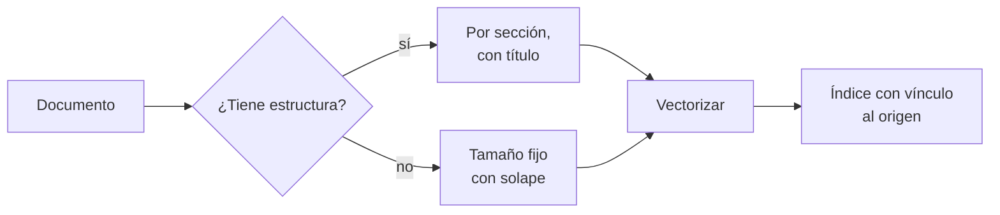

## 1. Resumen

Un documento entero no se vectoriza bien: excede el límite del modelo de embeddings o mezcla temas en un solo vector. **Chunking** es dividirlo en **fragmentos** antes de vectorizar. La guía de RAG Engine resume el compromiso: fragmentos chicos dan embeddings más precisos; grandes, más generales, que pueden perder detalles (*Fine-tune RAG transformations*).

Hay dos familias. **Por tamaño fijo**, con solape entre fragmentos consecutivos: simple y predecible. **Por estructura** (secciones, párrafos, oraciones): respeta las unidades de sentido del documento. Bedrock, por ejemplo, no mezcla contenido entre páginas o secciones del contenido parseado (*How content chunking works for knowledge bases*).

## 2. Qué es

- **Fragmento (chunk):** la unidad que se vectoriza, se indexa y se recupera.
- **Tamaño:** se mide en tokens del modelo (`tokens`); el ejemplo usa palabras para leerlo fácil.
- **Solape:** la parte final de un fragmento se repite al inicio del siguiente, para no cortar el contexto.
- **Por estructura:** cortar en encabezados, párrafos u oraciones.
- **Contexto heredado:** agregar el título del documento a cada fragmento.

## 3. Problema que resuelve

Un runbook dice: «reintenta una vez; si vuelve a fallar, escala a la guardia». Un corte por tamaño separa las dos frases en fragmentos distintos, y una búsqueda puede devolver solo «reintenta una vez»: la instrucción queda incompleta.

## 4. Cómo funciona

1. Se elige la estrategia según el documento: Markdown o HTML con encabezados, por sección; texto corrido, por tamaño con solape.
2. Se mide el tamaño en tokens del modelo de embeddings que se va a usar.
3. Se agrega a cada fragmento el contexto mínimo (título del documento, sección).
4. Se guarda el vínculo al documento y a la posición, para citar la fuente.
5. Se prueba con preguntas reales: el fragmento recuperado debe contener la respuesta completa.

## 5. Cuándo utilizarlo

- Siempre antes de vectorizar documentos más largos que unos párrafos.
- Documentación técnica, runbooks, contratos de datos, tickets largos.

## 6. Cuándo no utilizarlo

- Textos cortos que ya son una unidad (una descripción de tabla, un título): se vectorizan enteros.
- Datos tabulares: se vectorizan filas o descripciones, no fragmentos de un CSV.

## 7. Ejemplo sencillo

El runbook del §10, de 70 palabras:

| Estrategia | Fragmentos | Procedimiento de timeout entero |
|---|---|---|
| Tamaño fijo, 20 palabras, solape 5 | 5 | No |
| Por sección | 3 | Sí |

## 8. Ejemplo de producción

Un pipeline que indexa la documentación interna:

- Markdown por sección, con el título del documento en cada fragmento;
- documentos sin estructura, por tamaño: un punto de partida es 512 tokens con 25 % de solape, como recomienda Azure AI Search;
- en RAG Engine, `chunk_size` y `chunk_overlap` (1024 y 256 por defecto); en Bedrock, la estrategia del data source (no ejecutado);
- un conjunto de preguntas de control que verifica que la respuesta queda en un fragmento.

## 9. Arquitectura



## 10. Código

```python
# Python 3.12, biblioteca estándar (ejecutado en la CI): dos formas de dividir un documento antes de vectorizarlo.
# Por tamaño fijo con solape (aquí en palabras; en producción, en tokens del modelo de embeddings) y por estructura
# (secciones de Markdown), que no corta un procedimiento a la mitad.
import re

DOC = """# Runbook del job ventas_diarias

## Cuándo se ejecuta
Corre todos los días a las 03:00 después de la carga de pedidos.

## Qué hacer si falla por timeout
Revisa el estado del warehouse. Reintenta una vez con el parámetro --reintento.
Si vuelve a fallar, escala a la guardia de datos y no reproceses a mano.

## Quién es el dueño
El equipo de ingeniería de ventas mantiene este job.
"""


def por_tamano(texto: str, tamano: int, solape: int) -> list[str]:
    palabras = texto.split()
    paso = tamano - solape
    return [" ".join(palabras[i:i + tamano]) for i in range(0, max(len(palabras) - solape, 1), paso)]


def por_seccion(texto: str) -> list[str]:
    secciones = re.split(r"\n(?=## )", texto.strip())
    titulo = secciones[0].splitlines()[0]  # el título del documento viaja con cada fragmento como contexto
    return [f"{titulo}\n{s.strip()}" for s in secciones[1:]]


fijos = por_tamano(DOC, tamano=20, solape=5)
print(f"tamaño fijo (20 palabras, solape 5): {len(fijos)} fragmentos")
for f in fijos:
    print(f"  [{len(f.split())}] {f[:60]}…")
corte = next(f for f in fijos if "Reintenta" in f)
print("el procedimiento queda entero en un fragmento:", "escala a la guardia" in corte)

secciones = por_seccion(DOC)
print(f"por sección: {len(secciones)} fragmentos")
for s in secciones:
    print("  " + s.splitlines()[1])
print("el procedimiento queda entero en un fragmento:", any("Reintenta" in s and "escala a la guardia" in s for s in secciones))
```

El script se **ejecuta en la CI** con la biblioteca estándar y pasa `mypy --strict`. Por tamaño fijo imprime 5 fragmentos y `el procedimiento queda entero en un fragmento: False`; por sección, 3 fragmentos (una por encabezado `##`) y `True`.

## 11. GCP

En GCP, **RAG Engine** de Gemini Enterprise Agent Platform. Según *Fine-tune RAG transformations* (no ejecutado):

| | Este concepto | RAG Engine |
|---|---|---|
| Tamaño | Elegido por documento | `chunk_size`, 1024 tokens por defecto |
| Solape | Elegido | `chunk_overlap`, 256 tokens por defecto |

## 12. AWS

En AWS, **Amazon Bedrock Knowledge Bases**. Según *How content chunking works for knowledge bases* (no ejecutado):

| | Este concepto | Bedrock Knowledge Bases |
|---|---|---|
| Estrategias | Tamaño fijo o estructura | Estándar, jerárquica, semántica y multimodal |
| Tamaño fijo | Tokens y solape | Tokens máximos y porcentaje de solape |
| Límites del documento | Cortar por sección | Con contenido parseado, no mezcla páginas ni secciones |

## 13. Azure

En Azure, **Azure AI Search**. Según *Chunk large documents for RAG and vector search in Azure AI Search* (no ejecutado):

| | Este concepto | Azure AI Search |
|---|---|---|
| Punto de partida | Probar con preguntas | 512 tokens (unos 2000 caracteres) y 25 % de solape |
| Variable | Por estructura | Por puntuación, fin de línea o estructura del documento |

## 14. Buenas prácticas

- Cortar por estructura cuando el documento la tiene.
- Medir en tokens del modelo que se va a usar.
- Agregar el título y la sección a cada fragmento.
- Guardar el vínculo al documento y la posición.
- **Seguridad:** el fragmento hereda la clasificación del documento; no indexar en un índice abierto lo que el documento restringe.
- **Observabilidad:** fragmentos por documento y fragmentos que exceden el límite.
- **Costo:** más solape, más fragmentos y más tokens vectorizados.

## 15. Errores frecuentes

- Cortar por caracteres sin mirar la estructura.
- Fragmentos sin el contexto del documento.
- Cambiar la estrategia sin reindexar todo.
- No probar con preguntas reales.

## 16. Trade-offs

Fragmentos chicos son precisos y pierden contexto; grandes conservan contexto y diluyen el vector. Más solape protege los cortes y aumenta el volumen. Cortar por estructura respeta el documento y produce tamaños desparejos.

## 17. Conceptos relacionados

- `rag`: lo que se recupera.
- `embeddings`: el límite por entrada.
- `tokens`: la unidad de tamaño.

## 18. Preguntas técnicas abiertas

1. ¿Tus documentos tienen estructura que permita cortar por sección?
2. ¿Qué pregunta real usarías para probar que un procedimiento queda entero?
3. ¿Qué tamaño de fragmento usa hoy tu índice, y por qué?

## 19. Laboratorio relacionado

Pendiente (F4).

## 20. Fuentes

- Google Cloud: *Fine-tune RAG transformations*.
- AWS: *How content chunking works for knowledge bases*.
- Microsoft Learn: *Chunk large documents for RAG and vector search in Azure AI Search*.

El detalle de cada fuente está en `sources` del frontmatter.

## 21. Fecha de última verificación

2026-10-25. Pasa a `verified` el 2026-10-26: revisión B-F3.1 del lote F3b-21b sin hallazgos (docs/reviews/cards-f3b-21b.md) y CI en verde (run 40364714269).

## 22. Historial de cambios importantes

- 2026-10-25: creación (lote F3b-21b).
- 2026-10-26: `verification_status: verified` (revisión sin hallazgos; CI en verde, run 40364714269).
