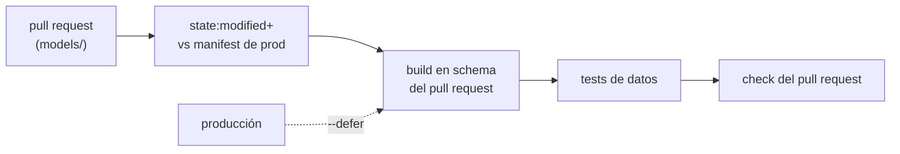

## 1. Resumen

En CI/CD para datos, el cambio que se integra es un modelo (una transformación SQL) cuyo resultado son tablas. Probarlo exige construir esas tablas en algún lado sin tocar producción. El patrón de la documentación de dbt:

- la CI construye y prueba **solo lo que cambió y sus dependientes**;
- lo hace en un **schema propio del pull request**;
- usa **producción para lo que no cambió**, sin reconstruirlo.

En dbt platform esto es un CI job: «only the modified data assets in your pull request (PR) and their downstream dependencies are built and tested in a staging schema». En dbt Core se arma con `state:modified+` y `--defer --state` sobre el manifest de producción. Los **tests de datos** (unicidad, no nulos, valores aceptados) son los checks que deciden si el pull request entra.

## 2. Qué es

- **CI de modelos:** construir y probar en cada pull request los modelos que tocó.
- **Selección por estado (`state:modified+`):** compara el proyecto con el manifest de producción y elige los nodos nuevos o cambiados, más sus dependientes.
- **Defer:** las referencias a modelos que no se construyeron se resuelven contra producción.
- **Schema del pull request:** un entorno efímero para el cambio, que dbt platform borra al cerrar o fusionar.
- **Test de datos:** una consulta que busca filas que violan una regla; si encuentra alguna, falla.

## 3. Problema que resuelve

Un cambio en un modelo puede compilar y aun así romper los datos: duplicar pedidos, dejar clientes nulos, inventar un estado. Los tests unitarios de Python no lo ven. Construir todo el proyecto en cada pull request es lento y caro. La CI de datos construye solo lo afectado, con datos reales o de prueba, y corre los tests de datos sobre el resultado.

## 4. Cómo funciona

Con dbt Core en GitHub Actions:

1. El pull request toca `models/`.
2. El job baja el manifest de la última corrida de producción.
3. `dbt run --select state:modified+ --defer --state prod-artifacts/` construye en el schema del pull request lo modificado y sus dependientes; lo demás se lee de producción.
4. `dbt test` con la misma selección corre los tests de datos de esos modelos.
5. El resultado es un check del pull request; en dbt platform, un estado en el pull request.

## 5. Cuándo utilizarlo

- En todo proyecto de modelos SQL (dbt, Dataform) con más de unas pocas tablas.
- Con tests de datos en las claves y columnas críticas de cada modelo.
- Con datos de prueba chicos cuando no se puede leer producción desde la CI.

## 6. Cuándo no utilizarlo

- Construir todo el proyecto en cada pull request cuando `state:modified+` alcanza.
- Usar `--defer` sin un manifest de producción actualizado: compararía contra un estado viejo.
- Correr la CI contra el schema de producción.

## 7. Ejemplo sencillo

`fct_pedidos` deja la última versión de cada pedido. Sus tests de datos comprueban que `pedido_id` es único, que `cliente_id` no es nulo y que `estado` está en una lista. Con datos de prueba correctos, la lista de fallas queda vacía; con un pedido sin cliente y un estado «devuelto», fallan dos tests.

## 8. Ejemplo de producción

Un proyecto dbt con:

- CI en cada pull request con `state:modified+` y `--defer` contra el manifest de producción;
- un schema por pull request, que se borra al cerrar;
- tests de unicidad y no nulos en todas las claves, y de valores aceptados en los estados;
- los checks de la CI obligatorios en main;
- despliegue a producción al integrar, con el mismo commit que pasó la CI.

## 9. Arquitectura



## 10. Código

```python
# Python 3.12 y sqlite3 de la biblioteca estándar (ejecutado en la CI; mypy --strict sin errores): lo que corre la CI
# de un modelo SQL. Construye el modelo sobre datos de prueba en una base desechable (en memoria) y corre sus tests de
# datos: unicidad, no nulos y valores aceptados. Una lista vacía es «pasa».
from __future__ import annotations

import sqlite3

MODEL = """
CREATE TABLE fct_pedidos AS
WITH ranked AS (
  SELECT *, ROW_NUMBER() OVER (PARTITION BY pedido_id ORDER BY actualizado_en DESC) AS rn
  FROM raw_pedidos
)
SELECT pedido_id, cliente_id, estado, monto FROM ranked WHERE rn = 1
"""

TESTS = {
    "unique_pedido_id": "SELECT pedido_id FROM fct_pedidos GROUP BY pedido_id HAVING COUNT(*) > 1",
    "not_null_cliente_id": "SELECT pedido_id FROM fct_pedidos WHERE cliente_id IS NULL",
    "accepted_values_estado": "SELECT pedido_id FROM fct_pedidos WHERE estado NOT IN ('creado', 'pagado', 'anulado')",
}


def run_ci(rows: list[tuple[int, int | None, str, float, str]]) -> list[str]:
    """Devuelve los tests que fallan (los que encuentran al menos una fila)."""
    with sqlite3.connect(":memory:") as conn:
        conn.execute("CREATE TABLE raw_pedidos (pedido_id, cliente_id, estado, monto, actualizado_en)")
        conn.executemany("INSERT INTO raw_pedidos VALUES (?, ?, ?, ?, ?)", rows)
        conn.execute(MODEL)
        return [name for name, sql in TESTS.items() if conn.execute(sql).fetchone() is not None]
```

```yaml
# GitHub Actions (.github/workflows/dbt-ci.yml; validado con actionlint en la CI, no ejecutado): CI de un proyecto dbt
# en cada pull request. Corre y prueba solo los modelos modificados y sus dependientes (state:modified+) en un
# schema del pull request, y usa los de producción para lo que no cambió (--defer, con el manifest de producción).
name: dbt-ci

on:
  pull_request:
    paths: ["models/**", "tests/**", "dbt_project.yml"]

permissions:
  contents: read

jobs:
  dbt:
    runs-on: ubuntu-24.04
    env:
      DBT_SCHEMA: pr_${{ github.event.pull_request.number }}
    steps:
      - uses: actions/checkout@v7
      - uses: actions/setup-python@v7
        with:
          python-version: "3.12"
      - run: pip install -r requirements-dbt.txt
      - name: Bajar el manifest de producción
        run: ./scripts/fetch-prod-manifest.sh prod-artifacts/
      - run: dbt run --select state:modified+ --defer --state prod-artifacts/
      - run: dbt test --select state:modified+ --defer --state prod-artifacts/
```

El script de Python se **ejecuta en la CI** y pasa `mypy --strict`. Usa `sqlite3` de la biblioteca estándar con una base en memoria. El test comprueba que con datos correctos no falla ningún test de datos y que con un pedido sin cliente y un estado fuera de la lista fallan los dos correspondientes. Es la idea de la CI de un modelo, no dbt. El workflow se **valida con actionlint en la CI y no se ejecutó**: dbt no corre en la CI del proyecto. Sigue la selección `state:modified+` y `--defer --state` de *Node selector methods* y *Defer*.

## 11. GCP

En GCP, **Dataform**. Las diferencias con dbt, según sus páginas:

| | dbt | Dataform |
|---|---|---|
| Desarrollo | Proyecto en Git; CI jobs en dbt platform | Desarrollo colaborativo con Git |
| Tests de datos | Tests de dbt sobre los modelos | Assertions (`nonNull`, `uniqueKey`, `rowConditions`) que corren al actualizar el workflow |
| CI por pull request | Schema temporal por pull request, solo lo modificado | Las páginas citadas de Dataform no lo tratan |

## 12. AWS

No aplica de forma específica: la CI de modelos es de la herramienta de transformación. En AWS, CodeBuild puede correrla y mostrar los resultados. Las diferencias, según sus páginas:

| | dbt platform | AWS CodeBuild |
|---|---|---|
| Resultado | Estado en el pull request | Reportes de tests en un report group, en JUnit XML y otros formatos |
| Qué construye | Solo lo modificado y sus dependientes | Lo que diga el buildspec |

## 13. Azure

En **Azure Pipelines**, un pipeline de Python puede correr la CI de los modelos y mostrar los resultados en la pestaña Tests (*Build and publish a Python app*). dbt platform publica el estado de su CI también en pull requests de Azure DevOps (*Continuous integration in dbt*).

## 14. Buenas prácticas

- Solo lo modificado y sus dependientes, con el manifest de producción al día.
- Un schema por pull request, borrado al cerrar.
- Tests de datos en claves, nulos y valores aceptados de cada modelo.
- Checks de datos obligatorios en main.
- **Seguridad:** la CI con un usuario que escribe solo en los schemas de pull request y lee producción, sin escribirla.
- **Observabilidad:** el nombre del schema del pull request queda en la corrida; sirve para revisar los datos construidos.
- **Costo:** construir solo lo modificado ahorra cómputo del warehouse en cada pull request; los schemas que no se borran siguen cobrando almacenamiento.

## 15. Errores frecuentes

- Construir todo el proyecto en cada pull request.
- Un manifest de producción viejo que hace que `state:modified` elija de más o de menos.
- Schemas de pull request que se acumulan (por ejemplo, con `generate_schema_name` personalizado, que según dbt puede impedir que se borren).
- Tests solo de compilación, sin tests de datos.

## 16. Trade-offs

Construir solo lo modificado acelera la CI y baja el costo, a cambio de depender de un manifest de producción al día. Leer producción con `--defer` evita reconstruir todo, pero la CI ve los datos de producción, con su volumen y sus permisos. Datos de prueba chicos dan una CI rápida y aislada, pero no muestran problemas que solo aparecen con datos reales.

## 17. Conceptos relacionados

- `ci-cd-pipelines` y `automated-testing-in-ci`: el pipeline y los checks.
- `sql-quality-checks`: los tests de datos.
- `environment-promotion`: el schema del pull request como entorno efímero.
- `dataform-workflows`: la alternativa en GCP.
- `data-contracts`: lo que los tests hacen cumplir.

## 18. Preguntas técnicas abiertas

1. ¿Cuánto tarda hoy la CI de tus modelos, y cuánto de eso es reconstruir lo que no cambió?
2. ¿Qué modelos no tienen ningún test de datos?
3. ¿La CI puede leer producción, o necesitas datos de prueba?

## 19. Laboratorio relacionado

Pendiente (F4).

## 20. Fuentes

- dbt: *Continuous integration in dbt*, *Node selector methods* y *Defer*.
- Google Cloud: *Dataform overview* y *Test data quality*.
- AWS: *Test reports in AWS CodeBuild*. Microsoft Learn: *Build and publish a Python app*. Python: *sqlite3 — DB-API 2.0 interface for SQLite databases*.

El detalle de cada fuente está en `sources` del frontmatter.

## 21. Fecha de última verificación

2026-10-14. `review_required`: pendiente de revisión B-F3.1 del lote F3b-11b.

## 22. Historial de cambios importantes

- 2026-10-14: creación (lote F3b-11b).
