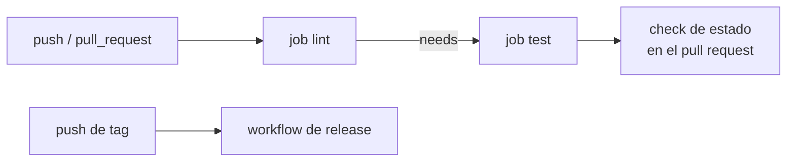

## 1. Resumen

Un pipeline de CI/CD automatiza lo que pasa después de un push: construir, probar y desplegar. Las plataformas usan nombres distintos para las mismas piezas:

- un **disparador** (evento, trigger): push, pull request, tag, horario;
- **etapas o jobs**: unidades que corren en un agente o runner;
- **pasos**: comandos o acciones dentro de un job, en orden.

Lo que cambia entre plataformas es cómo se ordenan los jobs. En GitHub Actions corren en paralelo salvo que declaren dependencias (`needs`). En GitLab, los stages fijan el orden y los jobs de un mismo stage corren en paralelo.

## 2. Qué es

| Pieza | GitHub Actions | GitLab CI/CD |
|---|---|---|
| Archivo | YAML en `.github/workflows/` | `.gitlab-ci.yml` en la raíz |
| Disparo | Evento del repositorio, manual o por horario | Pipeline definido en `.gitlab-ci.yml` |
| Orden | Jobs en paralelo por defecto; `needs` para dependencias | Stages en orden; jobs de un stage en paralelo |
| Ejecución | Runner: un job a la vez, máquina virtual nueva por corrida | Runner: agente que corre los jobs, con imagen opcional |

## 3. Problema que resuelve

Sin pipeline, alguien corre los tests en su máquina (o no) y despliega a mano. En una plataforma de datos eso termina en DAGs rotos en producción, modelos sin probar y nadie sabe qué versión corre. El pipeline hace que cada cambio pase por los mismos pasos, en una máquina limpia.

## 4. Cómo funciona

En GitHub Actions:

1. Un evento (push a main, pull request) dispara el workflow.
2. Cada job corre en un runner nuevo; sus pasos comparten el sistema de archivos.
3. `needs: lint` hace que el job de tests espere al de lint.
4. `concurrency` con `cancel-in-progress: true` cancela la corrida anterior de la misma rama cuando llega una nueva.
5. `permissions` deja al `GITHUB_TOKEN` solo con el acceso mínimo.

En GitLab, los mismos dos pasos son dos stages: `test` empieza cuando `lint` termina bien.

## 5. Cuándo utilizarlo

- En todo repositorio con código que se despliega: pipelines, DAGs, modelos, Terraform.
- CI en cada pull request; CD al integrar en main o al empujar una tag.
- Con `concurrency` en ramas con muchos pushes seguidos.

## 6. Cuándo no utilizarlo

- Un pipeline que nadie mira cuando falla: es solo costo.
- Pasos que dependen de la máquina de alguien o de estado fuera del repositorio.
- Desplegar a producción desde ramas sin protección.

## 7. Ejemplo sencillo

Un repositorio con un pipeline de Python: el workflow corre `ruff` y, si pasa, `pytest`. Un pull request con un error de lint no llega a correr los tests.

## 8. Ejemplo de producción

Una plataforma con:

- CI en cada pull request: lint, tests y `terraform validate`;
- CD al integrar en main: despliegue al entorno de desarrollo;
- release por tag: despliegue a producción con aprobación;
- `permissions: contents: read` por defecto y escritura solo en el job que la necesita.

## 9. Arquitectura



## 10. Código

```yaml
# GitHub Actions (.github/workflows/ci.yml; validado con actionlint en la CI, no ejecutado): en cada push y pull
# request, un job de lint y uno de tests que espera al primero (needs). Una corrida nueva de la misma rama cancela la
# anterior.
name: ci

on:
  push:
    branches: [main]
  pull_request:

concurrency:
  group: ci-${{ github.ref }}
  cancel-in-progress: true

permissions:
  contents: read

jobs:
  lint:
    runs-on: ubuntu-24.04
    steps:
      - uses: actions/checkout@v7
      - uses: actions/setup-python@v7
        with:
          python-version: "3.12"
      - run: pip install ruff
      - run: ruff check .

  test:
    needs: lint
    runs-on: ubuntu-24.04
    steps:
      - uses: actions/checkout@v7
      - uses: actions/setup-python@v7
        with:
          python-version: "3.12"
      - run: pip install -r requirements.txt
      - run: pytest -q
```

```yaml
# GitLab CI (.gitlab-ci.yml; no ejecutado): el mismo pipeline en dos stages. Los jobs de un stage corren en paralelo
# y el stage siguiente empieza cuando los anteriores terminan bien.
stages:
  - lint
  - test

lint:
  stage: lint
  image: python:3.12
  script:
    - pip install ruff
    - ruff check .

test:
  stage: test
  image: python:3.12
  script:
    - pip install -r requirements.txt
    - pytest -q
```

El workflow de GitHub Actions se **valida con actionlint en la CI** (ADR-014) **y no se ejecutó**: actionlint revisa la sintaxis, las expresiones y las entradas de las acciones, pero no corre el workflow. El `.gitlab-ci.yml` **no se ejecutó** ni se validó. Los dos describen el mismo pipeline: en GitHub, el orden lo da `needs`; en GitLab, los stages.

## 11. GCP

En GCP, **Cloud Build**. Las diferencias, según sus páginas:

| | GitHub Actions | Cloud Build |
|---|---|---|
| Unidad | Workflow con jobs y pasos en runners | Build con pasos; cada paso corre un contenedor de Docker (`docker run`) |
| Configuración | YAML en `.github/workflows/` | Archivo de configuración en YAML o JSON |
| Cobro | Gratis en repositorios públicos con runners estándar; cuota por plan en privados | Build-minutos mientras el build está en proceso, según el tipo de máquina, con cuota gratis mensual |

Precios consultados el 2026-10-14 en *GitHub Actions billing* y *Cloud Build pricing*; los montos no se copian.

## 12. AWS

En AWS, **CodeBuild** construye y **CodePipeline** orquesta las etapas. Las diferencias, según sus páginas:

| | GitHub Actions | AWS CodeBuild y CodePipeline |
|---|---|---|
| Unidad | Workflow con jobs y pasos | CodeBuild: build con fases (`install`, `pre_build`, `build`, `post_build`) en un buildspec; CodePipeline: etapas del release |
| Configuración | YAML en el repositorio | Buildspec en YAML, con el código o en el proyecto |
| Cobro | Cuota por plan en privados | CodeBuild: duración del build según el tipo de cómputo, pago por uso |

Precios consultados el 2026-10-14 en *AWS CodeBuild pricing*; los montos no se copian.

## 13. Azure

En **Azure Pipelines**, un trigger hace correr el pipeline. Un stage es un límite lógico (build, test, producción) y los stages corren uno tras otro por defecto. Un job es un conjunto de pasos secuenciales en un agente, y las aprobaciones y checks validan antes de que corra un stage (*Key Azure Pipelines concepts*). Se cobra por jobs en paralelo, con uno gratis de cada tipo (*Pricing for Azure DevOps*, consultada el 2026-10-14; sin montos).

## 14. Buenas prácticas

- El pipeline en el repositorio, revisado como el código.
- Jobs rápidos primero (lint) y los caros después.
- Cancelar corridas viejas de la misma rama.
- **Seguridad:** `permissions` con el acceso mínimo al `GITHUB_TOKEN`; escritura solo en el job que la necesita; sin secretos en el YAML.
- **Observabilidad:** cada corrida queda con sus logs y su resultado como check del pull request o del commit.
- **Costo:** cada plataforma cobra distinto (minutos, build-minutos, jobs en paralelo); un pipeline lento o que corre de más se paga.

## 15. Errores frecuentes

- Jobs que podrían correr en paralelo encadenados sin necesidad, o al revés.
- Permisos de escritura para todo el workflow.
- Pasos que instalan versiones sin fijar y fallan de un día para otro.
- Un pipeline que pasa en verde sin correr los tests.

## 16. Trade-offs

Más jobs en paralelo acortan el tiempo de respuesta a cambio de más minutos facturados. Un pipeline administrado (GitHub Actions, Cloud Build, CodeBuild) evita mantener servidores de build, a cambio de depender de su modelo de cobro y de sus runners. Encadenar jobs ahorra cómputo cuando el primero falla, pero alarga la corrida cuando todo pasa.

## 17. Conceptos relacionados

- `automated-testing-in-ci`: el job de tests.
- `build-artifacts`: lo que construye el pipeline.
- `pull-requests`: donde aparecen sus resultados.
- `git-tags-and-releases`: el pipeline de release.
- `infrastructure-as-code`: el Terraform que valida y aplica.

## 18. Preguntas técnicas abiertas

1. ¿Qué jobs de tu pipeline podrían correr en paralelo?
2. ¿Qué permisos tiene hoy el token de tus workflows?
3. ¿Cuánto tarda tu pipeline desde el push hasta el resultado, y cuánto de eso es espera?

## 19. Laboratorio relacionado

Pendiente (F4).

## 20. Fuentes

- GitHub Docs: *Understanding GitHub Actions*, *Workflow syntax for GitHub Actions* y *GitHub Actions billing*.
- GitLab Docs: *Get started with GitLab CI/CD* y *CI/CD YAML syntax reference*.
- Microsoft Learn: *Key Azure Pipelines concepts*; *Pricing for Azure DevOps*.
- Google Cloud: *Overview of Cloud Build*; *Cloud Build pricing*.
- AWS: *What is AWS CodeBuild?*, *Build specification reference for CodeBuild* y *What is AWS CodePipeline?*; *AWS CodeBuild pricing*.

El detalle de cada fuente está en `sources` del frontmatter.

## 21. Fecha de última verificación

2026-10-14. `review_required`: pendiente de revisión B-F3.1 del lote F3b-11a.

## 22. Historial de cambios importantes

- 2026-10-14: creación (lote F3b-11a).
