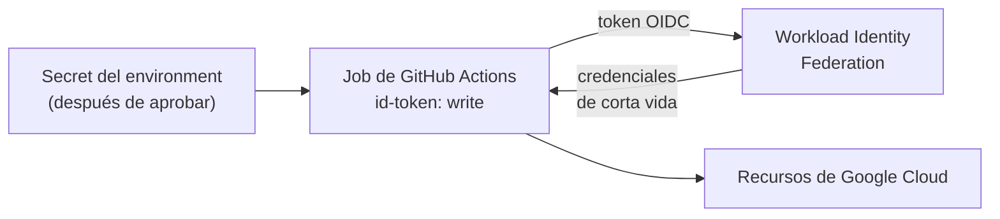

## 1. Resumen

Un pipeline necesita credenciales para desplegar y para leer datos. Hay dos formas de dárselas:

- **secretos guardados** en la plataforma de CI (GitHub secrets, variables de GitLab, secret variables de Azure). Se cifran y se ocultan en los logs, pero la redacción **no está garantizada**: lo dicen GitHub y GitLab.
- **federación de identidad por OIDC:** el pipeline presenta un token de corta vida emitido por la plataforma de CI y la nube lo cambia por credenciales temporales. Según Google Cloud, esto elimina la carga de mantener claves de cuentas de servicio. GitHub agrega que no hace falta duplicar credenciales de nube como secretos de larga vida.

Para las credenciales de nube conviene la federación. Para lo que no tiene federación (el token de una API externa), un secreto del environment, que el job recibe solo después de la aprobación.

## 2. Qué es

| | GitHub Actions | GitLab CI/CD |
|---|---|---|
| Secreto guardado | Secret de organización, repositorio o environment; se lee solo si el workflow lo incluye | Variable protegida (solo ramas y tags protegidos) y enmascarada |
| Ocultar en logs | Redacción automática, no garantizada | Masked, que no garantiza que no se pueda leer |
| Federación | Token OIDC con `permissions: id-token: write` | ID token (JWT) con `id_tokens` y un `aud` por servicio |

Del lado de la nube, la federación es Workload Identity Federation en Google Cloud, un proveedor OIDC de IAM en AWS y workload identity federation en Microsoft Entra.

## 3. Problema que resuelve

Una clave de cuenta de servicio guardada como secreto vive meses, sirve desde cualquier lugar y nadie la rota. Si se filtra (un `echo` en un log, un fork que la imprime), da acceso hasta que alguien la revoque. Las credenciales federadas son de corta vida, salen de la identidad del workflow y no se guardan en ningún lado.

## 4. Cómo funciona

Con GitHub Actions y Google Cloud:

1. En Google Cloud se configura un pool y un proveedor de Workload Identity Federation que confía en los tokens de GitHub de ese repositorio.
2. El workflow declara `permissions: id-token: write`.
3. La acción `google-github-actions/auth` pide el token OIDC y lo cambia por credenciales de la cuenta de servicio indicada.
4. Los pasos siguientes usan esas credenciales, que vencen solas.
5. El token de una API externa, sin federación, va como secreto del environment `production`.

## 5. Cuándo utilizarlo

- Federación para toda credencial de nube: GCP, AWS y Azure la soportan.
- Secretos del environment para lo que solo usa producción.
- Secret Manager o Secrets Manager cuando el mismo secreto lo usan el pipeline y la aplicación (Cloud Build y CodeBuild los leen de ahí).

## 6. Cuándo no utilizarlo

- Claves de cuenta de servicio como secreto de GitHub cuando hay federación.
- JSON, XML o YAML como valor de un secreto: según GitHub, la redacción busca coincidencias exactas y falla con datos estructurados.
- Confiar en el enmascarado: GitLab dice que no es una forma garantizada de impedir que se lea el valor.

## 7. Ejemplo sencillo

Un job de carga diaria se autentica en Google Cloud con OIDC; no hay ninguna clave guardada. El token de la API del proveedor de datos está en el environment `production` y solo lo ve ese job.

## 8. Ejemplo de producción

Una plataforma con:

- federación OIDC en GCP y AWS, con una cuenta de servicio o un rol por pipeline y entorno;
- la confianza OIDC configurada para que cada workflow obtenga solo los recursos que necesita (el control granular que describe *OpenID Connect*);
- secretos de terceros en el environment de producción, con aprobación;
- acciones de terceros fijadas a un commit completo;
- `permissions` mínimos en cada workflow.

## 9. Arquitectura



## 10. Código

```yaml
# GitHub Actions (.github/workflows/load.yml; validado con actionlint en la CI, no ejecutado): el job pide un token OIDC
# (id-token: write) y lo cambia por credenciales de corta vida de Google Cloud con Workload Identity Federation. No hay
# una clave de cuenta de servicio guardada como secreto. La acción va fijada a un commit completo.
name: load

on:
  schedule:
    - cron: "0 5 * * *"

permissions:
  contents: read
  id-token: write

jobs:
  load:
    runs-on: ubuntu-24.04
    environment: production
    steps:
      - uses: actions/checkout@v7
      - uses: google-github-actions/auth@7c6bc770dae815cd3e89ee6cdf493a5fab2cc093 # v3
        with:
          workload_identity_provider: ${{ vars.GCP_WIF_PROVIDER }}
          service_account: ${{ vars.GCP_LOADER_SA }}
      - name: Cargar con una API externa
        env:
          API_TOKEN: ${{ secrets.VENDOR_API_TOKEN }}  # secreto del environment: solo para jobs que lo referencian
        run: python load.py --since yesterday
```

```yaml
# GitLab CI (.gitlab-ci.yml; no ejecutado): el job recibe un ID token con el aud del proveedor de Workload Identity
# Federation. Las variables con datos sensibles van protegidas (solo en ramas y tags protegidos) y enmascaradas.
load:
  image: python:3.12
  id_tokens:
    WORKLOAD_IDENTITY_TOKEN:
      aud: https://iam.googleapis.com/projects/PROJECT_NUMBER/locations/global/workloadIdentityPools/POOL_ID/providers/PROVIDER_ID
  script:
    - python load.py --since yesterday
```

El workflow de GitHub Actions se **valida con actionlint en la CI y no se ejecutó**. Usa `google-github-actions/auth` con `workload_identity_provider` y `service_account`, como *Configure Workload Identity Federation with deployment pipelines*, que lo muestra con `@v1`. Aquí va fijado a un commit completo de la versión 3, como recomienda *Secure use reference*. El job de GitLab **no se ejecutó**: declara un ID token con el `aud` del proveedor, con el formato de esa misma página.

## 11. GCP

En GCP, **Workload Identity Federation** para los pipelines y **Secret Manager** para los secretos de Cloud Build. Las diferencias con la plataforma de CI, según sus páginas:

| | Secreto guardado en GitHub | Workload Identity Federation |
|---|---|---|
| Qué se guarda | El valor, cifrado, en GitHub | Nada: el pipeline presenta el token de su plataforma |
| Vida | Hasta que alguien lo rote | Credenciales de corta vida |
| Pipelines soportados | Solo GitHub Actions | GitHub Actions, GitLab, Azure DevOps (Entra), HCP Terraform |

## 12. AWS

En AWS, un **proveedor OIDC de IAM** y **Secrets Manager** desde el buildspec de CodeBuild. Las diferencias, según sus páginas:

| | Workload Identity Federation (GCP) | AWS |
|---|---|---|
| Confianza | Pool y proveedor de federación | Proveedor OIDC de IAM entre el IdP y la cuenta |
| Secretos en el build | Secret Manager en Cloud Build | `secrets-manager` en la sección `env` del buildspec |
| Logs | Las páginas citadas de Cloud Build no lo tratan | CodeBuild oculta, entre otros, los IDs de access keys |

## 13. Azure

En Azure, **workload identity federation** de Microsoft Entra: una identidad administrada asignada por el usuario o un app registration confía en tokens de un IdP externo como GitHub, sin secretos ni certificados que guardar y rotar (*Workload identity federation concepts*). En **Azure Pipelines**, las secret variables se cifran en reposo y están disponibles en el agente sin mostrar su valor (*Set secret variables*).

## 14. Buenas prácticas

- Federación OIDC para las credenciales de nube.
- Secretos del environment, no del repositorio, para producción.
- `permissions` mínimos; `id-token: write` solo en los jobs que lo necesitan.
- Acciones de terceros fijadas a un commit completo.
- **Seguridad:** ninguna clave de larga vida en la plataforma de CI; cada workflow, con acceso solo a lo que necesita.
- **Observabilidad:** las credenciales federadas quedan asociadas al workflow que las pidió; revisar qué workflows obtienen credenciales de producción.
- **Costo:** la federación evita el trabajo recurrente de rotar claves y el costo de una filtración.

## 15. Errores frecuentes

- Guardar el JSON de una clave de cuenta de servicio como secreto.
- Imprimir variables de entorno para depurar un job.
- `permissions: write-all` o sin `permissions` en el workflow.
- Acciones de terceros con un tag que su autor puede mover.

## 16. Trade-offs

La federación elimina las claves guardadas, a cambio de configurar la confianza en cada nube y de entender sus condiciones. Los secretos guardados son simples y sirven para cualquier servicio, pero viven mucho y dependen de una redacción que no está garantizada. Fijar acciones a un commit protege de cambios maliciosos, a cambio de tener que actualizar los SHA a mano o con una herramienta.

## 17. Conceptos relacionados

- `gcp-secret-manager-usage` y `key-vault-secrets`: secretos de aplicación en GCP y Azure.
- `gcp-iam-for-data`, `aws-iam-for-data` y `entra-id-for-data`: las identidades en cada nube.
- `environment-promotion`: secretos por entorno.
- `ci-cd-pipelines`: los permisos del token del workflow.

## 18. Preguntas técnicas abiertas

1. ¿Qué claves de larga vida tienen hoy tus pipelines?
2. ¿Qué workflows de tu repositorio pueden obtener credenciales de producción?
3. ¿Qué pasaría si un pull request imprimiera las variables de entorno?

## 19. Laboratorio relacionado

Pendiente (F4).

## 20. Fuentes

- GitHub Docs: *Secrets*, *OpenID Connect*, *Workflow syntax for GitHub Actions*, *Secure use reference* y *Deployments and environments*.
- GitLab Docs: *CI/CD variables* y *OpenID Connect (OIDC) Authentication Using ID Tokens*.
- Google Cloud: *Configure Workload Identity Federation with deployment pipelines* y *Use secrets from Secret Manager*.
- AWS: *Create an OpenID Connect (OIDC) identity provider in IAM* y *Build specification reference for CodeBuild*.
- Microsoft Learn: *Workload identity federation concepts* y *Set secret variables*.

El detalle de cada fuente está en `sources` del frontmatter.

## 21. Fecha de última verificación

2026-10-14. `review_required`: pendiente de revisión B-F3.1 del lote F3b-11b.

## 22. Historial de cambios importantes

- 2026-10-14: creación (lote F3b-11b).
