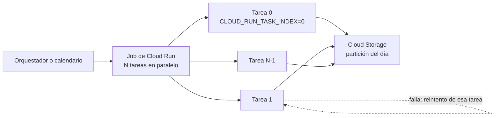

## 1. Resumen

**Cloud Run** ejecuta contenedores sin administrar servidores, y tiene cuatro formas de hacerlo según su documentación:

- **Service:** responde a solicitudes HTTP. Sirve para recibir webhooks o exponer una API de datos.
- **Job:** ejecuta tareas que **terminan**, a mano o con un calendario, en paralelo. Sirve para cargas por lotes.
- **Worker pool:** procesos de fondo siempre activos, como un consumidor de Pub/Sub o Kafka.
- **Instance:** cargas largas que necesitan un entorno único.

Para datos, el caso típico es el **job**: cada tarea recibe `CLOUD_RUN_TASK_INDEX` y `CLOUD_RUN_TASK_COUNT`, y **el código decide qué parte del trabajo le toca**. Cada tarea tiene reintentos y un timeout, de 10 minutos por defecto y hasta 168 horas.

## 2. Qué es

- **Job y tareas:**
  - una ejecución del job lanza N tareas, en secuencia o en paralelo;
  - cada tarea conoce su índice y el total por variables de entorno;
  - la ejecución termina cuando terminan todas, y no tiene timeout propio.
- **Reintentos:**
  - por tarea; si una supera sus reintentos, queda fallida;
  - si alguna falló, la ejecución queda fallida después de intentar todas.
- **Timeout por tarea:** 10 minutos por defecto, hasta 168 horas (1 hora con GPU). Aplica a cada intento.
- **Service:** endpoint HTTP estable, que escala según las solicitudes.
- **Worker pool:** procesos siempre activos, que escalan de forma manual o automática por CPU o por backlog de Pub/Sub.
- **Funciones:** una forma de desplegar código de un solo propósito, orientado a eventos, como service.

## 3. Problema que resuelve

Muchas cargas de datos son código propio en Python que no justifica un clúster: descargar archivos de una API, transformar un lote, consumir una cola. Cloud Run las ejecuta en contenedores sin servidores que mantener. Con los jobs:

- el trabajo se reparte entre tareas paralelas;
- una tarea que falla se reintenta sola, sin repetir las demás;
- se paga lo que corre.

## 4. Cómo funciona

1. Se construye la imagen, o se despliega desde el código fuente.
2. Se crea el job con su número de tareas, paralelismo, timeout y reintentos.
3. Al ejecutarse, cada tarea lee `CLOUD_RUN_TASK_INDEX` y `CLOUD_RUN_TASK_COUNT` y procesa su parte. Un reparto estable, como un hash del nombre, asigna siempre la misma parte a la misma tarea.
4. Una tarea que falla se reintenta. El timeout aplica a cada intento.
5. La ejecución termina cuando terminan todas las tareas. Si alguna agotó sus reintentos, queda fallida.

## 5. Cuándo utilizarlo

- **Job:** cargas por lotes en Python (descargas de APIs, conversiones de archivos, pasos de un pipeline) que caben en contenedores y terminan.
- **Service:** recibir eventos por HTTP o exponer una API de datos (ver `event-driven-pipelines`).
- **Worker pool:** consumidores siempre activos de una cola.

## 6. Cuándo no utilizarlo

- Procesamiento distribuido de grandes volúmenes con shuffle y agregaciones: ahí va Dataflow (ver `dataflow-execution-model`).
- Tareas que duran más de 168 horas: el timeout máximo por tarea.
- Transformaciones SQL sobre datos que ya están en BigQuery: Dataform o SQL programado.

## 7. Ejemplo sencillo

Un job con 3 tareas procesa 10 archivos del día. Cada tarea calcula el CRC32 del nombre módulo 3 y procesa solo los archivos cuyo resultado es su índice. Así cada archivo lo procesa una sola tarea, como muestra el script de §10.

## 8. Ejemplo de producción

Cada noche, un job de Cloud Run con 20 tareas descarga los archivos de un proveedor y los escribe en Cloud Storage:

- el orquestador lanza el job después de que el sensor detecta el aviso del proveedor;
- cada tarea escribe su parte en una partición del día, reemplazándola: un reintento no duplica;
- el timeout por tarea es de 1 hora, con 3 reintentos;
- si una tarea falla tres veces, la ejecución queda fallida y el orquestador alerta.

El paso siguiente, una carga a BigQuery, corre solo si el job termina bien.

## 9. Arquitectura



## 10. Código

```python
# Python 3.12, solo biblioteca estándar (ejecutado en local simulando las variables de Cloud Run; mypy --strict sin
# errores): un job de Cloud Run reparte el trabajo entre tareas. Cada tarea recibe CLOUD_RUN_TASK_INDEX y
# CLOUD_RUN_TASK_COUNT, y el código decide qué parte le toca. Reintentar una tarea rehace solo su parte.
import os
import zlib


def archivos_del_dia() -> list[str]:
    return [f"gs://landing/pedidos/2026-10-10/parte-{i:03d}.csv" for i in range(10)]   # en el job real: listar el bucket


def me_toca(nombre: str, indice: int, total: int) -> bool:
    return zlib.crc32(nombre.encode()) % total == indice    # reparto estable: el mismo archivo, siempre la misma tarea


def procesar(nombre: str) -> None:
    print(f"tarea {os.environ['CLOUD_RUN_TASK_INDEX']}: cargo {nombre.rsplit('/', 1)[1]}")   # idempotente: reescribe su partición


def main() -> None:
    indice = int(os.environ.get("CLOUD_RUN_TASK_INDEX", "0"))
    total = int(os.environ.get("CLOUD_RUN_TASK_COUNT", "1"))
    for nombre in archivos_del_dia():
        if me_toca(nombre, indice, total):
            procesar(nombre)


if __name__ == "__main__":
    for i in range(3):                                   # simulación local de un job con 3 tareas
        os.environ.update(CLOUD_RUN_TASK_INDEX=str(i), CLOUD_RUN_TASK_COUNT="3")
        main()
# Cada archivo aparece una sola vez, en la tarea que le toca (el reparto exacto depende del CRC32 del nombre).
```

Este script en Python 3.12, solo con biblioteca estándar, está ejecutado en local simulando las variables de entorno de Cloud Run (`CLOUD_RUN_TASK_INDEX`, `CLOUD_RUN_TASK_COUNT`) y pasa `mypy --strict` sin errores. **No se desplegó en Cloud Run.** En la ejecución local, los 10 archivos quedaron repartidos entre las 3 tareas sin repetirse. El reparto exacto depende del CRC32 de cada nombre.

## 11. GCP

**Cloud Run.** Services, jobs, worker pools e instances, las variables de las tareas, los reintentos y los timeouts son los de sus páginas.

## 12. AWS

No aplica de forma específica: esta ficha describe Cloud Run.

## 13. Azure

No aplica de forma específica (ver §12).

## 14. Buenas prácticas

- Reparto estable del trabajo por índice de tarea.
- Cada tarea idempotente, porque se reintenta sola.
- Timeout por tarea acorde a su trabajo, no el máximo por defecto.
- Jobs para lotes que terminan; worker pools para consumidores siempre activos.
- **Seguridad:** el contenedor corre con una cuenta de servicio; darle solo lo que necesita y leer los secretos de Secret Manager, no de variables de entorno (ver `gcp-secret-manager-usage`).
- **Observabilidad:** el estado de cada tarea y de cada ejecución, y los logs de cada intento; una tarea que se reintenta siempre indica un problema en su parte de los datos.
- **Costo:** se paga el tiempo de ejecución de las tareas; más paralelismo acorta la ejecución sin cambiar mucho el total de cómputo.

## 15. Errores frecuentes

- Lanzar N tareas que procesan todas lo mismo porque el código no usa el índice.
- Reparto por orden de llegada, que cambia entre intentos y duplica o pierde trabajo.
- Usar un service para un lote largo que no responde HTTP.
- Dejar el timeout por defecto de 10 minutos en una tarea que dura más.

## 16. Trade-offs

Cloud Run ejecuta código propio sin servidores y escala por tarea, a cambio de que el reparto del trabajo, la idempotencia y el estado entre tareas los resuelva el código. Dataflow resuelve el reparto, el shuffle y el estado, pero exige el modelo de Beam. Un job es más simple para lotes de tamaño medio; para procesamiento distribuido con agregaciones grandes, Dataflow.

## 17. Conceptos relacionados

- `api-ingestion` y `batch-ingestion`: lo que suele ejecutar un job.
- `idempotency`: tareas que se reintentan.
- `dataflow-execution-model`: la alternativa para procesamiento distribuido.
- `gcp-secret-manager-usage`: los secretos del contenedor.

## 18. Preguntas técnicas abiertas

1. ¿Qué script de tu pipeline podría ser un job de Cloud Run con tareas en paralelo?
2. ¿Cómo repartirías el trabajo para que cada tarea sea idempotente?
3. ¿En qué punto pasarías de un job de Cloud Run a Dataflow?

## 19. Laboratorio relacionado

Pendiente (F4).

## 20. Fuentes

- Google Cloud, Cloud Run: *What is Cloud Run*, *Deployment options and resource model*, *Create jobs* y *Set task timeout for jobs*.

El detalle de cada fuente está en `sources` del frontmatter.

## 21. Fecha de última verificación

2026-10-11. `review_required`: pendiente de revisión B-F3.1 del lote F3b-08c.

## 22. Historial de cambios importantes

- 2026-10-11: creación (lote F3b-08c).
