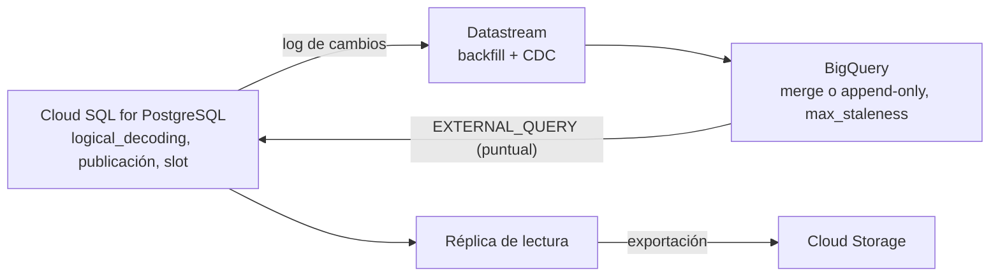

## 1. Resumen

Una base **Cloud SQL** de la aplicación suele ser la fuente de datos más importante, y también la que menos conviene cargar. La documentación de Google Cloud ofrece tres caminos:

- **Datastream (CDC continuo):** lee el log de cambios de PostgreSQL y replica en BigQuery con latencia mínima. En PostgreSQL requiere decodificación lógica (`cloudsql.logical_decoding`), una publicación, un slot de replicación y un usuario propio.
- **Consultas federadas:** `EXTERNAL_QUERY` desde BigQuery, para consultas puntuales que unen datos de la base con tablas de BigQuery.
- **Exportaciones:** desde una **réplica de lectura** o con **serverless export**, para no afectar la instancia principal.

El CDC en general está en `change-data-capture`. Elegir entre carga completa, incremental y CDC, en `database-ingestion`.

## 2. Qué es

- **Datastream:**
  - servicio serverless de CDC y replicación;
  - fuentes como PostgreSQL, MySQL, Oracle, SQL Server, MongoDB y Spanner;
  - destinos BigQuery y Cloud Storage, y otros con plantillas de Dataflow;
  - backfill de los datos existentes.
- **Preparación de Cloud SQL for PostgreSQL:**
  - `cloudsql.logical_decoding = on`, que requiere reiniciar la instancia;
  - una publicación solo con las tablas a replicar;
  - un slot de replicación lógica con `pgoutput`, de nombre único por stream;
  - un usuario con `REPLICATION LOGIN` y lectura de esas tablas.
- **Destino BigQuery:**
  - modo **merge**, que mantiene la última versión por clave primaria, o **append-only**, que guarda todos los cambios;
  - `max_staleness` equilibra frescura y costo;
  - los merges usan on-demand si no hay una reserva asignada.
- **`EXTERNAL_QUERY`:** BigQuery envía la subconsulta a Cloud SQL por una conexión.
- **Réplica de lectura y serverless export:** exportar sin cargar la instancia principal.

## 3. Problema que resuelve

Consultar la base de la aplicación directamente para análisis compite con las transacciones y la puede degradar. Copiarla entera cada noche es lento y pierde los cambios intermedios. Con estas opciones:

- Datastream mantiene una copia casi en tiempo real en BigQuery, leyendo el log en vez de consultar las tablas;
- las consultas federadas resuelven preguntas puntuales sin pipeline;
- las exportaciones desde réplica o serverless no tocan la principal.

## 4. Cómo funciona

1. **Con Datastream:**
   1. Se activa la marca, se reinicia la instancia y se crean la publicación, el slot y el usuario.
   2. Se crea el stream, con backfill de lo existente y luego CDC continuo.
   3. En BigQuery, el modo merge aplica los cambios por clave, con la frescura que fija `max_staleness`.
2. **Con una consulta federada:** BigQuery envía la subconsulta a Cloud SQL, recibe el resultado y lo une con sus tablas en la misma consulta.
3. **Con una exportación:** se exporta desde una réplica de lectura (frecuente y chica) o con serverless export (grande y puntual), que usa una instancia temporal.

## 5. Cuándo utilizarlo

- **Datastream:** el análisis necesita la base casi en tiempo real, o los cambios intermedios (append-only).
- **Consulta federada:** una pregunta puntual o una exploración que cruza la base con datos de BigQuery.
- **Exportación:** copias periódicas o puntuales sin CDC.

## 6. Cuándo no utilizarlo

- No usar consultas federadas como carga regular de dashboards: cada consulta va contra la base operacional.
- No crear un slot de replicación y abandonarlo: en PostgreSQL, un slot sin consumir retiene el WAL (ver `change-data-capture`).
- No exportar desde la instancia principal en horario de carga si existe una réplica o serverless export.

## 7. Ejemplo sencillo

Un analista quiere la fecha del primer pedido de cada cliente, que está en Cloud SQL, unida a los segmentos que están en BigQuery. Una consulta con `EXTERNAL_QUERY` lo resuelve una vez, sin pipeline.

## 8. Ejemplo de producción

La base de pedidos en Cloud SQL for PostgreSQL se replica a BigQuery con Datastream:

- la marca `cloudsql.logical_decoding` está activa y la publicación incluye solo `pedidos` y `clientes`;
- el usuario de Datastream solo lee esas tablas, y su contraseña está en Secret Manager;
- el destino usa modo merge, con un `max_staleness` de 15 minutos, y los merges corren en una reserva asignada para que el costo sea previsible;
- un monitoreo vigila que el slot avance, para que no retenga WAL en la base.

Las consultas federadas quedan solo para exploración.

## 9. Arquitectura



## 10. Código

```sql
-- PostgreSQL 17 (ejecutado en local salvo la creación del slot, marcada abajo): lo que la guía de Datastream pide
-- preparar en una base Cloud SQL for PostgreSQL antes de crear el stream. En Cloud SQL, además, se activa la marca
-- cloudsql.logical_decoding (requiere reiniciar la instancia).
CREATE TABLE pedidos (pedido_id bigint PRIMARY KEY, monto numeric(12, 2), creado_en timestamptz);
CREATE TABLE clientes (cliente_id bigint PRIMARY KEY, segmento text);

-- Publicación solo con las tablas que se replican (no FOR ALL TABLES).
CREATE PUBLICATION datastream_pub FOR TABLE pedidos, clientes;

-- Usuario de Datastream con permiso de replicación y lectura de esas tablas.
CREATE USER datastream_user WITH REPLICATION LOGIN PASSWORD 'cambiar-por-un-secreto';
GRANT USAGE ON SCHEMA ventas TO datastream_user;
GRANT SELECT ON pedidos, clientes TO datastream_user;

SELECT pubname, array_agg(tablename ORDER BY tablename) AS tablas
FROM pg_publication_tables WHERE pubname = 'datastream_pub' GROUP BY pubname;

-- NO ejecutado en local: requiere wal_level = logical (en Cloud SQL, cloudsql.logical_decoding = on).
-- SELECT pg_create_logical_replication_slot('datastream_slot', 'pgoutput');

DROP PUBLICATION datastream_pub;
REVOKE ALL ON pedidos, clientes FROM datastream_user;
REVOKE USAGE ON SCHEMA ventas FROM datastream_user;
DROP USER datastream_user;
```

```sql
-- BigQuery, GoogleSQL (no ejecutado: requiere un proyecto de GCP y una conexión a Cloud SQL). Consulta federada:
-- BigQuery envía la subconsulta a Cloud SQL y une su resultado con una tabla propia. Útil para consultas puntuales;
-- para cargas regulares, replicar con Datastream o exportar, y no cargar la base operacional en cada consulta.
SELECT c.cliente_id, c.segmento, p.primer_pedido
FROM `mi-proyecto.core.clientes` AS c
LEFT JOIN EXTERNAL_QUERY(
  'mi-proyecto.us.cloudsql-ventas',
  '''SELECT cliente_id, MIN(creado_en) AS primer_pedido FROM ventas.pedidos GROUP BY cliente_id'''
) AS p USING (cliente_id);
```

El primer bloque se **ejecutó en PostgreSQL 17 local**, en un esquema desechable `ventas`, salvo la creación del slot, que va comentada. PostgreSQL avisó que `wal_level` no alcanza para publicar cambios lógicos («"wal_level" is insufficient to publish logical changes»). Es lo esperado sin decodificación lógica: en Cloud SQL, eso lo activa la marca `cloudsql.logical_decoding`. La consulta mostró la publicación con las dos tablas.

El segundo bloque es GoogleSQL y **no se ejecutó**: requiere una conexión de BigQuery a Cloud SQL.

## 11. GCP

**Cloud SQL**, **Datastream** y **BigQuery**. La preparación de PostgreSQL, los modos de escritura y `max_staleness`, las consultas federadas y las formas de exportar son las de sus páginas. Datastream se explica aquí y en la arquitectura CDC, que es de F4, sin ficha de producto propia, como indica el blueprint.

## 12. AWS

No aplica de forma específica: esta ficha describe Cloud SQL y Datastream. El CDC en AWS se trata en `change-data-capture`.

## 13. Azure

No aplica de forma específica (ver §12).

## 14. Buenas prácticas

- Publicación solo con las tablas necesarias.
- Usuario de Datastream propio, con lectura mínima y la contraseña en Secret Manager.
- Reserva de BigQuery para los merges de CDC y `max_staleness` acorde a la frescura necesaria.
- Monitorear que el slot de replicación avance.
- Consultas federadas solo para casos puntuales.
- **Seguridad:** el usuario con `REPLICATION` puede leer todo lo publicado; limitar la publicación y las tablas que puede leer.
- **Observabilidad:** latencia del stream, atraso del slot y errores de merge en BigQuery.
- **Costo:** los merges de CDC usan on-demand sin reserva; un `max_staleness` menor hace merges más frecuentes y caros.

## 15. Errores frecuentes

- Publicar todas las tablas (`FOR ALL TABLES`) sin necesidad.
- Dejar un slot sin consumir y llenar el disco con WAL.
- Dashboards sobre consultas federadas que cargan la base de la aplicación.
- Olvidar el reinicio de la instancia al activar la marca, en un horario sin ventana de mantenimiento.

## 16. Trade-offs

Datastream da una copia casi en tiempo real sin consultar las tablas, a cambio de operar la decodificación lógica, el slot y los merges en BigQuery. Las consultas federadas no requieren pipeline, pero cargan la base en cada consulta y no escalan para uso frecuente. Las exportaciones son simples y predecibles, aunque no capturan los cambios intermedios y tienen la frescura de su calendario.

## 17. Conceptos relacionados

- `change-data-capture` y `database-ingestion`: CDC y las opciones de ingesta.
- `bigquery-slots`: la reserva para los merges.
- `python-database-io`: extracciones propias desde Python.
- Del blueprint, pendiente de ficha: `cdc-architecture` (arquitectura de F4).

## 18. Preguntas técnicas abiertas

1. ¿Qué tablas de tu base de aplicación necesitan estar casi en tiempo real en BigQuery?
2. ¿Cómo vigilarías que un slot de replicación no retenga WAL?
3. ¿Qué consultas federadas de tu equipo deberían pasar a una tabla replicada?

## 19. Laboratorio relacionado

Pendiente (F4).

## 20. Fuentes

- Google Cloud: *Datastream overview*, *Configure a Cloud SQL for PostgreSQL database for CDC*, *BigQuery destination* (Datastream), *Cloud SQL federated queries* (BigQuery), *Best practices for importing and exporting data* y *About replication in Cloud SQL*.

El detalle de cada fuente está en `sources` del frontmatter.

## 21. Fecha de última verificación

2026-10-12. Pasa a `verified`: revisión B-F3.1 del lote F3b-08c aplicada, sin VERIFY pendientes.

## 22. Historial de cambios importantes

- 2026-10-11: creación (lote F3b-08c).
- 2026-10-12: revisión B-F3.1 del lote F3b-08c aplicada (docs/reviews/cards-f3b-08c.md): filas aprobadas sin cambios en esta ficha.
- 2026-10-12: `verification_status: verified` (sin VERIFY pendientes).
- 2026-10-13: `page_title` en cada cita, con el título de la página citada (ADR-012); sin cambios de contenido.
