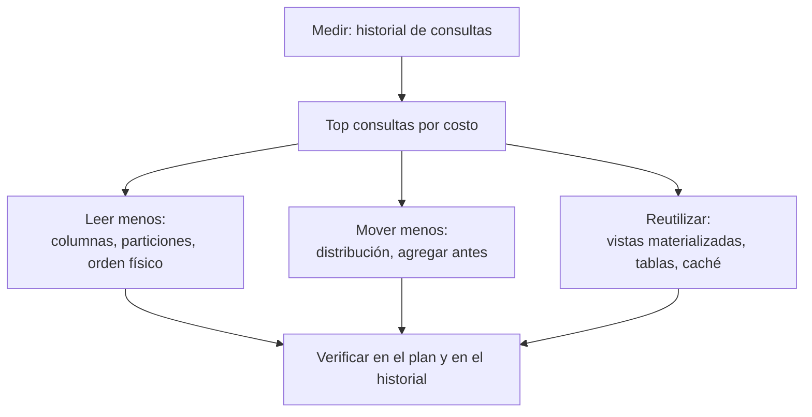

## 1. Resumen

Los warehouses cloud comparten objetivos (leer menos, mover menos datos, reutilizar resultados), pero reparten distinto **qué decide el equipo y qué decide el motor**:

- **BigQuery** no expone índices ni claves de distribución: el equipo decide particiones, clustering, vistas materializadas y qué consultas escribe.
- **Redshift** expone sort keys, distribution keys y compresión, y puede automatizarlas (`AUTO`, optimización automática de tablas, `ENCODE AUTO`).
- **El pool SQL dedicado de Synapse** deja en manos del equipo la distribución, las estadísticas, las particiones y la memoria por consulta.
- **Fabric Warehouse** automatiza estadísticas, caché, escalado y V-Order, y deja al equipo el data clustering y el diseño de las consultas.

Esta ficha es la visión comparada. El detalle de BigQuery corresponde a `bigquery-query-optimization`, del dominio 08.

## 2. Qué es

| Palanca | BigQuery | Redshift | Synapse dedicado | Fabric Warehouse |
|---|---|---|---|---|
| Orden físico / clustering | Clustering | Sort key (manual o automática) | Grano de partición (semanal o mensual mejor que diario) | Data clustering, V-Order (por defecto) |
| Memoria por consulta | — | — | Clases de recursos (60 distribuciones fijas) | — |
| Distribución para joins | No expuesta | Distribution key, `ALL`, `AUTO` | Hash, round-robin, replicada | No expuesta en su guía de rendimiento |
| Estadísticas | No detallado en esta ficha | `ANALYZE` (ver `query-plans`) | Manuales, por columna | Automáticas al primer acceso |
| Resultados precalculados | Vistas materializadas, BI Engine | Vistas materializadas | No detallado en esta ficha | No admite vistas materializadas |
| Historial de consultas | `INFORMATION_SCHEMA.JOBS` | Vistas de sistema (no detalladas aquí) | No detallado en esta ficha | `queryinsights.*` |

## 3. Problema que resuelve

Optimizar sin método lleva a ajustar consultas al azar. Esta ficha ordena el trabajo:

1. medir qué consultas cuestan más;
2. aplicar las palancas que el motor deja en manos del equipo;
3. no pelear contra lo que el motor ya automatiza.

## 4. Cómo funciona

1. **Medir:** cada motor tiene un historial. BigQuery tiene `INFORMATION_SCHEMA.JOBS`, con bytes procesados y slot-ms por job y 180 días de historia. Fabric tiene `queryinsights.exec_requests_history` y las vistas de consultas largas y frecuentes.
2. **Leer menos** (todas): columnas necesarias, particiones u orden físico alineados con los filtros (ver `scan-reduction`).
3. **Mover menos** (motores distribuidos): distribuir por la clave de los joins en Redshift y Synapse dedicado. En BigQuery, agregar antes de unir y aprovechar el broadcast (ver `join-optimization`).
4. **Reutilizar:** vistas materializadas en BigQuery y Redshift, BI Engine en BigQuery y tablas materializadas donde no hay vistas materializadas, como en Fabric (ver `materialization-strategies`).
5. **Dejar al motor lo automático:**
   - en Redshift, `AUTO` y la optimización automática de tablas pueden fijar sort keys y distribution keys;
   - en Fabric, estadísticas, caché y escalado son automáticos;
   - en Synapse dedicado, las estadísticas son responsabilidad del equipo.

## 5. Cuándo utilizarlo

- Al revisar periódicamente costo y rendimiento del warehouse.
- Al migrar entre motores: las palancas no se traducen una a una.
- Al diseñar tablas grandes nuevas.

## 6. Cuándo no utilizarlo

- Para trasladar recetas de un motor a otro sin revisar: por ejemplo, claves de distribución en un motor que no las expone, o vistas materializadas en Fabric Warehouse.
- Para optimizar consultas baratas o esporádicas antes que las que dominan el costo.
- Para desactivar automatismos sin medir antes su efecto.

## 7. Ejemplo sencillo

Antes de cambiar nada, listar las 20 consultas que más bytes leyeron la última semana en BigQuery o las de más CPU en Fabric (sección 10). Así el trabajo empieza por lo que más cuesta, no por la consulta que alguien recuerda.

## 8. Ejemplo de producción

Una empresa migra su warehouse de Synapse dedicado a Fabric Warehouse. En Synapse, el equipo mantenía la distribución por hash de las tablas de hechos, la replicación de dimensiones pequeñas y estadísticas manuales. En Fabric, esas tareas no tienen equivalente directo en la guía de rendimiento:

- las estadísticas se generan solas;
- no hay vistas materializadas.

El equipo define data clustering en las tablas grandes según los filtros más comunes, convierte las vistas materializadas en tablas incrementales y monitorea las consultas con `queryinsights`. Las primeras consultas sobre datos no cacheados son más lentas (cold start); la documentación advierte no juzgar el rendimiento por la primera ejecución.

## 9. Arquitectura



## 10. Código

```sql
-- BigQuery (columnas documentadas en INFORMATION_SCHEMA.JOBS; no ejecutado aquí):
-- las 20 consultas que más bytes procesaron en los últimos 7 días.
SELECT user_email, statement_type, total_bytes_processed, total_slot_ms, LEFT(query, 200) AS consulta
FROM `region-us`.INFORMATION_SCHEMA.JOBS
WHERE creation_time >= TIMESTAMP_SUB(CURRENT_TIMESTAMP(), INTERVAL 7 DAY)
  AND job_type = 'QUERY'
  AND statement_type != 'SCRIPT'          -- evita contar dos veces los scripts
ORDER BY total_bytes_processed DESC
LIMIT 20;

-- Fabric Warehouse (ejemplo de la documentación de query insights; no ejecutado aquí):
-- las 100 consultas con más tiempo de CPU asignado.
SELECT TOP 100 distributed_statement_id, query_hash, allocated_cpu_time_ms, label, command
FROM queryinsights.exec_requests_history
ORDER BY allocated_cpu_time_ms DESC;
```

Ninguna de las dos consultas se ejecutó, porque requieren GCP y Fabric. Usan solo columnas y vistas documentadas:

- en BigQuery, `creation_time` es la columna de partición de la vista, así que el filtro de 7 días limita lo que se lee, y la documentación pide excluir `SCRIPT` al resumir costos;
- la consulta de Fabric es la del ejemplo de su documentación.

## 11. GCP

**BigQuery** no expone claves de distribución ni índices tradicionales. Sus palancas documentadas son:

- columnas necesarias;
- particiones y clustering;
- agregar antes de unir y el orden de las tablas en los joins;
- vistas materializadas;
- BI Engine, un motor vectorizado con caché de los datos más usados.

`INFORMATION_SCHEMA.JOBS` permite medir bytes y slot-ms por consulta. El detalle de estas palancas corresponde a `bigquery-query-optimization` del dominio 08.

## 12. AWS

**Redshift** combina diseño manual y automático:

- sort keys y distribution keys, que la optimización automática de tablas puede elegir y aplicar sola;
- `AUTO` en la distribución;
- `ENCODE AUTO` para la compresión, que es el valor por defecto.

Las vistas materializadas y Spectrum completan las palancas (ver `materialization-strategies` y `predicate-pushdown`).

## 13. Azure

Los dos productos de Azure se optimizan de forma muy distinta:

- **Synapse, pool SQL dedicado:** el equipo elige distribución, estadísticas, particiones y clases de recursos (memoria por distribución, con 60 distribuciones fijas).
- **Fabric Warehouse:** automatiza estadísticas, caché y escalado, aplica V-Order por defecto y ofrece data clustering. No admite vistas materializadas. Usa solo aislamiento snapshot.

## 14. Buenas prácticas

- Medir antes de optimizar, con el historial de consultas de cada motor.
- Empezar por las consultas que más cuestan y por las palancas que afectan a muchas consultas (diseño físico).
- Conocer qué automatiza cada motor y no duplicarlo a mano.
- Volver a medir después de cada cambio y dejar registro.
- **Seguridad:** el historial de consultas incluye el texto SQL y usuarios; restringir el acceso a `INFORMATION_SCHEMA.JOBS` y a `queryinsights`.
- **Observabilidad:** un tablero semanal con las consultas más caras, más lentas y más frecuentes, por motor.
- **Costo:** optimizar la métrica que se paga en cada motor; en BigQuery depende del modelo de precios (ver `bigquery-cost-model`), y `INFORMATION_SCHEMA.JOBS` registra tanto bytes procesados como slot-ms.

## 15. Errores frecuentes

- Trasladar recetas entre motores sin revisar.
- Optimizar a ciegas, sin historial de consultas.
- Juzgar el rendimiento de Fabric por la primera ejecución sobre datos no cacheados.
- Sumar costos de `INFORMATION_SCHEMA.JOBS` sin excluir `SCRIPT`.

## 16. Trade-offs

Más automatización (Fabric, `AUTO` de Redshift) reduce el trabajo de mantenimiento a cambio de menos control. Más control manual (Synapse dedicado, distribución explícita en Redshift) permite ajustar casos específicos, a cambio de diseño y mantenimiento continuos. Las clasificaciones de esta ficha son de las fuentes de cada motor y pueden cambiar con nuevas versiones.

## 17. Conceptos relacionados

- `scan-reduction`, `join-optimization` y `materialization-strategies`: las palancas.
- `query-plans`: verificar el efecto.
- `predicate-pushdown`: tablas externas.
- Del blueprint, pendiente de ficha: `bigquery-query-optimization`.

## 18. Preguntas técnicas abiertas

1. ¿Qué métrica pagas en tu warehouse (bytes, slots, capacidad) y cuál optimizas hoy?
2. ¿Qué decisiones de diseño físico deja tu motor al equipo y cuáles automatiza?
3. ¿Qué cambiaría en tu estrategia si migraras a otro de estos motores?

## 19. Laboratorio relacionado

Pendiente (F4).

## 20. Fuentes

- Google Cloud: *Optimize query computation* y *JOBS view* (BigQuery).
- AWS: *Automatic table optimization*, *Choose the best distribution style* y *Column compression* (Amazon Redshift).
- Microsoft Learn: *Best practices for dedicated SQL pools* (Synapse), *Performance guidelines in Fabric Data Warehouse* y *Query insights in Fabric Data Warehouse*.

El detalle de cada fuente está en `sources` del frontmatter.

## 21. Fecha de última verificación

2026-10-07. En `review_required` hasta la revisión B-F3.1 del lote F3b-02b.

## 22. Historial de cambios importantes

- 2026-10-05: esqueleto creado desde el blueprint (rama `f/sql`), con la nota "visión comparada; el detalle de BigQuery está en 08-gcp".
- 2026-10-07: ficha completa (lote F3b-02b, dominio 02-sql).
- 2026-10-07: revisión B-F3.1 del lote F3b-02b aplicada (docs/reviews/cards-f3b-02b.md): la celda de Synapse dedicado usa las palancas que nombra su página (distribución, estadísticas, grano de partición y clases de recursos), sin presentar columnstore como equivalente de una sort key.
