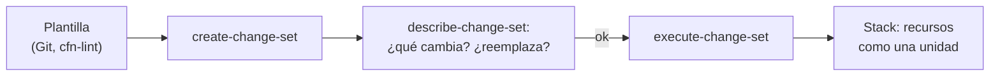

## 1. Resumen

AWS CloudFormation es la herramienta de infraestructura como código nativa de AWS. Según su documentación, se escribe una **plantilla** (YAML o JSON) que describe los recursos, y CloudFormation los crea y configura, resolviendo qué depende de qué. Los recursos de una plantilla forman un **stack**, que se crea, actualiza y borra como una unidad.

Lo que hay que saber para leer y cambiar una plantilla:

- **Resources** es la única sección obligatoria; **Parameters** y **Outputs** son opcionales;
- un **change set** muestra qué cambiaría un cambio, incluido si borra o reemplaza recursos, y nada cambia hasta ejecutarlo;
- no hay un state que administrar: CloudFormation compara contra el estado actual del stack.

## 2. Qué es

- **Plantilla:** archivo YAML o JSON con secciones; `Resources` es obligatoria.
- **Recurso:** un ID lógico, un tipo (`AWS::S3::Bucket`) y sus propiedades.
- **Parameters / Outputs:** valores que entran al crear o actualizar el stack, y valores que devuelve.
- **Stack:** los recursos de una plantilla, administrados como una unidad.
- **Change set:** el cambio propuesto a un stack, que se revisa y luego se ejecuta.

## 3. Problema que resuelve

Crear un bucket, su cifrado, su ciclo de vida y su bloqueo de acceso público a mano en la consola, en tres cuentas, termina con tres configuraciones distintas. Una plantilla describe exactamente qué se aprovisiona y, como es texto, sus cambios se revisan en Git. El change set agrega el paso que falta antes de tocar producción: ver qué va a pasar.

## 4. Cómo funciona

1. La plantilla declara `Parameters` (`Environment`, `RetentionDays`), un recurso `AWS::S3::Bucket` y un output con export.
2. Crear el stack despliega la plantilla con valores para los parámetros.
3. Para cambiar la retención, `create-change-set` usa la plantilla anterior con un parámetro nuevo.
4. `describe-change-set` muestra qué recursos cambian y si alguno se reemplaza.
5. `execute-change-set` aplica el cambio; CloudFormation actualiza solo lo que cambia.

## 5. Cuándo utilizarlo

- Equipos que trabajan solo en AWS y quieren la herramienta nativa, sin un state que administrar.
- Cuando se necesita desplegar el mismo stack en muchas cuentas y regiones con una sola operación (StackSets).

## 6. Cuándo no utilizarlo

- Infraestructura repartida entre varias nubes: Terraform cubre las tres con la misma herramienta.
- Actualizar un stack de producción sin change set.
- Poner secretos en `Outputs`: CloudFormation no los oculta (ver `terraform-security` para las referencias dinámicas a Secrets Manager).

## 7. Ejemplo sencillo

El stack `lake-raw-prod` tiene el bucket de la zona cruda con 30 días de retención. Un change set con `RetentionDays=90` muestra que solo cambia la configuración del ciclo de vida del bucket. Se ejecuta.

## 8. Ejemplo de producción

Una plataforma en AWS con:

- un stack por zona del lake y por entorno, con `DeletionPolicy: Retain` en los buckets;
- plantillas en Git, revisadas en pull request y revisadas con cfn-lint en la CI;
- todo cambio a producción como change set, revisado antes de ejecutarlo;
- detección de drift periódica en los stacks (ver `terraform-drift`).

## 9. Arquitectura



## 10. Código

```yaml
# CloudFormation (template.yaml; revisado con cfn-lint en la CI, no desplegado): la zona cruda de un lake como stack:
# un bucket cifrado, con versionado, sin acceso público y con expiración por parámetro, y su nombre como output.
AWSTemplateFormatVersion: "2010-09-09"
Description: Zona cruda del lake (bucket S3) de un entorno.
Parameters:
  Environment:
    Type: String
    AllowedValues: [dev, staging, prod]
  RetentionDays:
    Type: Number
    Default: 30
    MinValue: 1
Resources:
  RawBucket:
    Type: AWS::S3::Bucket
    DeletionPolicy: Retain
    UpdateReplacePolicy: Retain
    Properties:
      VersioningConfiguration:
        Status: Enabled
      BucketEncryption:
        ServerSideEncryptionConfiguration:
          - ServerSideEncryptionByDefault:
              SSEAlgorithm: aws:kms
      PublicAccessBlockConfiguration:
        BlockPublicAcls: true
        BlockPublicPolicy: true
        IgnorePublicAcls: true
        RestrictPublicBuckets: true
      LifecycleConfiguration:
        Rules:
          - Id: expirar-crudo
            Status: Enabled
            ExpirationInDays: !Ref RetentionDays
      Tags:
        - Key: environment
          Value: !Ref Environment
Outputs:
  RawBucketName:
    Value: !Ref RawBucket
    Export:
      Name: !Sub "${AWS::StackName}-raw-bucket"
```

```bash
# AWS CLI (no ejecutado: no hay cuenta de AWS en la CI): cambiar la retención con un change set, revisar qué va a
# cambiar antes de ejecutarlo, y después buscar drift en el stack. La forma de cada comando sigue los ejemplos de las
# páginas de CloudFormation; CHANGE_SET_ARN es el ARN del change set, como en esos ejemplos.
aws cloudformation create-change-set --stack-name lake-raw-prod \
  --change-set-name sube-retencion --use-previous-template \
  --parameters ParameterKey="Environment",UsePreviousValue=true ParameterKey="RetentionDays",ParameterValue="90"
aws cloudformation describe-change-set --change-set-name "$CHANGE_SET_ARN"
aws cloudformation execute-change-set --change-set-name "$CHANGE_SET_ARN"

aws cloudformation detect-stack-drift --stack-name lake-raw-prod
aws cloudformation describe-stack-resource-drifts --stack-name lake-raw-prod \
  --stack-resource-drift-status-filters MODIFIED DELETED
```

La plantilla se **revisa con cfn-lint en la CI** (ADR-015) **y no se desplegó**. Los comandos de AWS CLI **no se ejecutaron**: no hay cuenta de AWS en la CI. Su forma sigue los ejemplos de *Create a change set*, *View a change set* y *Execute a change set*, que usan el ARN del change set, y de *Detect drift on an entire CloudFormation stack*.

## 11. GCP

En GCP, la herramienta administrada de IaC es **Infrastructure Manager**, que ejecuta Terraform. Las diferencias, según sus páginas:

| | CloudFormation | Infrastructure Manager |
|---|---|---|
| Lenguaje | Plantillas YAML o JSON propias | Configuraciones de Terraform |
| Unidad | Stack | Deployment, con revisions |
| Ver antes de aplicar | Change set | Preview |
| Cobro (consultado el 2026-10-19) | Sin cargo adicional para recursos AWS::*; se pagan los recursos | Se cobra la ejecución en Cloud Build y el almacenamiento en Cloud Storage |

## 12. AWS

**CloudFormation** es la herramienta nativa de AWS que describe esta ficha. Comparado con Terraform en AWS:

| | Terraform | CloudFormation |
|---|---|---|
| State | Archivo de state que hay que guardar y proteger (ver `infrastructure-as-code`) | Lo lleva CloudFormation: compara contra el estado actual del stack |
| Ver antes de aplicar | `terraform plan` | Change set |
| Nubes | AWS, GCP y Azure con providers | Solo AWS |

## 13. Azure

En Azure, el equivalente nativo es **Bicep** (ver `bicep-basics`). Igual que CloudFormation, no tiene un state que administrar («No state or state files to manage: Azure stores all states»). Durante el despliegue, la CLI de Bicep lo convierte en una plantilla JSON de Resource Manager (*What is Bicep?*).

## 14. Buenas prácticas

- Plantillas en Git, con cfn-lint en la CI.
- Change set para todo cambio a producción.
- `DeletionPolicy: Retain` en los recursos con datos: sin él, CloudFormation los borra con el stack (*DeletionPolicy attribute*).
- Parámetros con `AllowedValues` y límites.
- **Seguridad:** el bucket del ejemplo bloquea el acceso público y cifra con KMS; los secretos llegan por referencias dinámicas, no por parámetros ni outputs.
- **Observabilidad:** los outputs con los nombres que necesitan otros stacks o el pipeline.
- **Costo:** CloudFormation no cobra por recursos AWS::* (consultado el 2026-10-19), pero sí los recursos; la retención del ciclo de vida es el parámetro que más cuesta.

## 15. Errores frecuentes

- Actualizar el stack directo, sin change set, y descubrir un reemplazo del bucket.
- Buckets sin `DeletionPolicy: Retain`: sin ese atributo, CloudFormation borra el recurso al borrar el stack.
- Secretos en `Outputs`.
- Plantillas gigantes con todo el entorno en un stack.

## 16. Trade-offs

CloudFormation no requiere administrar un state ni un backend, a cambio de quedar atado a AWS. Un stack chico por componente reduce el radio de un error, pero obliga a compartir valores con exports. Los change sets dan visibilidad antes de aplicar, a cambio de un paso más en cada cambio.

## 17. Conceptos relacionados

- `infrastructure-as-code`: el marco.
- `terraform-plan-apply`: el plan, frente al change set.
- `terraform-drift`: drift en Terraform y en CloudFormation.
- `bicep-basics`: el equivalente en Azure.
- `s3-data-lake`: el lake que crea el ejemplo.
- `terraform-security`: secretos y permisos, también en CloudFormation.

## 18. Preguntas técnicas abiertas

1. ¿Qué cambios de tus stacks se aplicaron sin change set?
2. ¿Qué recursos con datos no tienen `DeletionPolicy: Retain`?
3. ¿Cuándo elegirías CloudFormation en lugar de Terraform para una plataforma en AWS?

## 19. Laboratorio relacionado

Pendiente (F4).

## 20. Fuentes

- AWS: *What is CloudFormation?*, *CloudFormation template sections*, *Managing AWS resources as a single unit with CloudFormation stacks*, *Update CloudFormation stacks using change sets*, *Create a change set for a CloudFormation stack*, *View a change set for a CloudFormation stack*, *Execute a change set for a CloudFormation stack*, *DeletionPolicy attribute*, *Managing stacks across accounts and Regions with StackSets* y *AWS CloudFormation pricing*.
- Google Cloud: *Infrastructure Manager overview* e *Infrastructure Manager pricing*. Microsoft Learn: *What is Bicep?*.

El detalle de cada fuente está en `sources` del frontmatter.

## 21. Fecha de última verificación

2026-10-19. `review_required`: pendiente de revisión B-F3.1 del lote F3b-12b.

## 22. Historial de cambios importantes

- 2026-10-19: creación (lote F3b-12b).
