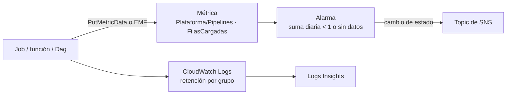

## 1. Resumen

**Amazon CloudWatch** reúne métricas, alarmas y logs de AWS. Para un pipeline de datos, las métricas de los servicios (errores, duración) no alcanzan: hace falta medir el **resultado**, por ejemplo las filas cargadas por tabla y día. Según su documentación:

- las **métricas propias** se publican con `PutMetricData` o con el **formato de métricas embebidas** en logs; para implementaciones nuevas, AWS recomienda **OpenTelemetry**;
- una **alarma** compara una métrica con un umbral durante varios períodos y notifica al cambiar de estado;
- el **tratamiento de datos faltantes** decide qué pasa si el pipeline no publica nada: con `breaching`, el silencio también alarma;
- **CloudWatch Logs** guarda los logs (indefinidamente por defecto) y **Logs Insights** los consulta.

## 2. Qué es

- **Métrica:** namespace, nombre y dimensiones (por ejemplo `Plataforma/Pipelines`, `FilasCargadas`, `Tabla=ventas_diarias`). Las de alta resolución se guardan cada segundo.
- **Formas de publicar:** `PutMetricData`, el formato de métricas embebidas (EMF) en logs, u OpenTelemetry, que se recomienda para implementaciones nuevas.
- **Alarma de métrica:**
  - estados `OK`, `ALARM` e `INSUFFICIENT_DATA`;
  - *Evaluation Periods:* cuántos períodos recientes mira;
  - *Datapoints to Alarm:* cuántos deben incumplir para pasar a `ALARM`;
  - acciones al cambiar de estado, como notificar a un topic de SNS.
- **Datos faltantes:** `missing` (si faltan todos, `INSUFFICIENT_DATA`), `breaching`, `notBreaching` e `ignore`.
- **Alarma compuesta:** combina estados de otras alarmas para reducir ruido.
- **Logs:** grupos con retención de un día a diez años, o indefinida (por defecto); protección contra borrado; consultas con Logs Insights.

## 3. Problema que resuelve

Un pipeline puede «terminar bien» y cargar cero filas, o no correr. Sin una métrica del resultado y una alarma que trate el silencio como falla, el problema se descubre cuando alguien mira un informe vacío.

## 4. Cómo funciona

1. Al terminar cada carga, el job publica `FilasCargadas` con la tabla como dimensión.
2. Una alarma diaria suma la métrica por tabla: si es menor que 1, o si no hay datos, pasa a `ALARM`.
3. Al cambiar de estado, la alarma notifica a un topic de SNS.
4. Los logs del job quedan en un grupo con retención definida y se consultan con Logs Insights para diagnosticar.

## 5. Cuándo utilizarlo

- Métricas de resultado de cada pipeline (filas, archivos, latencia de datos).
- Alarmas que detecten tanto fallas como ausencia de ejecución.
- Logs centralizados de Lambda, Glue, MWAA y Step Functions.

## 6. Cuándo no utilizarlo

- Validaciones de calidad de datos con reglas complejas: van en el pipeline o en su herramienta; CloudWatch recibe el resultado.
- Una alarma por cada error transitorio que el pipeline ya reintenta: genera ruido.
- Métricas con dimensiones de alta cardinalidad (por ejemplo, una por id de cliente).

## 7. Ejemplo sencillo

El job publica `FilasCargadas = 1250` para `ventas_diarias`. Al día siguiente el job no corre y no publica nada: con `TreatMissingData = breaching`, la alarma `sin-filas-ventas_diarias` pasa a `ALARM` y avisa.

## 8. Ejemplo de producción

Cada pipeline publica tres métricas por tabla: filas cargadas, duración y antigüedad del dato más reciente. Hay:

- una alarma por métrica crítica, con datos faltantes como incumplimiento;
- una alarma compuesta por dominio, que notifica a un solo topic si fallan varias;
- logs con 90 días de retención y consultas guardadas de Logs Insights para los errores más comunes.

## 9. Arquitectura



## 10. Código

```python
# Python 3.12 y boto3 (ejecutado en la CI contra moto, que simula CloudWatch; no se corrió contra AWS).
# Publica una métrica propia por corrida (filas cargadas, con la tabla como dimensión) y crea una alarma que trata
# los datos faltantes como incumplimiento: si un día el pipeline no publica nada, la alarma también salta.
from __future__ import annotations

import datetime as dt
from typing import TYPE_CHECKING

import boto3

if TYPE_CHECKING:
    from mypy_boto3_cloudwatch import CloudWatchClient

NAMESPACE = "Plataforma/Pipelines"


def publish_rows(cw: CloudWatchClient, table: str, rows: int, when: dt.datetime) -> None:
    cw.put_metric_data(
        Namespace=NAMESPACE,
        MetricData=[{
            "MetricName": "FilasCargadas",
            "Dimensions": [{"Name": "Tabla", "Value": table}],
            "Timestamp": when,
            "Value": float(rows),
            "Unit": "Count",
        }],
    )


def ensure_alarm(cw: CloudWatchClient, table: str, topic_arn: str) -> None:
    """Alarma diaria: menos de 1 fila en 1 de 1 períodos, o ningún dato, pasa a ALARM y notifica al topic."""
    cw.put_metric_alarm(
        AlarmName=f"sin-filas-{table}",
        Namespace=NAMESPACE,
        MetricName="FilasCargadas",
        Dimensions=[{"Name": "Tabla", "Value": table}],
        Statistic="Sum",
        Period=86400,
        EvaluationPeriods=1,
        DatapointsToAlarm=1,
        Threshold=1,
        ComparisonOperator="LessThanThreshold",
        TreatMissingData="breaching",
        AlarmActions=[topic_arn],
    )


if __name__ == "__main__":
    # Contra AWS (no ejecutado): credenciales del entorno y un topic de SNS existente.
    client = boto3.client("cloudwatch")
    publish_rows(client, "ventas_diarias", 1250, dt.datetime.now(dt.timezone.utc))
    ensure_alarm(client, "ventas_diarias", "arn:aws:sns:us-east-1:123456789012:alertas-datos")
```

El script en Python 3.12 con boto3 se **ejecuta en la CI contra moto**, que simula CloudWatch (ADR-011), y pasa `mypy --strict` con `boto3-stubs`. **No se corrió contra AWS:** moto guarda la métrica y la alarma, pero no evalúa estados ni notifica. El test publica la métrica, crea la alarma dos veces (queda una) y comprueba la dimensión y el tratamiento de datos faltantes. Usa `PutMetricData`; para implementaciones nuevas, la documentación recomienda OpenTelemetry.

## 11. GCP

No aplica de forma específica: esta ficha describe CloudWatch. En GCP, lo más cercano es Cloud Monitoring con Cloud Logging; `bigquery-monitoring` y `orchestration-observability` tratan el monitoreo de BigQuery y de la orquestación. Las diferencias, según sus páginas:

| | CloudWatch | Cloud Monitoring y Cloud Logging |
|---|---|---|
| Métricas propias | `PutMetricData`, métricas embebidas en logs (EMF) u OpenTelemetry, recomendado para implementaciones nuevas | API de Cloud Monitoring u OpenTelemetry, recomendado; además, métricas basadas en el contenido de los logs |
| Datos faltantes | Cada alarma decide: `missing`, `breaching`, `notBreaching` o `ignore` | Condición de ausencia de métrica, con una ventana de hasta 24 horas |
| Qué vigila la alerta | Una métrica o una expresión de métricas | Series de tiempo de Monitoring o logs de Cloud Logging |
| Logs | Grupos con retención de un día a diez años, o indefinida; consultas con Logs Insights | Buckets con retención configurable; consultas con Observability Analytics (SQL) o datasets vinculados de BigQuery |

## 12. AWS

**Amazon CloudWatch y CloudWatch Logs.** Las métricas propias, EMF, la recomendación de OpenTelemetry, las alarmas, la evaluación, los datos faltantes, las alarmas compuestas, la retención y Logs Insights son los de sus páginas. Los precios se consultan en la página de precios.

## 13. Azure

No aplica de forma específica.

## 14. Buenas prácticas

- Medir el resultado (filas, archivos, frescura), no solo los errores.
- `breaching` para métricas que el pipeline debe publicar siempre.
- Alarmas compuestas para no notificar diez veces la misma falla.
- Retención definida en cada grupo de logs; no dejar la indefinida por omisión.
- **Seguridad:** no escribir datos personales ni secretos en los logs; acceso a logs por rol.
- **Observabilidad:** un dashboard por dominio con las métricas de resultado y el estado de las alarmas.
- **Costo:** se cobran métricas propias, alarmas y la ingesta, el almacenamiento y las consultas de logs; las dimensiones de alta cardinalidad multiplican las métricas. Los montos se consultan en la página de precios.

## 15. Errores frecuentes

- Alarmas con `notBreaching` en una métrica que solo existe si el job corre.
- Logs sin retención que crecen para siempre.
- Una dimensión por id de registro.
- Alarmar por cada reintento.

## 16. Trade-offs

CloudWatch está integrado con los servicios de AWS y no exige otra herramienta, a cambio de un modelo propio de métricas y costos que crecen con la cantidad de métricas y logs. OpenTelemetry da portabilidad entre herramientas, con más configuración inicial. EMF evita llamadas a la API, a cambio de pasar por los logs.

## 17. Conceptos relacionados

- `orchestration-observability`: las señales de salud de un pipeline.
- `bigquery-monitoring`: el monitoreo en GCP.
- `lambda-for-data`, `step-functions-workflows` y `mwaa-managed-airflow`: lo que se monitorea.
- `data-reconciliation`: las filas cargadas como control.

## 18. Preguntas técnicas abiertas

1. ¿Qué métrica de resultado le falta hoy a tu pipeline más importante?
2. ¿Qué alarmas deberían tratar los datos faltantes como incumplimiento?
3. ¿Qué retención necesitan tus logs?

## 19. Laboratorio relacionado

Pendiente (F4).

## 20. Fuentes

- AWS, Amazon CloudWatch User Guide: *What is Amazon CloudWatch?*, *Publish custom metrics*, *Embedding metrics within logs*, *Using Amazon CloudWatch alarms*, *Alarm evaluation* y *Configuring how CloudWatch alarms treat missing data*.
- AWS, Amazon CloudWatch Logs User Guide: *What is Amazon CloudWatch Logs?* y *Analyzing log data with CloudWatch Logs Insights*; *Amazon CloudWatch pricing*.

El detalle de cada fuente está en `sources` del frontmatter.

## 21. Fecha de última verificación

2026-10-13. Pasa a `verified`: revisión B-F3.1 del lote F3b-09b aplicada, sin VERIFY pendientes.

## 22. Historial de cambios importantes

- 2026-10-12: creación (lote F3b-09b).
- 2026-10-13: revisión B-F3.1 del lote F3b-09b aplicada (docs/reviews/cards-f3b-09b.md): el §11 compara con Cloud Monitoring y Cloud Logging (métricas propias, datos faltantes, qué vigila la alerta y logs), con fuente de cada lado; fuente nueva `gcp-cloud-monitoring-docs`.
- 2026-10-13: `verification_status: verified` (sin VERIFY pendientes).
