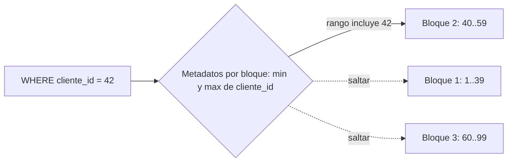

## 1. Resumen

Clustering es guardar juntas en disco las filas que tienen valores parecidos en ciertas columnas. Así, cuando una consulta filtra por esas columnas, el motor puede saltarse bloques enteros sin leerlos. La idea es la misma en todos los motores, pero la implementación cambia mucho: en algunos es una operación puntual que se degrada con las escrituras, en otros se mantiene sola.

## 2. Qué es

Es una forma de **ordenamiento físico** de una tabla. No cambia el resultado de ninguna consulta: solo cambia dónde quedan las filas y, por lo tanto, cuántos bloques hay que leer. Funciona porque los motores guardan metadatos por bloque (por ejemplo, el mínimo y el máximo de cada columna) y pueden descartar los bloques que no pueden contener filas que cumplan el filtro.

Se distingue de la **partición**: la partición divide la tabla en segmentos separados por el valor de una columna, mientras que el clustering ordena las filas dentro de la tabla o de cada partición.

## 3. Problema que resuelve

Una tabla grande se consulta casi siempre filtrando por unas pocas columnas (cliente, fecha, país). Si las filas de un mismo cliente están repartidas por todos los bloques, cada consulta lee toda la tabla. Si están agrupadas, lee solo los bloques de ese cliente.

## 4. Cómo funciona

1. Se eligen una o más columnas de ordenamiento, en un orden concreto.
2. El motor guarda las filas ordenadas por esas columnas, en bloques con metadatos (rango de valores por bloque).
3. Al consultar con un filtro sobre esas columnas, compara el filtro con los metadatos y salta los bloques que no pueden cumplirlo.
4. Con las escrituras nuevas, el orden se degrada. Según el motor, hay que reordenar a mano o el motor lo mantiene en segundo plano.

El **orden de las columnas importa**: el ordenamiento favorece los filtros sobre la primera columna, y sobre las siguientes solo en combinación con las anteriores.

## 5. Cuándo utilizarlo

- Tablas grandes consultadas con filtros frecuentes sobre las mismas columnas.
- Columnas de alta cardinalidad que no conviene usar para particionar.
- Consultas de rango (fechas, ids) sobre tablas que crecen de forma ordenada.

## 6. Cuándo no utilizarlo

- Tablas pequeñas, donde leer todo es barato.
- Tablas sin un patrón de filtro dominante: ordenar por una columna no ayuda a filtros por otras.
- Cuando el mantenimiento del orden cuesta más que lo que ahorra (por ejemplo, reordenar con bloqueo exclusivo una tabla muy escrita).

## 7. Ejemplo sencillo

Una tabla de pedidos ordenada por `cliente_id`. La consulta `WHERE cliente_id = 42` lee solo los bloques cuyo rango de `cliente_id` incluye el 42, en lugar de todos.

## 8. Ejemplo de producción

Una tabla de eventos de varios cientos de millones de filas se consulta por `tenant_id` y rango de fechas. En el data warehouse se particiona por fecha y se ordena por `tenant_id` dentro de cada partición. En la réplica PostgreSQL usada para reportes, en cambio, se ejecuta `CLUSTER` fuera de horario, porque bloquea la tabla y el orden se pierde con las escrituras siguientes; se vuelve a ejecutar cuando las consultas empiezan a leer demasiados bloques.

## 9. Arquitectura



## 10. Código

```sql
-- PostgreSQL: ordenar físicamente la tabla por un índice existente.
-- CLUSTER es una operación única y toma ACCESS EXCLUSIVE: ejecutarla en una ventana sin tráfico.
CREATE INDEX IF NOT EXISTS pedidos_cliente_idx ON pedidos (cliente_id);
CLUSTER pedidos USING pedidos_cliente_idx;

-- Un fillfactor menor a 100 ayuda a conservar el orden durante las actualizaciones:
-- las filas actualizadas quedan en la misma página si hay espacio.
ALTER TABLE pedidos SET (fillfactor = 90);
```

Repetir `CLUSTER` deja la tabla en el mismo estado ordenado: es seguro reejecutarlo, pero cada ejecución vuelve a bloquear la tabla.

## 11. GCP

En **BigQuery**, el clustering es una propiedad de la tabla: hasta cuatro columnas, en orden, y BigQuery poda bloques cuando se filtra por ellas. Hace **reclustering automático** en segundo plano, sin efecto en la capacidad de consulta. El detalle (costo, combinación con partición) está en `bigquery-clustering`.

## 12. AWS

En **Redshift**, el mecanismo equivalente son las **sort keys**: los datos se guardan en bloques de 1 MB con el mínimo y el máximo de cada bloque, y los predicados de rango saltan bloques. Hay dos tipos: `COMPOUND` (por defecto) e `INTERLEAVED` (hasta ocho columnas). A diferencia de BigQuery, se elige el tipo de ordenamiento y el nombre es otro, aunque el efecto buscado (saltar bloques) es el mismo.

## 13. Azure

En **Synapse** (dedicated SQL pool), el equivalente más cercano es el **clustered columnstore index ordenado**: ordena los datos por la clave antes de comprimirlos en segmentos, reduce el solapamiento entre segmentos y permite *segment elimination*. La unidad que se salta es el segmento del índice columnar, no un bloque de tamaño fijo como en Redshift.

## 14. Buenas prácticas

- Elegir como primera columna la que más consultas filtran.
- Medir antes y después (bloques o bytes leídos) en las consultas reales, no en consultas de prueba.
- Combinar partición por fecha con ordenamiento por la columna de filtro secundaria.
- Conocer cómo mantiene el orden cada motor: automático (BigQuery) o manual (`CLUSTER` en PostgreSQL).
- **Seguridad:** el clustering no restringe el acceso a filas; para eso hacen falta permisos, vistas o políticas de filas.
- **Observabilidad:** seguir los bloques o bytes leídos por las consultas frecuentes; si suben sin más datos, el orden se degradó o cambió el patrón de filtro.
- **Costo:** reordenar consume cómputo y, en PostgreSQL, bloquea la tabla; en motores que cobran por datos leídos, un buen ordenamiento reduce directamente el costo por consulta.

## 15. Errores frecuentes

- Poner primero una columna que casi nadie filtra.
- Suponer que el orden se mantiene solo en motores donde es una operación única.
- Ejecutar `CLUSTER` en horario productivo y bloquear lecturas y escrituras.
- Confundir clustering con partición y esperar que descarte particiones.

## 16. Trade-offs

Un ordenamiento bien elegido reduce mucho los datos leídos para los filtros previstos, a cambio de costo de mantenimiento y de no ayudar (o ayudar poco) a los demás filtros. Más columnas de ordenamiento cubren más casos, pero cada una aporta menos que la anterior.

## 17. Conceptos relacionados

- `partitioning`: la organización complementaria por segmentos.
- `bigquery-clustering`: la implementación en BigQuery.
- `partition-pruning`: descarte de particiones; el clustering descarta bloques.
- Con ficha: `query-plans`.
- Del blueprint, pendientes de ficha: `columnar-storage`, `bigquery-query-optimization`.

## 18. Preguntas técnicas abiertas

1. ¿Cómo decidirías la columna de ordenamiento a partir del historial de consultas?
2. ¿Qué harías en PostgreSQL si la tabla se escribe todo el día y `CLUSTER` necesita un bloqueo exclusivo?
3. ¿Cuándo preferirías ordenar por una columna en vez de particionar por ella?

## 19. Laboratorio relacionado

Pendiente (F4): lab de tipo B sobre una consulta cara en BigQuery.

## 20. Fuentes

- PostgreSQL: *CLUSTER*.
- Google Cloud: *Introduction to clustered tables* (BigQuery).
- AWS: *Sort keys* (Redshift).
- Microsoft Learn: *Performance tuning with ordered clustered columnstore index* (Synapse).

El detalle de cada fuente está en `sources` del frontmatter.

## 21. Fecha de última verificación

2026-10-01. Pasa a `verified`: revisión B-F3.1 del lote 3 aplicada, sin VERIFY pendientes.

## 22. Historial de cambios importantes

- 2026-09-30: creación (lote 3 de F3).
- 2026-10-01: `verification_status: verified` (revisión B-F3.1 del lote 3 aplicada; sin VERIFY pendientes).
- 2026-10-07: la sección de conceptos relacionados ya no lista como pendiente de ficha a `query-plans`, que ya tiene ficha.
