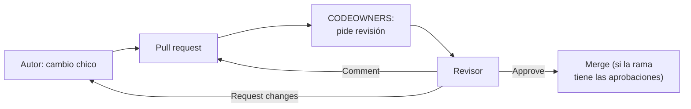

## 1. Resumen

Una revisión de código responde dos preguntas: qué buscar y cómo se registra la decisión.

- **Qué buscar (lo conceptual, de la guía de Google, Nivel 4).** El criterio superior es aprobar cuando el cambio «definitely improves the overall code health of the system being worked on, even if the CL isn't perfect». Se miran diseño, funcionalidad, complejidad, tests, nombres y comentarios. Los cambios pequeños se revisan mejor. Responder no debería tomar más de un día hábil.
- **Cómo se registra (la mecánica, de GitHub y GitLab, Nivel 1).** En GitHub, cada revisión es Comment, Approve o Request changes, y los code owners se piden solos. En GitLab, las aprobaciones son opcionales en Free y pueden ser obligatorias en Premium y Ultimate.

La guía de Google habla de «CL» (changelist), su nombre para un cambio; aquí equivale a un pull request.

## 2. Qué es

- **Revisión:** lectura de un cambio por otra persona antes del merge, con una decisión registrada.
- **Decisiones en GitHub:** *Comment* (feedback sin decidir), *Approve* (listo para merge), *Request changes* (hay que resolver algo antes).
- **Code owners:** dueños de rutas del repositorio, declarados en `CODEOWNERS`; GitHub los pide como revisores cuando un pull request toca su código.
- **Aprobaciones en GitLab:** uno de los merge checks; obligatorias solo con reglas (Premium y Ultimate).

## 3. Problema que resuelve

Un cambio en una transformación puede romper un reporte sin que falle ningún test. La revisión agrega una segunda lectura de lo que los tests no cubren: el diseño, los casos borde, los nombres. Según la guía de Google, también enseña: siempre está bien dejar comentarios que ayuden a aprender.

## 4. Cómo funciona

1. El autor abre el pull request con un cambio acotado.
2. GitHub pide revisión a los code owners de las rutas tocadas; el autor puede pedir a otras personas o equipos.
3. Cada revisor lee el cambio, comenta líneas o sugiere cambios, y envía su decisión.
4. Si la rama exige aprobaciones, el merge espera hasta tenerlas. En GitLab, un reviewer puede bloquear el merge con Request changes, según la configuración.
5. El autor responde, corrige y vuelve a pedir revisión.

## 5. Cuándo utilizarlo

- En todo cambio a una rama protegida.
- Con code owners en rutas donde un error cuesta caro: DAGs de producción, modelos financieros, Terraform.
- Como forma de compartir conocimiento entre quienes mantienen la plataforma.

## 6. Cuándo no utilizarlo

- Para lo que una herramienta revisa sola: formato, lint, tipos. Mejor un check en la CI.
- Para buscar perfección: la guía de Google dice que la aprobación no espera a que el cambio sea perfecto.
- Sobre un cambio gigante: se revisa peor; mejor dividirlo.

## 7. Ejemplo sencillo

Un pull request agrega reintentos a una carga y su test. El revisor ve que el reintento no tiene tope: envía *Request changes* con una sugerencia de `max_retries`. El autor la acepta, y el revisor aprueba.

## 8. Ejemplo de producción

En un repositorio de datos:

- `CODEOWNERS` asigna `dags/` al equipo de orquestación y `models/finanzas/` al de finanzas;
- la rama main exige la aprobación de un code owner;
- antes de pedir revisión, el autor mide el tamaño del cambio y, si pasa el umbral del equipo, lo divide;
- el equipo acuerda responder en el día, como sugiere la guía de Google.

## 9. Arquitectura



## 10. Código

```bash
# Bash y Git (ejecutado en la CI sobre un repositorio temporal, sin remoto): mide un cambio contra main antes de
# pedir revisión, con los archivos y las líneas que verá el revisor. El umbral es una convención del equipo, no de Git.
set -euo pipefail
git init -q -b main repo && cd repo
printf 'def cargar():\n    pass\n' > carga.py && git add carga.py && git commit -q -m "carga"
git switch -q -c feature/reintentos
printf 'def cargar(reintentos=3):\n    pass\n' > carga.py
printf 'def test_reintentos():\n    assert True\n' > test_carga.py
git add -A && git commit -q -m "reintentos en la carga"

UMBRAL=400  # líneas cambiadas que el equipo acepta revisar de una vez
git diff --stat main...HEAD
cambiadas=$(git diff --numstat main...HEAD | awk '{s += $1 + $2} END {print s + 0}')
echo "líneas cambiadas: $cambiadas"
if [ "$cambiadas" -gt "$UMBRAL" ]; then
  echo "cambio grande: dividir antes de pedir revisión" >&2
  exit 1
fi
```

```text
# .github/CODEOWNERS (no ejecutado: lo interpreta GitHub al abrir un pull request). Según «About code owners», el
# último patrón que coincide tiene prioridad.
*                    @org/data-platform
/dags/               @org/orquestacion
/models/finanzas/    @org/finanzas-datos
*.tf                 @org/infra
```

El script de Bash se **ejecuta en la CI** (pytest, sobre un repositorio temporal, sin remoto) y el test comprueba que mide 4 líneas cambiadas. El umbral de 400 líneas es una convención de ejemplo: ni Git ni la guía de Google fijan un número. El archivo `CODEOWNERS` **no se ejecuta**: lo interpreta GitHub. Según *About code owners*, va en `.github/`, la raíz o `docs/`, y el último patrón que coincide tiene prioridad: un cambio en `dags/` pide revisión a `@org/orquestacion`, no a `@org/data-platform`.

## 11. GCP

En GCP, Secure Source Manager. Las diferencias, según sus páginas:

| | GitHub | Secure Source Manager |
|---|---|---|
| Decisión de la revisión | Comment, Approve o Request changes | Revisores agregados al pull request |
| Aprobaciones obligatorias | Rama protegida con revisiones exigidas o de code owner | Protección de ramas con número de revisores y aprobadores |

## 12. AWS

En AWS, CodeCommit. Las diferencias, según sus páginas:

| | GitHub | AWS CodeCommit |
|---|---|---|
| Revisión | Decisiones de revisión, comentarios por línea y sugerencias | Revisar y comentar cambios en el pull request |
| Avisos | Code owners pedidos automáticamente | Emails sobre pull requests y comentarios |

## 13. Azure

En **Azure Repos**, quienes revisan votan para aprobar o rechazar. La política de revisores mínimos exige aprobaciones antes de completar el pull request, y la opción «Prohibit the most recent pusher from approving their own changes» separa a quien escribe de quien aprueba (*Set and manage branch policies*).

## 14. Buenas prácticas

- Cambios pequeños y autocontenidos.
- Revisar diseño, tests y nombres; dejar formato y lint a la CI.
- Responder pronto; la guía de Google fija un día hábil como máximo.
- Code owners en las rutas críticas.
- **Seguridad:** que quien hizo el último push no apruebe su propio cambio (Azure Repos lo permite exigir); code owners para Terraform y secretos.
- **Observabilidad:** las revisiones quedan en el pull request; sirven para ver dónde se traban los cambios.
- **Costo:** una revisión lenta frena a todo el equipo; un cambio grande cuesta más revisarlo.

## 15. Errores frecuentes

- Pedir revisión de un pull request de miles de líneas.
- Discutir formato a mano en lugar de tener un linter en la CI.
- Bloquear un cambio que mejora el código porque no es perfecto.
- `CODEOWNERS` con patrones en un orden que no da lo esperado: el último que coincide gana.

## 16. Trade-offs

Más revisores y aprobaciones obligatorias reducen errores y reparten conocimiento, a cambio de más tiempo hasta el merge. Los cambios pequeños se revisan mejor, pero obligan a planificar el trabajo en partes. Los code owners concentran la revisión en quien conoce el código, con el riesgo de que ese equipo sea un cuello de botella.

## 17. Conceptos relacionados

- `pull-requests`: donde ocurre la revisión.
- `testing-with-pytest`: los tests que la revisión espera ver.
- `automated-testing-in-ci`: lo que la CI revisa sola.

## 18. Preguntas técnicas abiertas

1. ¿Qué revisa hoy una persona que podría revisar la CI?
2. ¿Qué rutas de tu repositorio deberían tener code owner?
3. ¿Cuánto tarda en promedio la primera revisión en tu equipo?

## 19. Laboratorio relacionado

Pendiente (F4).

## 20. Fuentes

- Google eng-practices (Nivel 4, solo afirmaciones conceptuales): *The Standard of Code Review*, *What to look for in a code review*, *Small CLs* y *Speed of Code Reviews*.
- GitHub Docs: *Pull request reviews* y *About code owners*. GitLab Docs: *Merge request reviews* y *Merge request approvals*.
- Google Cloud: *Secure Source Manager overview*. AWS: *What is AWS CodeCommit?*. Microsoft Learn: *Set and manage branch policies*.

El detalle de cada fuente está en `sources` del frontmatter.

## 21. Fecha de última verificación

2026-10-14. Pasa a `verified`: revisión B-F3.1 del lote F3b-11a aplicada, sin VERIFY pendientes.

## 22. Historial de cambios importantes

- 2026-10-14: creación (lote F3b-11a).
- 2026-10-14: revisión B-F3.1 del lote F3b-11a aplicada (docs/reviews/cards-f3b-11a.md): filas aprobadas sin cambios en esta ficha.
- 2026-10-14: `verification_status: verified` (sin VERIFY pendientes).
