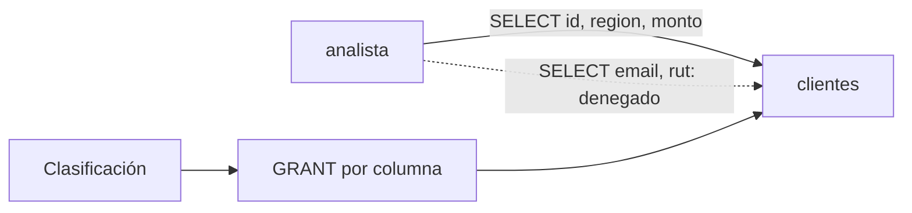

## 1. Resumen

La **seguridad a nivel de columna** decide qué **columnas** puede leer cada rol. El analista lee `id`, `region` y `monto`, pero no `email` ni `rut`. Si pide `SELECT *`, la consulta falla: no recibe las columnas permitidas y nada más, sino un error de permisos. En PostgreSQL se hace con **privilegios por columna** (`GRANT SELECT (id, region, monto) ON clientes TO analista`, *GRANT*).

Si en lugar de negar se quiere mostrar una versión enmascarada, eso es `data-masking`.

## 2. Qué es

- **Privilegio por columna:** `SELECT` sobre columnas concretas (*5.8. Privileges*).
- **Columna sensible:** una que la clasificación marca (`data-classification`).
- **Negar frente a enmascarar:** sin privilegio, error; con máscara, un valor parcial.

## 3. Problema que resuelve

La tabla `clientes` tiene datos de contacto e identificación junto a datos de negocio. Hacer una tabla aparte por cada combinación de columnas multiplica copias. Con privilegios por columna, la tabla es una y cada rol lee lo suyo.

## 4. Cómo funciona

1. La clasificación identifica las columnas sensibles.
2. Se concede `SELECT` por columna a cada rol, sin las sensibles.
3. Las consultas que piden columnas no concedidas fallan.
4. El catálogo muestra qué roles leen cada columna.

## 5. Cuándo utilizarlo

- Tablas con columnas sensibles junto a columnas de uso general.
- Cuando no hace falta ver ni siquiera una máscara.

## 6. Cuándo no utilizarlo

- Cuando el consumidor necesita un valor parcial (los últimos dígitos): ahí, máscara.
- Con herramientas que siempre hacen `SELECT *`: fallarán; conviene una vista con las columnas permitidas.

## 7. Ejemplo sencillo

| Consulta del analista | Resultado |
|---|---|
| `SELECT id, region, monto` | `[(1, 'norte', 10)]` |
| `SELECT *` | denegado |
| `SELECT email` | denegado |

Columnas con `SELECT` para el analista: `id`, `monto`, `region`.

## 8. Ejemplo de producción

- Columnas sensibles marcadas en el catálogo.
- Privilegios por columna generados desde esa marca, como código.
- Vistas con las columnas permitidas para herramientas que hacen `SELECT *`.
- Pruebas que consultan como cada rol.

## 9. Arquitectura



## 10. Código

```python
# Python 3.12 y psycopg contra PostgreSQL 17 (ejecutado en la CI con el servicio postgres:17): seguridad a nivel de
# columna con privilegios por columna: el analista lee id, region y monto, pero no email ni rut.
# PG_HOST, PG_PORT, PG_USER, PG_PASSWORD y PG_DB: base vacía temporal; el rol lleva sufijo y se borra.
import os

import psycopg
from psycopg import errors

S = os.environ["PG_DB"]
ANALISTA = f"analista_{S}"

with psycopg.connect(host=os.environ["PG_HOST"], port=os.environ["PG_PORT"], user=os.environ["PG_USER"],
                     password=os.environ["PG_PASSWORD"], dbname=S, autocommit=True) as conn:
    try:
        conn.execute("CREATE TABLE clientes (id int, region text, monto numeric, email text, rut text)")
        conn.execute("INSERT INTO clientes VALUES (1, 'norte', 10, 'ana@example.com', '11.111.111-1')")
        conn.execute(f"CREATE ROLE {ANALISTA}")
        conn.execute(f"GRANT SELECT (id, region, monto) ON clientes TO {ANALISTA}")

        def consulta(sql: str) -> str:
            conn.execute(f"SET ROLE {ANALISTA}")
            try:
                return str(conn.execute(sql).fetchall())
            except errors.InsufficientPrivilege:
                return "denegado"
            finally:
                conn.execute("RESET ROLE")

        print("SELECT id, region, monto:", consulta("SELECT id, region, monto FROM clientes"))
        print("SELECT *:", consulta("SELECT * FROM clientes"))
        print("SELECT email:", consulta("SELECT email FROM clientes"))
        visibles = conn.execute("SELECT column_name FROM information_schema.column_privileges "
                                "WHERE grantee = %s AND table_name = 'clientes' ORDER BY column_name", (ANALISTA,)).fetchall()
        print("columnas con SELECT para el analista:", [c for (c,) in visibles])
    finally:
        conn.execute("DROP TABLE IF EXISTS clientes")
        conn.execute(f"DROP ROLE IF EXISTS {ANALISTA}")
```

El script se **ejecuta en la CI contra el servicio postgres:17** y pasa `mypy --strict`. Imprime el resultado de las columnas permitidas, `denegado` para `SELECT *` y para `SELECT email`, y las columnas concedidas: `['id', 'monto', 'region']`.

## 11. GCP

En GCP, las **policy tags** de BigQuery. Según *GRANT* e *Introduction to column-level access control* (no ejecutado):

| | Privilegios por columna (PostgreSQL) | BigQuery |
|---|---|---|
| Qué se asigna | `GRANT SELECT (columnas)` a un rol | Policy tags de una taxonomía (o data governance tags) a las columnas |
| Cuándo se verifica | Al consultar | En tiempo de consulta |
| Quién accede | Roles con el privilegio | Quien tiene acceso al tag |

## 12. AWS

En AWS, los **filtros de datos** de Lake Formation. Según *GRANT* y *Data filtering and cell-level security in Lake Formation* (no ejecutado):

| | Privilegios por columna (PostgreSQL) | Lake Formation |
|---|---|---|
| Dónde | En la tabla | En el permiso sobre la tabla, con un filtro |
| Granularidad | Columnas | Columnas, filas y celdas |

## 13. Azure

En Azure SQL, los permisos de columna conviven con **dynamic data masking**. Según *GRANT* y *Dynamic data masking* (no ejecutado):

| | Privilegios por columna (PostgreSQL) | Azure SQL |
|---|---|---|
| Sin permiso | Error | Con DDM, la columna se ve enmascarada para usuarios sin privilegio (`UNMASK`) |
| Complemento | — | La página recomienda usar DDM junto con otras funciones de seguridad (auditoría, cifrado, RLS) |

## 14. Buenas prácticas

- Proteger las columnas que marca la clasificación, no por intuición.
- Vistas con columnas permitidas para herramientas que piden todo.
- Privilegios por columna como código.
- **Seguridad:** negar es más fuerte que enmascarar; elegir según lo que el rol necesita.
- **Observabilidad:** registrar los intentos denegados sobre columnas sensibles.
- **Costo:** una tabla con control por columna evita copias por audiencia.

## 15. Errores frecuentes

- Esperar que `SELECT *` devuelva solo lo permitido.
- Columnas sensibles nuevas sin protección porque nadie actualizó los permisos.
- Copias de la tabla sin las columnas sensibles que se desactualizan.

## 16. Trade-offs

Negar por columna es simple y rompe herramientas que piden todo. Enmascarar mantiene la consulta funcionando y muestra parte del dato.

## 17. Conceptos relacionados

- `row-level-security`: filas.
- `data-masking`: máscaras.
- `bigquery-policy-tags`: BigQuery.
- `data-classification`: qué proteger.
- `least-privilege`: lo justo.

## 18. Preguntas técnicas abiertas

1. ¿Qué columnas sensibles de tu tabla de clientes leen todos los analistas?
2. ¿Tus herramientas de BI hacen `SELECT *`?
3. ¿Las columnas nuevas quedan protegidas solas?

## 19. Laboratorio relacionado

Pendiente (F4).

## 20. Fuentes

- PostgreSQL 17: *GRANT* y *5.8. Privileges*.
- Google Cloud: *Introduction to column-level access control*.
- AWS: *Data filtering and cell-level security in Lake Formation*.
- Microsoft Learn: *Dynamic data masking*.

El detalle de cada fuente está en `sources` del frontmatter.

## 21. Fecha de última verificación

2026-10-21. `review_required`: pendiente de revisión B-F3.1 del lote F3b-18a.

## 22. Historial de cambios importantes

- 2026-10-21: creación (lote F3b-18a).
