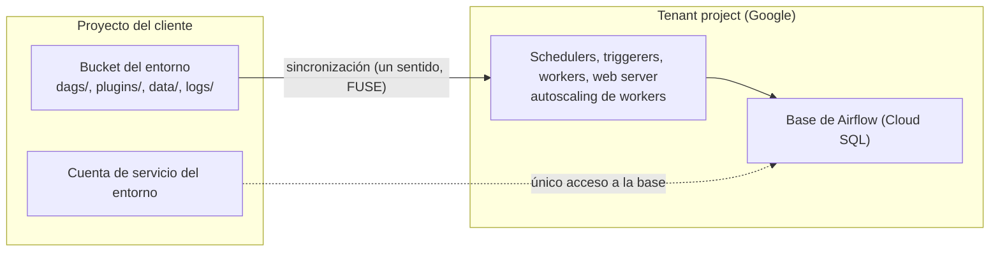

## 1. Resumen

Un **entorno** de **Managed Service for Apache Airflow** (el servicio que antes se llamaba Cloud Composer) es un Airflow completo que Google opera. En **Gen 3**, según su documentación:

- **Recursos repartidos:** una parte vive en el proyecto del cliente; otra, en un **tenant project** de Google propio de cada entorno, incluida la base de metadatos (Cloud SQL).
- **Bucket del entorno:** los DAGs, plugins, datos y logs están en un bucket que se sincroniza **en un solo sentido**, del bucket hacia Airflow.
- **Escala:** los workers escalan solos entre un mínimo y un máximo. CPU y memoria se ajustan por componente, y el **tamaño del entorno** dimensiona la infraestructura administrada.
- **Versiones:** la imagen fija la versión de Airflow. Hay que indicarla, porque la de por defecto puede ser de Gen 2 o de otra versión de Airflow. La infraestructura se actualiza sola; **la versión de Airflow no**.

Qué cambia entre operar Airflow propio y este servicio está en `open-source-vs-managed-orchestration`. Los componentes de Airflow, en `airflow-architecture`.

## 2. Qué es

- **Proyecto del cliente y tenant project:** el entorno se crea en el proyecto del cliente. El tenant project, administrado por Google, da una capa adicional de seguridad y aloja la base de Airflow, a la que solo accede la cuenta de servicio del entorno.
- **Bucket del entorno:**
  - `dags/`, `plugins/`, `data/` y `logs/`, montados en `/home/airflow/gcs/…` con Cloud Storage FUSE;
  - la sincronización va del bucket a Airflow;
  - borrar el entorno no borra el bucket.
- **Autoscaling:**
  - tres autoscalers de GKE ajustan nodos y workers según una métrica de factor de escala;
  - esa métrica considera las tareas en cola, los workers ociosos y la concurrencia por worker.
- **Escalado vertical:** CPU, memoria y disco de schedulers, triggerers, web server y workers.
- **Tamaño del entorno:** la infraestructura administrada, incluida la base de Airflow. Uno más grande procesa más DAGs, tareas y logs con poca demora.
- **Imagen:** `composer-3-airflow-x.y.z-build.t`. Al 2026-10-11, la más nueva es `composer-3-airflow-3.3.1-build.3` y la de por defecto, `composer-3-airflow-2.11.1-build.20`.

## 3. Problema que resuelve

Operar Airflow implica mantener la base de metadatos, los schedulers, los workers, su escalado y las actualizaciones (ver `airflow-architecture`). Un entorno administrado se encarga de la infraestructura. Al equipo le quedan los DAGs, los paquetes, la configuración expuesta y la elección de la versión de Airflow.

## 4. Cómo funciona

1. Se crea el entorno indicando la imagen de Gen 3, la cuenta de servicio, los límites de workers y el tamaño. Con Terraform, con `google_composer_environment`.
2. Se suben los DAGs a `dags/` y los plugins a `plugins/` del bucket. Los componentes de Airflow los reciben por la sincronización.
3. Los schedulers parsean los DAGs y encolan tareas. El autoscaling agrega workers si hay tareas en cola, hasta el máximo.
4. Google actualiza la infraestructura sola, sin cambiar cómo corren los DAGs.
5. Para cambiar la versión de Airflow, el equipo hace un upgrade manual. Se mantienen los paquetes y las opciones de configuración. La consola avisa cuando la versión se acerca al fin de soporte.

## 5. Cuándo utilizarlo

- Orquestar pipelines de datos en Google Cloud con Airflow, sin operar la plataforma.
- Cuando la imagen disponible tiene la versión de Airflow y de Python que los DAGs necesitan (ver `open-source-vs-managed-orchestration`).

## 6. Cuándo no utilizarlo

- Si se necesita una versión de Airflow que el servicio todavía no ofrece, o una configuración que tiene bloqueada.
- Para escribir datos grandes en `data/` del bucket como si fuera el almacenamiento del pipeline: los datos van a su propio bucket o a BigQuery.
- No crear el entorno sin indicar la imagen: la de por defecto puede no ser Gen 3.

## 7. Ejemplo sencillo

Un equipo crea `orquestacion-prod` con la imagen `composer-3-airflow-3.3.1-build.3`, de 1 a 6 workers y tamaño pequeño. Sube `ventas_diarias.py` a `dags/` del bucket y el DAG aparece en Airflow.

## 8. Ejemplo de producción

La plataforma de datos tiene dos entornos, `orquestacion-staging` y `orquestacion-prod`, definidos en Terraform:

- **Imagen:** la misma imagen fijada en los dos; un upgrade se prueba primero en staging.
- **Escalado:** dos schedulers y dos triggerers en producción, para tareas diferibles, y workers de 1 a 6.
- **Despliegue:** la CI carga los DAGs con `DagBag`, usando la misma versión de Airflow que la imagen (ver `pipeline-dependencies`), y los copia a `dags/`.
- **Logs:** se revisan en la UI y en Cloud Logging; el bucket guarda los de cada tarea.

Cuando la consola avisa que la versión se acerca al fin de soporte, el equipo planifica el upgrade.

## 9. Arquitectura



## 10. Código

```hcl
# Terraform (validado en la CI con terraform validate, sin credenciales; no se aplicó): un entorno de Managed Service
# for Apache Airflow (Gen 3) con imagen fijada, tamaño del entorno y límites de los workers. El recurso conserva el
# nombre google_composer_environment y, como en el ejemplo de su página, usa el provider google-beta.
# Requiere: provider hashicorp/google-beta; una cuenta de servicio para el entorno.
terraform {
  required_providers {
    google-beta = {
      source  = "hashicorp/google-beta"
      version = "~> 8.0"
    }
  }
}

variable "project_id" {
  type = string
}

variable "composer_sa" {
  type = string # correo de la cuenta de servicio del entorno
}

resource "google_composer_environment" "orquestacion" {
  provider = google-beta
  project  = var.project_id
  name     = "orquestacion-prod"
  region   = "us-central1"

  config {
    software_config {
      image_version = "composer-3-airflow-3.3.1-build.3" # fijada: la de por defecto puede ser de Gen 2 o de otra versión de Airflow
      airflow_config_overrides = {
        core-dags_are_paused_at_creation = "True"
      }
    }

    workloads_config {
      scheduler {
        cpu        = 1
        memory_gb  = 2
        storage_gb = 1
        count      = 2
      }
      triggerer {
        cpu       = 0.5
        memory_gb = 1
        count     = 2
      }
      worker {
        cpu        = 1
        memory_gb  = 4
        storage_gb = 10
        min_count  = 1
        max_count  = 6 # Managed Airflow escala los workers dentro de estos límites
      }
    }

    environment_size = "ENVIRONMENT_SIZE_SMALL"

    node_config {
      service_account = var.composer_sa
    }
  }
}
```

Este bloque de Terraform se valida en la CI con `terraform validate`, sin credenciales (`make validate-terraform`), y **no se aplicó**. Usa `google_composer_environment` con el provider `google-beta`, como el ejemplo de *Create Managed Service for Apache Airflow environments*. La imagen está fijada en la más nueva de Gen 3 al 2026-10-11. Los valores de CPU, memoria y cantidad son de ejemplo.

## 11. GCP

**Managed Service for Apache Airflow.** Su página dice que «Cloud Composer is evolving to become Managed Service for Apache Airflow». Los recursos de la API y de Terraform conservan el nombre `composer`, y la tecnología conserva el slug `gcp-cloud-composer`, con el nombre anterior como alias (ADR-010).

## 12. AWS

No aplica de forma específica: Amazon MWAA es otro servicio administrado de Airflow, comparado en `open-source-vs-managed-orchestration` sin presentarlo como equivalente.

## 13. Azure

No aplica de forma específica: el Apache Airflow job de Fabric se compara en `open-source-vs-managed-orchestration`.

## 14. Buenas prácticas

- Imagen de Gen 3 explícita en Terraform; nunca la de por defecto.
- La misma imagen en staging y producción; los upgrades, primero en staging.
- La CI carga los DAGs con la misma versión de Airflow que la imagen.
- Límites de workers según la carga real; triggerers si hay tareas diferibles.
- Datos del pipeline fuera del bucket del entorno.
- **Seguridad:** la cuenta de servicio del entorno es la única que accede a la base de Airflow y la que usan las tareas; darle solo los permisos que los DAGs necesitan.
- **Observabilidad:** logs de tareas en el bucket, la UI y Cloud Logging; métricas del entorno en Cloud Monitoring (ver `orchestration-observability`).
- **Costo:** el entorno cobra capacidad aunque no haya tareas; el tamaño y los mínimos de workers definen el piso. Los montos se consultan en la página de precios.

## 15. Errores frecuentes

- Crear el entorno sin imagen y quedar en Gen 2 o en otra versión de Airflow.
- Esperar que Google actualice la versión de Airflow sola.
- Editar los DAGs en Airflow esperando que se guarden en el bucket: la sincronización va del bucket a Airflow, no al revés.
- Borrar el entorno y olvidar que el bucket queda y sigue cobrando.

## 16. Trade-offs

El entorno administrado quita la operación de la infraestructura y escala los workers solo, a cambio de las versiones y opciones que el servicio ofrece y de un costo de capacidad aunque no haya tareas. Fijar la imagen da estabilidad, pero obliga a planificar los upgrades antes del fin de soporte. Un entorno más grande da más margen y cuesta más.

## 17. Conceptos relacionados

- `open-source-vs-managed-orchestration`: propio frente a administrado, y MWAA y Fabric.
- `airflow-architecture`: los componentes de Airflow.
- `airflow-operators-and-hooks`: plugins propios.
- `orchestration-observability`: logs y métricas.
- `pipeline-dependencies`: la carga de DAGs con `DagBag` en la CI.

## 18. Preguntas técnicas abiertas

1. ¿Qué imagen usa hoy tu entorno, y cuándo vence su soporte?
2. ¿Qué mínimo de workers necesitas de verdad?
3. ¿Cómo probarías un upgrade de Airflow antes de producción?

## 19. Laboratorio relacionado

Pendiente (F4).

## 20. Fuentes

- Google Cloud, Managed Service for Apache Airflow (Gen 3): *Managed Airflow overview*, *Environment architecture*, *Data stored in Cloud Storage*, *About environment scaling*, *Create Managed Service for Apache Airflow environments*, *Upgrade environments* y *version list*.

El detalle de cada fuente está en `sources` del frontmatter.

## 21. Fecha de última verificación

2026-10-11. `review_required`: pendiente de revisión B-F3.1 del lote F3b-08c.

## 22. Historial de cambios importantes

- 2026-10-11: creación (lote F3b-08c), con el nombre actual del servicio y el anterior como alias (ADR-010).
