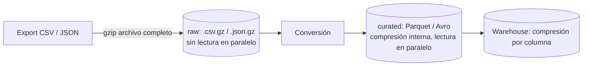

## 1. Resumen

Comprimir reduce el tamaño de los datos sin perder información: menos almacenamiento, menos red y, en motores columnares, menos lectura de disco. En datos hay que distinguir dos tipos:

- **Compresión de archivo completo:** un `.csv.gz` o un `.json.gz`. Ahorra espacio, pero obliga a leer el archivo de principio a fin.
- **Compresión interna:** por bloques en Avro, por páginas de columnas en Parquet, por columna en Redshift. Ahorra espacio y conserva la lectura en paralelo.

BigQuery lo deja explícito: carga Avro, Parquet y ORC con compresión interna, pero no esos formatos comprimidos enteros. Con CSV o JSON en gzip, no puede leer en paralelo.

## 2. Qué es

Es una técnica consolidada. En datos se usa **compresión sin pérdida**: descomprimir devuelve exactamente los mismos bytes. Los codecs más vistos en las fuentes de esta ficha:

| Codec | Dónde aparece |
|---|---|
| GZIP | Archivos CSV y JSON, Parquet, COPY de Redshift, Athena, Data Factory |
| Snappy | Parquet, Avro, Athena |
| ZSTD (Zstandard) | Parquet, Avro, Athena (por defecto en Iceberg), COPY de Redshift desde S3 |
| BZIP2 | Avro, Athena, COPY de Redshift, Data Factory |
| LZ4 y LZ4_RAW | Parquet (LZ4 está obsoleto en favor de LZ4_RAW), Athena |
| DEFLATE | Avro, Data Factory |

Cada motor admite su propio subconjunto: hay que revisarlo en la documentación de cada uno.

## 3. Problema que resuelve

Los datos de pipelines (logs, eventos, exportaciones) son repetitivos y ocupan mucho sin comprimir. Comprimirlos reduce costos de almacenamiento y transferencia. En formatos columnares, también reduce lo que se lee en cada consulta.

## 4. Cómo funciona

1. **Archivo completo** (`gzip archivo.csv`): un solo flujo comprimido. Para leer una parte hay que descomprimir desde el inicio, así que un archivo grande no se reparte entre varios lectores. En BigQuery, el CSV y el JSON en gzip se cargan más lento y sin paralelismo.
2. **Por bloques** (Avro): cada bloque de registros se comprime por separado, con marcadores de sincronización entre bloques. Se puede dividir el archivo y leerlo en paralelo.
3. **Por páginas de columna** (Parquet): cada página de una columna se comprime. Como una columna tiene un solo tipo y valores parecidos, comprime mejor. BigQuery señala que Parquet suele lograr mejor tasa de compresión.
4. **En el almacenamiento del motor** (Redshift): la compresión es por columna y por defecto es automática (`ENCODE AUTO`). Reduce el almacenamiento y lo que se lee de disco.
5. **El intercambio:** cada codec elige un punto distinto entre tasa de compresión y velocidad. Athena describe Snappy y LZ4 como codecs que priorizan la velocidad sobre la tasa máxima.

## 5. Cuándo utilizarlo

- Siempre en almacenamiento analítico: los formatos columnares con su codec interno.
- En archivos de la zona raw o de archivo, para ahorrar espacio.
- En transferencias por red, entre nubes o con socios.

## 6. Cuándo no utilizarlo

- Gzip de archivo completo sobre CSV o JSON grandes que se cargan a BigQuery con urgencia: la carga pierde paralelismo; mejor varios archivos o un formato con compresión interna.
- Comprimir con gzip un archivo Avro, Parquet u ORC entero: BigQuery no lo carga, y ya trae compresión interna.
- Codecs que el motor destino no admite: revisar la lista de cada servicio.

## 7. Ejemplo sencillo

Un CSV de ventas de 1 MB, muy repetitivo, ocupa cerca del 14 % al comprimirlo con gzip (ver la sección 10). El mismo dato convertido a Parquet con Snappy queda comprimido por columna y, además, se puede leer columna por columna y en paralelo.

## 8. Ejemplo de producción

Un socio envía CSV diarios de 30 GB en un solo `.csv.gz`. La carga a BigQuery tarda, porque no se paraleliza. El equipo acuerda que el socio divida el export en archivos de unos cientos de MB comprimidos. Tras aterrizarlos, un job los convierte a Parquet con ZSTD en la zona curada. Las consultas recurrentes y las cargas siguientes usan Parquet. La zona raw conserva los `.gz` con una regla de ciclo de vida.

## 9. Arquitectura



## 10. Código

```python
# Python 3.12, solo biblioteca estándar: cuánto ahorra gzip en un CSV repetitivo, y comprobación de que
# la descompresión devuelve exactamente los mismos bytes (compresión sin pérdida).
import gzip

rows = ["fecha,tienda,producto,cantidad"] + [f"2026-10-0{d % 9 + 1},T{d % 20},P{d % 300},{d % 7}" for d in range(50_000)]
raw = ("\n".join(rows) + "\n").encode("utf-8")

compressed = gzip.compress(raw)
assert gzip.decompress(compressed) == raw          # sin pérdida

print(f"sin comprimir: {len(raw):,} bytes")
print(f"gzip:          {len(compressed):,} bytes ({len(compressed) / len(raw):.0%} del original)")
```

Ejecutado, imprime 1.056.661 bytes sin comprimir y 144.050 con gzip (14 %). La tasa depende de cuán repetitivos sean los datos: con datos poco repetitivos, el ahorro es mucho menor.

## 11. GCP

**BigQuery** distingue explícitamente los dos tipos:

- carga Avro, Parquet y ORC con compresión interna (en Parquet: GZip, LZO_1C, LZO_1X, LZ4_RAW, Snappy o ZSTD), pero no esos archivos comprimidos enteros;
- carga CSV y JSON en gzip, aunque sin leerlos en paralelo y más lento que sin comprimir, sin mezclar comprimidos y sin comprimir en un mismo job y con un máximo de 4 GB por archivo gzip.

Para cargar rápido, la documentación recomienda Avro.

## 12. AWS

En **Redshift**, el almacenamiento comprime por columna y por defecto es automático (`ENCODE AUTO`). Al especificar la codificación de una columna, la tabla deja de gestionarse sola. `COPY` lee archivos en BZIP2, GZIP, LZOP o ZSTD (ZSTD solo desde S3). **Athena** lee tablas que mezclan codecs, usa GZIP por defecto al escribir Parquet en tablas Hive y ZSTD en tablas Iceberg, no admite `tar.gz` y no escribe Parquet con LZ4 ni LZO.

## 13. Azure

**Data Factory** configura la compresión por dataset (`compressionCodec`): bzip2, gzip, deflate, ZipDeflate, TarGzip, Tar, snappy o lz4. La Copy activity no admite snappy ni lz4. Puede descomprimir al copiar, y hay que elegir el codec según lo que admita el destino.

## 14. Buenas prácticas

- En la capa analítica, formatos columnares con su codec interno (por ejemplo Snappy, que prioriza la velocidad, o ZSTD).
- Evitar el gzip de archivo completo sobre archivos muy grandes que deben cargarse rápido; dividir en varios archivos.
- No comprimir enteros archivos Parquet, Avro u ORC.
- Verificar el codec contra la lista que admite cada motor de destino.
- **Seguridad:** comprimir no es cifrar; los archivos comprimidos necesitan el mismo control de acceso y cifrado que los originales.
- **Observabilidad:** medir el tamaño comprimido y la tasa por fuente; un cambio brusco indica cambios en los datos o en la configuración del productor.
- **Costo:** la compresión baja el almacenamiento y la transferencia; en Redshift, la compresión por columna reduce además lo que se lee de disco en cada consulta. A cambio se gasta CPU al comprimir y descomprimir.

## 15. Errores frecuentes

- Un único `.csv.gz` enorme que no se puede cargar en paralelo.
- Comprimir con gzip un Parquet y que el motor no lo cargue.
- Usar un codec que el motor de destino no admite (por ejemplo, LZ4 con la Copy activity).
- Creer que comprimir protege los datos.
- Medir el ahorro con datos de prueba poco representativos.

## 16. Trade-offs

Comprimir ahorra almacenamiento y red, a cambio de CPU; los codecs rápidos (Snappy, LZ4) comprimen menos que los que buscan la tasa máxima. El gzip de archivo completo es simple y universal, pero pierde la lectura en paralelo. La compresión interna de los formatos columnares da a la vez ahorro y paralelismo, a cambio de convertir los datos a esos formatos.

## 17. Conceptos relacionados

- `parquet-format` y `avro-format`: compresión interna.
- `csv-format` y `json-format`: compresión de archivo completo.
- `row-vs-columnar-formats`: por qué lo columnar comprime mejor.

## 18. Preguntas técnicas abiertas

1. ¿Cómo pedirías a un socio que entregue un export de 30 GB para cargarlo rápido?
2. ¿Qué codec usarías en la capa curada y por qué?
3. ¿Cómo medirías si la compresión está ahorrando costo de verdad en tus consultas?

## 19. Laboratorio relacionado

Pendiente (F4).

## 20. Fuentes

- Google Cloud: *Batch loading data*, *Load CSV data from Cloud Storage* y *Load Parquet data from Cloud Storage* (BigQuery).
- Apache: *Parquet compression* y *Avro Specification*.
- AWS: *Use compression in Athena*, *Column compression to reduce the size of stored data* y *File compression parameters* (Amazon Redshift).
- Microsoft Learn: *Delimited text format in Azure Data Factory*.
- Python: *gzip — Support for gzip files*.

El detalle de cada fuente está en `sources` del frontmatter.

## 21. Fecha de última verificación

2026-10-06. Pasa a `verified`: revisión B-F3.1 del lote F3b-01b aplicada, sin VERIFY pendientes.

## 22. Historial de cambios importantes

- 2026-10-06: creación (lote F3b-01b, dominio 01-fundamentals).
- 2026-10-06: revisión B-F3.1 del lote F3b-01b aplicada (docs/reviews/cards-f3b-01b.md): §11 nombra `LZO_1C` y `LZO_1X`, como la documentación de BigQuery.
- 2026-10-06: `verification_status: verified` (sin VERIFY pendientes).
