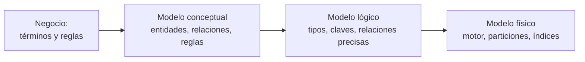
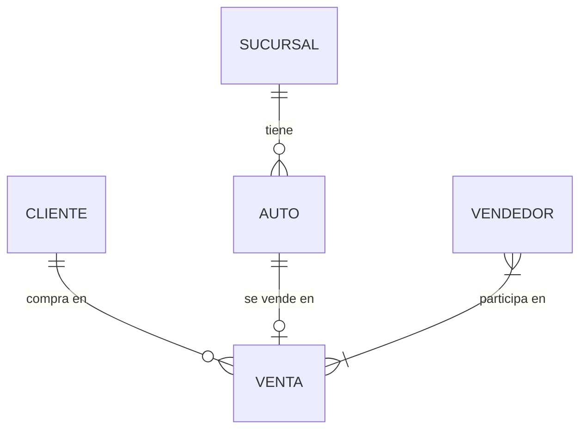

## 1. Resumen

El modelo conceptual responde **qué** datos importan, antes de decidir cómo guardarlos. Nombra las entidades del negocio (clientes, autos, ventas), cómo se relacionan y qué reglas cumplen («toda venta tiene un cliente»). Es un diagrama simple que el negocio y el equipo técnico pueden leer y acordar. No tiene tipos de datos, claves técnicas ni tecnología. Esos detalles llegan en el modelo lógico y en el físico.

## 2. Qué es

Según AWS, el modelo conceptual da una vista general de:

- qué datos contiene el sistema;
- sus atributos y restricciones;
- las reglas de negocio;
- cómo organizarlos;
- sus requisitos de seguridad e integridad.

Lo crean personas de negocio y analistas. No sigue reglas formales de modelado, y también se le llama **modelo de dominio**.

Sus piezas vienen del modelo entidad-relación de Chen (1976):

- **Entidad:** algo que se puede identificar de forma distinta, como una persona, un auto o una venta.
- **Relación:** una asociación entre entidades, por ejemplo un cliente que compra un auto.
- **Rol:** la función que cumple una entidad en una relación, como comprador o vendedor.

## 3. Problema que resuelve

Sin un acuerdo previo sobre qué es un «cliente» o una «venta», cada equipo construye tablas con definiciones distintas y los reportes no cuadran. El modelo conceptual fija el vocabulario y las reglas antes de escribir SQL, y deja explícitas preguntas que de otro modo aparecen tarde. Por ejemplo, ¿una venta puede tener dos vendedores? ¿Un cliente sin compras es cliente?

## 4. Cómo funciona

1. Se elige el alcance: un proceso o un área del negocio.
2. Se listan las **entidades**, con un nombre y una definición de una línea cada una.
3. Se dibujan las **relaciones** y su cardinalidad en lenguaje de negocio: «una sucursal tiene muchos autos», «una venta tiene uno o más vendedores».
4. Se escriben las **reglas de negocio** que el modelo debe respetar.
5. Se revisa con el negocio hasta que el diagrama refleja lo que la gente entiende. Recién entonces se pasa al modelo lógico.

Chen señala que algo puede modelarse como entidad o como relación (su ejemplo es un matrimonio). Esa decisión es de diseño y conviene tomarla aquí.

## 5. Cuándo utilizarlo

- Al iniciar un dominio nuevo de datos o un data warehouse.
- Cuando varios equipos usan el mismo término con significados distintos.
- Antes de diseñar un modelo dimensional: los procesos de negocio y sus entidades salen de aquí.
- Para documentar un sistema existente del que nadie tiene el diagrama.

## 6. Cuándo no utilizarlo

- No como sustituto del modelo lógico: el conceptual no define tipos, claves ni normalización.
- No para cada cambio menor de una tabla ya existente: basta con actualizar el diagrama si cambia una entidad o una regla.
- No con un nivel de detalle técnico (columnas, índices): eso lo vuelve ilegible para el negocio, que es su principal lector.

## 7. Ejemplo sencillo

Entidades y reglas del concesionario del ejemplo de AWS, en texto:

- **Sucursal**, **Auto**, **Cliente**, **Venta** y **Vendedor**.
- Todo auto pertenece a una sucursal.
- Toda venta tiene al menos un vendedor y un cliente.
- Todo cliente da su teléfono y su email.

## 8. Ejemplo de producción

Un retailer va a construir su warehouse de ventas. En dos sesiones con comercial, logística y finanzas, el equipo de datos dibuja el modelo conceptual: Cliente, Tienda, Producto, Ticket, Línea de ticket, Devolución y Promoción. Surgen definiciones que no estaban escritas: una devolución se asocia a la línea original, y una promoción aplica a líneas, no a tickets completos. El diagrama queda versionado en el repositorio junto al modelo lógico, y cada cambio de definición pasa por el mismo grupo.

## 9. Arquitectura

## 10. Código

No es código ejecutable: es el modelo conceptual del concesionario como diagrama entidad-relación en sintaxis Mermaid, la misma que usa esta plataforma para los diagramas. Las cardinalidades dicen en lenguaje de negocio lo que las reglas de la §7 exigen. Cómo se implementan esas reglas está en `logical-data-model`.

## 11. GCP

No aplica de forma específica: el modelo conceptual es independiente de la tecnología.

## 12. AWS

No aplica de forma específica (ver §11). La definición de esta ficha se apoya en la página *What is Data Modeling?* de AWS, que no describe un servicio.

## 13. Azure

No aplica de forma específica (ver §11).

## 14. Buenas prácticas

- Un nombre y una definición de una línea por entidad, escritos con el negocio.
- Reglas de negocio explícitas al lado del diagrama, no solo cardinalidades.
- Diagrama versionado junto al código del modelo lógico.
- Revisarlo cuando cambia un proceso de negocio, no solo cuando cambia una tabla.
- **Seguridad:** marcar ya en este nivel qué entidades contienen datos personales o sensibles (clientes, empleados); esa marca guía después los permisos y el enmascaramiento en el modelo físico.
- **Observabilidad:** las reglas de negocio del modelo conceptual son la fuente de las pruebas de calidad posteriores (por ejemplo, «toda venta tiene un cliente» se vuelve un chequeo sobre la tabla).
- **Costo:** acordar definiciones antes de construir evita rehacer tablas y pipelines cuando dos áreas descubren que entendían distinto la misma entidad.

## 15. Errores frecuentes

- Saltarse el modelo conceptual y empezar por las tablas del sistema de origen, heredando sus nombres y sus limitaciones.
- Llenar el diagrama de columnas técnicas hasta que el negocio deja de leerlo.
- Definir entidades sin reglas: el diagrama no dice qué combinaciones son válidas.
- Hacerlo una vez y no actualizarlo nunca.

## 16. Trade-offs

El modelo conceptual cuesta reuniones y tiempo antes de producir una sola tabla, a cambio de evitar retrabajo y discusiones posteriores sobre definiciones. Su simplicidad es su ventaja y su límite: no alcanza para construir nada sin el modelo lógico. Algunos equipos ágiles pasan directo del conceptual al físico, como menciona AWS, y ganan velocidad a cambio de decisiones de tipos y claves menos discutidas.

## 17. Conceptos relacionados

- `logical-data-model` y `physical-data-model`: los niveles siguientes.
- `kimball-methodology`: elegir procesos de negocio y entidades.
- `grain`: qué representa una fila.
- `normalization`: cómo se organizan las entidades en el modelo lógico.

## 18. Preguntas técnicas abiertas

1. ¿Qué entidad de tu negocio tiene hoy dos definiciones distintas según el área que la usa?
2. En tu dominio, ¿qué modelarías como entidad y qué como relación, y por qué?
3. ¿Quién debería aprobar un cambio en el modelo conceptual?

## 19. Laboratorio relacionado

Pendiente (F4).

## 20. Fuentes

- AWS: *What is Data Modeling?*
- Chen (1976): *The Entity-Relationship Model: Toward a Unified View of Data* (Nivel 4, conceptual).

El detalle de cada fuente está en `sources` del frontmatter.

## 21. Fecha de última verificación

2026-10-11. Pasa a `verified`: revisión B-F3.1 del lote F3b-04a aplicada, sin VERIFY pendientes.

## 22. Historial de cambios importantes

- 2026-10-10: creación (lote F3b-04a).
- 2026-10-11: revisión B-F3.1 del lote F3b-04a aplicada (docs/reviews/cards-f3b-04a.md): filas aprobadas sin cambios en esta ficha.
- 2026-10-11: `verification_status: verified` (sin VERIFY pendientes).
