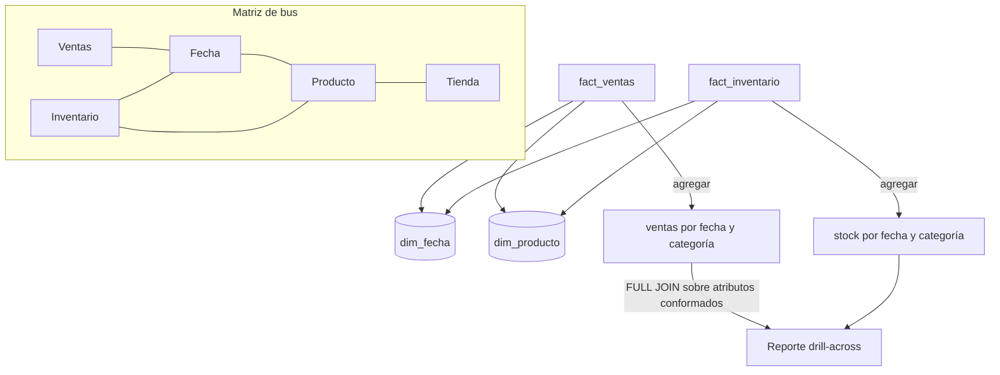

## 1. Resumen

Una dimensión conformada es una dimensión que comparten varias tablas de hechos, con los mismos nombres de columnas y el mismo contenido: el mismo «producto» o la misma «fecha» para ventas, inventario y devoluciones. Gracias a eso, un reporte puede **cruzar procesos** (drill-across): cada hecho se agrega por separado a los mismos atributos y los resultados se alinean fila a fila. La **matriz de bus** de Kimball es la herramienta para planificar qué dimensiones se comparten entre qué procesos.

## 2. Qué es

Según Kimball, dos dimensiones están conformadas cuando sus atributos tienen los mismos nombres de columna y el mismo contenido de dominio. Variantes:

- **Idéntica:** la misma tabla, como `dim_fecha`, usada por todos los hechos.
- **Reducida (shrunken):**
  - un subconjunto de filas o columnas de la dimensión base;
  - por ejemplo, una dimensión de marca para un pronóstico mensual por marca, con atributos idénticos a los de la dimensión de producto.
- **Matriz de bus:**
  - filas = procesos de negocio; columnas = dimensiones;
  - las celdas marcan qué dimensión usa cada proceso;
  - recorrer una columna muestra dónde hay que conformar.

## 3. Problema que resuelve

Si ventas tiene su propio «producto» e inventario el suyo, con códigos, categorías o nombres distintos, un reporte que cruce ambos no cuadra o no se puede hacer. Las dimensiones conformadas, definidas una vez con el gobierno de datos, hacen que los procesos se puedan integrar. Kimball las llama la esencia de la integración en un DW/BI empresarial. También ahorran desarrollo, porque la dimensión no se rehace en cada proyecto.

## 4. Cómo funciona

1. En la matriz de bus se identifican las dimensiones que usan varios procesos: fecha, producto, tienda, cliente.
2. Se acuerdan con el negocio los atributos y sus valores: qué es una categoría y cómo se escribe.
3. Se construye la dimensión una vez, en el ETL, y todas las tablas de hechos la referencian.
4. Para un proceso de grano más grueso se publica una dimensión reducida con los mismos nombres y valores.
5. **Drill-across:**
   - cada tabla de hechos se agrega por separado a los atributos conformados;
   - los resultados se alinean con un `FULL JOIN` sobre esos atributos;
   - **nunca** se unen los hechos directamente fila a fila, porque los granos distintos multiplican las filas.

## 5. Cuándo utilizarlo

- Siempre que dos o más procesos compartan contexto: casi siempre fecha, y a menudo producto, cliente o tienda.
- Para reportes que comparan procesos: ventas frente a stock, pedidos frente a entregas.
- Para agregados y pronósticos, con dimensiones reducidas.

## 6. Cuándo no utilizarlo

- No forzar la conformidad de atributos que de verdad significan cosas distintas en cada proceso: es mejor nombrarlos distinto.
- No para un único proceso aislado sin planes de cruce; aun así, diseñar fecha y producto conformados desde el inicio suele costar poco.
- No como excusa para una dimensión gigante con todos los atributos de todas las áreas: la conformidad es sobre nombres y contenido compartidos, no sobre juntar todo.

## 7. Ejemplo sencillo

`fact_ventas` (una línea de ticket) y `fact_inventario` (stock diario por producto) usan la misma `dim_fecha` y la misma `dim_producto`. Un reporte de «unidades vendidas y stock de cierre por fecha y categoría» agrega cada hecho por separado y alinea los resultados.

## 8. Ejemplo de producción

La matriz de bus de un retailer tiene cinco procesos y seis dimensiones. Fecha, producto y tienda aparecen en casi todas las filas. El equipo las construye una vez, con dueños en el gobierno de datos, y las versiona. El pronóstico de demanda, que es mensual por marca, usa una dimensión reducida de marca cuyos valores salen de la de producto. El tablero de «ventas frente a stock frente a pronóstico» hace tres consultas y las alinea por mes y marca.

## 9. Arquitectura



## 10. Código

```sql
-- PostgreSQL 17 (ejecutado): dos procesos (ventas e inventario) con grano distinto que comparten dimensiones
-- conformadas (fecha y producto); el reporte cruza ambos hechos con drill-across.
CREATE TABLE dim_fecha    (fecha_key integer PRIMARY KEY, fecha date NOT NULL, mes text NOT NULL);
CREATE TABLE dim_producto (producto_key integer PRIMARY KEY, sku text NOT NULL, categoria text NOT NULL);
CREATE TABLE fact_ventas (       -- grano: línea de ticket
  fecha_key integer REFERENCES dim_fecha, producto_key integer REFERENCES dim_producto, unidades integer NOT NULL);
CREATE TABLE fact_inventario (   -- grano: snapshot diario por producto
  fecha_key integer REFERENCES dim_fecha, producto_key integer REFERENCES dim_producto, stock integer NOT NULL);

INSERT INTO dim_fecha VALUES (20261007, '2026-10-07', '2026-10'), (20261008, '2026-10-08', '2026-10');
INSERT INTO dim_producto VALUES (1, 'SKU-1', 'Bebidas'), (2, 'SKU-2', 'Panadería'), (3, 'SKU-3', 'Lácteos');
INSERT INTO fact_ventas VALUES (20261007, 1, 5), (20261007, 1, 2), (20261008, 2, 4);
INSERT INTO fact_inventario VALUES (20261007, 1, 40), (20261007, 2, 10), (20261007, 3, 7),
                                   (20261008, 1, 33), (20261008, 2, 6), (20261008, 3, 7);

-- Drill-across: cada hecho se agrega por separado a los mismos atributos conformados y luego se alinean.
WITH v AS (
  SELECT d.fecha, p.categoria, sum(f.unidades) AS vendidas
  FROM fact_ventas f JOIN dim_fecha d USING (fecha_key) JOIN dim_producto p USING (producto_key)
  GROUP BY 1, 2
), i AS (
  SELECT d.fecha, p.categoria, sum(f.stock) AS stock_cierre
  FROM fact_inventario f JOIN dim_fecha d USING (fecha_key) JOIN dim_producto p USING (producto_key)
  GROUP BY 1, 2
)
SELECT coalesce(v.fecha, i.fecha) AS fecha, coalesce(v.categoria, i.categoria) AS categoria,
       coalesce(v.vendidas, 0) AS vendidas, i.stock_cierre
FROM v FULL JOIN i ON v.fecha = i.fecha AND v.categoria = i.categoria
ORDER BY 1, 2;
-- 2026-10-07 | Bebidas   | 7 | 40
-- 2026-10-07 | Lácteos   | 0 |  7
-- 2026-10-07 | Panadería | 0 | 10
-- 2026-10-08 | Bebidas   | 0 | 33
-- 2026-10-08 | Lácteos   | 0 |  7
-- 2026-10-08 | Panadería | 4 |  6

-- Unir los dos hechos directamente (sin agregar antes) multiplica filas: el stock se suma dos veces.
SELECT sum(i.stock) AS stock_mal_sumado
FROM fact_ventas v JOIN fact_inventario i USING (fecha_key, producto_key)
WHERE v.fecha_key = 20261007 AND v.producto_key = 1;   -- 80, no 40
```

Ejecutado en PostgreSQL 17.11 local, en un esquema desechable. El drill-across devuelve una fila por fecha y categoría con ambos hechos. Las categorías sin ventas ese día aparecen con 0 gracias al `FULL JOIN` y al `coalesce`. La última consulta muestra el error de unir los hechos directamente: el producto 1 tiene dos líneas de venta el 7 de octubre y su stock de 40 se suma dos veces.

## 11. GCP

No aplica de forma específica: las dimensiones conformadas son una decisión de diseño independiente del motor.

## 12. AWS

No aplica de forma específica (ver §11).

## 13. Azure

La guía de **Fabric Data Warehouse** describe las dimensiones conformadas como tablas compartidas por varias estrellas, que dan consistencia y reducen el desarrollo y el mantenimiento. Pone la dimensión de fecha como el caso habitual, en su ejemplo compartida por los hechos de Sales e Inventory. Recomienda que esa dimensión incluya los atributos que necesitan todas las tablas de hechos.

## 14. Buenas prácticas

- Matriz de bus mantenida con el negocio y revisada antes de cada nuevo proceso.
- Una sola construcción por dimensión conformada, con dueño en el gobierno de datos.
- Dimensiones reducidas derivadas de la base, con los mismos nombres y valores.
- Drill-across siempre agregando cada hecho por separado antes de alinear.
- **Seguridad:** una dimensión compartida por muchos procesos tiene muchos consumidores; separar atributos sensibles (por ejemplo, datos personales del cliente) o publicar una versión reducida sin ellos.
- **Observabilidad:** chequeos de que todas las claves de dimensión de cada hecho existen en la dimensión conformada, y de que los valores de los atributos conformados no divergen entre la base y sus versiones reducidas.
- **Costo:** construir cada dimensión una vez evita mantener varias versiones del mismo cliente o producto y reconciliarlas después.

## 15. Errores frecuentes

- Cada proceso con su propia dimensión de producto, con categorías escritas distinto.
- Unir dos tablas de hechos directamente y sumar dos veces (el error de la §10).
- Dimensiones reducidas construidas por separado, que se desalinean de la base con el tiempo.
- Llamar «conformada» a una dimensión que solo comparte el nombre de tabla, pero no los valores.

## 16. Trade-offs

Las dimensiones conformadas exigen acuerdos entre áreas y un dueño que los haga cumplir, y eso cuesta tiempo político además de técnico. A cambio, habilitan los reportes cruzados y evitan rehacer dimensiones. Conformar de más fuerza definiciones únicas donde el negocio de verdad necesita dos; conformar de menos deja silos.

## 17. Conceptos relacionados

- `kimball-methodology`: la arquitectura de bus.
- `dimension-tables` y `fact-tables`: las piezas que se comparten y las que las usan.
- `grain`: por qué no se unen hechos de granos distintos.
- `data-reconciliation`: cuadrar totales entre procesos.

## 18. Preguntas técnicas abiertas

1. ¿Qué dimensión de tu warehouse existe hoy en dos versiones y qué reporte se rompe por eso?
2. ¿Quién debería ser dueño de la dimensión de producto conformada?
3. ¿Cómo garantizarías que una dimensión reducida no se desalinee de su base?

## 19. Laboratorio relacionado

Pendiente (F4).

## 20. Fuentes

- Kimball Group: *Conformed Dimensions*, *Enterprise Data Warehouse Bus Matrix*, *Drilling Across* y *Shrunken Rollup Dimensions* (Nivel 4, conceptual).
- Microsoft Learn: *Modeling Dimension Tables in Warehouse* (Microsoft Fabric).

El detalle de cada fuente está en `sources` del frontmatter.

## 21. Fecha de última verificación

2026-10-11. Pasa a `verified`: revisión B-F3.1 del lote F3b-04a aplicada, sin VERIFY pendientes.

## 22. Historial de cambios importantes

- 2026-10-10: creación (lote F3b-04a).
- 2026-10-11: revisión B-F3.1 del lote F3b-04a aplicada (docs/reviews/cards-f3b-04a.md): filas aprobadas sin cambios en esta ficha.
- 2026-10-11: `verification_status: verified` (sin VERIFY pendientes).
- 2026-10-13: `page_title` en cada cita, con el título de la página citada (ADR-012); sin cambios de contenido.
