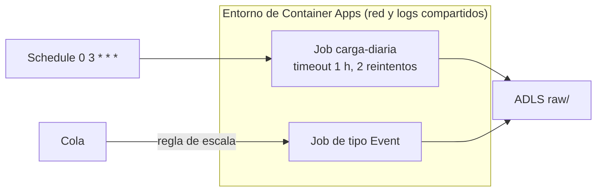

## 1. Resumen

**Azure Container Apps** ejecuta contenedores sin administrar servidores. Según su documentación, tiene dos tipos de recurso:

- **apps:** servicios que corren de forma continua y escalan con **KEDA** (por HTTP, colas, CPU, memoria o eventos como Event Hubs y Kafka);
- **jobs:** tareas que **corren un tiempo finito y terminan**.

Para datos, el caso típico es el **job**:
- de tipo **Schedule** (cron) para cargas diarias;
- de tipo **Event** para procesar mensajes de una cola;
- de tipo **Manual** para lanzarlo desde un orquestador.

Cada réplica tiene **timeout** y **reintentos**, y la ejecución define **paralelismo** y cuántas réplicas deben terminar bien.

## 2. Qué es

- **Entorno:** el límite donde corren apps y jobs, con red y logs compartidos.
- **App:** servicio que corre de forma continua y se reinicia si el contenedor falla; escala con reglas de KEDA.
- **Job:** contenedor que corre hasta terminar. Tipos:
  - *Manual*: se inicia por API;
  - *Schedule*: por expresión cron;
  - *Event*: por una regla de escala (por ejemplo, mensajes en una cola).
- **Configuración del job:**
  - `replicaTimeout`: tiempo máximo de una réplica;
  - `replicaRetryLimit`: reintentos de una réplica fallida (0 para no reintentar; el timeout prevalece);
  - `parallelism`: réplicas por ejecución (1 para la mayoría);
  - `replicaCompletionCount`: réplicas que deben terminar bien (menor o igual que el paralelismo).

## 3. Problema que resuelve

Cargas de datos en contenedores propios (Python con sus dependencias, herramientas de línea de comandos) que duran más que una función o necesitan otra imagen, sin operar un clúster de Kubernetes.

## 4. Cómo funciona

1. Se publica la imagen del job en un registro de contenedores.
2. Se crea el job de tipo Schedule con `0 3 * * *`, timeout de 1 hora y 2 reintentos.
3. Cada día a las 3:00, el job lanza una réplica; si falla, se reintenta hasta 2 veces dentro del timeout.
4. La ejecución termina cuando la réplica completa; los logs quedan en el entorno.

## 5. Cuándo utilizarlo

- Cargas por lotes en contenedores que terminan.
- Procesar mensajes de una cola por lotes, con un job de tipo Event que arranca cuando hay mensajes.
- Pasos de un pipeline lanzados por un orquestador (job Manual).

## 6. Cuándo no utilizarlo

- Pasos cortos y reactivos: una función (ver `azure-functions-for-data`).
- Procesamiento distribuido con shuffle: Spark.
- Repartir un lote entre réplicas sin un mecanismo propio: la página del job no documenta un índice de réplica, a diferencia de Cloud Run.

## 7. Ejemplo sencillo

El job `carga-diaria` corre a las 3:00, descarga el archivo del proveedor y lo escribe en `raw/dt=<día>/`. Si la descarga falla, la réplica se reintenta.

## 8. Ejemplo de producción

Un entorno de Container Apps con:

- un job Schedule que carga los archivos del día, con timeout de 1 hora y 2 reintentos;
- un job Event que arranca cuando hay mensajes en la cola de pedidos;
- identidad administrada para leer el registro de contenedores y escribir en el lake;
- logs del entorno para cada ejecución.

## 9. Arquitectura



## 10. Código

```hcl
# Terraform (validado en la CI con terraform validate, sin credenciales; no se aplicó): job de Container Apps de tipo
# Schedule (cron), con timeout por réplica, reintentos y paralelismo; termina al completar el trabajo.
# Requiere: provider hashicorp/azurerm ~> 5.0; grupo de recursos y un entorno de Container Apps existentes.
terraform {
  required_providers {
    azurerm = {
      source  = "hashicorp/azurerm"
      version = "~> 5.0"
    }
  }
}

provider "azurerm" {
  features {}
}

variable "resource_group_name" {
  type = string
}

variable "location" {
  type    = string
  default = "eastus2"
}

variable "container_app_environment_id" {
  type = string
}

resource "azurerm_container_app_job" "carga_diaria" {
  name                         = "carga-diaria"
  resource_group_name          = var.resource_group_name
  location                     = var.location
  container_app_environment_id = var.container_app_environment_id
  replica_timeout_in_seconds   = 3600
  replica_retry_limit          = 2

  schedule_trigger_config {
    cron_expression          = "0 3 * * *"
    parallelism              = 1
    replica_completion_count = 1
  }

  template {
    container {
      name   = "carga"
      image  = "dekhacr.azurecr.io/carga-ventas:1.4.0"
      cpu    = 0.5
      memory = "1Gi"
    }
  }
}
```

El bloque de Terraform se valida en la CI con `terraform validate`, sin credenciales (`make validate-terraform`), y **no se aplicó**. Los nombres de los atributos corresponden a la configuración de *Jobs in Azure Container Apps*: timeout y reintentos por réplica, paralelismo y réplicas que deben completar. La imagen es ilustrativa.

## 11. GCP

No aplica de forma específica: esta ficha describe Container Apps. Lo más cercano en GCP son los jobs de Cloud Run (ver `cloud-run-for-data`). Las diferencias, según sus páginas:

| | Container Apps jobs | Cloud Run jobs |
|---|---|---|
| Disparo | Manual, Schedule (cron) o Event (regla de escala) | A mano o con calendario |
| Repartir trabajo entre tareas | La página no documenta un índice de réplica | Cada tarea recibe `CLOUD_RUN_TASK_INDEX` y `CLOUD_RUN_TASK_COUNT` |
| Duración | `replicaTimeout` por réplica | Timeout por tarea, de 10 minutos por defecto hasta 168 horas |

## 12. AWS

No aplica de forma específica. Lo más cercano en las fichas de AWS es Lambda (ver `lambda-for-data`), para tareas cortas. Las diferencias, según sus páginas:

| | Container Apps jobs | Lambda |
|---|---|---|
| Unidad | Contenedor propio que corre hasta terminar | Función con un handler |
| Duración | `replicaTimeout` configurable por réplica | 15 minutos como máximo |
| Disparo | Manual, cron o eventos | Eventos de servicios de AWS o invocación |

## 13. Azure

**Azure Container Apps.** Apps y jobs, los tipos de job, su configuración y el escalado con KEDA son los de sus páginas.

## 14. Buenas prácticas

- Jobs para tareas que terminan; apps para servicios continuos.
- Timeout y reintentos explícitos por réplica.
- Escribir por partición, para que un reintento no duplique.
- Imagen versionada (no `latest`) para saber qué corrió cada día.
- **Seguridad:** identidad administrada para el registro de contenedores y el lake; secretos fuera de la imagen.
- **Observabilidad:** logs del entorno por ejecución y alertas por ejecuciones fallidas.
- **Costo:** según *Azure Container Apps pricing* (consultada el 2026-10-14), en el plan de consumo cada ejecución de un job se cobra a la tarifa activa desde que empieza hasta que termina, sin cargos cuando no hay ejecuciones; una app con réplicas mínimas paga una tarifa reducida en reposo. Los montos no se copian.

## 15. Errores frecuentes

- Una app que corre todo el día para una tarea diaria.
- Timeout más corto que la tarea, que agota los reintentos.
- Paralelismo mayor que 1 sin un mecanismo para repartir el trabajo.
- Imágenes `latest` que cambian sin aviso.

## 16. Trade-offs

Container Apps da contenedores propios sin operar Kubernetes, con jobs que terminan y escalado por eventos, a cambio de armar la imagen y su ciclo de vida. Functions es más simple para pasos cortos; Spark, para procesamiento distribuido.

## 17. Conceptos relacionados

- `cloud-run-for-data` y `lambda-for-data`: lo más cercano en GCP y AWS.
- `azure-functions-for-data`: para pasos cortos.
- `batch-ingestion` y `retries`: lo que ejecuta un job y cómo se recupera.

## 18. Preguntas técnicas abiertas

1. ¿Qué tareas de tu pipeline necesitan un contenedor propio?
2. ¿Cómo repartirías un lote entre varias réplicas?
3. ¿Qué colas podrían consumirse con un job de tipo Event?

## 19. Laboratorio relacionado

Pendiente (F4).

## 20. Fuentes

- Microsoft Learn, Azure Container Apps: *Azure Container Apps overview*, *Jobs in Azure Container Apps* y *Set scaling rules in Azure Container Apps*; *Azure Container Apps pricing*.
- Google Cloud, Cloud Run: *Create jobs* y *Deployment options and resource model*. AWS: *Lambda quotas* y *What is AWS Lambda?*.

El detalle de cada fuente está en `sources` del frontmatter.

## 21. Fecha de última verificación

2026-10-14. Pasa a `verified`: revisión B-F3.1 del lote F3b-10b aplicada, sin VERIFY pendientes.

## 22. Historial de cambios importantes

- 2026-10-13: creación (lote F3b-10b).
- 2026-10-14: revisión B-F3.1 del lote F3b-10b aplicada (docs/reviews/cards-f3b-10b.md): el costo de los jobs cita *Azure Container Apps pricing* (2026-10-14), sin montos.
- 2026-10-14: `verification_status: verified` (sin VERIFY pendientes).
