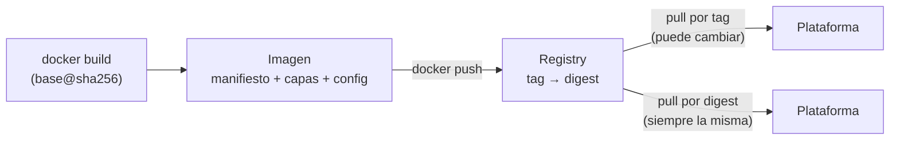

## 1. Resumen

Según Docker, «A container image is a standardized package that includes all of the files, binaries, libraries, and configurations to run a container». La especificación OCI la define por sus partes: un manifiesto, un índice opcional, un conjunto de capas y una configuración.

Dos propiedades guían cómo se usan:

- **son inmutables:** una imagen no se modifica; se construye otra;
- **un tag es mutable y un digest no:** `python:3.12-slim` puede apuntar mañana a otra imagen, mientras que `python:3.12-slim@sha256:…` siempre es la misma.

## 2. Qué es

- **Capa:** un conjunto de cambios del sistema de archivos. Las capas se apilan y se reusan entre imágenes.
- **Manifiesto y configuración:** describen qué capas forman la imagen y cómo correrla (usuario, comando, etiquetas).
- **Índice:** opcional; en una imagen multiarquitectura lista las variantes por plataforma, y Cloud Run exige que incluya `linux/amd64`.
- **Tag:** un nombre legible, como `1.0` o `3.12-slim`, que el publicador puede mover.
- **Digest:** el identificador inmutable de la imagen, con la forma `sha256:…`.

## 3. Problema que resuelve

Un job corre en producción con `python:3.12-slim`. Un día el publicador actualiza ese tag y el job empieza a fallar sin que nadie haya cambiado el código. Con la base fijada por digest, el build usa siempre la misma imagen, y actualizarla es un cambio visible en el repositorio.

## 4. Cómo funciona

1. `docker build` crea una imagen sobre una base y le agrega capas.
2. `docker push` la sube a un registry con su tag; el registry la identifica por su digest.
3. `docker pull` por tag trae lo que el tag apunte en ese momento; por digest, siempre la misma imagen.
4. Al correr, Docker apila las capas y agrega la capa escribible del contenedor.

## 5. Cuándo utilizarlo

- Empaquetar un job con su runtime y dependencias para correrlo en cualquier plataforma de contenedores.
- Fijar por digest las imágenes base de los Dockerfiles y las imágenes que se despliegan.
- Usar un tag único por build (hash de Git o fecha) para saber qué versión corre.

## 6. Cuándo no utilizarlo

- Para guardar datos o secretos: todo lo que entra en una capa queda en la imagen.
- `latest` como versión de producción: no dice qué imagen corre y cambia sin aviso.
- Una imagen distinta por entorno: se construye una vez y se promueve la misma.

## 7. Ejemplo sencillo

Una imagen `dekh/base:1.0` sobre Alpine fijada por digest, con una sola etiqueta. Se publica en un registry local, se borra la copia local y se vuelve a bajar por digest: la etiqueta `dekh-base` sigue ahí, porque es la misma imagen.

## 8. Ejemplo de producción

La imagen de un job de transformación:

- parte de una base fijada por digest, que un bot actualiza con un pull request;
- se construye una vez en la CI, con un tag igual al hash del commit;
- se despliega en desarrollo y después en producción por su digest;
- se publica en el registry de la nube donde corre, cerca de la plataforma que la baja.

## 9. Arquitectura



## 10. Código

```bash
# Bash y Docker (ejecutado en la CI con Docker real y un registry:2 local; ADR-016): una imagen se identifica por tag
# (mutable) o por digest (inmutable). Se construye una imagen chica sobre una base fijada por digest, se publica en el
# registry local, se borra la copia local y se vuelve a bajar por digest.
set -euo pipefail
REGISTRY="${REGISTRY:-localhost:5055}"   # registry:2 local que levanta el test
IMAGE="$REGISTRY/dekh/base:1.0"

docker build -q -t "$IMAGE" - > /dev/null <<'EOF'
FROM alpine:3.22@sha256:5291449c3df73caf6ed85e649dec1b9e818b39a5d8c871e97afc13e9cd5e8fa8
LABEL org.opencontainers.image.title="dekh-base"
EOF
echo "capas: $(docker image inspect --format '{{len .RootFS.Layers}}' "$IMAGE")"

docker push -q "$IMAGE" > /dev/null
DIGEST=$(docker image inspect --format '{{range .RepoDigests}}{{println .}}{{end}}' "$IMAGE" | grep "^$REGISTRY/" | cut -d@ -f2)
echo "digest publicado: $DIGEST"

docker image rm -f "$IMAGE" > /dev/null                          # sin copia local con ese nombre
docker pull -q "$REGISTRY/dekh/base@$DIGEST" > /dev/null          # por digest: siempre la misma imagen
echo "bajada por digest: $(docker image inspect --format '{{index .Config.Labels "org.opencontainers.image.title"}}' "$REGISTRY/dekh/base@$DIGEST")"
```

El script se **ejecuta en la CI con Docker real y un `registry:2` local** (ADR-016), fijado por digest. Imprime `capas: 1`, el digest publicado y `bajada por digest: dekh-base`. Publicar en Artifact Registry, ECR o ACR es el mismo `docker push` con otra dirección y credenciales de la nube, y **no se ejecutó**.

## 11. GCP

En GCP, **Cloud Run** corre la imagen tal como se construyó. Lo que exige, según *Container runtime contract*:

| | Docker local | Cloud Run |
|---|---|---|
| Formatos | Los que construye Docker | Docker Image Manifest V2 (Schema 1 y 2) y OCI, también con Zstd |
| Arquitectura | La del host | Linux 64-bit (x86_64); un índice multiarquitectura debe incluir `linux/amd64` |

## 12. AWS

En AWS, **ECS con Fargate** toma la imagen de la task definition. Según *Amazon ECS task definitions* y *AWS Fargate Pricing*:

| | Docker local | ECS con Fargate |
|---|---|---|
| Dónde se indica la imagen | `docker run <imagen>` | La task definition, por contenedor, junto con el sistema operativo |
| Efecto del tamaño | Tiempo de descarga | Además, el cobro empieza con la descarga de la imagen y es por segundo, con un mínimo de 1 minuto, redondeado hacia arriba (consultado el 2026-10-19) |

## 13. Azure

En Azure, **Container Apps** baja la imagen de cualquier registry. Según *Containers in Azure Container Apps*:

| | Docker local | Container Apps |
|---|---|---|
| Arquitectura | La del host | Solo `linux/amd64` |
| Tags | Cualquiera | Evitar tags estáticos como `latest`; uno único por despliegue |
| Tamaño | — | Hasta 8 GB por réplica en el perfil Consumption |

## 14. Buenas prácticas

- Imagen base fijada por digest, con el tag al lado para que se lea qué versión es.
- Un tag único por build y despliegue por digest.
- Imágenes chicas: solo lo que el job necesita para correr (ver `dockerfile`).
- **Seguridad:** fijar por digest protege de un tag que se mueve; nunca meter secretos en una capa, porque quedan en la imagen.
- **Observabilidad:** una etiqueta (`LABEL`) con el título y la versión, como en el ejemplo, y el digest de lo desplegado en los logs del despliegue.
- **Costo:** en Fargate el cobro empieza con la descarga de la imagen y es por segundo, con un mínimo de 1 minuto (consultado el 2026-10-19), así que una imagen más chica acorta el tiempo cobrado.

## 15. Errores frecuentes

- Desplegar `latest` y no saber qué versión corre.
- Creer que un tag fija la versión.
- Construir una imagen distinta para cada entorno.
- Publicar solo `linux/arm64` (por ejemplo, desde una laptop ARM) y desplegar en Cloud Run o Container Apps, que piden `linux/amd64`.

## 16. Trade-offs

Fijar por digest da builds reproducibles y protege la cadena de suministro, a cambio de actualizar a mano o con un bot. Las capas compartidas ahorran descargas y espacio; las capas grandes alargan el arranque. Un tag legible ayuda a las personas; un digest, a las máquinas: se usan los dos.

## 17. Conceptos relacionados

- `containers`: una imagen en ejecución.
- `dockerfile`: cómo se construye la imagen.
- `build-artifacts`: construir una vez y desplegar lo mismo.
- `cloud-run-for-data`: qué imágenes acepta Cloud Run.
- `container-apps-for-data`: qué imágenes acepta Container Apps.

## 18. Preguntas técnicas abiertas

1. ¿Tus Dockerfiles fijan la imagen base por tag o por digest?
2. ¿Cómo sabrías qué imagen exacta corrió el job de anoche?
3. ¿Quién actualiza las imágenes base y cada cuánto?

## 19. Laboratorio relacionado

Pendiente (F4).

## 20. Fuentes

- Docker: *What is an image?*, *Understanding the image layers*, *docker image pull* y *Building best practices*.
- Open Container Initiative: *OCI Image Format Specification* v1.1.1 (Nivel 4, solo para la definición de imagen).
- Google Cloud: *Container runtime contract*.
- AWS: *Amazon ECS task definitions* y *AWS Fargate Pricing*.
- Microsoft Learn: *Containers in Azure Container Apps*.

El detalle de cada fuente está en `sources` del frontmatter.

## 21. Fecha de última verificación

2026-10-19. Pasa a `verified`: revisión B-F3.1 del lote F3b-13a aplicada, sin VERIFY pendientes.

## 22. Historial de cambios importantes

- 2026-10-19: creación (lote F3b-13a).
- 2026-10-19: revisión B-F3.1 del lote F3b-13a aplicada (docs/reviews/cards-f3b-13a.md): Fargate cita «per second with a 1-minute minimum» y «rounded up to the nearest second» (*AWS Fargate Pricing*, consultada el 2026-10-19).
- 2026-10-19: `verification_status: verified` (sin VERIFY pendientes).
