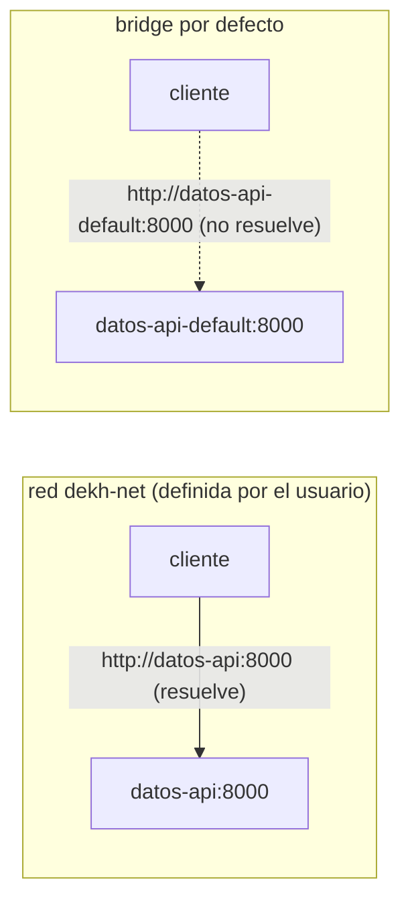

## 1. Resumen

Dos reglas de Docker explican casi todos los problemas de red en desarrollo:

- **en una red bridge definida por el usuario, los contenedores se encuentran por nombre**: «User-defined bridges provide automatic DNS resolution between containers»; en la red bridge por defecto, solo por IP;
- **un puerto no sale del host salvo que se publique** con `-p`.

En la nube cambia el modelo: en Cloud Run el contenedor escucha en `0.0.0.0:$PORT` y sale a la VPC con Direct VPC egress; en Fargate cada tarea tiene su propia interfaz de red y sus contenedores se hablan por `localhost`; en Container Apps, el entorno corre su propia red virtual.

## 2. Qué es

- **Red bridge:** una red privada en el host a la que se conectan contenedores.
- **Red definida por el usuario:** una red bridge creada con `docker network create`; da resolución de nombres entre sus contenedores.
- **Red bridge por defecto:** la que usa un contenedor si no se indica otra; sin resolución por nombre.
- **Publicar un puerto:** `-p <host>:<contenedor>` abre un puerto del contenedor fuera del host.
- **Escuchar en `0.0.0.0`:** aceptar conexiones de cualquier interfaz, no solo de `127.0.0.1` dentro del contenedor.

## 3. Problema que resuelve

Un job necesita llamar a una API de datos que corre en otro contenedor. Con la red por defecto, el job tiene que conocer la IP de la API, que cambia en cada arranque. En una red propia, el job llama a `http://datos-api:8000` y Docker resuelve el nombre.

## 4. Cómo funciona

1. `docker network create dekh-net` crea una red bridge definida por el usuario.
2. `docker run --network dekh-net --name datos-api …` conecta la API a esa red con un nombre.
3. Otro contenedor en la misma red resuelve `datos-api` por DNS.
4. Un contenedor en la red por defecto no resuelve ese nombre.
5. Para llegar desde fuera del host, la API publica su puerto con `-p`.

## 5. Cuándo utilizarlo

- Entornos locales con varios servicios (job, base de datos, API) que se llaman por nombre.
- Separar grupos de contenedores en redes distintas para que no se vean entre sí.
- Publicar solo los puertos que deben verse desde el host.

## 6. Cuándo no utilizarlo

- La red bridge por defecto para servicios que se llaman entre sí.
- `--link`: se considera legacy.
- Publicar todos los puertos «por si acaso».

## 7. Ejemplo sencillo

Una API con `python -m http.server` corre como `datos-api` en la red `dekh-net`. Un cliente de Alpine en la misma red recibe respuesta en `http://datos-api:8000/`. La misma API en la red por defecto, como `datos-api-default`, no se encuentra por nombre.

## 8. Ejemplo de producción

Un pipeline en la nube:

- el job corre en Cloud Run y llega a una base de datos privada de la VPC con Direct VPC egress;
- o corre en Fargate, con la API de enriquecimiento como segundo contenedor de la misma tarea, a la que llama por `localhost`;
- o en Container Apps, en un entorno con red virtual propia y salida por NAT Gateway.

En local, el mismo pipeline usa una red definida por el usuario con los mismos nombres de servicio.

## 9. Arquitectura



## 10. Código

```bash
# Bash y Docker (ejecutado en la CI con Docker real; ADR-016): una API de datos y un cliente. En una red definida por el
# usuario el cliente encuentra la API por su nombre; en la red bridge por defecto, no.
set -euo pipefail
PY="python:3.12-slim@sha256:a6e34c598f2467ed0e9a8d349809fcd8b5c603269512df273a0bb1784edc11b1"
ALPINE="alpine:3.22@sha256:5291449c3df73caf6ed85e649dec1b9e818b39a5d8c871e97afc13e9cd5e8fa8"
cleanup() { docker rm -f datos-api datos-api-default > /dev/null 2>&1 || true; docker network rm dekh-net > /dev/null 2>&1 || true; }
trap cleanup EXIT

docker network create dekh-net > /dev/null
docker run -d --name datos-api --network dekh-net "$PY" python -m http.server 8000 > /dev/null
docker run --rm --network dekh-net "$ALPINE" sh -c \
  'for i in 1 2 3 4 5 6 7 8 9 10; do wget -q -O /dev/null http://datos-api:8000/ && echo "red propia: datos-api responde" && exit 0; sleep 1; done; exit 1'

docker run -d --name datos-api-default "$PY" python -m http.server 8000 > /dev/null   # red bridge por defecto
docker run --rm "$ALPINE" sh -c \
  'wget -q -T 3 -O /dev/null http://datos-api-default:8000/ 2>/dev/null || echo "bridge por defecto: el nombre no resuelve"'
```

El script se **ejecuta en la CI con Docker real** (ADR-016), con Python y Alpine fijadas por digest. Imprime `red propia: datos-api responde` y `bridge por defecto: el nombre no resuelve`, y borra la red y los contenedores al salir.

## 11. GCP

En GCP, **Cloud Run** recibe las solicitudes y las entrega al contenedor. Las diferencias, según *Container runtime contract*:

| | Docker | Cloud Run |
|---|---|---|
| Dónde escucha | El puerto que se publica con `-p` | `0.0.0.0`, en el puerto de `PORT` (por defecto 8080); no en `127.0.0.1` |
| Recursos privados | Redes definidas por el usuario en el host | Direct VPC egress hacia la VPC |
| Entrada privada | — | Servicios y jobs no soportan Direct VPC ingress; los worker pools sí |

## 12. AWS

En AWS, **ECS con Fargate** da una interfaz de red a cada tarea. Las diferencias, según *Amazon ECS task networking options for Fargate*:

| | Docker | ECS con Fargate |
|---|---|---|
| Dirección | IP en la red bridge del host | Una ENI por tarea, con IP privada de la VPC (y pública opcional) |
| Entre contenedores | Por nombre en una red propia | Los de la misma tarea, por `localhost` |
| Bajar la imagen | El host necesita acceso al registry | La tarea necesita ruta a internet (IP pública o NAT) o un endpoint de VPC para ECR |

## 13. Azure

En Azure, **Container Apps** agrupa apps y jobs en un entorno con su propia red. Las diferencias, según *Networking in an Azure Container Apps environment*:

| | Docker | Container Apps |
|---|---|---|
| Red | Redes bridge en el host | El entorno corre su propia red virtual, o una existente |
| Tipos | — | Workload profiles (rutas propias, NAT Gateway, private endpoints; subred mínima /27) o Consumption only (legacy; subred mínima /23) |
| Cambiar la red | — | El tipo de red no cambia después de crear el entorno |

## 14. Buenas prácticas

- Una red definida por el usuario por entorno local, con nombres de servicio estables.
- Publicar solo los puertos necesarios.
- En la nube, escuchar en `0.0.0.0` y en el puerto que indica la plataforma.
- **Seguridad:** redes separadas para grupos de contenedores que no deben verse; en la nube, recursos privados por la VPC y no por internet.
- **Observabilidad:** registrar a qué nombre y puerto se conecta el job, para distinguir un error de red de uno de la API.
- **Costo:** en Fargate, una subred privada necesita NAT o endpoints de VPC para bajar imágenes; elegir la red del entorno de Container Apps antes de crearlo, porque después no cambia.

## 15. Errores frecuentes

- Escuchar en `127.0.0.1` dentro del contenedor y no recibir nada desde fuera.
- Usar la red por defecto y esperar resolución por nombre.
- Dejar una tarea de Fargate en una subred privada sin NAT ni endpoint y que no pueda bajar la imagen.
- Crear un entorno de Container Apps con la red por defecto y descubrir después que se necesitaba una red propia.

## 16. Trade-offs

Las redes definidas por el usuario dan nombres y aislamiento en un host; entre hosts, el modelo es el de la plataforma. Cloud Run simplifica la entrada (un puerto) y deja la salida privada en Direct VPC egress. Fargate da a cada tarea una identidad de red en la VPC, con la configuración de subredes que eso trae. Container Apps resuelve la red en el entorno, con una decisión que se toma al crearlo.

## 17. Conceptos relacionados

- `containers`: lo que se conecta.
- `python-api-consumption`: el cliente de una API de datos.
- `cloud-run-for-data`: puerto y salida a la VPC en Cloud Run.
- `container-apps-for-data`: la red del entorno de Container Apps.

## 18. Preguntas técnicas abiertas

1. ¿Qué servicios de tu entorno local se llaman por IP en lugar de por nombre?
2. ¿Qué puertos publica tu entorno que nadie usa desde el host?
3. ¿Cómo llega tu job de la nube a una base de datos privada?

## 19. Laboratorio relacionado

Pendiente (F4).

## 20. Fuentes

- Docker: *Networking overview* y *Bridge network driver*.
- Google Cloud: *Container runtime contract*.
- AWS: *Amazon ECS task networking options for Fargate*.
- Microsoft Learn: *Networking in an Azure Container Apps environment*.

El detalle de cada fuente está en `sources` del frontmatter.

## 21. Fecha de última verificación

2026-10-19. Pasa a `verified`: revisión B-F3.1 del lote F3b-13a aplicada, sin VERIFY pendientes.

## 22. Historial de cambios importantes

- 2026-10-19: creación (lote F3b-13a).
- 2026-10-19: revisión B-F3.1 del lote F3b-13a aplicada (docs/reviews/cards-f3b-13a.md): sin hallazgos en esta ficha; sin cambios.
- 2026-10-19: `verification_status: verified` (sin VERIFY pendientes).
