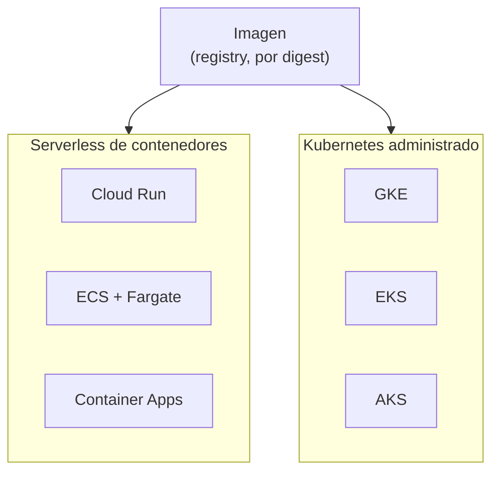

## 1. Resumen

Cada nube ofrece dos familias para correr contenedores, y **no son equivalentes**:

- **serverless de contenedores** (Cloud Run, ECS con Fargate, Container Apps): se entrega una imagen y una configuración, y la plataforma opera la infraestructura; no hay API de Kubernetes que usar;
- **Kubernetes administrado** (GKE, EKS, AKS): la nube opera el control plane, y el equipo usa la API de Kubernetes y, según el modo, opera los nodos.

Microsoft lo resume para Azure: «If you require access to the Kubernetes APIs and control plane, you should use Azure Kubernetes Service». La misma regla vale, con sus diferencias, en GCP y AWS.

## 2. Qué es

- **Serverless de contenedores:** la plataforma recibe la imagen, la corre como servicio o job, escala y cobra por los recursos o el tiempo de cada ejecución.
- **Kubernetes administrado:** un clúster de Kubernetes cuyo control plane opera la nube; se despliega con manifiestos y se paga el clúster y el cómputo.
- **Modos con nodos administrados:** GKE Autopilot, EKS Auto Mode y AKS Automatic: la nube también opera los nodos, pero sigue siendo Kubernetes.
- **ECS:** el orquestador propio de AWS, que no es Kubernetes; con Fargate, sin servidores que administrar.

## 3. Problema que resuelve

Un equipo de datos tiene una imagen de un job de ingesta y debe elegir dónde correrla. Si elige Kubernetes por costumbre, opera un clúster para tres jobs. Si elige serverless y después necesita control de red, hardware o la API de Kubernetes, migra. Comparar las dos familias en cada nube, con sus diferencias, evita ese error.

## 4. Cómo funciona

1. La imagen se publica en el registry de la nube.
2. **Serverless:** se crea un job o servicio con la imagen (Cloud Run job, tarea de ECS en Fargate, Container Apps job). La plataforma la arranca, la reintenta según la configuración y cobra la ejecución.
3. **Kubernetes administrado:** se aplican manifiestos (Job, CronJob, Deployment) al clúster; Kubernetes programa los Pods en nodos; se paga el clúster y el cómputo.
4. En los dos casos, el job debe ser idempotente: las plataformas reintentan.

## 5. Cuándo utilizarlo

- **Serverless de contenedores:** jobs y APIs de datos que caben en los límites de la plataforma, equipos sin operación de clústeres, cargas intermitentes.
- **Kubernetes administrado:** muchas cargas distintas en una sola plataforma, necesidad de la API de Kubernetes (operadores, GitOps sobre el clúster) o de control de red y hardware.

## 6. Cuándo no utilizarlo

- Kubernetes administrado para un par de jobs diarios.
- Serverless cuando el job necesita la API de Kubernetes o un hardware que la plataforma no ofrece.
- Tratar ECS y EKS, o Container Apps y AKS, como intercambiables: cambian la API, el despliegue y el cobro.

## 7. Ejemplo sencillo

La misma imagen de ingesta, fijada por digest, como job: en Cloud Run con dos reintentos y una hora por tarea; en ECS como tarea de Fargate en una subred privada; en Container Apps como job programado a las 3:00. Ninguno de los tres pide un clúster.

## 8. Ejemplo de producción

Una plataforma de datos multicloud:

- los jobs de ingesta corren en la plataforma serverless de cada nube, programados (en ECS, con EventBridge Scheduler);
- un clúster de Kubernetes administrado, en una sola nube, corre las cargas que necesitan la API de Kubernetes, como un operador de streaming;
- todas las imágenes salen de la misma CI y se despliegan por digest;
- el costo se revisa por familia: tiempo de ejecución en serverless, clúster más nodos en Kubernetes.

## 9. Arquitectura



## 10. Código

```bash
# Bash (no ejecutado: no hay cuentas de nube en la CI): la misma imagen, por digest, como job en las tres plataformas
# serverless de contenedores. Las formas siguen «Create jobs» (Cloud Run), «run-task» (AWS CLI) y
# «Jobs in Azure Container Apps». Proyecto, cuenta, subred y registries son ilustrativos.
set -euo pipefail
DIGEST="sha256:5291449c3df73caf6ed85e649dec1b9e818b39a5d8c871e97afc13e9cd5e8fa8"

# GCP: Cloud Run job con reintentos y timeout por tarea; el horario se agrega aparte.
gcloud run jobs create ingesta-ventas \
  --image "us-docker.pkg.dev/dekh-datos/jobs/ingesta@$DIGEST" \
  --max-retries 2 --task-timeout 1h

# AWS: una tarea de ECS en Fargate desde una task definition ya registrada; la tarea recibe su ENI en la subred.
aws ecs run-task --cluster datos --launch-type FARGATE --task-definition ingesta-ventas \
  --network-configuration "awsvpcConfiguration={subnets=[subnet-0abc1234],assignPublicIp=DISABLED}"

# Azure: job programado de Container Apps, con timeout y reintentos por réplica.
az containerapp job create --name ingesta-ventas --resource-group dekh-datos --environment dekh-env \
  --trigger-type "Schedule" --cron-expression "0 3 * * *" \
  --replica-timeout 3600 --replica-retry-limit 2 --parallelism 1 --replica-completion-count 1 \
  --image "dekhregistry.azurecr.io/jobs/ingesta@$DIGEST" --cpu "0.5" --memory "1.0Gi"
```

Los comandos **no se ejecutaron**: no hay cuentas de nube en la CI. Sus formas siguen *Create jobs* (Cloud Run), *run-task* (AWS CLI Command Reference) y *Jobs in Azure Container Apps*. Para Kubernetes administrado, los manifiestos de `kubernetes-fundamentals` se validan con kubeconform y se aplicarían igual en GKE, EKS o AKS.

## 11. GCP

En GCP, **Cloud Run** frente a **GKE**, según *What is Cloud Run*, *Create jobs*, *Cloud Run pricing*, *GKE overview* y *Google Kubernetes Engine pricing*:

| | Cloud Run | GKE |
|---|---|---|
| Qué es | Plataforma totalmente administrada para correr código o contenedores | Implementación administrada de Kubernetes |
| Job | `gcloud run jobs create`, con `--max-retries` y `--task-timeout` | Job o CronJob de Kubernetes |
| Qué opera el equipo | La imagen y la configuración del job o servicio | Los manifiestos; en Standard, también los nodos |
| Cobro (consultado el 2026-10-19) | Recursos usados, redondeados hacia arriba al tramo de 100 ms | Tarifa de administración por clúster y por hora en todos los modos, más el cómputo (en Autopilot, lo que piden los Pods) |

## 12. AWS

En AWS, **ECS con Fargate** frente a **EKS**, según *What is Amazon Elastic Container Service?*, *Architect for AWS Fargate for Amazon ECS*, *AWS Fargate Pricing*, *What is Amazon EKS?* y *Amazon EKS pricing*:

| | ECS con Fargate | EKS |
|---|---|---|
| Qué es | Orquestador propio de AWS, totalmente administrado; Fargate sin servidores | Kubernetes con el control plane administrado por AWS |
| Job | `aws ecs run-task`; programado con EventBridge Scheduler | Job o CronJob de Kubernetes |
| Qué opera el equipo | Task definitions y red (subred por tarea) | Los manifiestos; en EKS standard, también los nodos |
| Cobro (consultado el 2026-10-19) | vCPU, memoria, sistema operativo, arquitectura y almacenamiento, por segundo con un mínimo de 1 minuto, redondeado hacia arriba | Por hora por clúster (mayor en soporte extendido), más los worker nodes; Auto Mode suma un cargo por instancia |

## 13. Azure

En Azure, **Container Apps** frente a **AKS**, según *Comparing Container Apps with other Azure container options*, *Jobs in Azure Container Apps*, *Azure Container Apps pricing*, *What is Azure Kubernetes Service (AKS)?* y *Azure Kubernetes Service (AKS) pricing*:

| | Container Apps | AKS |
|---|---|---|
| Qué es | Microservicios y jobs serverless en contenedores, sin acceso directo a la API de Kubernetes | Kubernetes administrado, con la API y el control plane |
| Job | `az containerapp job create` (Manual, Schedule o Event) | Job o CronJob de Kubernetes |
| Qué opera el equipo | La app o el job y su entorno | Los manifiestos; en AKS Standard, también los node pools |
| Cobro (consultado el 2026-10-19) | Consumption por segundo y por solicitudes; Dedicated por vCPU-segundo y GiB-segundo más un cargo base | Control plane sin costo en el nivel Free; Standard y Premium con SLA; el cómputo por máquinas virtuales |

## 14. Buenas prácticas

- Empezar por serverless de contenedores y pasar a Kubernetes cuando haya una razón concreta (la API, la red, el hardware, la cantidad de cargas).
- Una sola imagen por digest para todas las plataformas.
- Jobs idempotentes, con reintentos y timeout explícitos.
- **Seguridad:** cada job con su propia identidad de la nube y acceso solo a lo que usa; imágenes de un registry privado.
- **Observabilidad:** el estado de cada ejecución (job de Cloud Run, tarea de ECS, ejecución de Container Apps, Job de Kubernetes) con alertas sobre fallas.
- **Costo:** en serverless se paga la ejecución; en Kubernetes administrado, el clúster aunque no corra nada, más el cómputo (consultado el 2026-10-19).

## 15. Errores frecuentes

- Elegir Kubernetes para pocos jobs y pagar y operar un clúster ocioso.
- Suponer que ECS es Kubernetes, o que Container Apps da la API de Kubernetes.
- Copiar los límites de una plataforma a otra: timeouts, reintentos y tamaños cambian.
- Sin timeout: un job colgado sigue cobrando.

## 16. Trade-offs

Serverless de contenedores cambia control por menos operación: menos decisiones, límites de la plataforma y cobro por ejecución. Kubernetes administrado da una API común a las tres nubes y control fino, a cambio de un clúster que se paga y se opera, aun en los modos con nodos administrados. Dentro de cada familia, las nubes tampoco son iguales: ECS no es Kubernetes, y la red, los límites y el cobro de Cloud Run, Fargate y Container Apps difieren.

## 17. Conceptos relacionados

- `kubernetes-fundamentals`: los objetos que se usan en GKE, EKS y AKS.
- `containers`: la imagen que corre en todas.
- `cloud-run-for-data`: Cloud Run para cargas de datos.
- `container-apps-for-data`: Container Apps para cargas de datos.
- `lambda-for-data`: la opción de funciones en AWS.
- `container-registries`: de dónde baja la imagen cada plataforma.

## 18. Preguntas técnicas abiertas

1. ¿Qué necesita hoy tu carga que una plataforma serverless de contenedores no ofrece?
2. ¿Cuántas cargas correrían en tu clúster y cuánto cuesta tenerlo encendido?
3. ¿Qué cambia en tu despliegue si pasas de ECS a EKS, o de Container Apps a AKS?

## 19. Laboratorio relacionado

Pendiente (F4).

## 20. Fuentes

- Google Cloud: *What is Cloud Run*, *Create jobs*, *Cloud Run pricing*, *GKE overview* y *Google Kubernetes Engine pricing*.
- AWS: *What is Amazon Elastic Container Service?*, *Architect for AWS Fargate for Amazon ECS*, *run-task* (AWS CLI), *Using Amazon EventBridge Scheduler to schedule Amazon ECS tasks*, *AWS Fargate Pricing*, *What is Amazon EKS?* y *Amazon EKS pricing*.
- Microsoft Learn: *Comparing Container Apps with other Azure container options*, *Jobs in Azure Container Apps*, *Azure Container Apps pricing*, *What is Azure Kubernetes Service (AKS)?* y *Azure Kubernetes Service (AKS) pricing*.

El detalle de cada fuente está en `sources` del frontmatter.

## 21. Fecha de última verificación

2026-10-19. Pasa a `verified`: revisión B-F3.1 del lote F3b-13b aplicada, sin VERIFY pendientes.

## 22. Historial de cambios importantes

- 2026-10-19: creación (lote F3b-13b).
- 2026-10-19: revisión B-F3.1 del lote F3b-13b aplicada (docs/reviews/cards-f3b-13b.md): Fargate cita «per second with a 1-minute minimum» y «rounded up to the nearest second»; Cloud Run redondea hacia arriba al tramo de 100 ms; *run-task* sin número de versión de la AWS CLI.
- 2026-10-19: `verification_status: verified` (sin VERIFY pendientes).
- 2026-10-25: §9 con el estándar de diagramas (máximo 8 nodos, CLAUDE.md): los servicios de cada familia van en un subgraph; la imagen apunta a cada familia.
